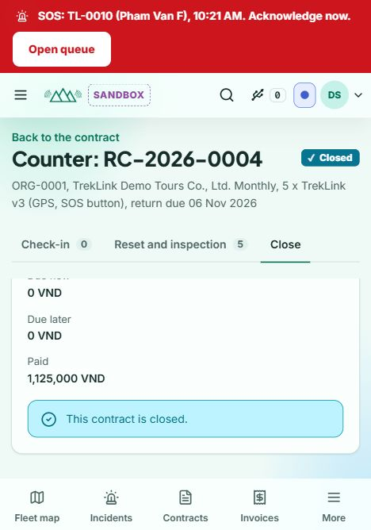
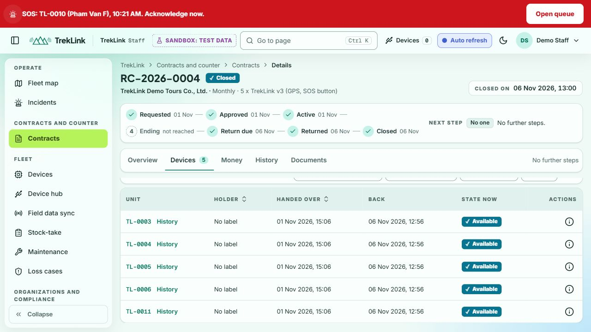
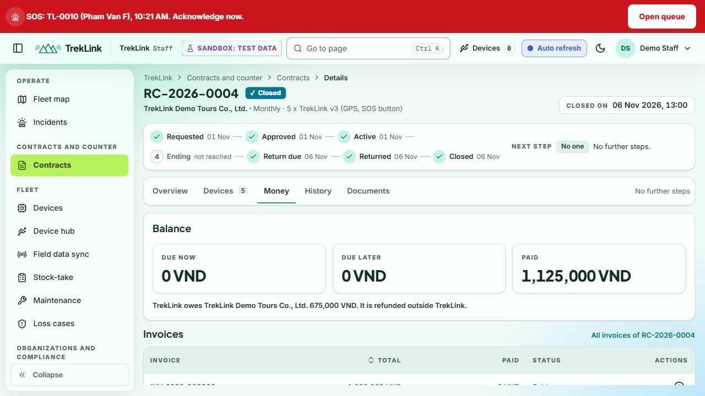
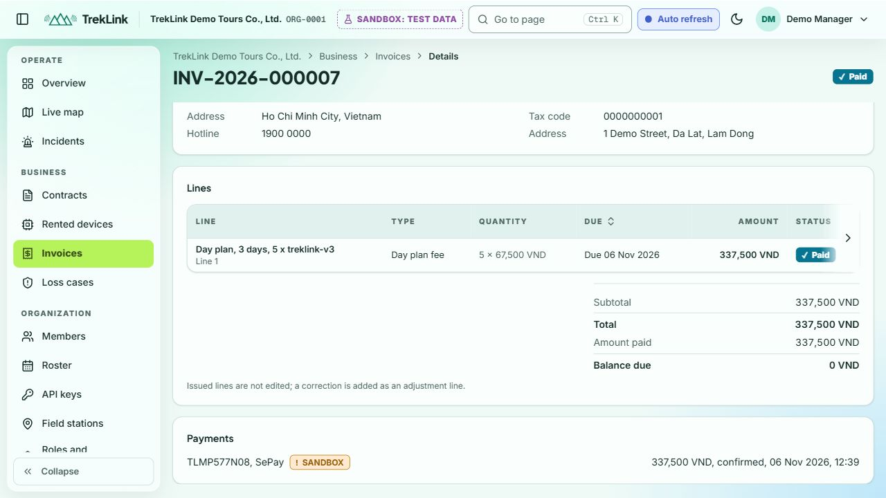
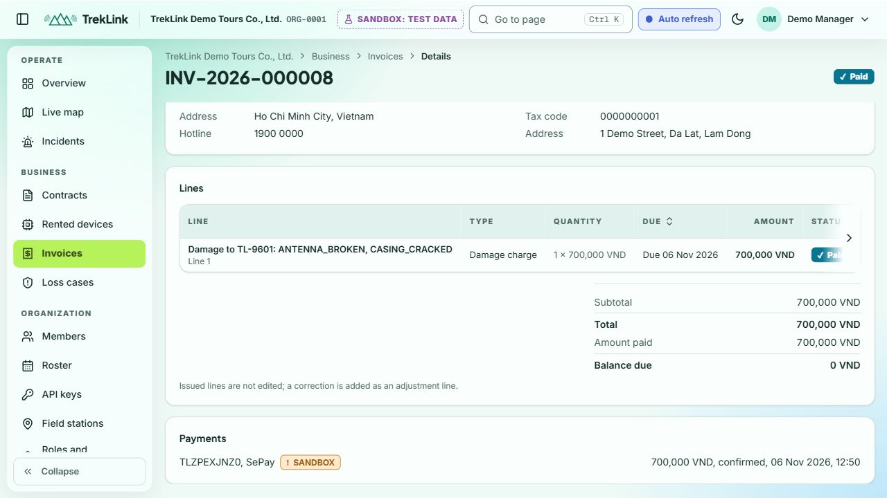
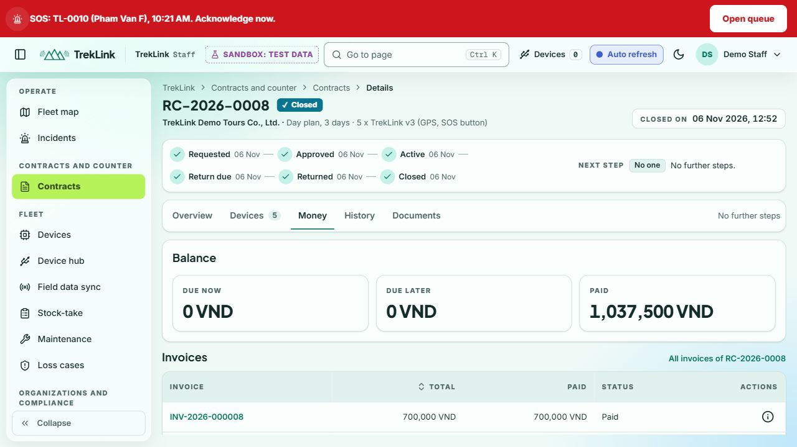
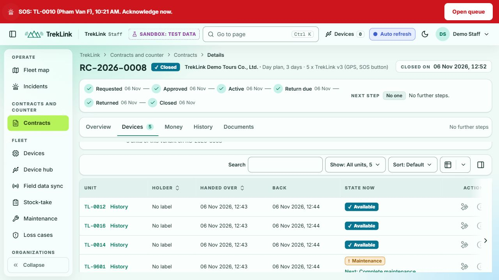

# WF-05 and full contract staging follow-up

LongLP, 2026-11-06 ICT, `https://treklink-web.vercel.app`.
These are software rehearsals, with no real money or physical hardware verification asserted.
The exact deployed SHA was not exposed by the UI. KhoaDD confirmed the SePay configuration on
deployment `dpl_AD4tH9XtkRNQW8CDPr6VvaahiCiA`, dev `d846608`, at 11:25 ICT in web#408.

## DS-05a, passing returns

Authority: [KhoaDD approved RC-2026-0004](https://github.com/TrekLink-Team/treklink-docs/issues/164#issuecomment-6675695718).
Contract `fba8e245-9ec6-4085-8c2e-07c1feaf825d`, ORG-0001, monthly, five v3 units.

| Check | Result |
|---|---|
| Fixture | ACTIVE, tags TL-0003, TL-0004, TL-0005, TL-0006 and TL-0011, no other fixture touched |
| End now | PASS, 12:56, disclosed DS-05a reason, RETURN_DUE. Preview credit 1,800,000 VND for 24 unused days of 30 |
| Check-in and reset | PASS, all five back at 12:56, simulated reset checklist recorded for every unit |
| Inspection | PASS, all five PASSED and AVAILABLE, no damage fee |
| Actual balance | PASS, due now/later 0, already paid 1,125,000 VND. No new payment needed after credit |
| Close | PASS, CLOSED 13:00, fresh Staff sign-in confirms all five AVAILABLE, empty holder labels and zero debt |

INV-2026-000009 records the -1,800,000 VND closing adjustment as Paid. Original INV-2026-000003
remains Partly paid. The net contract debt is zero, and the UI separately records **675,000 VND
owed to the organization, refunded outside TrekLink**. No actual refund is claimed. The existing
expired SePay attempt remains unchanged. There is no invented collection against this credit balance.

## Full lifecycle, all three inspection outcomes and SePay

Authority and preparation: [web#408](https://github.com/TrekLink-Team/treklink-web/issues/408).
Contract **RC-2026-0008**, id `bd60d5a0-181b-49a5-98d5-c7e5c224f73f`, ORG-0001, DAY, three days,
five v3 units. Key rotation and two rehearsal stock records were approved before mutation.

| Check | Result |
|---|---|
| Request and approval | PASS, 10:16, five reserved tags TL-0012, TL-0016, TL-0014, TL-9601 and TL-9602 |
| First SePay | PASS, TLMP577N08, 337,500 VND, CONFIRMED 12:39, INV-2026-000007 Paid, balance 0 |
| Handover/start | PASS, ACTIVE 12:43, five issued, manual provisioning v2, simulated battery/GPS, identity and signature |
| End now | PASS, RETURN_DUE 12:43, disclosed reason, DAY correctly gives no pro-rata credit |
| Return and reset | PASS, all five checked in 12:44, RETURNED, simulated reset recorded per unit |
| PASSED | PASS, TL-0012, TL-0016 and TL-0014 AVAILABLE |
| DAMAGED | PASS, TL-9601 MAINTENANCE. Antenna 300,000 plus casing 400,000, above 500,000 threshold, waiting for Admin |
| FAILED | PASS, TL-9602 MAINTENANCE, no invented fee |
| Admin | PASS, separate Admin approved 700,000 at 12:49, exactly one DAMAGE line on INV-2026-000008 |
| Closing SePay | PASS, TLZPEXJNZ0, 700,000 VND, CONFIRMED 12:50, closing invoice Paid, balance 0 |
| Close and fresh sign-in | PASS, CLOSED 12:52, due now/later 0, total paid 1,037,500 VND, two Paid invoices, two confirmed payments, three AVAILABLE and two MAINTENANCE, empty holder labels |

The read-only invoice captures below show the recorded payment method **SePay**, the **SANDBOX**
badge, reference, amount and **confirmed** status. INV-2026-000007 shows `TLMP577N08`, 337,500 VND,
confirmed at 12:39. INV-2026-000008 shows `TLZPEXJNZ0`, 700,000 VND, confirmed at 12:50.
Both invoices are Paid with balance 0. These application records distinguish the payments from
cash or bank-transfer counter receipts. The captures were taken after contract closure without
replaying a transfer. They establish TrekLink's stored method and confirmation, not an independent
review of the provider's delivery logs.

## Acceptance limits and follow-ups

- The earlier DS-05b result is in [the original evidence](../wf05-2026-11-06/README.md), RC-2026-0002 CLOSED, zero debt, damaged unit MAINTENANCE and lost unit RETIRED. Issue #400 is closed.
- Counter receipt labeling from that run remains evidence, unchanged. The approved correction is PR #420 for #407, pending review. It is not claimed deployed by this run.
- Actual duplicate provider delivery, positive late fees and scheduled natural rollover were not tested here. End now was the approved staging alternative to changing time.
- The handover preview iframe appeared, but the immediate screenshot was blank. This run does not verify the embedded PDF's visual contents.
- #406 tracks the counter's transient damage hint. No F-11/F-21 mutation coverage for every console/group control is claimed by these contract runs. #395's reviewed tests and prior viewport evidence remain separate.
- The five-unit screenshots show the visible portion of the scrollable table. All five tags and states were additionally read from the rendered DOM after a new Staff sign-in.

Browser/test helpers were closed after use. No local stack, shared reset, database edit or clock change was used.
