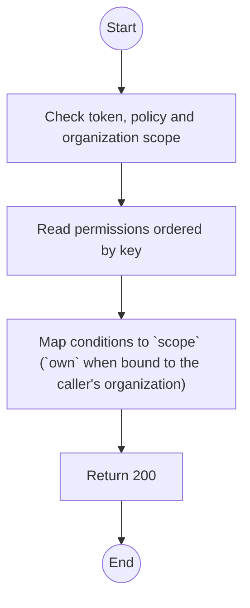
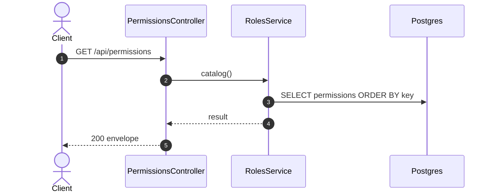

# GET /api/permissions: List the permission catalog

> Module `auth`. Generated from `scripts/specs/endpoints/auth.py` by `scripts/specs/build_api_design.py`; edit the catalog, not this file. Format: `02-templates/04-api-endpoint-template.md` with Mermaid (D-017). Envelope: D-002.

[TOC]

---
## Overview

Lists every permission a role can hold, from the seeded catalog, so the roles screen can grant a permission that no role holds today (D-057 rule 2). Read-only: permissions come from `scripts/specs/catalog.py` and the seed, never from an endpoint. Each item states the account type whose roles may hold it and whether ADMIN may lose it; CASL `conditions`, `fields` and `inverted` are not returned. Gated by `role.manage`.

## API Specification

| API | URL |
| --- | --- |
| GET | /api/permissions |
| Permission | TrekLink Admin |
| Traces | UC-10, FR-AUTH-06, FR-AUTH-10 |

## Request sample

No body.

## Response sample

```json
{
  "result": [
    {
      "key": "liveMap.read.own",
      "action": "read",
      "subject": "LiveMap",
      "scope": "own",
      "accountType": "ORGANIZATION",
      "description": "Read the live map of the own organization",
      "protected": false
    },
    {
      "key": "role.manage",
      "action": "manage",
      "subject": "Role",
      "scope": "any",
      "accountType": "TREKLINK",
      "description": "Manage roles and their permissions",
      "protected": true
    }
  ],
  "isSuccess": true,
  "statusCode": 200,
  "message": "OK"
}
```

## Validation

<table>
    <th>Status code</th>
    <th>Description</th>
    <th>Examples</th>
    <tbody>
        <tr>
            <td>401</td>
            <td>Missing, malformed or expired access token or API key (<code>UNAUTHENTICATED</code>)</td>
<td>

```json
{
  "result": {
    "errorCode": "UNAUTHENTICATED"
  },
  "isSuccess": false,
  "statusCode": 401,
  "message": "Authentication required."
}
```
</td>
        </tr>
        <tr>
            <td>403</td>
            <td>The caller's role, policy or organization does not allow this action (<code>FORBIDDEN</code>)</td>
<td>

```json
{
  "result": {
    "errorCode": "FORBIDDEN"
  },
  "isSuccess": false,
  "statusCode": 403,
  "message": "You do not have access to this."
}
```
</td>
        </tr>
    </tbody>
</table>

## Activity Diagram



## Sequence Diagram


