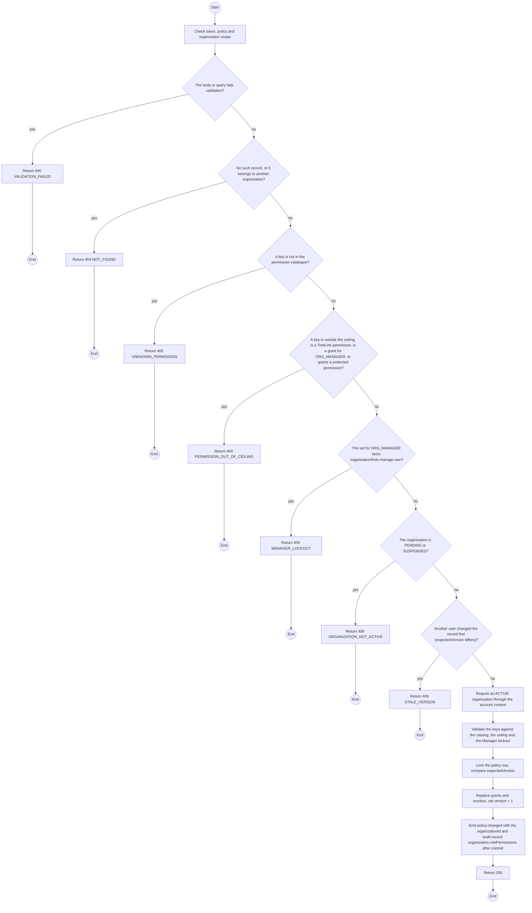
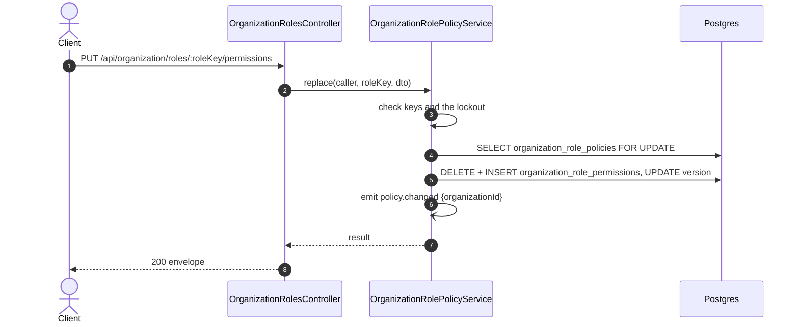

# PUT /api/organization/roles/:roleKey/permissions: Replace the permissions of an organization role

> Module `auth`. Generated from `scripts/specs/endpoints/auth.py` by `scripts/specs/build_api_design.py`; edit the catalog, not this file. Format: `02-templates/04-api-endpoint-template.md` with Mermaid (D-017). Envelope: D-002.

[TOC]

---
## Overview

Proposal of D-095, specified in `design.md` section 9; not built until the leader rules on the decision text there. Replaces the effective permission set of `ORG_MANAGER` or `ORG_OPERATOR` of the caller's organization. The service stores the difference from the baseline as grants and revokes, in one transaction, and compares `expectedVersion` with the stored `version`. The change applies to every holder from the next request and ends no session (REQ-EVT-10). Only an `ACTIVE` organization may save (REQ-STA-04).

## API Specification

| API | URL |
| --- | --- |
| PUT | /api/organization/roles/:roleKey/permissions |
| Permission | Org Manager (`organizationRole.manage.own`) |
| Traces | FR-AUTH-06, FR-AUTH-10, FR-AUTH-11, D-095 |

### Path parameters

| Field | Description | Data Type | Examples |
| --- | --- | --- | --- |
| roleKey | `ORG_MANAGER` or `ORG_OPERATOR` | string | `ORG_OPERATOR` |

## Request sample

```json
{
  "permissionKeys": [
    "incident.read.own"
  ],
  "expectedVersion": 2
}
```

| Field | Description | Data Type | Required | Examples |
| --- | --- | --- | --- | --- |
| permissionKeys | Full list of effective permission keys | string[] | yes | `["incident.read.own"]` |
| expectedVersion | The `version` read with the role | int | yes | `2` |

## Response sample

```json
{
  "result": {
    "key": "ORG_OPERATOR",
    "version": 3,
    "effectiveKeys": [
      "incident.read.own"
    ]
  },
  "isSuccess": true,
  "statusCode": 200,
  "message": "Permissions updated"
}
```

## Validation

<table>
    <th>Status code</th>
    <th>Description</th>
    <th>Examples</th>
    <tbody>
        <tr>
            <td>400</td>
            <td>The body or query fails validation (<code>VALIDATION_FAILED</code>)</td>
<td>

```json
{
  "result": {
    "errorCode": "VALIDATION_FAILED"
  },
  "isSuccess": false,
  "statusCode": 400,
  "message": "{field} is required."
}
```
</td>
        </tr>
        <tr>
            <td>401</td>
            <td>Missing, malformed or expired access token or API key (<code>UNAUTHENTICATED</code>)</td>
<td>

```json
{
  "result": {
    "errorCode": "UNAUTHENTICATED"
  },
  "isSuccess": false,
  "statusCode": 401,
  "message": "Authentication required."
}
```
</td>
        </tr>
        <tr>
            <td>403</td>
            <td>The caller's role, policy or organization does not allow this action (<code>FORBIDDEN</code>)</td>
<td>

```json
{
  "result": {
    "errorCode": "FORBIDDEN"
  },
  "isSuccess": false,
  "statusCode": 403,
  "message": "You do not have access to this."
}
```
</td>
        </tr>
        <tr>
            <td>404</td>
            <td>No such record, or it belongs to another organization (<code>NOT_FOUND</code>)</td>
<td>

```json
{
  "result": {
    "errorCode": "NOT_FOUND"
  },
  "isSuccess": false,
  "statusCode": 404,
  "message": "Role not found."
}
```
</td>
        </tr>
        <tr>
            <td>400</td>
            <td>A key is not in the permission catalogue (<code>UNKNOWN_PERMISSION</code>)</td>
<td>

```json
{
  "result": {
    "errorCode": "UNKNOWN_PERMISSION"
  },
  "isSuccess": false,
  "statusCode": 400,
  "message": "Unknown permission: x."
}
```
</td>
        </tr>
        <tr>
            <td>400</td>
            <td>A key is outside the ceiling, is a TrekLink permission, is a grant for ORG_MANAGER, or grants a protected permission (<code>PERMISSION_OUT_OF_CEILING</code>)</td>
<td>

```json
{
  "result": {
    "errorCode": "PERMISSION_OUT_OF_CEILING"
  },
  "isSuccess": false,
  "statusCode": 400,
  "message": "incident.respond.own cannot be granted to this role."
}
```
</td>
        </tr>
        <tr>
            <td>409</td>
            <td>The set for ORG_MANAGER lacks organizationRole.manage.own (<code>MANAGER_LOCKOUT</code>)</td>
<td>

```json
{
  "result": {
    "errorCode": "MANAGER_LOCKOUT"
  },
  "isSuccess": false,
  "statusCode": 409,
  "message": "Managers must keep the right to manage roles."
}
```
</td>
        </tr>
        <tr>
            <td>409</td>
            <td>The organization is PENDING or SUSPENDED (<code>ORGANIZATION_NOT_ACTIVE</code>)</td>
<td>

```json
{
  "result": {
    "errorCode": "ORGANIZATION_NOT_ACTIVE"
  },
  "isSuccess": false,
  "statusCode": 409,
  "message": "Role permissions cannot be changed while the organization is suspended."
}
```
</td>
        </tr>
        <tr>
            <td>409</td>
            <td>Another user changed the record first (expectedVersion differs) (<code>STALE_VERSION</code>)</td>
<td>

```json
{
  "result": {
    "errorCode": "STALE_VERSION"
  },
  "isSuccess": false,
  "statusCode": 409,
  "message": "This was changed by someone else. Reload and try again."
}
```
</td>
        </tr>
    </tbody>
</table>

## Activity Diagram



## Sequence Diagram


