# Technical Design: auth

> Fulfills `requirements.md` in this folder. Rewritten 2026-10-04 (D-036). Schema: the `// @module auth`
> block of `backend/prisma/schema.prisma` is authoritative; this document explains it.
>
> **Status**: Approved, written by KhoaDD and merged on `dev` (treklink-web PR #30 and #31, 2026-10-18). Changes go through a pull request reviewed by KhoaDD (D-052).

---

## 1. Data model

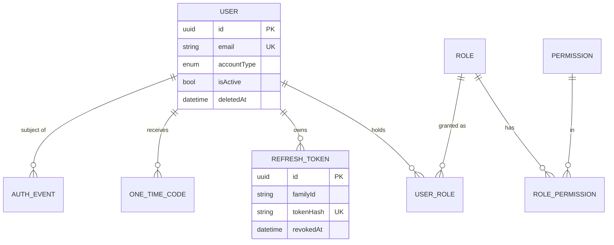

***Figure 1***: auth slice. Membership (`OrganizationMember`) belongs to `organizations`.

| Model | Notes |
|---|---|
| `User` | Email is the login key, lower-case, unique across all accounts ever created. `passwordHash` is null until the invitation code is used. Soft delete by `deletedAt`. |
| `Role`, `Permission`, `RolePermission`, `UserRole` | Seeded by `20261004120100_seed` from `scripts/specs/catalog.py`; see the [Permission Matrix](permission-matrix.md). |
| `RefreshToken` | One family per sign-in; `replacedById` chains rotations so reuse is detectable. |
| `OneTimeCode` | `SET_PASSWORD` (invitation) or `PASSWORD_RESET`; SHA-256 of a six-digit code; attempts counted. |
| `AuthEvent` | Append-only (trigger); `userId` null when the email matched nothing. |

---

## 2. Tokens and the request context

Access token (HS256, `JWT_ACCESS_SECRET`): `{ sub, accountType, roles, organizationId?, memberRole?, pv }`
where `pv` is the policy version at issue. The `JwtStrategy` rebuilds the request context on every
request: the user row (active, not deleted), the role permissions from the CASL cache, and, for an
organization account, membership through `ACCOUNT_CONTEXT_PROVIDER`:

```typescript
export const ACCOUNT_CONTEXT_PROVIDER = Symbol('ACCOUNT_CONTEXT_PROVIDER');
export interface AccountContextProvider {
  // null for a TrekLink account or a deactivated member
  forUser(userId: string): Promise<{ organizationId: string; organizationCode: string; legalName: string;
                                     memberRole: 'MANAGER' | 'OPERATOR'; organizationStatus: string } | null>;
  // api-design 17: the organization of each listed account with a member row, deactivated or not
  organizationsOf(userIds: readonly string[]): Promise<Map<string, { id: string; name: string }>>;
  // api-design 17: every account that is or was a member; empty for an unknown organization
  memberUserIds(organizationId: string): Promise<string[]>;
}

export const API_KEY_RESOLVER = Symbol('API_KEY_RESOLVER');
export interface ApiKeyResolver {
  // null for an unknown or revoked key; touches lastUsedAt at most once a minute
  resolve(keyHash: string): Promise<{ apiKeyId: string; organizationId: string } | null>;
}
```

Re-reading membership per request (cached 30 s, invalidated by `member.deactivated`) is what makes
REQ-EVT-07 and REQ-STA-03 hold without waiting for the access token to expire. `organizationCode` and
`legalName` fill `organization.code` and `organization.legalName` of the login and `me` responses (api-design
01 and 04, D-060 rule 5). `organizations` 1.3 provides both ports.

`auth` in turn provides `platform`'s `ACCOUNT_DIRECTORY` (`namesOf(userIds)`, inactive and soft-deleted accounts
included) from `AuthPortsModule`, for the actor names of the parameter history and the audit log.

The same global module provides `STAFF_NOTIFICATIONS.send(subject, text, tx?)` for operational
contract email. It reads active, non-deleted TrekLink accounts with Staff or Admin roles through
`AccountsRepository` and reuses the single `MAIL_PORT` instance. `MAIL_PORT` is constructed in
`AuthPortsModule`, which `AuthModule` re-exports. A false result means no eligible recipient or a
transport failure; after partial success, retrying may repeat mail to a recipient already served.

Refresh rotation is strict (D-060 rule 8): when two requests rotate one refresh token at once, the second
loses the compare-and-set on `revokedAt` and is treated as reuse (REQ-ERR-02). The client runs one refresh at
a time (`frontend` 1.2). Refresh returns the token pair only (api-design 02, D-060 rule 7). The web client
keeps the refresh token in the tab's `sessionStorage` and the access token in memory, and runs one silent
refresh on load, so a reload keeps the session (D-090 rule 3, amending D-060 rule 3).

Lockout counting (REQ-STA-01, D-060 rule 9): a failed sign-in records `LOGIN_FAILED`, then counts the
account's `LOGIN_FAILED` events newer than the latest of three instants: now minus
`auth.loginFailureWindowMinutes`, the last successful sign-in, and the end of the last lock. When the count
reaches `auth.loginMaxFailures`, that attempt sets `lockedUntil` to now plus `auth.lockoutMinutes`, records
`ACCOUNT_LOCKED` and answers 423. While locked, an attempt answers 423 before the password is checked.

`ApiKeyGuard` authenticates `X-Api-Key` into a context `{ kind: 'API_KEY', apiKeyId, organizationId }`
(carried as `organization: { id }` with `accountType: ORGANIZATION`, so `scopeWhere` treats it as a
member) whose ability is the fixed read-only set `liveMap.read.own`, `telemetryHistory.read.own`,
`incident.read.own` (BR-20). The global `JwtAuthGuard` hands it a request that carries a key and no bearer
token. Controllers that serve the organization API accept either credential via
`@AuthOneOf('jwt', 'apiKey')`; `PoliciesGuard` refuses a key with 403 on any other route and on every
mutating route, and `@CurrentCaller()` refuses it because a key acts as no account.

---

## 3. Authorization

**Global guards (D-061).** `AuthModule` registers `JwtAuthGuard` and then `PoliciesGuard` as `APP_GUARD`,
so every route of every module needs a valid access token and a passing policy. `@Public()` opts a route
out of both (sign-in, refresh, health, the SePay webhook, the broker hooks); `@Authenticated()` needs the
token only (sign-out, `me`). A route with none of `@Public()`, `@Authenticated()` or `@CheckPolicies` is
refused with 403, so a forgotten policy fails closed. The decorators and `@CurrentCaller()` live in
`backend/src/common/decorators/access.decorator.ts`, so a module below `auth` in `platform` Figure 3 can
declare them without importing `auth`.

`PoliciesGuard` evaluates the handler's `@CheckPolicies((ability) => ability.can(action, subject))`.
The ability is built from the permission rows: `conditions` placeholders `${user.organizationId}` are
interpolated from the request context, never from the request. Record-level checks use
`ability.can('read', subject('Incident', row))` after loading the row; a mismatch on an `own`
condition answers 404 (scoped 404 rule, `platform` design §4.2), a missing permission 403.

Scoping helper for queries: `scopeWhere(ctx)` returns `{}` for TrekLink accounts and
`{ organizationId: ctx.organizationId }` for members and keys; every repository method that serves an
organization takes it. The cross-organization e2e test per module (NFR-SEC-04) exercises it.

The CASL cache is keyed by role and invalidated on `policy.changed`, so a permission edit applies on the
next request (FR-AUTH-06).

---

## 4. Error catalogue

| Code | HTTP | Where |
|---|---|---|
| `INVALID_CREDENTIALS` | 401 | sign-in, password change |
| `ACCOUNT_LOCKED` | 423 | sign-in |
| `REFRESH_INVALID` | 401 | refresh |
| `REFRESH_REUSED` | 401 | refresh |
| `CODE_INVALID` | 400 | reset, invitation |
| `OTP_COOLDOWN` | 429 | Staff-triggered reset (D-063 rule 7); forgot answers as usual inside the cooldown (rule 2) |
| `PASSWORD_POLICY` | 400 | reset, invitation, change |
| `SELF_DEMOTION` | 409 | account edit |
| `LAST_ADMIN` | 409 | account deactivate, role edit |
| `UNKNOWN_PERMISSION` | 400 | role permissions |
| `PERMISSION_SCOPE_MISMATCH` | 400 | role permissions: a permission of the other account type (D-057 rule 2) |
| `ADMIN_LOCKOUT` | 409 | role permissions |

---

## 5. Services other modules call

| Method | Caller | Purpose |
|---|---|---|
| `AccountsService.createOrganizationAccount({ email, fullName, phone, role, createdById }, tx)` | organizations | Member invitation and the registering Manager; sends the `SET_PASSWORD` code after commit |
| `AccountsService.setOrganizationRole(userId, role, tx, actorId?)` | organizations | Manager changes a member's role |
| `AccountsService.deactivateOrganizationAccount(userId, reason, actor, tx)` | organizations | Member deactivation and organization closing |
| `AccountsService.contactCard(userIds)` | incidents | Name, email, phone and `isActive` for alert delivery |

The caller opens its transaction with `TransactionalEvents.transaction`, so the invitation is sent only
after commit and never for a rolled-back one. These methods return the account without its password
hash, answer 404 for an id that is not an organization account, and leave the membership, the
last-Manager rule and `member.deactivated` to `organizations`. Deactivation is named apart from
`deactivate`, the TrekLink route of api-design 12.

---

## 6. Sequence: sign-in

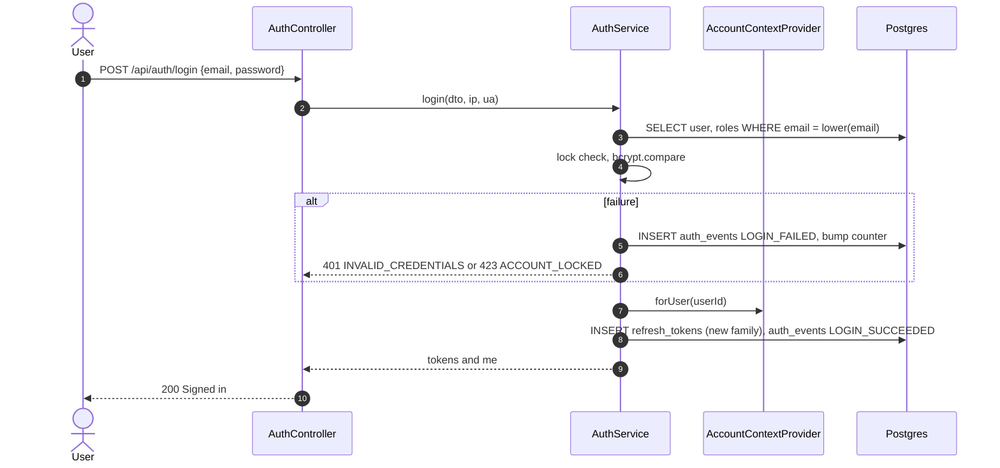

***Figure 2***: Sign-in.

---

## 7. Testing strategy

- Unit: token rotation and reuse, lockout window, code attempts and expiry, CASL interpolation (no
  request value can set `organizationId`), last-Admin guard.
- E2E: every api-design Validation row; the cross-organization 404 suite shared by all modules lives in
  `backend/test/tenancy.e2e-spec.ts` and is extended by each module.

## 8. Detailed design for Report 4 (D-044)

Layering as in `organizations` design §9. Figure 3 is the class view; Figures 4 to 8 are the account
interactions that start MF-01: an invited Manager or TrekLink account sets its first password and
signs in, and a forgotten password is reset with a one-time code.

<!-- sdd: MF-01 class auth -->
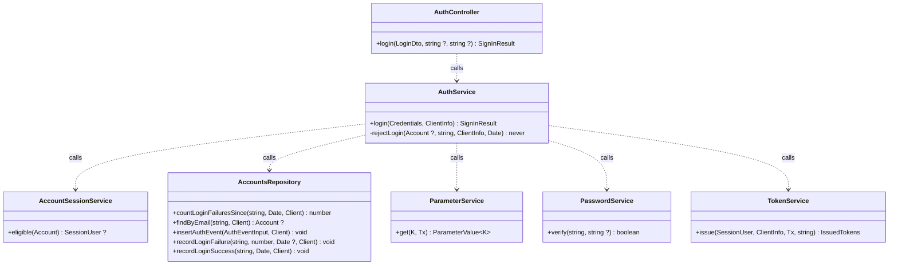

***Figure 3***: auth classes used in MF-01, UC-08. Dependencies are call-only (`..>`). Parameter types are listed in source order; `Tx` means `Prisma.TransactionClient`, and a result or structural type the code leaves unnamed is named after what it holds. The source remains authoritative for defaults, optional arguments and full type shapes.

<!-- sdd: MF-01 class auth-uc-09-part-1-of-2 -->
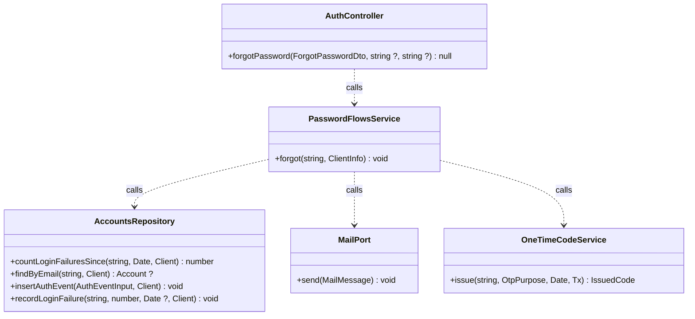

***Figure 4***: auth classes used in MF-01, UC-09 part 1 of 2. Dependencies are call-only (`..>`). Parameter types are listed in source order; `Tx` means `Prisma.TransactionClient`, and a result or structural type the code leaves unnamed is named after what it holds. The source remains authoritative for defaults, optional arguments and full type shapes.

<!-- sdd: MF-01 class auth-uc-09-part-2-of-2 -->
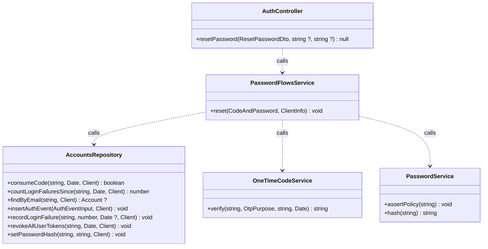

***Figure 5***: auth classes used in MF-01, UC-09 part 2 of 2. Dependencies are call-only (`..>`). Parameter types are listed in source order; `Tx` means `Prisma.TransactionClient`, and a result or structural type the code leaves unnamed is named after what it holds. The source remains authoritative for defaults, optional arguments and full type shapes.

<!-- sdd: MF-01 class auth-uc-10-part-1-of-2 -->
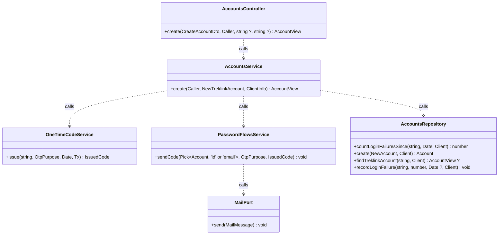

***Figure 6***: auth classes used in MF-01, UC-10 part 1 of 2. Dependencies are call-only (`..>`). Parameter types are listed in source order; `Tx` means `Prisma.TransactionClient`, and a result or structural type the code leaves unnamed is named after what it holds. The source remains authoritative for defaults, optional arguments and full type shapes.

<!-- sdd: MF-01 class auth-uc-10-part-2-of-2 -->
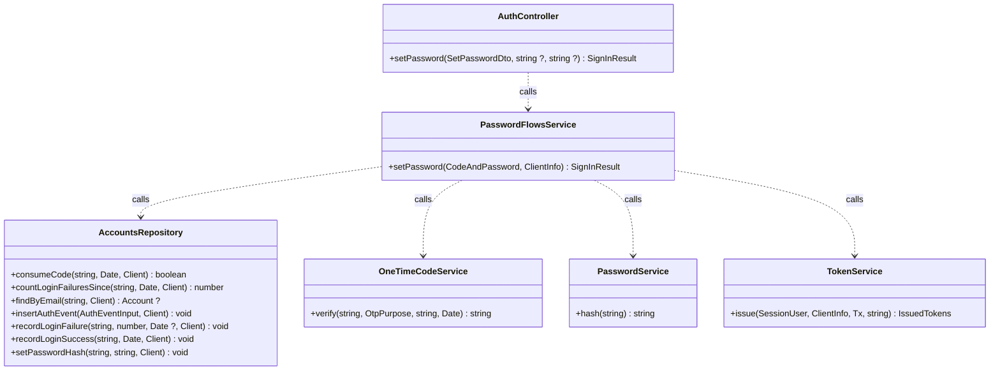

***Figure 7***: auth classes used in MF-01, UC-10 part 2 of 2. Dependencies are call-only (`..>`). Parameter types are listed in source order; `Tx` means `Prisma.TransactionClient`, and a result or structural type the code leaves unnamed is named after what it holds. The source remains authoritative for defaults, optional arguments and full type shapes.


<!-- sdd: MF-01 seq UC-08 -->
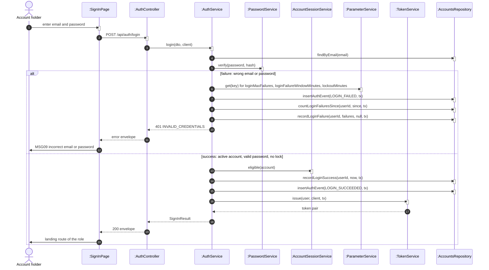

***Figure 8***: UC-08 Authenticate. The named failure is wrong credentials (SRS UC-08, MSG09): for a known account, AuthService.rejectLogin reads auth.loginMaxFailures, auth.loginFailureWindowMinutes and auth.lockoutMinutes, inserts LOGIN_FAILED, counts the failures in the window and records them in one transaction, then returns 401 INVALID_CREDENTIALS (REQ-ERR-01). Outside this two-lane view: at the limit the same transaction also sets lockedUntil, inserts ACCOUNT_LOCKED and returns 423 ACCOUNT_LOCKED; an account already locked is refused before its password is checked, logs LOGIN_FAILED and returns 423 with the minutes left (REQ-STA-01); an unknown email still performs the password verification, logs LOGIN_FAILED and returns 401 without reading lockout parameters or counting failures; an account that eligible() refuses is rejected as a wrong password.

<!-- sdd: MF-01 seq UC-09 part 1 of 2: request a code -->
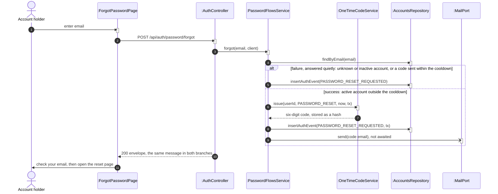

***Figure 9***: UC-09 Reset Password, part 1 of 2. Both branches answer alike and the mail is not
awaited, so the timing does not reveal whether the email exists (FR-AUTH-05).

<!-- sdd: MF-01 seq UC-09 part 2 of 2: set the new password -->
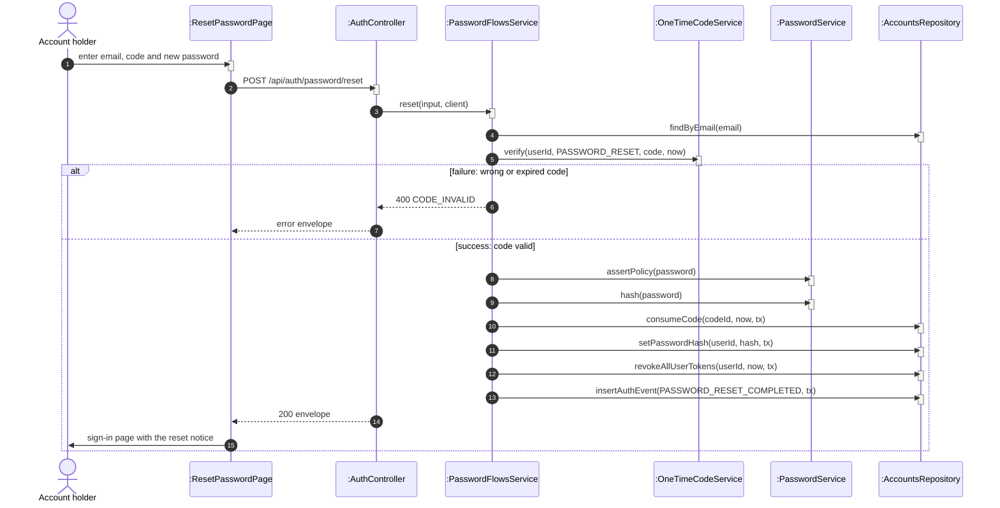

***Figure 10***: UC-09 Reset Password, part 2 of 2. Every session of the account ends with the reset (REQ-EVT-05). The named failure is a wrong or expired code. A new password that fails assertPolicy is separately refused with 400 PASSWORD_POLICY and changes nothing; that refusal is outside this two-lane view.

<!-- sdd: MF-01 seq UC-10 part 1 of 2: create an account -->
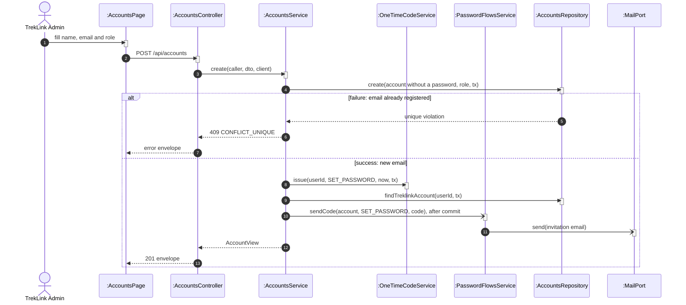

***Figure 11***: UC-10 Manage Platform Accounts, part 1 of 2. An account has no password until its
invitation code is used (REQ-EVT-06, BR-35). Deactivation follows the same layering and refuses the last
active Admin (409 `LAST_ADMIN`).

<!-- sdd: MF-01 seq UC-10 part 2 of 2: first password from the invitation -->
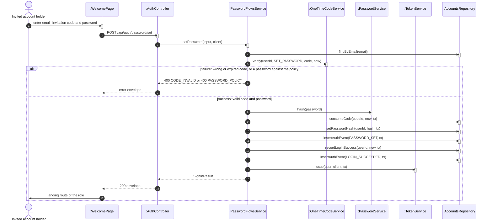

***Figure 12***: UC-10 Manage Platform Accounts, part 2 of 2. The same page serves an Org Manager created
by organization registration (UC-01), so MF-01 continues from here with a signed-in Manager.
