# Technical Design: auth

> Fulfills `requirements.md` in this folder. Rewritten 2026-10-04 (D-036). Schema: the `// @module auth`
> block of `backend/prisma/schema.prisma` is authoritative; this document explains it.
>
> **Status**: Approved, written by KhoaDD and merged on `dev` (treklink-web PR #30 and #31, 2026-10-18). Changes go through a pull request reviewed by KhoaDD (D-052).

---

## 1. Data model

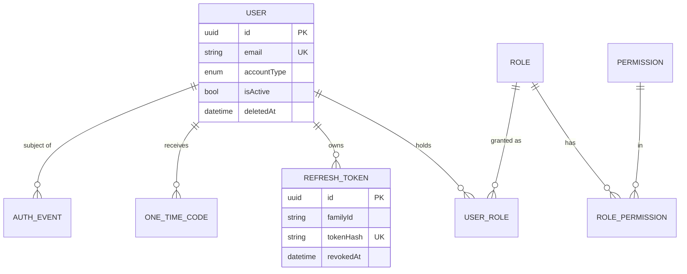

***Figure 1***: auth slice. Membership (`OrganizationMember`) belongs to `organizations`.

| Model | Notes |
|---|---|
| `User` | Email is the login key, lower-case, unique across all accounts ever created. `passwordHash` is null until the invitation code is used. Soft delete by `deletedAt`. |
| `Role`, `Permission`, `RolePermission`, `UserRole` | Seeded by `20261004120100_seed` from `scripts/specs/catalog.py`; see the [Permission Matrix](permission-matrix.md). |
| `RefreshToken` | One family per sign-in; `replacedById` chains rotations so reuse is detectable. |
| `OneTimeCode` | `SET_PASSWORD` (invitation) or `PASSWORD_RESET`; SHA-256 of a six-digit code; attempts counted. |
| `AuthEvent` | Append-only (trigger); `userId` null when the email matched nothing. |

---

## 2. Tokens and the request context

Access token (HS256, `JWT_ACCESS_SECRET`): `{ sub, accountType, roles, organizationId?, memberRole?, pv }`
where `pv` is the policy version at issue. The `JwtStrategy` rebuilds the request context on every
request: the user row (active, not deleted), the role permissions from the CASL cache, and, for an
organization account, membership through `ACCOUNT_CONTEXT_PROVIDER`:

```typescript
export const ACCOUNT_CONTEXT_PROVIDER = Symbol('ACCOUNT_CONTEXT_PROVIDER');
export interface AccountContextProvider {
  // null for a TrekLink account or a deactivated member
  forUser(userId: string): Promise<{ organizationId: string; organizationCode: string; legalName: string;
                                     memberRole: 'MANAGER' | 'OPERATOR'; organizationStatus: string } | null>;
  // api-design 17: the organization of each listed account with a member row, deactivated or not
  organizationsOf(userIds: readonly string[]): Promise<Map<string, { id: string; name: string }>>;
  // api-design 17: every account that is or was a member; empty for an unknown organization
  memberUserIds(organizationId: string): Promise<string[]>;
}

export const API_KEY_RESOLVER = Symbol('API_KEY_RESOLVER');
export interface ApiKeyResolver {
  // null for an unknown or revoked key; touches lastUsedAt at most once a minute
  resolve(keyHash: string): Promise<{ apiKeyId: string; organizationId: string } | null>;
}
```

Re-reading membership per request (cached 30 s, invalidated by `member.deactivated`) is what makes
REQ-EVT-07 and REQ-STA-03 hold without waiting for the access token to expire. `organizationCode` and
`legalName` fill `organization.code` and `organization.legalName` of the login and `me` responses (api-design
01 and 04, D-060 rule 5). `organizations` 1.3 provides both ports.

`auth` in turn provides `platform`'s `ACCOUNT_DIRECTORY` (`namesOf(userIds)`, inactive and soft-deleted accounts
included) from `AuthPortsModule`, for the actor names of the parameter history and the audit log.

The same global module provides `STAFF_NOTIFICATIONS.send(subject, text, tx?)` for operational
contract email. It reads active, non-deleted TrekLink accounts with Staff or Admin roles through
`AccountsRepository` and reuses the single `MAIL_PORT` instance. `MAIL_PORT` is constructed in
`AuthPortsModule`, which `AuthModule` re-exports. A false result means no eligible recipient or a
transport failure; after partial success, retrying may repeat mail to a recipient already served.

Refresh rotation is strict (D-060 rule 8): when two requests rotate one refresh token at once, the second
loses the compare-and-set on `revokedAt` and is treated as reuse (REQ-ERR-02). The client runs one refresh at
a time (`frontend` 1.2). Refresh returns the token pair only (api-design 02, D-060 rule 7). The web client
keeps the refresh token in the tab's `sessionStorage` and the access token in memory, and runs one silent
refresh on load, so a reload keeps the session (D-090 rule 3, amending D-060 rule 3).

Lockout counting (REQ-STA-01, D-060 rule 9): a failed sign-in records `LOGIN_FAILED`, then counts the
account's `LOGIN_FAILED` events newer than the latest of three instants: now minus
`auth.loginFailureWindowMinutes`, the last successful sign-in, and the end of the last lock. When the count
reaches `auth.loginMaxFailures`, that attempt sets `lockedUntil` to now plus `auth.lockoutMinutes`, records
`ACCOUNT_LOCKED` and answers 423. While locked, an attempt answers 423 before the password is checked.

`ApiKeyGuard` authenticates `X-Api-Key` into a context `{ kind: 'API_KEY', apiKeyId, organizationId }`
(carried as `organization: { id }` with `accountType: ORGANIZATION`, so `scopeWhere` treats it as a
member) whose ability is the fixed read-only set `liveMap.read.own`, `telemetryHistory.read.own`,
`incident.read.own` (BR-20). The global `JwtAuthGuard` hands it a request that carries a key and no bearer
token. Controllers that serve the organization API accept either credential via
`@AuthOneOf('jwt', 'apiKey')`; `PoliciesGuard` refuses a key with 403 on any other route and on every
mutating route, and `@CurrentCaller()` refuses it because a key acts as no account.

---

## 3. Authorization

**Global guards (D-061).** `AuthModule` registers `JwtAuthGuard` and then `PoliciesGuard` as `APP_GUARD`,
so every route of every module needs a valid access token and a passing policy. `@Public()` opts a route
out of both (sign-in, refresh, health, the SePay webhook, the broker hooks); `@Authenticated()` needs the
token only (sign-out, `me`). A route with none of `@Public()`, `@Authenticated()` or `@CheckPolicies` is
refused with 403, so a forgotten policy fails closed. The decorators and `@CurrentCaller()` live in
`backend/src/common/decorators/access.decorator.ts`, so a module below `auth` in `platform` Figure 3 can
declare them without importing `auth`.

`PoliciesGuard` evaluates the handler's `@CheckPolicies((ability) => ability.can(action, subject))`.
The ability is built from the permission rows: `conditions` placeholders `${user.organizationId}` are
interpolated from the request context, never from the request. Record-level checks use
`ability.can('read', subject('Incident', row))` after loading the row; a mismatch on an `own`
condition answers 404 (scoped 404 rule, `platform` design §4.2), a missing permission 403.

Scoping helper for queries: `scopeWhere(ctx)` returns `{}` for TrekLink accounts and
`{ organizationId: ctx.organizationId }` for members and keys; every repository method that serves an
organization takes it. The cross-organization e2e test per module (NFR-SEC-04) exercises it.

The CASL cache is keyed by role and invalidated on `policy.changed`, so a permission edit applies on the
next request (FR-AUTH-06).

---

## 4. Error catalogue

| Code | HTTP | Where |
|---|---|---|
| `INVALID_CREDENTIALS` | 401 | sign-in, password change |
| `ACCOUNT_LOCKED` | 423 | sign-in |
| `REFRESH_INVALID` | 401 | refresh |
| `REFRESH_REUSED` | 401 | refresh |
| `CODE_INVALID` | 400 | reset, invitation |
| `OTP_COOLDOWN` | 429 | Staff-triggered reset (D-063 rule 7); forgot answers as usual inside the cooldown (rule 2) |
| `PASSWORD_POLICY` | 400 | reset, invitation, change |
| `SELF_DEMOTION` | 409 | account edit |
| `LAST_ADMIN` | 409 | account deactivate, role edit |
| `UNKNOWN_PERMISSION` | 400 | role permissions |
| `PERMISSION_SCOPE_MISMATCH` | 400 | role permissions: a permission of the other account type (D-057 rule 2) |
| `ADMIN_LOCKOUT` | 409 | role permissions |

---

## 5. Services other modules call

| Method | Caller | Purpose |
|---|---|---|
| `AccountsService.createOrganizationAccount({ email, fullName, phone, role, createdById }, tx)` | organizations | Member invitation and the registering Manager; sends the `SET_PASSWORD` code after commit |
| `AccountsService.setOrganizationRole(userId, role, tx, actorId?)` | organizations | Manager changes a member's role |
| `AccountsService.deactivateOrganizationAccount(userId, reason, actor, tx)` | organizations | Member deactivation and organization closing |
| `AccountsService.contactCard(userIds)` | incidents | Name, email, phone and `isActive` for alert delivery |

The caller opens its transaction with `TransactionalEvents.transaction`, so the invitation is sent only
after commit and never for a rolled-back one. These methods return the account without its password
hash, answer 404 for an id that is not an organization account, and leave the membership, the
last-Manager rule and `member.deactivated` to `organizations`. Deactivation is named apart from
`deactivate`, the TrekLink route of api-design 12.

---

## 6. Sequence: sign-in

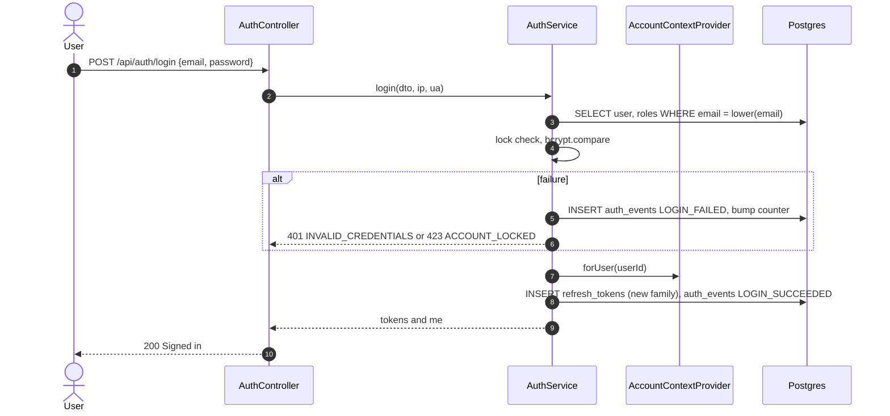

***Figure 2***: Sign-in.

---

## 7. Testing strategy

- Unit: token rotation and reuse, lockout window, code attempts and expiry, CASL interpolation (no
  request value can set `organizationId`), last-Admin guard.
- E2E: every api-design Validation row; the cross-organization 404 suite shared by all modules lives in
  `backend/test/tenancy.e2e-spec.ts` and is extended by each module.

## 8. Detailed design for Report 4 (D-044)

Layering as in `organizations` design §9. Figure 3 is the class view; Figures 4 to 8 are the account
interactions that start MF-01: an invited Manager or TrekLink account sets its first password and
signs in, and a forgotten password is reset with a one-time code.

<!-- sdd: MF-01 class auth -->
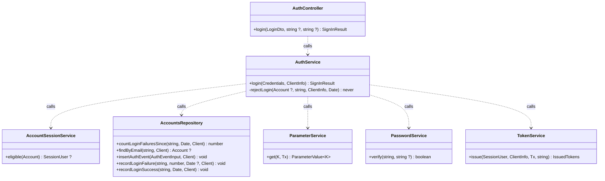

***Figure 3***: auth classes used in MF-01, UC-08. Dependencies are call-only (`..>`). Parameter types are listed in source order; `Tx` means `Prisma.TransactionClient`, and a result or structural type the code leaves unnamed is named after what it holds. The source remains authoritative for defaults, optional arguments and full type shapes.

<!-- sdd: MF-01 class auth-uc-09-part-1-of-2 -->
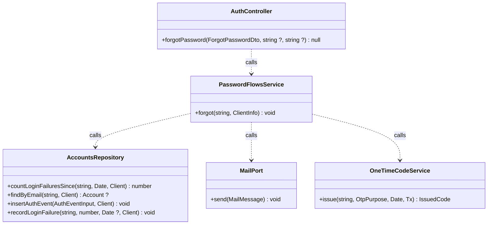

***Figure 4***: auth classes used in MF-01, UC-09 part 1 of 2. Dependencies are call-only (`..>`). Parameter types are listed in source order; `Tx` means `Prisma.TransactionClient`, and a result or structural type the code leaves unnamed is named after what it holds. The source remains authoritative for defaults, optional arguments and full type shapes.

<!-- sdd: MF-01 class auth-uc-09-part-2-of-2 -->
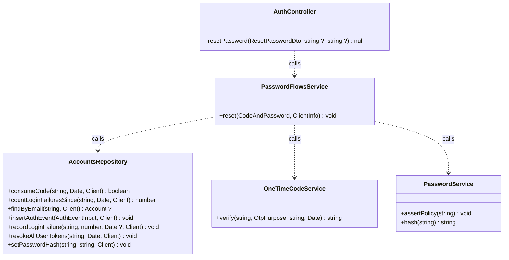

***Figure 5***: auth classes used in MF-01, UC-09 part 2 of 2. Dependencies are call-only (`..>`). Parameter types are listed in source order; `Tx` means `Prisma.TransactionClient`, and a result or structural type the code leaves unnamed is named after what it holds. The source remains authoritative for defaults, optional arguments and full type shapes.

<!-- sdd: MF-01 class auth-uc-10-part-1-of-2 -->
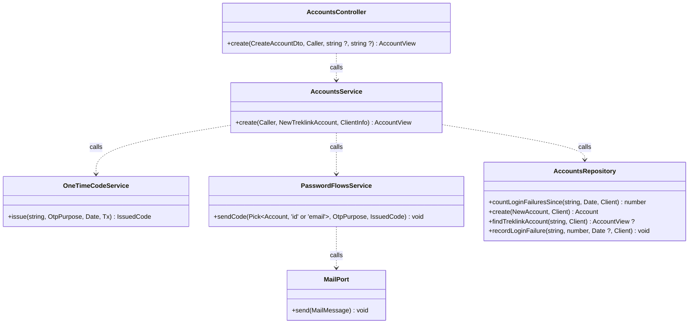

***Figure 6***: auth classes used in MF-01, UC-10 part 1 of 2. Dependencies are call-only (`..>`). Parameter types are listed in source order; `Tx` means `Prisma.TransactionClient`, and a result or structural type the code leaves unnamed is named after what it holds. The source remains authoritative for defaults, optional arguments and full type shapes.

<!-- sdd: MF-01 class auth-uc-10-part-2-of-2 -->
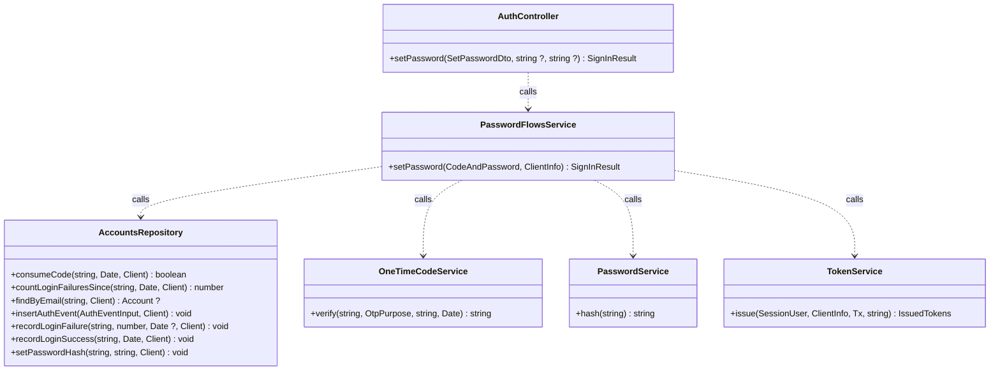

***Figure 7***: auth classes used in MF-01, UC-10 part 2 of 2. Dependencies are call-only (`..>`). Parameter types are listed in source order; `Tx` means `Prisma.TransactionClient`, and a result or structural type the code leaves unnamed is named after what it holds. The source remains authoritative for defaults, optional arguments and full type shapes.


<!-- sdd: MF-01 seq UC-08 -->
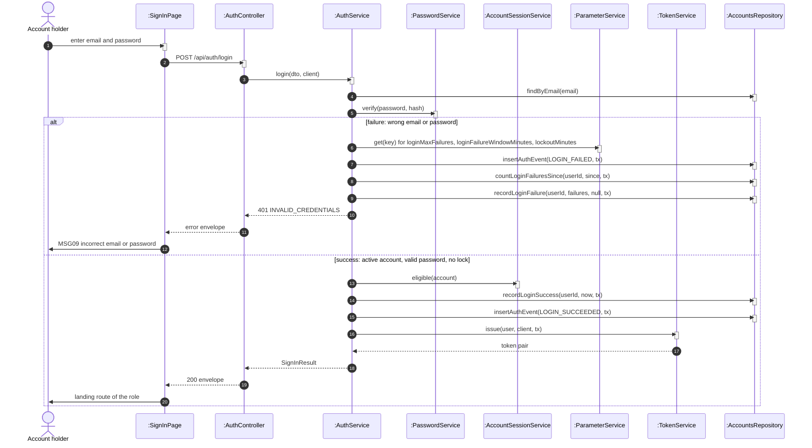

***Figure 8***: UC-08 Authenticate. The named failure is wrong credentials (SRS UC-08, MSG09): for a known account, AuthService.rejectLogin reads auth.loginMaxFailures, auth.loginFailureWindowMinutes and auth.lockoutMinutes, inserts LOGIN_FAILED, counts the failures in the window and records them in one transaction, then returns 401 INVALID_CREDENTIALS (REQ-ERR-01). Outside this two-lane view: at the limit the same transaction also sets lockedUntil, inserts ACCOUNT_LOCKED and returns 423 ACCOUNT_LOCKED; an account already locked is refused before its password is checked, logs LOGIN_FAILED and returns 423 with the minutes left (REQ-STA-01); an unknown email still performs the password verification, logs LOGIN_FAILED and returns 401 without reading lockout parameters or counting failures; an account that eligible() refuses is rejected as a wrong password.

<!-- sdd: MF-01 seq UC-09 part 1 of 2: request a code -->
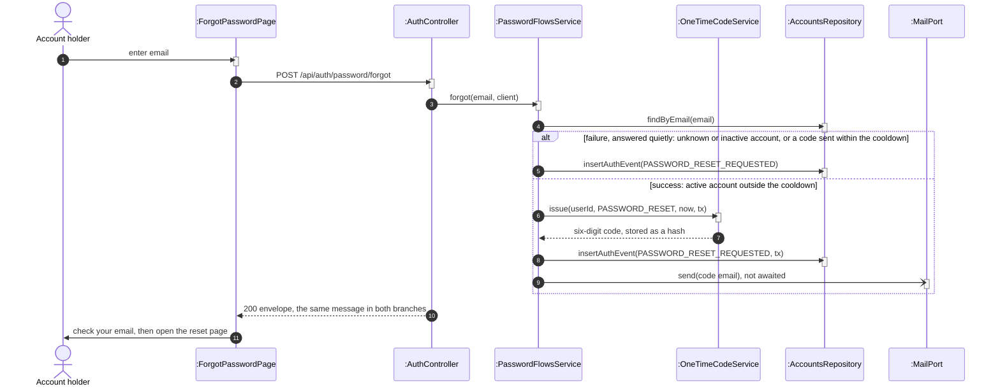

***Figure 9***: UC-09 Reset Password, part 1 of 2. Both branches answer alike and the mail is not
awaited, so the timing does not reveal whether the email exists (FR-AUTH-05).

<!-- sdd: MF-01 seq UC-09 part 2 of 2: set the new password -->
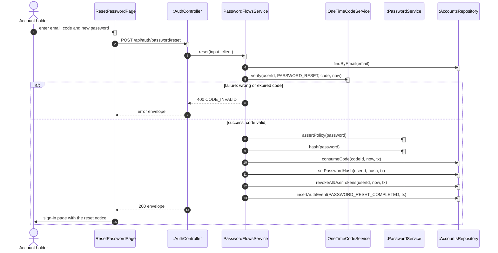

***Figure 10***: UC-09 Reset Password, part 2 of 2. Every session of the account ends with the reset (REQ-EVT-05). The named failure is a wrong or expired code. A new password that fails assertPolicy is separately refused with 400 PASSWORD_POLICY and changes nothing; that refusal is outside this two-lane view.

<!-- sdd: MF-01 seq UC-10 part 1 of 2: create an account -->
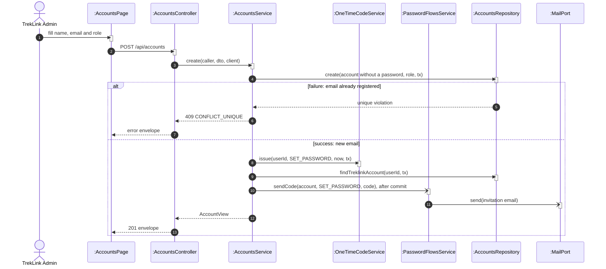

***Figure 11***: UC-10 Manage Platform Accounts, part 1 of 2. An account has no password until its
invitation code is used (REQ-EVT-06, BR-35). Deactivation follows the same layering and refuses the last
active Admin (409 `LAST_ADMIN`).

<!-- sdd: MF-01 seq UC-10 part 2 of 2: first password from the invitation -->
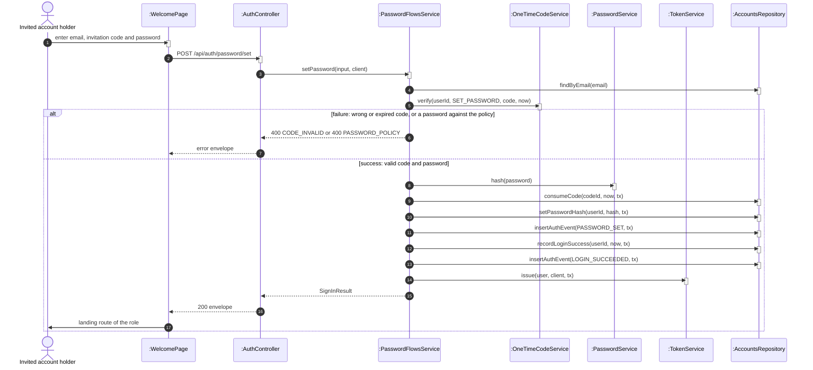

***Figure 12***: UC-10 Manage Platform Accounts, part 2 of 2. The same page serves an Org Manager created
by organization registration (UC-01), so MF-01 continues from here with a signed-in Manager.

---

## 9. Per-organization role policy (proposal, D-095)

> **Status**: Proposal of TanNB, 2026-11-02, ruled by the leader the same day (D-095). It changes D-057 and touches D-061. The migration `20261103120000_organization_role_policy`, the policy service and the Staff and Admin read `GET /api/organizations/:id/roles` (treklink-web#388) are built; the sections below still read as the proposal. Requirements: REQ-UBI-10 to REQ-UBI-12, REQ-EVT-10 and REQ-EVT-11, REQ-STA-04, REQ-ERR-10 to REQ-ERR-12. Screen: `specs/frontend/ui-design/3-7-organization-roles-and-permissions.md`.

An Org Manager edits what the two organization roles of their own organization may do. TrekLink keeps control through a ceiling: no organization can give a role more than the `ORG_MANAGER` role holds in the data, which the Admin edits on screen 7.2.

### 9.1 Terms

| Term | Meaning |
|---|---|
| Baseline | The rows of `role_permissions` of the role, as the Admin set them on screen 7.2. |
| Ceiling | The baseline of `ORG_MANAGER`. It bounds both organization roles in every organization. |
| Policy | The stored difference of one organization for one role: a set of grants and revokes plus a `version`. |
| Grant | A permission the baseline of the role lacks, the ceiling holds and that is not `protected`. Only `ORG_OPERATOR` can receive one. |
| Revoke | A permission the baseline of the role holds. |
| Effective set | What the members of that role in that organization may do. |

### 9.2 Data model

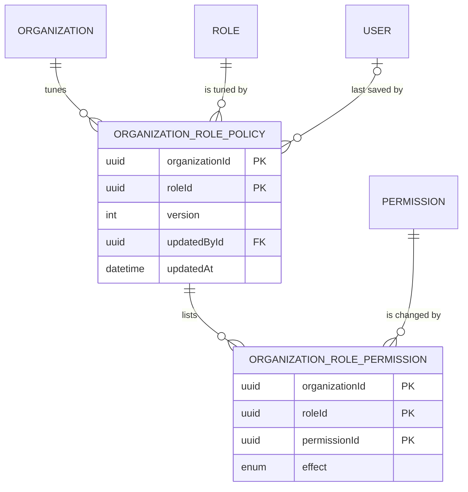

***Figure 13***: Per-organization role policy, Crow's foot notation. `||` is exactly one, `o{` is zero or many, `|o` is zero or one. A policy exists for an organization and a role once a Manager has saved it; no row means version 0 and no difference. `effect` is `GRANT` or `REVOKE`. `ORGANIZATION` belongs to `organizations`; both new models belong to `auth` and relate to `Organization` the way other modules already do.

| Model | Notes |
|---|---|
| `OrganizationRolePolicy` | One row per organization and role, created by the first save. `version` starts at 1 and counts the saves; it is the `expectedVersion` of the next one. `updatedById` is the Manager who saved. |
| `OrganizationRolePermission` | One row per grant or revoke. Composite primary key `(organizationId, roleId, permissionId)`; a foreign key to the policy of the same organization and role. Deleted and re-inserted with the policy on every save. |

Both tables keep their rows when an organization is closed (REQ-STA-04).

### 9.3 Effective set

For a role `R` of organization `O`, with `B(R)` the baseline, `G` and `V` the grants and revokes stored for `(O, R)`, and `C` the ceiling:

1. `own(R) = (B(R) ∪ G) ∖ V`, then keep only permissions of account type `ORGANIZATION` that are in `C`.
2. For `ORG_OPERATOR`, the effective set is `own(ORG_OPERATOR)`.
3. For `ORG_MANAGER`, the effective set is `own(ORG_MANAGER) ∪ B(ORG_OPERATOR)` (REQ-UBI-05), plus `organizationRole.manage.own` always (REQ-UBI-12). The Operator contributes its baseline `B`, not `own(ORG_OPERATOR)`.

An Operator revoke therefore never reaches the Manager (OQ-01, AC-10). A permission in `B(ORG_OPERATOR)` is always in the Manager's effective set: screen 3.7 shows it ticked and read-only, and `PUT` ignores the absence of such a key from the `permissionKeys` sent for `ORG_MANAGER`. A stored grant outside a changed ceiling, and a stored revoke of a permission the baseline no longer holds, are ignored without being deleted (REQ-EVT-11).

### 9.4 Cache and ability (touches D-061)

`PermissionCache.rulesFor(roleKeys)` becomes `rulesFor(roleKeys, organizationId)`. A TrekLink role keeps its cache entry by role key. An organization role is cached by `(organizationId, roleKey)` and holds the permission rows of the effective set of 9.3, read once. `AbilityFactory.forContext` already receives `organizationId` in its context; it passes it on. `PoliciesGuard`, `@CheckPolicies` and `scopeWhere` do not change, and the new handlers declare `ability.can('manage', 'OrganizationRole')` and `ability.can('read', 'OrganizationRole')`.

`policy.changed` gains an optional payload `{ organizationId }`. With it, `PermissionCache.invalidate` drops only that organization's entries and does not bump `policyVersion`; without it, as an Admin edit emits today, it drops everything and bumps the version. The access token carries no permissions, so no token changes and no session ends (D-060 is unchanged). The cache is in memory and `policy.changed` reaches only the process that handled the write, so every entry also expires after `auth.permissionCacheTtlSeconds`: the baseline entries by role (`byRole`) and the key-set entries of API keys (`byKeys`), which every organization shares, as well as the entries by organization and role. The time-to-live is not specific to organizations. The guarantee is: a change applies from the next request on the same instance, and within the time-to-live on any other instance. Several instances exist on the Vercel staging; the register entry of 2026-10-24 on the permission cache is the risk this closes.

| Key | Default | Type | Bounds | Unit | Meaning | Requirement |
|---|---|---|---|---|---|---|
| `auth.permissionCacheTtlSeconds` (proposal) | `30` | INT | 5 to 300 | seconds | Longest an entry of the permission cache is served without a new read | REQ-EVT-08, REQ-EVT-10 |

The row joins the `auth` table of `specs/platform/configuration-matrix.md` when the build adds it to `scripts/specs/catalog.py` (OQ-05).

An organization API key keeps the fixed list of permission keys it carries (task 4.3, `forApiKey`) and is not narrowed by a policy (OQ-02).

### 9.5 Endpoints

| API | Module | Permission | Purpose |
|---|---|---|---|
| `GET /api/organization/roles` | auth | `organizationRole.manage.own` | The two roles of the caller's organization: baseline keys, effective keys, `version`, and the ceiling as a catalog of descriptions. The organization comes from the token (REQ-UBI-06). |
| `PUT /api/organization/roles/:roleKey/permissions` | auth | `organizationRole.manage.own` | Replaces the effective set of one role, with `expectedVersion`. The service stores the difference from the baseline. |
| `GET /api/organizations/:id/roles` | organizations | `organizationRole.read` | The same view for TrekLink Admin and Staff, read-only. It calls the read service of `auth`, as `organizations` already calls its account services. |

The full-list `PUT` keeps the shape of `PUT /api/roles/:id/permissions` (api-design 16), so the screen can send the grid state without computing a difference. Files: auth api-design 19 and 20, organizations api-design 33.

### 9.6 Sequence: a Manager saves a role

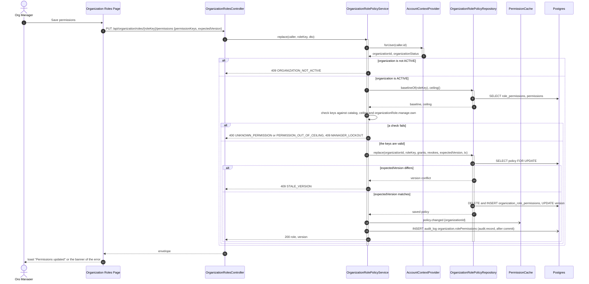

***Figure 14***: A Manager saves the permissions of one role. The two outer `alt` blocks separate the refusals that come before any write from the save itself; the inner `alt` separates a stale version from a successful compare and set. The audit record and the cache event follow the commit. The figure shows the first status read, before the transaction; the save repeats it inside the transaction with the row of the organization locked FOR SHARE (`AccountContextProvider.lockOrganizationStatus`), before the policy row is locked, so a suspension or a closing that commits between the two reads does not let the save through, and one that starts later waits for the save.

### 9.7 Proposed decision text (for the leader)

**Amends D-057.**

1. Rule 2 stays: a role holds only permissions of its own account type, and the catalog is read-only and comes from the seed.
2. New: an organization may store grants and revokes for its `ORG_MANAGER` and `ORG_OPERATOR` roles. The effective set is the baseline, adjusted by those rows, kept inside the ceiling, with `ORG_MANAGER` also holding the baseline set of `ORG_OPERATOR` (9.3). The ceiling is the `ORG_MANAGER` baseline.
3. New: the flag `protected` means that the highest role of an account type cannot lose the permission: `ADMIN` for TrekLink permissions (as today), `ORG_MANAGER` for organization permissions, and a `protected` permission is never granted to a lower role. `PUT /api/roles/:id/permissions` refuses to remove one from `ORG_MANAGER` with 409 `MANAGER_LOCKOUT`, and screen 7.2 shows such a cell as locked ("Required for Manager").
4. New catalog entries: `organizationRole.manage.own` (account type `ORGANIZATION`, `protected`, granted to `ORG_MANAGER`) and `organizationRole.read` (account type `TREKLINK`, granted to `STAFF`, held by `ADMIN` through REQ-UBI-05). The CASL subject is `OrganizationRole`.
5. New error codes: `MANAGER_LOCKOUT` (409), `PERMISSION_OUT_OF_CEILING` (400). `STALE_VERSION` (409, MSG36) and `ORGANIZATION_NOT_ACTIVE` (409) already exist.

**Touches D-061.** `AbilityFactory.forContext` and `PermissionCache.rulesFor` take the organization (9.4). The global guard, `@Public()`, `@Authenticated()` and `@CheckPolicies` keep their rules.

**Does not change D-060.** Tokens carry no permissions, an organization-scoped change does not bump `pv`, and no session is revoked. The rulings on OQ-01 to OQ-06 are in `requirements.md`.

**Rejected.** A full copy of the role per organization at registration (it drifts from the Admin's changes). A ceiling set per organization (more screens and data for no stated need). Permissions inside the access token (a change would wait for the token to expire, against REQ-EVT-08). Ending the sessions of the affected members (the ability is rebuilt on every request anyway).

### 9.8 Errors added

| Code | HTTP | Where |
|---|---|---|
| `MANAGER_LOCKOUT` | 409 | organization role save; global role save that removes a Manager-protected permission |
| `PERMISSION_OUT_OF_CEILING` | 400 | organization role save |
| `STALE_VERSION` | 409 | organization role save (MSG36) |
| `ORGANIZATION_NOT_ACTIVE` | 409 | organization role save |

### 9.9 Testing strategy (build in W10)

- Unit: the effective set of 9.3 as a table of cases (baseline only, grant, revoke, grant outside the ceiling ignored, Operator revoke not reaching the Manager, Manager protected permission always present); `PermissionCache` keyed by organization, `invalidate` with and without a payload, and an entry that expires after `auth.permissionCacheTtlSeconds` and is read again (fake clock).
- E2E: AC-07 to AC-10 with two organizations; every validation row of auth api-design 19 and 20; the cross-organization 404 rule of NFR-SEC-04 for the Admin read.
- Database: two concurrent saves for one `(organization, role)`, one wins and the other gets `STALE_VERSION` (`FOR UPDATE` on the policy row).
