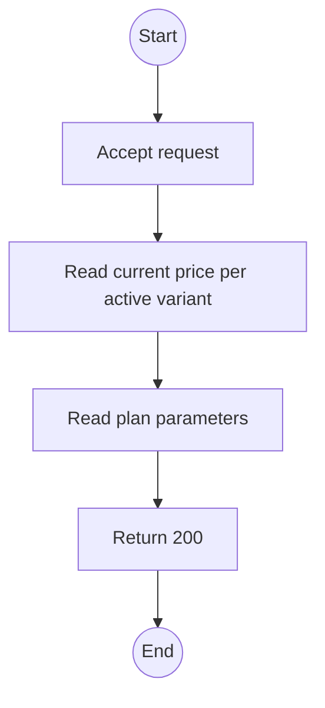
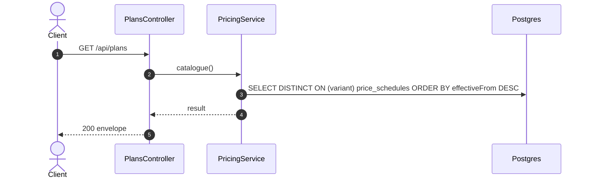

# GET /api/plans: Public plan catalogue

> Module `billing`. Generated from `scripts/specs/endpoints/billing.py` by `scripts/specs/build_api_design.py`; edit the catalog, not this file. Format: `02-templates/04-api-endpoint-template.md` with Mermaid (D-017). Envelope: D-002.

[TOC]

---
## Overview

What the website sells: every active hardware variant with its current monthly price per device and its image and spec sheet (devices design section 10, shown as the variant card of the request form), the day-plan lengths and premium, the holding-fee ratio and the minimum order quantity. All values come from configuration (BR-29).

## API Specification

| API | URL |
| --- | --- |
| GET | /api/plans |
| Permission | Public |
| Traces | UC-56, FR-BILL-01, FR-BILL-02, BR-02, BR-29 |

## Request sample

No body.

## Response sample

```json
{
  "result": {
    "minOrderQuantity": 5,
    "holdingFeeRatio": 0.5,
    "dayPlanLengths": [
      3,
      4,
      7
    ],
    "dayPremium": 1.5,
    "variants": [
      {
        "id": "a1b2c3d4-e5f6-4a7b-8c9d-0e1f2a3b4c5d",
        "code": "treklink-v3",
        "name": "TrekLink v3 (GPS, SOS button)",
        "imageUrl": null,
        "specSheet": {
          "mcu": "ESP32",
          "sosControl": "3 s hold on the user button",
          "localAlarm": "LED blinks"
        },
        "hasGps": true,
        "hasMotionSensor": false,
        "mqttCapable": true,
        "firmwareBaseline": "2.7.19-treklink.3",
        "monthlyPriceVnd": 450000,
        "dayPriceVnd": 22500
      }
    ],
    "sandbox": true
  },
  "isSuccess": true,
  "statusCode": 200,
  "message": "OK"
}
```

| Field | Description | Data Type | Examples |
| --- | --- | --- | --- |
| variants[].hasGps | Capability flags as text on the variant card (GPS, motion sensor, MQTT); the same names and values as devices api-design 01, display only | bool | `true` |
| variants[].hasMotionSensor | See `hasGps` | bool | `false` |
| variants[].mqttCapable | See `hasGps` | bool | `true` |
| variants[].firmwareBaseline | The firmware the variant ships with, shown on the variant card as the firmware baseline (design section 10) | string | `2.7.19-treklink.3` |

## Validation

<table>
    <th>Status code</th>
    <th>Description</th>
    <th>Examples</th>
    <tbody>
    </tbody>
</table>

## Activity Diagram



## Sequence Diagram


