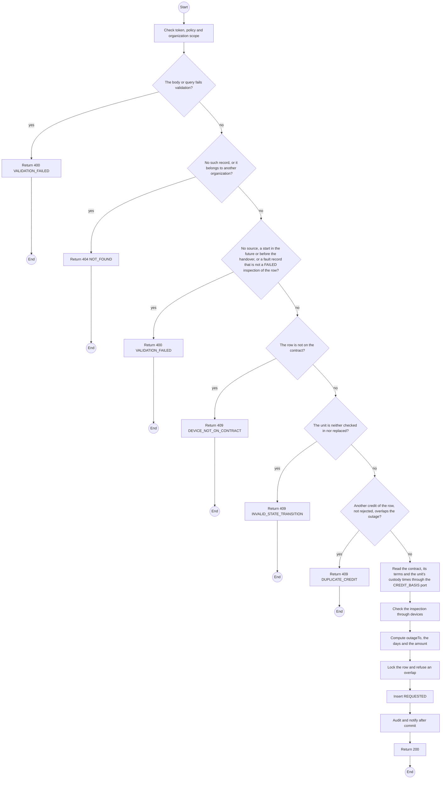
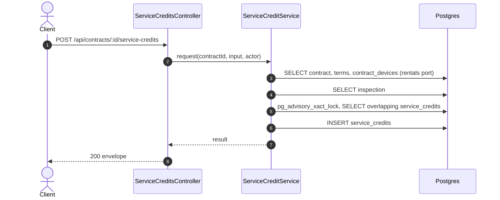

# POST /api/contracts/:id/service-credits: Request a service credit

> Module `billing`. Generated from `scripts/specs/endpoints/billing.py` by `scripts/specs/build_api_design.py`; edit the catalog, not this file. Format: `02-templates/04-api-endpoint-template.md` with Mermaid (D-017). Envelope: D-002.

[TOC]

---
## Overview

Records a credit for a unit that failed through no fault of the organization, once the unit is checked in or replaced (design §9). The caller names the contract row, the cause, the `FAILED` inspection of that row and the outage start with its source: an incident, or a note with the time of the call or counter visit. `outageTo` is computed as the first of the replacement handover, the check-in and the end of the term the outage starts in; days round up with a one-day minimum. Monthly: ceil(P x days / termDays), at most P. Day plan: ceil(P / 30 x premium x days), at most the unit day-plan fee. The organization's Managers are emailed after commit.

## API Specification

| API | URL |
| --- | --- |
| POST | /api/contracts/:id/service-credits |
| Permission | TrekLink Staff, TrekLink Admin |
| Traces | D-092 rule 5, REQ-EVT-12, REQ-ERR-06, REQ-ERR-08, AC-06 |

### Path parameters

| Field | Description | Data Type | Examples |
| --- | --- | --- | --- |
| id | Contract id | uuid | `c0ffee00-1234-4abc-9def-001122334455` |

## Request sample

```json
{
  "contractDeviceId": "cd-1",
  "cause": "BATTERY_FAULT",
  "faultInspectionId": "in-7",
  "outageFrom": "2026-10-10T01:30:00Z",
  "outageSourceIncidentId": "7a6b5c4d-3e2f-4a1b-8c9d-0e1f2a3b4c5d"
}
```

| Field | Description | Data Type | Required | Examples |
| --- | --- | --- | --- | --- |
| contractDeviceId | The unit's row on the contract | uuid | yes | `cd-1` |
| cause | `BATTERY_FAULT`, `RADIO_FAULT`, `GPS_FAULT`, `BOARD_FAULT` or `FIRMWARE_FAULT` | enum | yes | `BATTERY_FAULT` |
| faultInspectionId | The FAILED inspection of that row | uuid | yes | `in-7` |
| outageFrom | When the organization reported the fault, not before the handover | date-time | yes | `2026-10-10T01:30:00Z` |
| outageSourceIncidentId | The incident that reported it | uuid | cond. | `7a6b5c4d-3e2f-4a1b-8c9d-0e1f2a3b4c5d` |
| outageSourceNote | The call or counter visit, at most 500 characters | string | cond. | `Called the counter at 08:30` |

## Response sample

```json
{
  "result": {
    "id": "sc-1",
    "contractId": "c0ffee00-1234-4abc-9def-001122334455",
    "contractDeviceId": "cd-1",
    "deviceId": "0d3f6a2b-7e11-4c55-8f0a-2b1c9e7d4a10",
    "assetTag": "TL-0042",
    "cause": "BATTERY_FAULT",
    "faultInspectionId": "in-7",
    "outageFrom": "2026-10-10T01:30:00.000Z",
    "outageSourceIncidentId": "7a6b5c4d-3e2f-4a1b-8c9d-0e1f2a3b4c5d",
    "outageSourceNote": null,
    "outageTo": "2026-10-13T03:00:00.000Z",
    "outageDays": 3,
    "computedVnd": 45000,
    "decidedVnd": null,
    "appliedVnd": 0,
    "status": "REQUESTED",
    "decisionReason": null,
    "decidedAt": null,
    "refundReference": null,
    "refundedAt": null,
    "version": 1,
    "createdAt": "2026-10-20T03:15:00.000Z"
  },
  "isSuccess": true,
  "statusCode": 200,
  "message": "Service credit requested"
}
```

## Validation

<table>
    <th>Status code</th>
    <th>Description</th>
    <th>Examples</th>
    <tbody>
        <tr>
            <td>400</td>
            <td>The body or query fails validation (<code>VALIDATION_FAILED</code>)</td>
<td>

```json
{
  "result": {
    "errorCode": "VALIDATION_FAILED"
  },
  "isSuccess": false,
  "statusCode": 400,
  "message": "{field} is required."
}
```
</td>
        </tr>
        <tr>
            <td>401</td>
            <td>Missing, malformed or expired access token or API key (<code>UNAUTHENTICATED</code>)</td>
<td>

```json
{
  "result": {
    "errorCode": "UNAUTHENTICATED"
  },
  "isSuccess": false,
  "statusCode": 401,
  "message": "Authentication required."
}
```
</td>
        </tr>
        <tr>
            <td>403</td>
            <td>The caller's role, policy or organization does not allow this action (<code>FORBIDDEN</code>)</td>
<td>

```json
{
  "result": {
    "errorCode": "FORBIDDEN"
  },
  "isSuccess": false,
  "statusCode": 403,
  "message": "You do not have access to this."
}
```
</td>
        </tr>
        <tr>
            <td>404</td>
            <td>No such record, or it belongs to another organization (<code>NOT_FOUND</code>)</td>
<td>

```json
{
  "result": {
    "errorCode": "NOT_FOUND"
  },
  "isSuccess": false,
  "statusCode": 404,
  "message": "Service credit not found."
}
```
</td>
        </tr>
        <tr>
            <td>400</td>
            <td>No source, a start in the future or before the handover, or a fault record that is not a FAILED inspection of the row (<code>VALIDATION_FAILED</code>)</td>
<td>

```json
{
  "result": {
    "errorCode": "VALIDATION_FAILED"
  },
  "isSuccess": false,
  "statusCode": 400,
  "message": "The fault record must be a FAILED inspection of this unit on this contract."
}
```
</td>
        </tr>
        <tr>
            <td>409</td>
            <td>The row is not on the contract (<code>DEVICE_NOT_ON_CONTRACT</code>)</td>
<td>

```json
{
  "result": {
    "errorCode": "DEVICE_NOT_ON_CONTRACT"
  },
  "isSuccess": false,
  "statusCode": 409,
  "message": "This device is not on the contract."
}
```
</td>
        </tr>
        <tr>
            <td>409</td>
            <td>The unit is neither checked in nor replaced (<code>INVALID_STATE_TRANSITION</code>)</td>
<td>

```json
{
  "result": {
    "errorCode": "INVALID_STATE_TRANSITION"
  },
  "isSuccess": false,
  "statusCode": 409,
  "message": "A service credit is requested once the unit is checked in or replaced."
}
```
</td>
        </tr>
        <tr>
            <td>409</td>
            <td>Another credit of the row, not rejected, overlaps the outage (<code>DUPLICATE_CREDIT</code>)</td>
<td>

```json
{
  "result": {
    "errorCode": "DUPLICATE_CREDIT"
  },
  "isSuccess": false,
  "statusCode": 409,
  "message": "A service credit already covers part of this outage."
}
```
</td>
        </tr>
    </tbody>
</table>

## Activity Diagram



## Sequence Diagram


