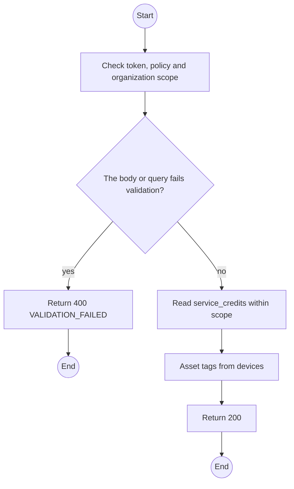
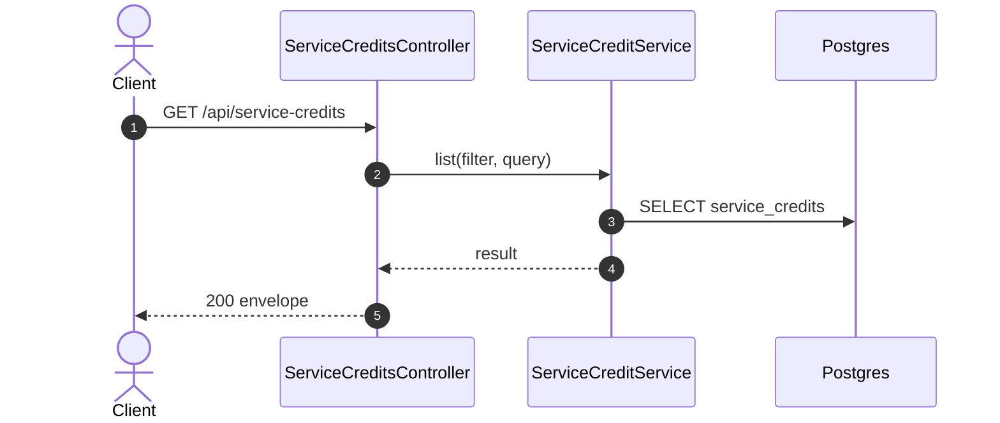

# GET /api/service-credits: Service credits

> Module `billing`. Generated from `scripts/specs/endpoints/billing.py` by `scripts/specs/build_api_design.py`; edit the catalog, not this file. Format: `02-templates/04-api-endpoint-template.md` with Mermaid (D-017). Envelope: D-002.

[TOC]

---
## Overview

Lists credits, newest first; Admins use `status=REQUESTED` as their decision queue and Staff `status=REFUND_DUE` for refunds to record.

## API Specification

| API | URL |
| --- | --- |
| GET | /api/service-credits |
| Permission | TrekLink Staff, TrekLink Admin; the organization's Managers for their own |
| Traces | D-092 rule 5, REQ-EVT-13, REQ-EVT-15 |

### Query parameters

| Field | Description | Data Type | Required | Examples |
| --- | --- | --- | --- | --- |
| status | ServiceCreditStatus | enum | no | `REQUESTED` |
| pageNumber | 1-based page | int | no | `1` |
| pageSize | Items per page, at most MAX_PAGE_SIZE | int | no | `20` |
| contractId | Contract | uuid | no | `c0ffee00-1234-4abc-9def-001122334455` |

## Request sample

No body.

## Response sample

```json
{
  "result": {
    "items": [
      {
        "id": "sc-1",
        "contractId": "c0ffee00-1234-4abc-9def-001122334455",
        "contractDeviceId": "cd-1",
        "deviceId": "0d3f6a2b-7e11-4c55-8f0a-2b1c9e7d4a10",
        "assetTag": "TL-0042",
        "cause": "BATTERY_FAULT",
        "faultInspectionId": "in-7",
        "outageFrom": "2026-10-10T01:30:00.000Z",
        "outageSourceIncidentId": "7a6b5c4d-3e2f-4a1b-8c9d-0e1f2a3b4c5d",
        "outageSourceFaultReportId": null,
        "outageSourceNote": null,
        "outageTo": "2026-10-13T03:00:00.000Z",
        "outageDays": 3,
        "computedVnd": 45000,
        "decidedVnd": null,
        "appliedVnd": 0,
        "status": "REQUESTED",
        "kind": "FAULT",
        "unitReleaseId": null,
        "requestedById": "3f2e1d0c-9b8a-4c7d-8e6f-5a4b3c2d1e0f",
        "decisionReason": null,
        "decidedAt": null,
        "refundReference": null,
        "refundedAt": null,
        "version": 1,
        "createdAt": "2026-10-20T03:15:00.000Z"
      }
    ],
    "pageNumber": 1,
    "pageSize": 20,
    "totalCount": 1,
    "totalPages": 1
  },
  "isSuccess": true,
  "statusCode": 200,
  "message": "OK"
}
```

## Validation

<table>
    <th>Status code</th>
    <th>Description</th>
    <th>Examples</th>
    <tbody>
        <tr>
            <td>400</td>
            <td>The body or query fails validation (<code>VALIDATION_FAILED</code>)</td>
<td>

```json
{
  "result": {
    "errorCode": "VALIDATION_FAILED"
  },
  "isSuccess": false,
  "statusCode": 400,
  "message": "{field} is required."
}
```
</td>
        </tr>
        <tr>
            <td>401</td>
            <td>Missing, malformed or expired access token or API key (<code>UNAUTHENTICATED</code>)</td>
<td>

```json
{
  "result": {
    "errorCode": "UNAUTHENTICATED"
  },
  "isSuccess": false,
  "statusCode": 401,
  "message": "Authentication required."
}
```
</td>
        </tr>
        <tr>
            <td>403</td>
            <td>The caller's role, policy or organization does not allow this action (<code>FORBIDDEN</code>)</td>
<td>

```json
{
  "result": {
    "errorCode": "FORBIDDEN"
  },
  "isSuccess": false,
  "statusCode": 403,
  "message": "You do not have access to this."
}
```
</td>
        </tr>
    </tbody>
</table>

## Activity Diagram



## Sequence Diagram


