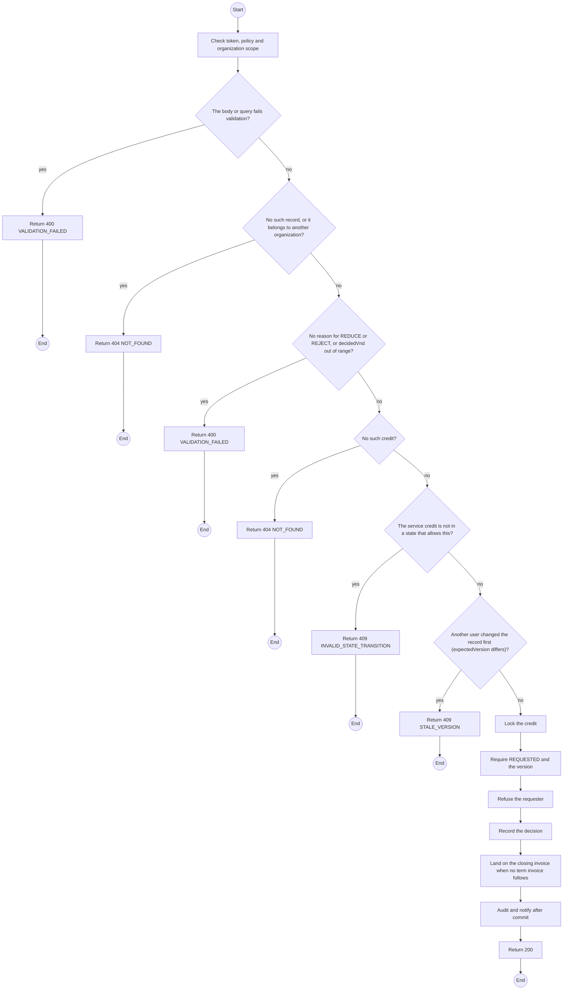
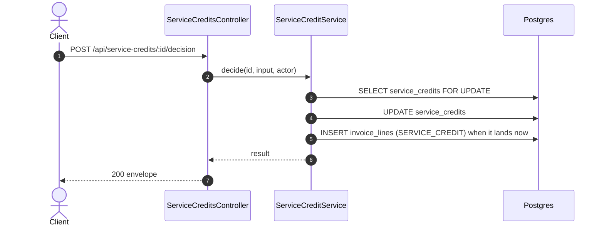

# POST /api/service-credits/:id/decision: Decide a service credit

> Module `billing`. Generated from `scripts/specs/endpoints/billing.py` by `scripts/specs/build_api_design.py`; edit the catalog, not this file. Format: `02-templates/04-api-endpoint-template.md` with Mermaid (D-017). Envelope: D-002.

[TOC]

---
## Overview

Approves, reduces (with a reason, below the computed amount) or rejects (with a reason) a `REQUESTED` credit with the `version` the Admin saw. A decided amount lands as a negative `SERVICE_CREDIT` line on the contract's next term invoice when it is issued; when no further term invoice will be issued (a day plan, notice given, or the contract no longer active), it lands on the closing invoice now. Only the part that brings an invoice's unpaid amount to zero is written; the rest stays `APPROVED` for the next invoice and becomes `REFUND_DUE` at the close, or at once on a contract already `CLOSED`. The organization's Managers are emailed after commit.

## API Specification

| API | URL |
| --- | --- |
| POST | /api/service-credits/:id/decision |
| Permission | TrekLink Admin, never the requester |
| Traces | D-092 rule 5, REQ-EVT-13, REQ-EVT-14, REQ-ERR-07, AC-07, BR-24 |

### Path parameters

| Field | Description | Data Type | Examples |
| --- | --- | --- | --- |
| id | Service credit id | uuid | `sc-1` |

## Request sample

```json
{
  "decision": "REDUCE",
  "decidedVnd": 30000,
  "reason": "Unit used for part of day 10",
  "expectedVersion": 1
}
```

| Field | Description | Data Type | Required | Examples |
| --- | --- | --- | --- | --- |
| decision | `APPROVE`, `REDUCE` or `REJECT` | enum | yes | `REDUCE` |
| decidedVnd | Required for REDUCE, above 0 and below computedVnd | int | cond. | `30000` |
| reason | Required for REDUCE and REJECT, at most 500 characters | string | cond. | `Unit used for part of day 10` |
| expectedVersion | The version the Admin saw | int | yes | `1` |

## Response sample

```json
{
  "result": {
    "id": "sc-1",
    "contractId": "c0ffee00-1234-4abc-9def-001122334455",
    "contractDeviceId": "cd-1",
    "deviceId": "0d3f6a2b-7e11-4c55-8f0a-2b1c9e7d4a10",
    "assetTag": "TL-0042",
    "cause": "BATTERY_FAULT",
    "faultInspectionId": "in-7",
    "outageFrom": "2026-10-10T01:30:00.000Z",
    "outageSourceIncidentId": "7a6b5c4d-3e2f-4a1b-8c9d-0e1f2a3b4c5d",
    "outageSourceFaultReportId": null,
    "outageSourceNote": null,
    "outageTo": "2026-10-13T03:00:00.000Z",
    "outageDays": 3,
    "computedVnd": 45000,
    "decidedVnd": 30000,
    "appliedVnd": 0,
    "status": "APPROVED",
    "requestedById": "3f2e1d0c-9b8a-4c7d-8e6f-5a4b3c2d1e0f",
    "decisionReason": "Unit used for part of day 10",
    "decidedAt": "2026-10-20T03:15:00.000Z",
    "refundReference": null,
    "refundedAt": null,
    "version": 2,
    "createdAt": "2026-10-20T03:15:00.000Z"
  },
  "isSuccess": true,
  "statusCode": 200,
  "message": "Decision recorded"
}
```

## Validation

<table>
    <th>Status code</th>
    <th>Description</th>
    <th>Examples</th>
    <tbody>
        <tr>
            <td>400</td>
            <td>The body or query fails validation (<code>VALIDATION_FAILED</code>)</td>
<td>

```json
{
  "result": {
    "errorCode": "VALIDATION_FAILED"
  },
  "isSuccess": false,
  "statusCode": 400,
  "message": "{field} is required."
}
```
</td>
        </tr>
        <tr>
            <td>401</td>
            <td>Missing, malformed or expired access token or API key (<code>UNAUTHENTICATED</code>)</td>
<td>

```json
{
  "result": {
    "errorCode": "UNAUTHENTICATED"
  },
  "isSuccess": false,
  "statusCode": 401,
  "message": "Authentication required."
}
```
</td>
        </tr>
        <tr>
            <td>403</td>
            <td>The caller's role, policy or organization does not allow this action (<code>FORBIDDEN</code>)</td>
<td>

```json
{
  "result": {
    "errorCode": "FORBIDDEN"
  },
  "isSuccess": false,
  "statusCode": 403,
  "message": "You do not have access to this."
}
```
</td>
        </tr>
        <tr>
            <td>404</td>
            <td>No such record, or it belongs to another organization (<code>NOT_FOUND</code>)</td>
<td>

```json
{
  "result": {
    "errorCode": "NOT_FOUND"
  },
  "isSuccess": false,
  "statusCode": 404,
  "message": "Service credit not found."
}
```
</td>
        </tr>
        <tr>
            <td>400</td>
            <td>No reason for REDUCE or REJECT, or decidedVnd out of range (<code>VALIDATION_FAILED</code>)</td>
<td>

```json
{
  "result": {
    "errorCode": "VALIDATION_FAILED"
  },
  "isSuccess": false,
  "statusCode": 400,
  "message": "A reason is required to reduce or reject a credit."
}
```
</td>
        </tr>
        <tr>
            <td>403</td>
            <td>The caller requested the credit (<code>SEPARATION_OF_DUTY</code>)</td>
<td>

```json
{
  "result": {
    "errorCode": "SEPARATION_OF_DUTY"
  },
  "isSuccess": false,
  "statusCode": 403,
  "message": "A different Admin must decide this credit."
}
```
</td>
        </tr>
        <tr>
            <td>404</td>
            <td>No such credit (<code>NOT_FOUND</code>)</td>
<td>

```json
{
  "result": {
    "errorCode": "NOT_FOUND"
  },
  "isSuccess": false,
  "statusCode": 404,
  "message": "Service credit not found."
}
```
</td>
        </tr>
        <tr>
            <td>409</td>
            <td>The service credit is not in a state that allows this (<code>INVALID_STATE_TRANSITION</code>)</td>
<td>

```json
{
  "result": {
    "errorCode": "INVALID_STATE_TRANSITION"
  },
  "isSuccess": false,
  "statusCode": 409,
  "message": "This cannot be done while it is APPROVED."
}
```
</td>
        </tr>
        <tr>
            <td>409</td>
            <td>Another user changed the record first (expectedVersion differs) (<code>STALE_VERSION</code>)</td>
<td>

```json
{
  "result": {
    "errorCode": "STALE_VERSION"
  },
  "isSuccess": false,
  "statusCode": 409,
  "message": "This was changed by someone else. Reload and try again."
}
```
</td>
        </tr>
    </tbody>
</table>

## Activity Diagram



## Sequence Diagram


