# Technical Design: billing

> Fulfills `requirements.md` in this folder. Schema: the `// @module billing` block of
> `backend/prisma/schema.prisma` is authoritative.
>
> **Status**: Approved, written by KhoaDD and merged on `dev` (treklink-web PR #30 and #31, 2026-10-18). Changes go through a pull request reviewed by KhoaDD (D-052).

---

## 1. Data model

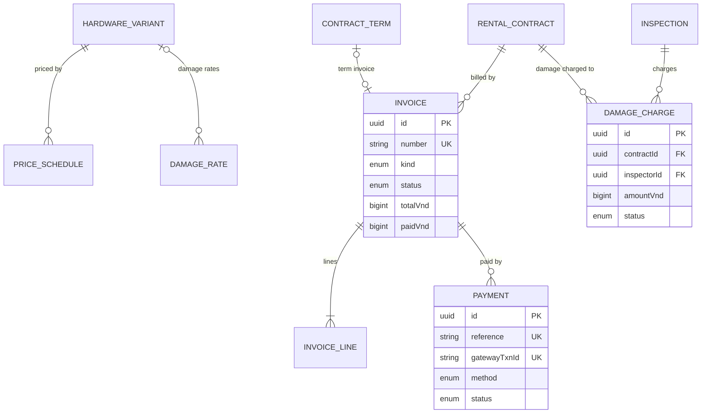

***Figure 1***: billing slice. A damage charge stores its contract, its inspector and the codes it priced
(D-081), so the Admin decision of UC-48 needs no read from `rentals` or `devices`.

Invoice kinds: `TERM` (monthly, two dated lines), `DAY_PLAN` (one line), `CLOSING` (late, damage, loss,
adjustments; created on the first such charge of a contract and kept open for more lines until the
contract closes). A closing invoice is the one exception to "issued once": lines are appended while the
contract is not `CLOSED`, never changed (REQ-UBI-02).

---

## 2. Calculations

| Charge | Formula | Due |
|---|---|---|
| Holding fee | ⌈ratio × P × q⌉ | term start |
| Term balance | P × q − holding fee | term end |
| Day plan | ⌈P ÷ 30 × premium × days × q⌉ | start date (paid by the handover) |
| Late | `lateFeePerDevicePerDayVnd` × ⌈(checkedInAt − returnDueAt) ÷ 1 day⌉, only if past the grace | at check-in |
| Damage | Σ rate(code) for the device's variant, generic rate as fallback | when decided, or at once below the threshold |
| Loss | `devices.valueAt(device, confirmedAt)`, renter custody only; a reduction or waiver is an `ADJUSTMENT` line | at loss-case confirmation |

`P` is the contract's `monthlyUnitPriceVnd` snapshot; `ratio` and `premium` are the snapshot too.

---

## 3. SePay sandbox flow

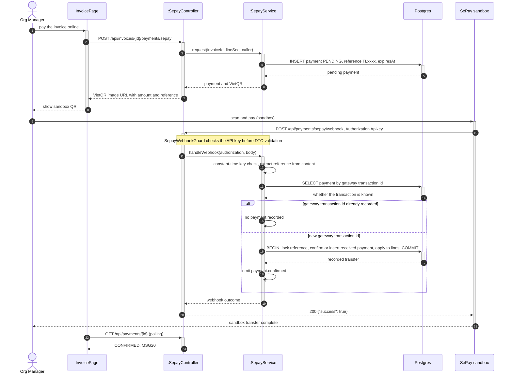

***Figure 2***: SePay flow. Facts verified on 2026-10-04 at https://docs.sepay.vn/tich-hop-webhooks.html:
the `Authorization: Apikey <key>` header, the payload fields, the required `{"success": true}` body and
the retry policy (7 retries over 5 hours). The VietQR image URL format is configuration (`SEPAY_QR_BASE_URL`). On 2026-10-18
https://docs.sepay.vn/tao-qr-code-vietqr-dong.html documents `https://vietqr.app/img?acc=&bank=&amount=&des=`, with optional `template`
and `download`; it replaces the older `qr.sepay.vn/img` default. Rendering against SePay's sandbox stays in task 3.2.

The reference is `TL` plus 8 Crockford base32 characters, so it survives banks that strip punctuation
from transfer content. The webhook's `transferAmount` must equal the payment amount; a different amount
is recorded as a separate `CONFIRMED` payment of the received amount against the same invoice and logged
for Staff, rather than rejected, because the money has moved.

The contract balance must be open before a new QR request is inserted. An earlier invoice may
still have unpaid lines after a cancellation adjustment on the closing invoice settles the
contract; the request is then 409 `NOTHING_DUE`. The invoice page applies the same balance rule
to both SePay and counter-payment actions (the ruling on #87 point 4).

The API-key guard runs before body validation. A missing or wrong key is always 401
`WEBHOOK_UNAUTHENTICATED`, including when the DTO is invalid. The constant-time comparison also
runs for direct service callers. Deduplication is by gateway transaction id only. A different
transaction on a confirmed reference is its own confirmed payment; the invoice receives at most
what remains due, and any excess stays on that payment and is logged for Staff.

---

## 4. Services and ports

| Export | Used by |
|---|---|
| `PricingService.snapshot(variantId, tx?)`, 404 when no price is in effect | rentals |
| `InvoicesService.issueTermInvoice(contract, term, tx)`, `issueDayPlanInvoice(contract, tx)` | rentals: the first invoice inside the request transaction since D-092 rule 1 (inside the approval for a contract requested before it), later terms at rollover. The first line, the holding fee or the day-plan fee, is the deposit the request's hold waits for; its due date is unchanged (the term start), because the hold expiry, not the line, decides how long the units wait (rentals design §2.1). Staff record it at the counter (REQ-EVT-10) or the Manager pays it through SePay before approval |
| `ChargesService.chargeLate(contract, device, checkedInAt, actorId, tx)`, `chargeDamage(contract, inspection, actorId, tx)`; `actorId` is null for SYSTEM | rentals |
| `ChargesService.chargeLoss(contract, device, lostAt, tx)` and `adjustLoss(contract, device, decision, amountVnd, reason, actor, tx, settledAt)` (an `ADJUSTMENT` line for a reduced or waived loss, due at the settlement time, never an edit of the `LOSS` line, FR-BILL-11, BR-39), called from this module's provider of the `devices` port `LOSS_CASE_LISTENERS` (`onConfirmed` for `RENTER` custody, `onSettled`) | devices, through the port (D-045) |
| `ChargesService.settleCancellation(contract, tx)` | rentals |
| `ChargesService.pendingDamage(contractId, tx)`: the number of the contract's damage charges still `PENDING_APPROVAL`, which have no invoice line yet, so the close guard refuses on them as well as on unpaid lines (REQ-STA-02, D-081) | rentals |
| `PaymentsService.receivedOfContract(contractId, tx?)`: the contract's confirmed payments, oldest first, each with its invoice number, amount, method, reference and confirmation time (`ReceivedPayment`) | rentals, the handover note (rentals design §4.1) |
| `PricingService.rateTableFor(variantId, tx?)`: the variant's active damage rates, one row per code with the variant's own rate over the generic one, as `damageRateFor` applies them, sorted by code (`RateTableRow`) | rentals, the handover note (rentals design §4.1) |
| `BalanceService.firstPaymentConfirmed(contractId)`, `outstanding(contractId)`, `balanceSummary(contractId)` | rentals |
| `BalanceService.revenue({from, to})`: per hardware variant, the lines due in `[from, to)` invoiced, paid and still owed (a line belongs to the period of its due time, ruling of 2026-10-30), the rows of api-design 08 `revenue` in monitoring. It reads every line due in the range, so the monitoring caller (task 3.4) enforces `monitoring.reportMaxRangeDays` before calling | monitoring |
| provider of `ORGANIZATION_EXIT_CHECKS.canReactivate(orgId, tx, at)`: 409 `BALANCE_OUTSTANDING` while an invoice line is due and unpaid at `at` (`BalanceService.dueUnpaidOfOrganization`, credits netted per contract, oldest due first; a line not yet due does not count, leader ruling 2026-10-30) or a damage charge waits for an Admin | organizations |

Port declared: `CONTRACT_DIRECTORY` (`ports/contract-directory.port.ts`), the contract code, organization
code and term sequence the invoice and payment reads show (api-design 08, 09, 14), and through
`variantsOf(contractIds)` the hardware variant of each contract, which `revenue` groups by. `billing` may not read
`rental_contracts` or `contract_terms`, and `rentals` depends on `billing`, so `rentals` provides it the
D-032 way; the reads inject it `@Optional()` and show null codes without it.

Events emitted: `payment.confirmed`, `audit.record`.

---

## 5. Scheduler jobs

| Job | Rule |
|---|---|
| `billing.expirePayments` | `PENDING` past `expiresAt` to `EXPIRED` |

---

## 6. Error catalogue

| Code | HTTP |
|---|---|
| `BELOW_MOQ` | 400 (quote) |
| `EFFECTIVE_IN_PAST` | 400 |
| `NOTHING_DUE` | 409 |
| `PAYMENT_PENDING` | 409 |
| `WEBHOOK_UNAUTHENTICATED` | 401 |
| `DUPLICATE_REFERENCE` | 409 |
| `OVERPAYMENT` | 400 |
| `SEPARATION_OF_DUTY` | 403 |

`NOTHING_DUE` covers either an invoice/line with no unpaid amount or a contract whose balance
is settled after all invoices and cancellation credits are netted.

---

## 7. Testing strategy

Formula tests from the acceptance criteria; rounding at boundaries; webhook replay ×10; amount mismatch;
expiry; separation of duty; adjustment lines never mutating issued lines; concurrent counter payments on
one invoice.

---

## 8. Detailed design for Report 4 (D-044)

Layering follows `organizations` design §9. Separate class views cover MF-01 counter payments/prices and MF-05 balances/return charges. UC-19 follows `SepayController`, `SepayService` and `SepayWebhookGuard`, and UC-48 follows `DamageChargesController` and `DamageChargeService` on the columns of D-081.

<!-- sdd: MF-01 class billing -->
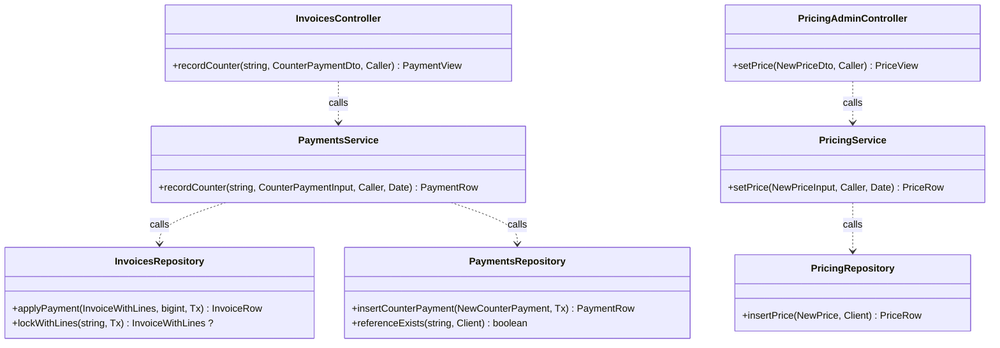

***Figure 3***: billing classes used in MF-01, UC-22, UC-56. Dependencies are call-only (`..>`). Parameter types are listed in source order; `Tx` means `Prisma.TransactionClient`, and a result or structural type the code leaves unnamed is named after what it holds. The source remains authoritative for defaults, optional arguments and full type shapes.

<!-- sdd: MF-05 class billing -->
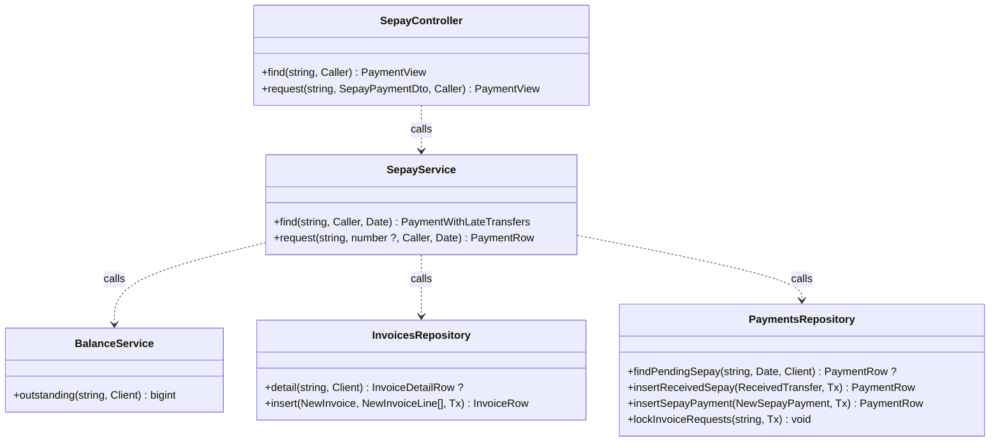

***Figure 4***: billing classes used in MF-05, UC-19 part 1 of 2. Dependencies are call-only (`..>`). Parameter types are listed in source order; `Tx` means `Prisma.TransactionClient`, and a result or structural type the code leaves unnamed is named after what it holds. The source remains authoritative for defaults, optional arguments and full type shapes.

<!-- sdd: MF-05 class billing-uc-19-part-2-of-2 -->
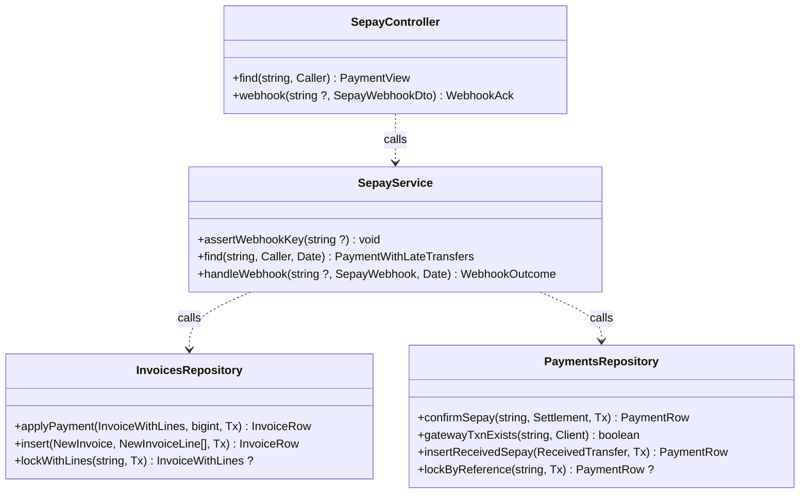

***Figure 5***: billing classes used in MF-05, UC-19 part 2 of 2. Dependencies are call-only (`..>`). Parameter types are listed in source order; `Tx` means `Prisma.TransactionClient`, and a result or structural type the code leaves unnamed is named after what it holds. The source remains authoritative for defaults, optional arguments and full type shapes.

<!-- sdd: MF-05 class billing-uc-48 -->
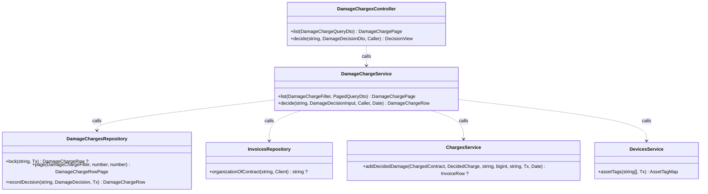

***Figure 6***: billing classes used in MF-05, UC-48. Dependencies are call-only (`..>`). Parameter types are listed in source order; `Tx` means `Prisma.TransactionClient`, and a result or structural type the code leaves unnamed is named after what it holds. The source remains authoritative for defaults, optional arguments and full type shapes.

<!-- sdd: MF-05 class billing-uc-45 -->
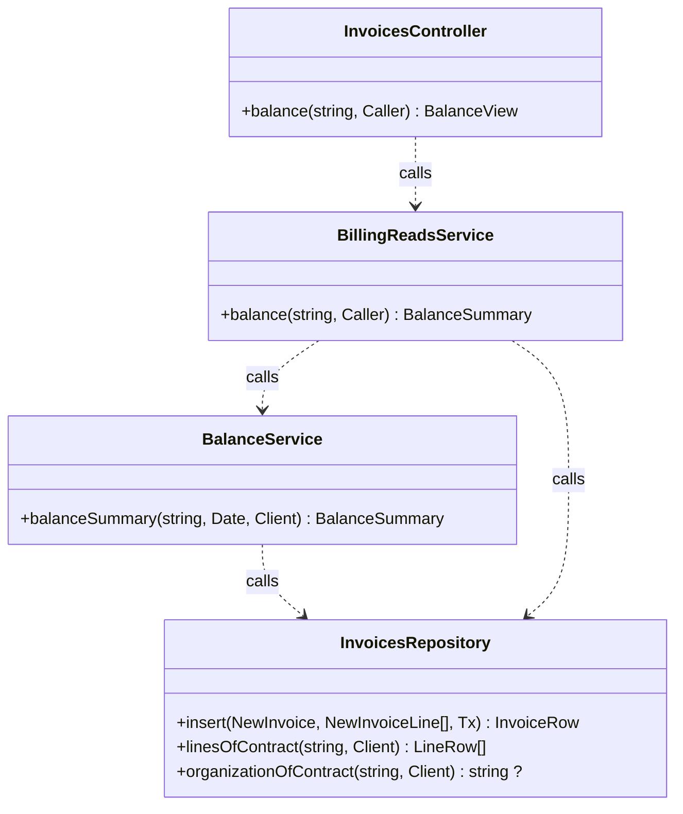

***Figure 7***: billing classes used in MF-05, UC-45. Dependencies are call-only (`..>`). Parameter types are listed in source order; `Tx` means `Prisma.TransactionClient`, and a result or structural type the code leaves unnamed is named after what it holds. The source remains authoritative for defaults, optional arguments and full type shapes.

<!-- sdd: MF-05 class billing-uc-46 -->
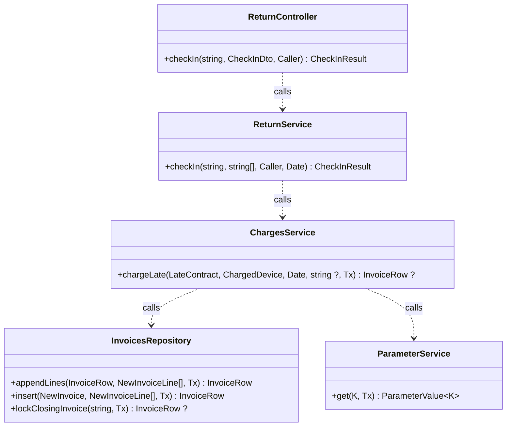

***Figure 8***: billing classes used in MF-05, UC-46. Dependencies are call-only (`..>`). Parameter types are listed in source order; `Tx` means `Prisma.TransactionClient`, and a result or structural type the code leaves unnamed is named after what it holds. The source remains authoritative for defaults, optional arguments and full type shapes.

<!-- sdd: MF-05 class billing-uc-47 -->
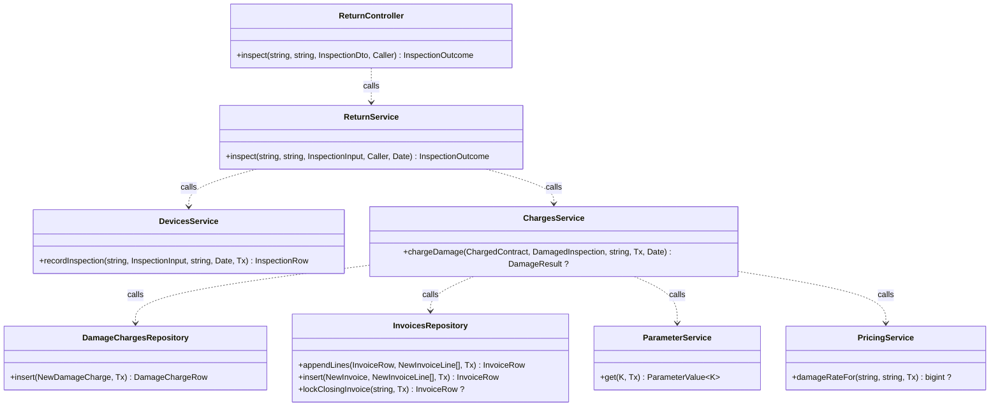

***Figure 9***: billing classes used in MF-05, UC-47. Dependencies are call-only (`..>`). Parameter types are listed in source order; `Tx` means `Prisma.TransactionClient`, and a result or structural type the code leaves unnamed is named after what it holds. The source remains authoritative for defaults, optional arguments and full type shapes.

<!-- sdd: MF-05 seq UC-19 part 1 of 2: payment request -->
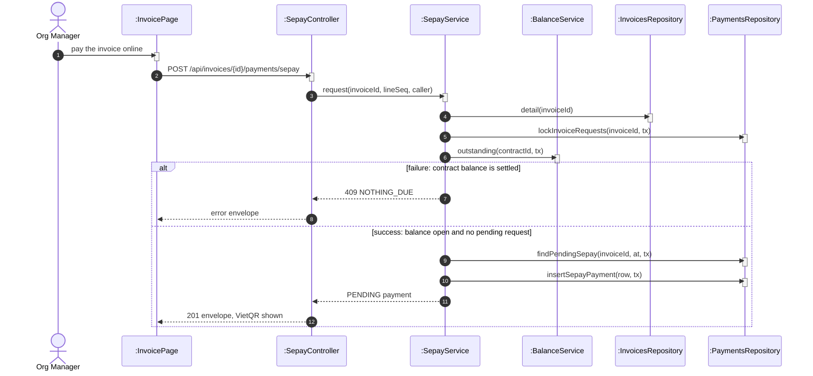

***Figure 10***: UC-19 Pay Online, part 1 of 2: the payment request. SepayController delegates to SepayService.request. The named failure is a settled contract balance (409 NOTHING_DUE). Wrong ownership is 404 and an existing pending request is 409 PAYMENT_PENDING outside these two lanes. Status polling uses SepayController.find and SepayService.find.

<!-- sdd: MF-05 seq UC-19 part 2 of 2: confirming webhook -->
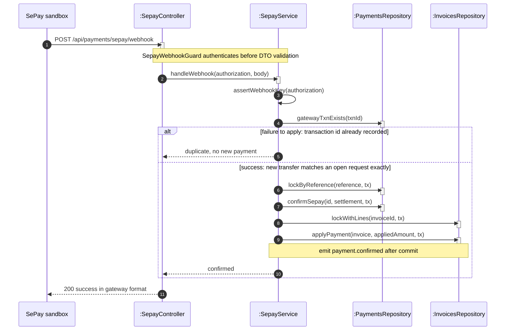

***Figure 11***: UC-19 Pay Online, part 2 of 2: the confirming webhook. SepayController.webhook is the raw-response route (D-038). SepayWebhookGuard validates the key before body validation. Gateway transaction id is the deduplication key; a different transfer for an already confirmed reference is recorded by insertReceivedSepay and applied up to the invoice due amount. Unknown references and outgoing transfers acknowledge success without recording a payment. These additional outcomes are described here, outside the named duplicate lane.

<!-- sdd: MF-05 seq UC-48 -->
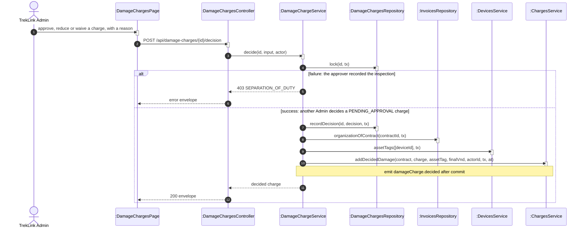

***Figure 12***: UC-48 Approve Damage Charge. Everything the decision needs is on the charge (D-081): `contractId` finds the closing invoice and `inspectorId` decides the separation of duty (BR-24, REQ-ERR-03, MSG30). Approve keeps the charged amount, Reduce takes a `finalVnd` above zero and below it (else 400 `VALIDATION_FAILED`), and Waive keeps nothing, so `addDecidedDamage` adds no line for it. Outside the named lane, an unknown charge is 404 and a charge no longer `PENDING_APPROVAL` is 409 `INVALID_STATE_TRANSITION`, both before any write. When `organizationOfContract` finds no invoice for the contract, an approved or reduced amount is also 409 `INVALID_STATE_TRANSITION` ("This charge cannot be billed before the contract has an invoice.") and the transaction rolls the decision back, while a waiver is recorded and its audit row carries no organization (reviews of #144 and #148).

<!-- sdd: MF-01 seq UC-22 -->
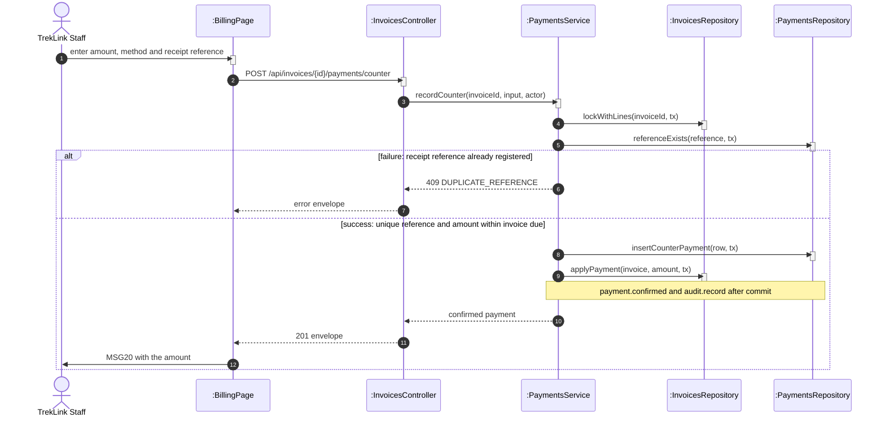

***Figure 13***: UC-22 Record Counter Payment. The same dialog is step 2 of counter handover; payment is applied to unpaid lines oldest due first. A missing invoice is 404 NOT_FOUND and an amount above its remaining amount is 400 OVERPAYMENT; those refusals are outside the named duplicate-reference lane. The invoice screen also hides payment when the contract balance is settled.

<!-- sdd: MF-01 seq UC-56 -->
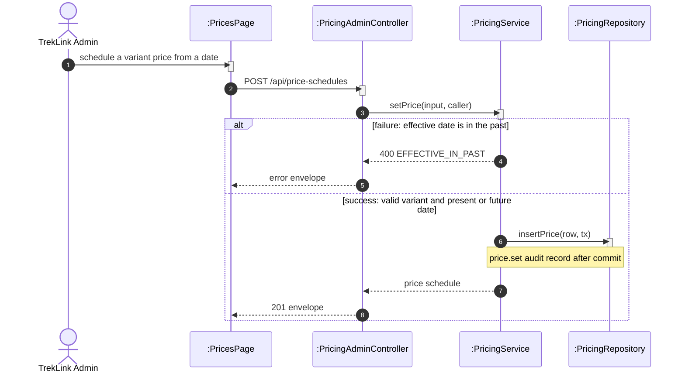

***Figure 14***: UC-56 Configure Plans and Prices. The schedule is append-only, and each contract keeps its requested price snapshot. An unknown variant fails the insert with 404 NOT_FOUND outside this two-lane view.

<!-- sdd: MF-05 seq UC-45 -->
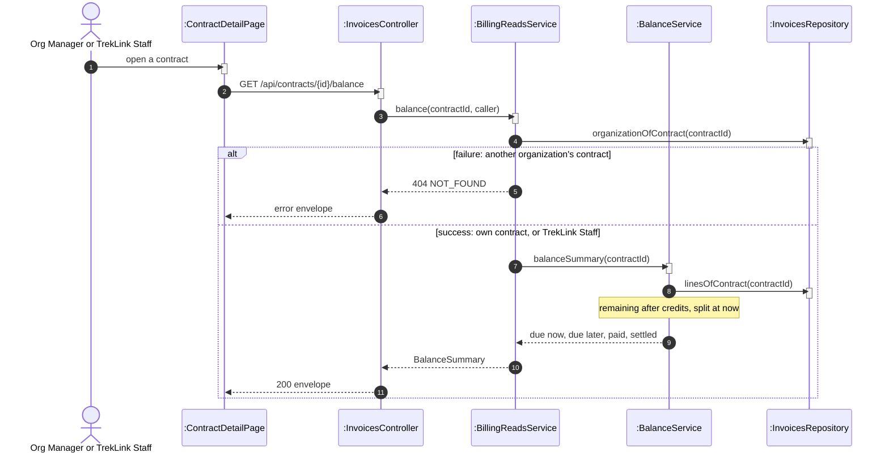

***Figure 15***: UC-45 Calculate Contract Balance. Due now is what falls due at or before the current time;
a settled contract offers no counter payment.

<!-- sdd: MF-05 seq UC-46 -->
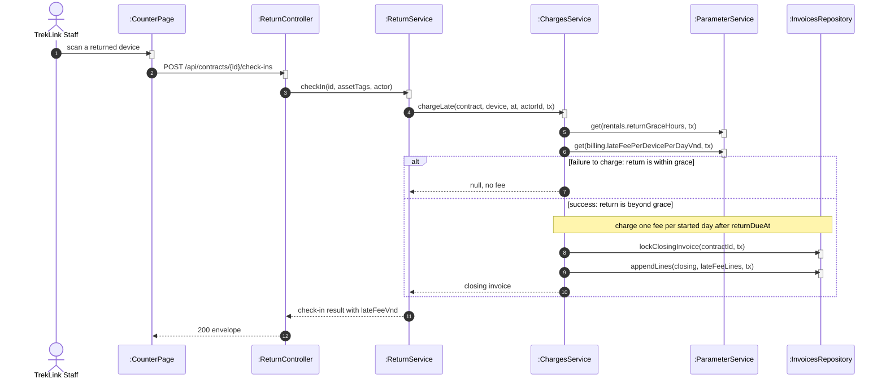

***Figure 16***: UC-46 Apply Late Fee, included in UC-43 Check In Device. chargeLate is called for each checked-in device when returnDueAt is set. Outside this two-lane grace test, the first fee creates a CLOSING invoice through InvoicesRepository.insert instead of appendLines; later fees append. Started days are counted from returnDueAt, not from the end of grace (FR-BILL-03, BR-23).

<!-- sdd: MF-05 seq UC-47 -->
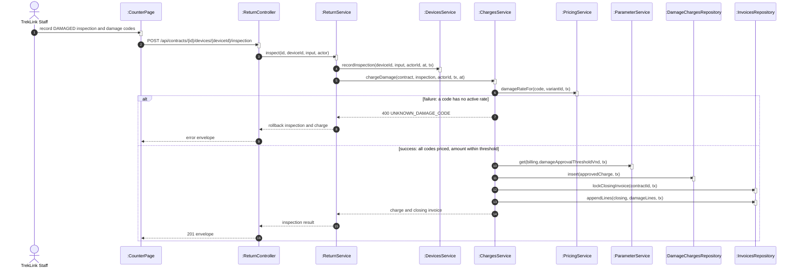

***Figure 17***: UC-47 Apply Damage Fee, included in return inspection. damageRateFor runs for every code, preferring a variant-specific rate over its generic rate. The named failure is 400 UNKNOWN_DAMAGE_CODE, which rolls back the whole inspection. Above billing.damageApprovalThresholdVnd, the alternative success inserts PENDING_APPROVAL and no invoice line; at or below it the charge is APPROVED. If no CLOSING invoice exists, InvoicesRepository.insert creates it instead of appendLines (FR-BILL-04, BR-24).
