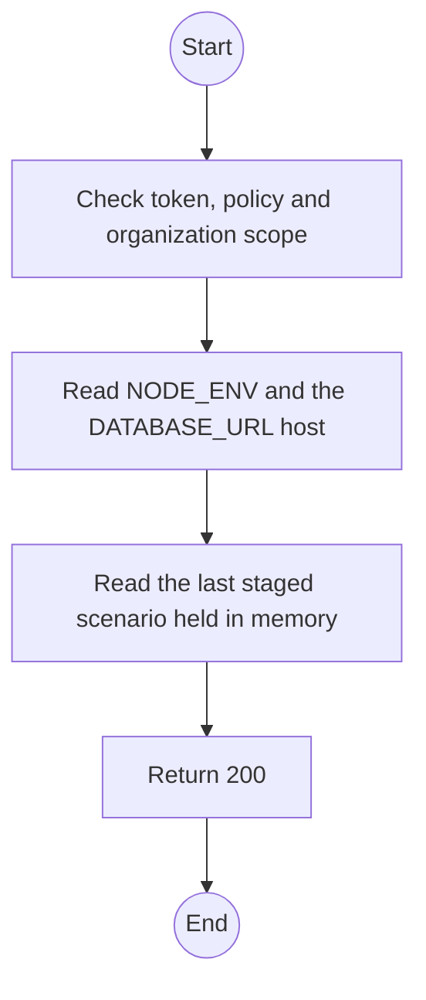
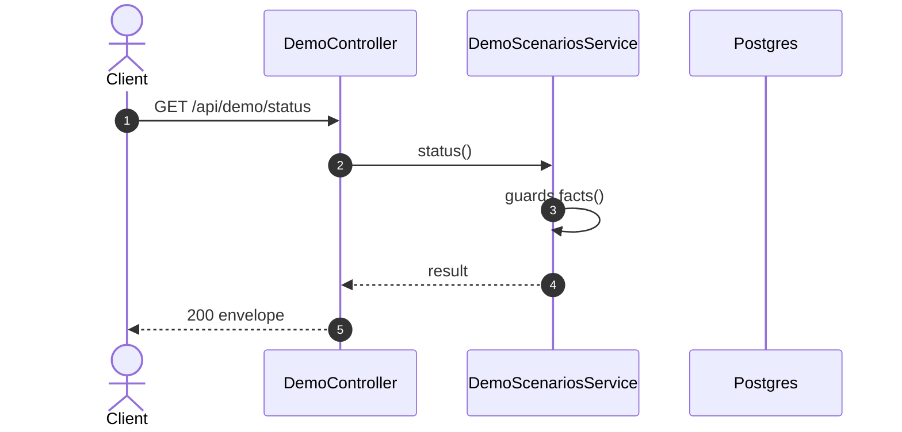

# GET /api/demo/status: Demo controls status

> Module `demo`. Generated from `scripts/specs/endpoints/demo.py` by `scripts/specs/build_api_design.py`; edit the catalog, not this file. Format: `02-templates/04-api-endpoint-template.md` with Mermaid (D-017). Envelope: D-002.

[TOC]

---
## Overview

Tells the client whether demo controls can act in this process and on this database, and which scenario was staged last. The account menu and the demo page read it to show or hide the controls.

## API Specification

| API | URL |
| --- | --- |
| GET | /api/demo/status |
| Permission | Any signed-in user |
| Traces | D-088, REQ-EVT-01 |

## Request sample

No body.

## Response sample

```json
{
  "result": {
    "enabled": true,
    "databaseLocal": true,
    "lastStaged": {
      "scenarioId": "clean",
      "at": "2026-10-20T03:15:00.000Z"
    }
  },
  "isSuccess": true,
  "statusCode": 200,
  "message": "OK"
}
```

| Field | Description | Data Type | Examples |
| --- | --- | --- | --- |
| enabled | False when `NODE_ENV` is production | boolean | `true` |
| databaseLocal | The host of `DATABASE_URL` is loopback | boolean | `true` |
| lastStaged | Last scenario staged by this process, or null | object | `null` |

## Validation

<table>
    <th>Status code</th>
    <th>Description</th>
    <th>Examples</th>
    <tbody>
        <tr>
            <td>401</td>
            <td>Missing, malformed or expired access token or API key (<code>UNAUTHENTICATED</code>)</td>
<td>

```json
{
  "result": {
    "errorCode": "UNAUTHENTICATED"
  },
  "isSuccess": false,
  "statusCode": 401,
  "message": "Authentication required."
}
```
</td>
        </tr>
        <tr>
            <td>403</td>
            <td>The caller's role, policy or organization does not allow this action (<code>FORBIDDEN</code>)</td>
<td>

```json
{
  "result": {
    "errorCode": "FORBIDDEN"
  },
  "isSuccess": false,
  "statusCode": 403,
  "message": "You do not have access to this."
}
```
</td>
        </tr>
    </tbody>
</table>

## Activity Diagram



## Sequence Diagram


