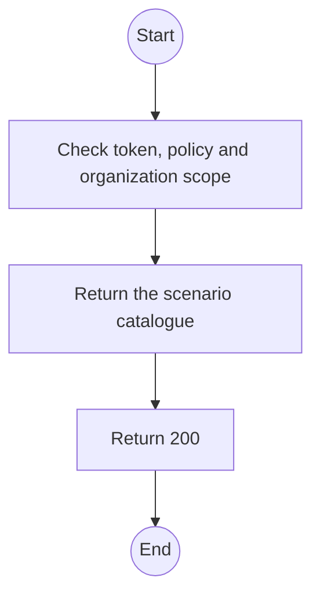
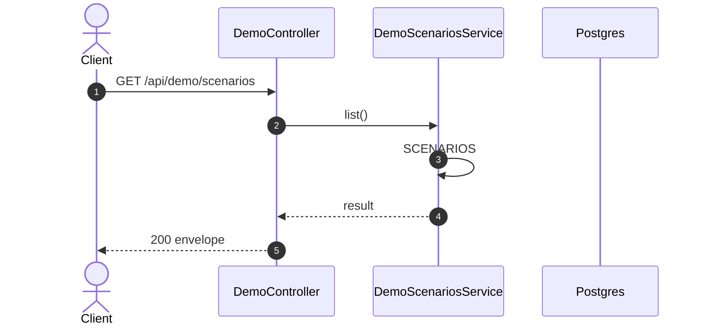

# GET /api/demo/scenarios: List demo scenarios

> Module `demo`. Generated from `scripts/specs/endpoints/demo.py` by `scripts/specs/build_api_design.py`; edit the catalog, not this file. Format: `02-templates/04-api-endpoint-template.md` with Mermaid (D-017). Envelope: D-002.

[TOC]

---
## Overview

Lists the scenarios a stage can reach, each with its main flow and whether it can be staged now.

## API Specification

| API | URL |
| --- | --- |
| GET | /api/demo/scenarios |
| Permission | TrekLink Admin (`demo.stage`) |
| Traces | D-088, REQ-EVT-02 |

## Request sample

No body.

## Response sample

```json
{
  "result": [
    {
      "id": "contract-ready-for-handover",
      "title": "Contract ready for handover",
      "flow": "MF-01",
      "summary": "RC-2026-0004 approved for five treklink-v3 units from today, holding fee paid.",
      "available": true,
      "unavailableReason": null
    },
    {
      "id": "loss-cases",
      "title": "Loss cases",
      "flow": "MF-05",
      "summary": "...",
      "available": false,
      "unavailableReason": "Needs the loss cases change (treklink-web#228)."
    }
  ],
  "isSuccess": true,
  "statusCode": 200,
  "message": "OK"
}
```

## Validation

<table>
    <th>Status code</th>
    <th>Description</th>
    <th>Examples</th>
    <tbody>
        <tr>
            <td>401</td>
            <td>Missing, malformed or expired access token or API key (<code>UNAUTHENTICATED</code>)</td>
<td>

```json
{
  "result": {
    "errorCode": "UNAUTHENTICATED"
  },
  "isSuccess": false,
  "statusCode": 401,
  "message": "Authentication required."
}
```
</td>
        </tr>
        <tr>
            <td>403</td>
            <td>The caller's role, policy or organization does not allow this action (<code>FORBIDDEN</code>)</td>
<td>

```json
{
  "result": {
    "errorCode": "FORBIDDEN"
  },
  "isSuccess": false,
  "statusCode": 403,
  "message": "You do not have access to this."
}
```
</td>
        </tr>
    </tbody>
</table>

## Activity Diagram



## Sequence Diagram


