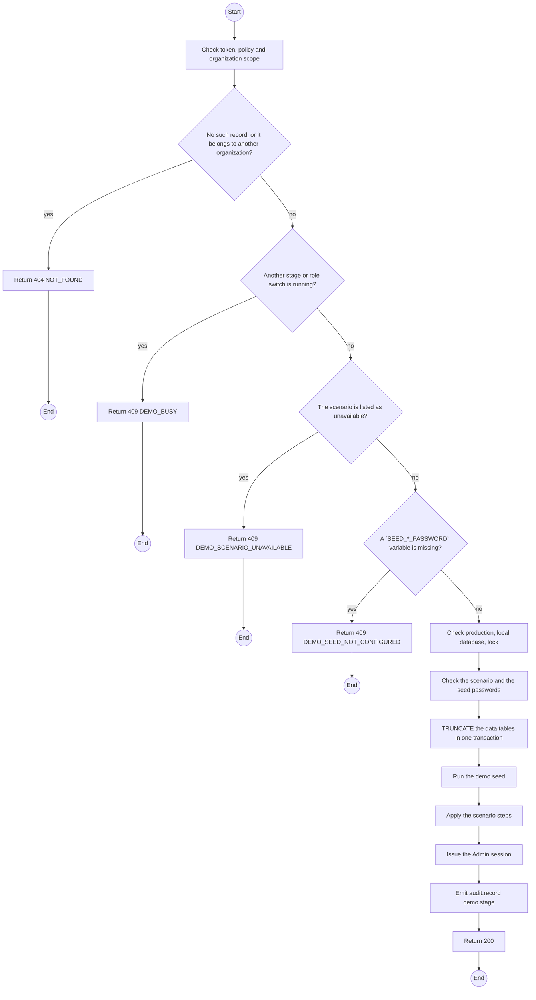
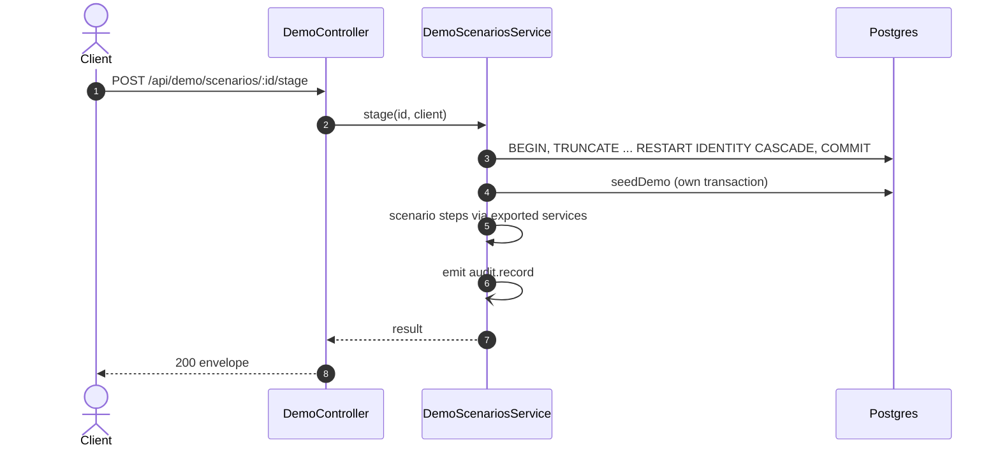

# POST /api/demo/scenarios/:id/stage: Stage a demo scenario

> Module `demo`. Generated from `scripts/specs/endpoints/demo.py` by `scripts/specs/build_api_design.py`; edit the catalog, not this file. Format: `02-templates/04-api-endpoint-template.md` with Mermaid (D-017). Envelope: D-002.

[TOC]

---
## Overview

Deletes every row of the local database except the migration-filled reference tables, runs the demo seed, applies the scenario's steps through the owning modules' services and signs the caller in again as the seeded Admin. Every other window must sign in again.

## API Specification

| API | URL |
| --- | --- |
| POST | /api/demo/scenarios/:id/stage |
| Permission | TrekLink Admin (`demo.stage`) |
| Traces | D-088, REQ-EVT-03, REQ-ERR-01 to REQ-ERR-05 |

### Path parameters

| Field | Description | Data Type | Examples |
| --- | --- | --- | --- |
| id | Scenario id | string | `term-ended` |

## Request sample

No body.

## Response sample

```json
{
  "result": {
    "scenarioId": "contract-ready-for-handover",
    "stagedAt": "2026-10-20T03:15:00.000Z",
    "records": [
      {
        "label": "Contract",
        "code": "RC-2026-0004",
        "path": "/t/counter/c0ffee00-1234-4abc-9def-001122334455"
      }
    ],
    "firstSteps": [
      "Window B, Staff: Contracts, tab Approved, RC-2026-0004.",
      "Open the contract, then Open the counter."
    ],
    "session": {
      "accessToken": "eyJhbGciOi...",
      "accessTokenExpiresIn": 900,
      "refreshToken": "rt_...",
      "refreshTokenExpiresIn": 604800,
      "user": {
        "id": "3f2e1d0c-9b8a-4c7d-8e6f-5a4b3c2d1e0f",
        "email": "admin@treklink.local",
        "fullName": "Demo Admin",
        "accountType": "TREKLINK",
        "roles": [
          "ADMIN"
        ],
        "organization": null
      }
    }
  },
  "isSuccess": true,
  "statusCode": 200,
  "message": "Scenario staged"
}
```

| Field | Description | Data Type | Examples |
| --- | --- | --- | --- |
| records[].path | Frontend route the panel links to | string | `/t/counter/...` |
| session | Token pair and account of the seeded Admin, as a sign-in returns them | object | see sample |

## Validation

<table>
    <th>Status code</th>
    <th>Description</th>
    <th>Examples</th>
    <tbody>
        <tr>
            <td>401</td>
            <td>Missing, malformed or expired access token or API key (<code>UNAUTHENTICATED</code>)</td>
<td>

```json
{
  "result": {
    "errorCode": "UNAUTHENTICATED"
  },
  "isSuccess": false,
  "statusCode": 401,
  "message": "Authentication required."
}
```
</td>
        </tr>
        <tr>
            <td>403</td>
            <td>The caller's role, policy or organization does not allow this action (<code>FORBIDDEN</code>)</td>
<td>

```json
{
  "result": {
    "errorCode": "FORBIDDEN"
  },
  "isSuccess": false,
  "statusCode": 403,
  "message": "You do not have access to this."
}
```
</td>
        </tr>
        <tr>
            <td>404</td>
            <td>No such record, or it belongs to another organization (<code>NOT_FOUND</code>)</td>
<td>

```json
{
  "result": {
    "errorCode": "NOT_FOUND"
  },
  "isSuccess": false,
  "statusCode": 404,
  "message": "Scenario not found."
}
```
</td>
        </tr>
        <tr>
            <td>403</td>
            <td>`NODE_ENV` is `production` (<code>DEMO_DISABLED</code>)</td>
<td>

```json
{
  "result": {
    "errorCode": "DEMO_DISABLED"
  },
  "isSuccess": false,
  "statusCode": 403,
  "message": "Demo controls are disabled in production."
}
```
</td>
        </tr>
        <tr>
            <td>403</td>
            <td>The host of `DATABASE_URL` is not a loopback address (<code>DEMO_DATABASE_NOT_LOCAL</code>)</td>
<td>

```json
{
  "result": {
    "errorCode": "DEMO_DATABASE_NOT_LOCAL"
  },
  "isSuccess": false,
  "statusCode": 403,
  "message": "Demo controls run only against a local database."
}
```
</td>
        </tr>
        <tr>
            <td>409</td>
            <td>Another stage or role switch is running (<code>DEMO_BUSY</code>)</td>
<td>

```json
{
  "result": {
    "errorCode": "DEMO_BUSY"
  },
  "isSuccess": false,
  "statusCode": 409,
  "message": "A demo action is already running. Try again in a moment."
}
```
</td>
        </tr>
        <tr>
            <td>409</td>
            <td>The scenario is listed as unavailable (<code>DEMO_SCENARIO_UNAVAILABLE</code>)</td>
<td>

```json
{
  "result": {
    "errorCode": "DEMO_SCENARIO_UNAVAILABLE"
  },
  "isSuccess": false,
  "statusCode": 409,
  "message": "Needs the loss cases change (treklink-web#228)."
}
```
</td>
        </tr>
        <tr>
            <td>409</td>
            <td>A `SEED_*_PASSWORD` variable is missing (<code>DEMO_SEED_NOT_CONFIGURED</code>)</td>
<td>

```json
{
  "result": {
    "errorCode": "DEMO_SEED_NOT_CONFIGURED"
  },
  "isSuccess": false,
  "statusCode": 409,
  "message": "Set SEED_ADMIN_PASSWORD before staging."
}
```
</td>
        </tr>
    </tbody>
</table>

## Activity Diagram



## Sequence Diagram


