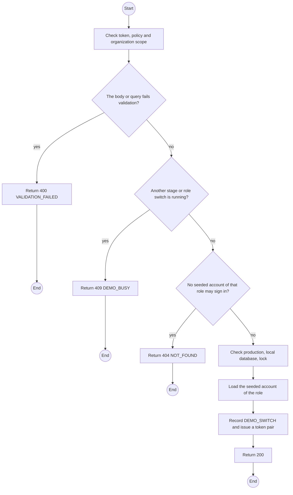
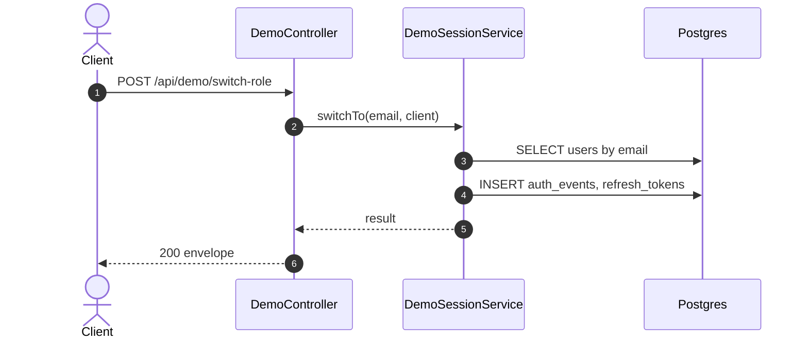

# POST /api/demo/switch-role: Switch to a seeded role

> Module `demo`. Generated from `scripts/specs/endpoints/demo.py` by `scripts/specs/build_api_design.py`; edit the catalog, not this file. Format: `02-templates/04-api-endpoint-template.md` with Mermaid (D-017). Envelope: D-002.

[TOC]

---
## Overview

Issues a normal token pair for the seeded account of the chosen role, as a sign-in would, and records an auth event `DEMO_SWITCH`. A presenter signed in as the Manager can switch back to the Admin.

## API Specification

| API | URL |
| --- | --- |
| POST | /api/demo/switch-role |
| Permission | Any seeded role (`demo.switchRole`, `demo.switchRole.org`) |
| Traces | D-088, REQ-EVT-04, REQ-ERR-01 to REQ-ERR-03, REQ-ERR-06 |

## Request sample

```json
{
  "role": "ORG_MANAGER"
}
```

| Field | Description | Data Type | Required | Examples |
| --- | --- | --- | --- | --- |
| role | `ADMIN`, `STAFF`, `ORG_MANAGER` or `ORG_OPERATOR` | string | yes | `ORG_MANAGER` |

## Response sample

```json
{
  "result": {
    "accessToken": "eyJhbGciOi...",
    "accessTokenExpiresIn": 900,
    "refreshToken": "rt_...",
    "refreshTokenExpiresIn": 604800,
    "user": {
      "id": "3f2e1d0c-9b8a-4c7d-8e6f-5a4b3c2d1e0f",
      "email": "manager@treklink.local",
      "fullName": "Demo Manager",
      "accountType": "ORGANIZATION",
      "roles": [
        "ORG_MANAGER"
      ],
      "organization": null
    }
  },
  "isSuccess": true,
  "statusCode": 200,
  "message": "Signed in"
}
```

## Validation

<table>
    <th>Status code</th>
    <th>Description</th>
    <th>Examples</th>
    <tbody>
        <tr>
            <td>400</td>
            <td>The body or query fails validation (<code>VALIDATION_FAILED</code>)</td>
<td>

```json
{
  "result": {
    "errorCode": "VALIDATION_FAILED"
  },
  "isSuccess": false,
  "statusCode": 400,
  "message": "{field} is required."
}
```
</td>
        </tr>
        <tr>
            <td>401</td>
            <td>Missing, malformed or expired access token or API key (<code>UNAUTHENTICATED</code>)</td>
<td>

```json
{
  "result": {
    "errorCode": "UNAUTHENTICATED"
  },
  "isSuccess": false,
  "statusCode": 401,
  "message": "Authentication required."
}
```
</td>
        </tr>
        <tr>
            <td>403</td>
            <td>The caller's role, policy or organization does not allow this action (<code>FORBIDDEN</code>)</td>
<td>

```json
{
  "result": {
    "errorCode": "FORBIDDEN"
  },
  "isSuccess": false,
  "statusCode": 403,
  "message": "You do not have access to this."
}
```
</td>
        </tr>
        <tr>
            <td>403</td>
            <td>`NODE_ENV` is `production` (<code>DEMO_DISABLED</code>)</td>
<td>

```json
{
  "result": {
    "errorCode": "DEMO_DISABLED"
  },
  "isSuccess": false,
  "statusCode": 403,
  "message": "Demo controls are disabled in production."
}
```
</td>
        </tr>
        <tr>
            <td>403</td>
            <td>The host of `DATABASE_URL` is not a loopback address (<code>DEMO_DATABASE_NOT_LOCAL</code>)</td>
<td>

```json
{
  "result": {
    "errorCode": "DEMO_DATABASE_NOT_LOCAL"
  },
  "isSuccess": false,
  "statusCode": 403,
  "message": "Demo controls run only against a local database."
}
```
</td>
        </tr>
        <tr>
            <td>409</td>
            <td>Another stage or role switch is running (<code>DEMO_BUSY</code>)</td>
<td>

```json
{
  "result": {
    "errorCode": "DEMO_BUSY"
  },
  "isSuccess": false,
  "statusCode": 409,
  "message": "A demo action is already running. Try again in a moment."
}
```
</td>
        </tr>
        <tr>
            <td>404</td>
            <td>No seeded account of that role may sign in (<code>NOT_FOUND</code>)</td>
<td>

```json
{
  "result": {
    "errorCode": "NOT_FOUND"
  },
  "isSuccess": false,
  "statusCode": 404,
  "message": "No seeded account for this role. Stage a scenario first."
}
```
</td>
        </tr>
    </tbody>
</table>

## Activity Diagram



## Sequence Diagram


