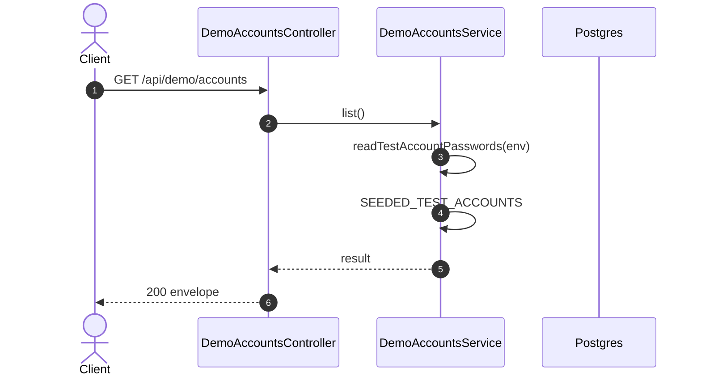

# GET /api/demo/accounts: List the sandbox test accounts

> Module `demo`. Generated from `scripts/specs/endpoints/demo.py` by `scripts/specs/build_api_design.py`; edit the catalog, not this file. Format: `02-templates/04-api-endpoint-template.md` with Mermaid (D-017). Envelope: D-002.

[TOC]

---
## Overview

Lists every account the demo seed creates, with its password, so a tester signs in as any role without asking anyone. The root page and the sign-in page show it in the "Sandbox test accounts" box. The passwords are read from the `SEED_*_PASSWORD` variables on every request, never stored and never logged; the response carries `Cache-Control: no-store`. The route belongs to `DemoAccountsModule`, loaded only when `DEMO_TEST_ACCOUNTS_ENABLED` is `true`, independently of the control panel. It is read-only and touches no database, so it answers in any `NODE_ENV` and on any database, the Vercel production included (D-089); the guards of the control panel routes stay as they are.

## API Specification

| API | URL |
| --- | --- |
| GET | /api/demo/accounts |
| Permission | Public (`DEMO_TEST_ACCOUNTS_ENABLED`) |
| Traces | D-088 amendment of 2026-11-01, D-089, REQ-UBI-01, REQ-EVT-05, REQ-ERR-05 |

## Request sample

No body.

## Response sample

```json
{
  "result": {
    "accounts": [
      {
        "role": "ADMIN",
        "roleLabel": "TrekLink Admin",
        "email": "admin@treklink.local",
        "password": "<SEED_ADMIN_PASSWORD>",
        "fullName": "Demo Admin",
        "organization": null
      },
      {
        "role": "STAFF",
        "roleLabel": "TrekLink Staff",
        "email": "staff@treklink.local",
        "password": "<SEED_STAFF_PASSWORD>",
        "fullName": "Demo Staff",
        "organization": null
      },
      {
        "role": "ORG_MANAGER",
        "roleLabel": "Org Manager",
        "email": "manager@treklink.local",
        "password": "<SEED_MANAGER_PASSWORD>",
        "fullName": "Demo Manager",
        "organization": "ORG-0001"
      },
      {
        "role": "ORG_OPERATOR",
        "roleLabel": "Org Operator",
        "email": "operator@treklink.local",
        "password": "<SEED_OPERATOR_PASSWORD>",
        "fullName": "Demo Operator",
        "organization": "ORG-0001"
      }
    ]
  },
  "isSuccess": true,
  "statusCode": 200,
  "message": "OK"
}
```

| Field | Description | Data Type | Examples |
| --- | --- | --- | --- |
| accounts | Every seeded account, in the order Admin, Staff, Manager, Operator | array | see sample |
| accounts[].password | The value of the account's `SEED_*_PASSWORD` variable at request time | string | `<SEED_ADMIN_PASSWORD>` |
| accounts[].organization | Organization code of a member account, null for a TrekLink account | string | `ORG-0001` |

## Validation

<table>
    <th>Status code</th>
    <th>Description</th>
    <th>Examples</th>
    <tbody>
        <tr>
            <td>404</td>
            <td>`DEMO_TEST_ACCOUNTS_ENABLED` is not `true`: the route does not exist (<code>NOT_FOUND</code>)</td>
<td>

```json
{
  "result": {
    "errorCode": "NOT_FOUND"
  },
  "isSuccess": false,
  "statusCode": 404,
  "message": "Cannot GET /api/demo/accounts"
}
```
</td>
        </tr>
        <tr>
            <td>409</td>
            <td>A `SEED_*_PASSWORD` variable is missing (<code>DEMO_SEED_NOT_CONFIGURED</code>)</td>
<td>

```json
{
  "result": {
    "errorCode": "DEMO_SEED_NOT_CONFIGURED"
  },
  "isSuccess": false,
  "statusCode": 409,
  "message": "Set SEED_ADMIN_PASSWORD before listing the test accounts."
}
```
</td>
        </tr>
    </tbody>
</table>

## Activity Diagram

```mermaid
flowchart TB
    S((Start))
    A0["Accept request"]
    S --> A0
    D1{"`DEMO_TEST_ACCOUNTS_ENABLED` is not `true`: the route does not exist?"}
    A0 --> D1
    E1["Return 404 NOT_FOUND"]
    D1 -->|yes| E1
    E1 --> X1((End))
    D2{"A `SEED_*_PASSWORD` variable is missing?"}
    D1 -->|no| D2
    E2["Return 409 DEMO_SEED_NOT_CONFIGURED"]
    D2 -->|yes| E2
    E2 --> X2((End))
    P0["Read the SEED_*_PASSWORD variables"]
    D2 -->|no| P0
    P1["Map SEEDED_TEST_ACCOUNTS, the compiled copy of the seed list"]
    P0 --> P1
    OK["Return 200"]
    P1 --> OK
    OK --> Z((End))
```

## Sequence Diagram


