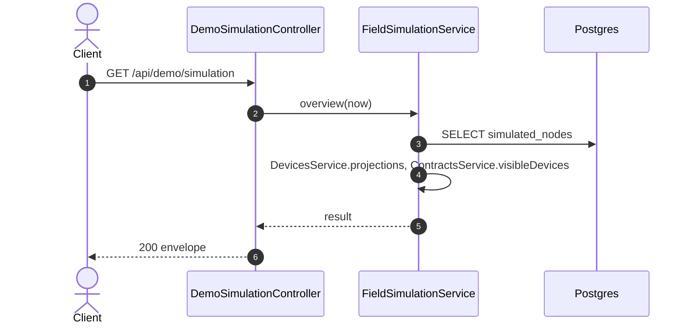

# GET /api/demo/simulation: Read the field simulation

> Module `demo`. Generated from `scripts/specs/endpoints/demo.py` by `scripts/specs/build_api_design.py`; edit the catalog, not this file. Format: `02-templates/04-api-endpoint-template.md` with Mermaid (D-017). Envelope: D-002.

[TOC]

---
## Overview

Lists what the field simulation panel needs: the trails (OpenStreetMap, © OpenStreetMap contributors, ODbL), the patterns, the movement styles, the devices that can be simulated and the simulated nodes, running ones first, then the twenty most recently stopped. `databaseAllowed` tells the screen whether the writes 07 to 10 can act on this database. The route belongs to `DemoSimulationModule`, loaded only when `DEMO_SIMULATION_ENABLED` is `true`; it is independent of `DEMO_CONTROLS_ENABLED` and is not refused in production, because the Vercel staging runs as production (D-094).

## API Specification

| API | URL |
| --- | --- |
| GET | /api/demo/simulation |
| Permission | TrekLink Admin (`demo.simulate`) |
| Traces | D-093 amendment, D-094, REQ-SIM-01, REQ-SIM-08, REQ-SIM-09 |

## Request sample

No body.

## Response sample

```json
{
  "result": {
    "databaseAllowed": true,
    "trails": [
      {
        "id": "ta-nang-phan-dung",
        "name": "Ta Nang to Phan Dung",
        "region": "Lam Dong",
        "lengthMetres": 7200,
        "pointCount": 63,
        "source": {
          "osmWayIds": [
            1164619760
          ],
          "readOn": "2026-11-01",
          "simplification": "Douglas-Peucker, 10 m, 189 to 63 points"
        }
      }
    ],
    "patterns": [
      "WALK",
      "STOP",
      "STRAY",
      "SILENT",
      "LOW_BATTERY"
    ],
    "styles": [
      "JOGGER",
      "HIKER",
      "CAMPER",
      "EXPLORER",
      "TRAIL_WALKER",
      "WANDERER",
      "GROUP_FOLLOWER",
      "STRAGGLER"
    ],
    "devices": [
      {
        "id": "0d3f6a2b-7e11-4c55-8f0a-2b1c9e7d4a10",
        "assetTag": "TL-0010",
        "nodeId": "!de00000a",
        "status": "RENTED",
        "organization": {
          "id": "5b1d2c0e-7f3a-4e21-9c8d-1a2b3c4d5e6f",
          "code": "ORG-0001",
          "name": "TrekLink Demo Tours Co., Ltd."
        },
        "runningNodeId": "4b3a2918-0716-4f5e-8d4c-3b2a19080706"
      }
    ],
    "nodes": [
      {
        "id": "4b3a2918-0716-4f5e-8d4c-3b2a19080706",
        "deviceId": "0d3f6a2b-7e11-4c55-8f0a-2b1c9e7d4a10",
        "assetTag": "TL-0010",
        "nodeId": "!de00000a",
        "organization": {
          "id": "5b1d2c0e-7f3a-4e21-9c8d-1a2b3c4d5e6f",
          "code": "ORG-0001",
          "name": "TrekLink Demo Tours Co., Ltd."
        },
        "trailId": "ta-nang-phan-dung",
        "pattern": "WALK",
        "style": "HIKER",
        "speedMetresPerMinute": 60,
        "status": "RUNNING",
        "sosKind": null,
        "sosSince": null,
        "position": {
          "lat": 11.497591,
          "lon": 108.568646
        },
        "batteryPct": 99,
        "lastPacketAt": "2026-10-20T03:15:00.000Z",
        "simulated": true,
        "version": 0,
        "createdAt": "2026-10-20T03:15:00.000Z",
        "updatedAt": "2026-10-20T03:15:00.000Z"
      }
    ]
  },
  "isSuccess": true,
  "statusCode": 200,
  "message": "OK"
}
```

| Field | Description | Data Type | Examples |
| --- | --- | --- | --- |
| databaseAllowed | The database is on a loopback host or named `treklink_prod` (REQ-SIM-02) | boolean | `true` |
| styles | The movement styles of design §9.1, in the order the seed picks them | array | see sample |
| trails[].lengthMetres | Length of the simplified line | int | `7200` |
| trails[].source | OpenStreetMap way ids, the date they were read through the Overpass API, the simplification | object | see sample |
| devices | Every device not `DISPOSED`, by asset tag; each has a `nodeNum` (devices schema) | array | see sample |
| devices[].runningNodeId | The `RUNNING` simulated node of the device, or null | uuid | `null` |
| nodeId | Mesh node id the packets carry, `!` and eight hex digits of `nodeNum` | string | `!de00000a` |
| organization | Organization holding the device now, or null when it is not handed over | object | see sample |
| position | Position the pattern gives at the time of the read (the stop time for a `STOPPED` node) | object | see sample |
| batteryPct | Battery the pattern gives at the same time, 5 to 100 | int | `99` |
| lastPacketAt | Last time the device was heard (device projection `lastSeenAt`), or null | datetime | `2026-10-20T03:15:00.000Z` |
| style | Movement style while the pattern walks (design §9.1), or null for a node started before the styles, which keeps the steady walk at `speedMetresPerMinute` | string | `HIKER` |
| sosKind | `SOS` or `FALL` while an SOS is active, otherwise null | string | `null` |
| version | Compare-and-set version for 08 and 09 | int | `0` |

## Validation

<table>
    <th>Status code</th>
    <th>Description</th>
    <th>Examples</th>
    <tbody>
        <tr>
            <td>401</td>
            <td>Missing, malformed or expired access token or API key (<code>UNAUTHENTICATED</code>)</td>
<td>

```json
{
  "result": {
    "errorCode": "UNAUTHENTICATED"
  },
  "isSuccess": false,
  "statusCode": 401,
  "message": "Authentication required."
}
```
</td>
        </tr>
        <tr>
            <td>403</td>
            <td>The caller's role, policy or organization does not allow this action (<code>FORBIDDEN</code>)</td>
<td>

```json
{
  "result": {
    "errorCode": "FORBIDDEN"
  },
  "isSuccess": false,
  "statusCode": 403,
  "message": "You do not have access to this."
}
```
</td>
        </tr>
        <tr>
            <td>404</td>
            <td>`DEMO_SIMULATION_ENABLED` is not `true`: the route does not exist (<code>NOT_FOUND</code>)</td>
<td>

```json
{
  "result": {
    "errorCode": "NOT_FOUND"
  },
  "isSuccess": false,
  "statusCode": 404,
  "message": "Cannot GET /api/demo/simulation"
}
```
</td>
        </tr>
    </tbody>
</table>

## Activity Diagram

```mermaid
flowchart TB
    S((Start))
    A0["Check token, policy and organization scope"]
    S --> A0
    D1{"`DEMO_SIMULATION_ENABLED` is not `true`: the route does not exist?"}
    A0 --> D1
    E1["Return 404 NOT_FOUND"]
    D1 -->|yes| E1
    E1 --> X1((End))
    P0["Read the trails and patterns (compiled data)"]
    D1 -->|no| P0
    P1["Read the devices and their holders"]
    P0 --> P1
    P2["Read the simulated nodes and their device projections"]
    P1 --> P2
    P3["Compute each node's position and battery now"]
    P2 --> P3
    OK["Return 200"]
    P3 --> OK
    OK --> Z((End))
```

## Sequence Diagram


