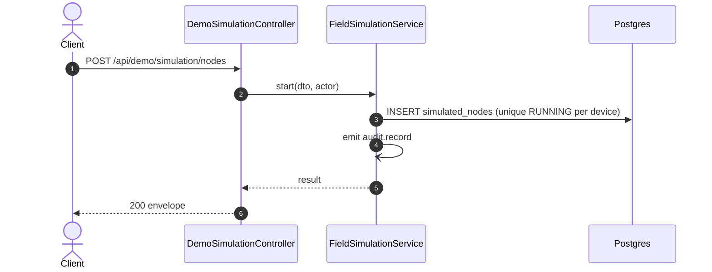

# POST /api/demo/simulation/nodes: Start a simulated node

> Module `demo`. Generated from `scripts/specs/endpoints/demo.py` by `scripts/specs/build_api_design.py`; edit the catalog, not this file. Format: `02-templates/04-api-endpoint-template.md` with Mermaid (D-017). Envelope: D-002.

[TOC]

---
## Overview

Starts a simulated node for a device on a trail with a pattern. From the next run of the field data simulator (gateway-sync design §2) the node sends one position and one telemetry packet per `gatewaySync.simulatorIntervalSeconds` through the node uplink path, so positions, staleness, incidents and alerts behave as for a real node; every field event it causes is stored with `simulated = true`. A device runs as at most one node at a time.

## API Specification

| API | URL |
| --- | --- |
| POST | /api/demo/simulation/nodes |
| Permission | TrekLink Admin (`demo.simulate`) |
| Traces | D-093 amendment, REQ-SIM-02, REQ-SIM-03, REQ-SIM-04, REQ-SIM-07 |

## Request sample

```json
{
  "deviceId": "0d3f6a2b-7e11-4c55-8f0a-2b1c9e7d4a10",
  "trailId": "ta-nang-phan-dung",
  "pattern": "WALK"
}
```

| Field | Description | Data Type | Required | Examples |
| --- | --- | --- | --- | --- |
| deviceId | Device to simulate | uuid | yes | `0d3f6a2b-...` |
| trailId | Id of a trail of 06 | string | yes | `ta-nang-phan-dung` |
| pattern | `WALK`, `STOP`, `STRAY`, `SILENT` or `LOW_BATTERY` | string | yes | `WALK` |
| speedMetresPerMinute | Walking speed, 10 to 300; default 60 | int | no | `60` |
| startMetres | Distance along the trail to start from, 0 to its length; default 0 | int | no | `0` |

## Response sample

```json
{
  "result": {
    "id": "4b3a2918-0716-4f5e-8d4c-3b2a19080706",
    "deviceId": "0d3f6a2b-7e11-4c55-8f0a-2b1c9e7d4a10",
    "assetTag": "TL-0010",
    "nodeId": "!de00000a",
    "organization": {
      "id": "5b1d2c0e-7f3a-4e21-9c8d-1a2b3c4d5e6f",
      "code": "ORG-0001",
      "name": "TrekLink Demo Tours Co., Ltd."
    },
    "trailId": "ta-nang-phan-dung",
    "pattern": "WALK",
    "speedMetresPerMinute": 60,
    "status": "RUNNING",
    "sosKind": null,
    "sosSince": null,
    "position": {
      "lat": 11.497591,
      "lon": 108.568646
    },
    "batteryPct": 99,
    "lastPacketAt": "2026-10-20T03:15:00.000Z",
    "simulated": true,
    "version": 0,
    "createdAt": "2026-10-20T03:15:00.000Z",
    "updatedAt": "2026-10-20T03:15:00.000Z"
  },
  "isSuccess": true,
  "statusCode": 200,
  "message": "Simulated node started"
}
```

| Field | Description | Data Type | Examples |
| --- | --- | --- | --- |
| nodeId | Mesh node id the packets carry, `!` and eight hex digits of `nodeNum` | string | `!de00000a` |
| organization | Organization holding the device now, or null when it is not handed over | object | see sample |
| position | Position the pattern gives at the time of the read (the stop time for a `STOPPED` node) | object | see sample |
| batteryPct | Battery the pattern gives at the same time, 5 to 100 | int | `99` |
| lastPacketAt | Last time the device was heard (device projection `lastSeenAt`), or null | datetime | `2026-10-20T03:15:00.000Z` |
| sosKind | `SOS` or `FALL` while an SOS is active, otherwise null | string | `null` |
| version | Compare-and-set version for 08 and 09 | int | `0` |

## Validation

<table>
    <th>Status code</th>
    <th>Description</th>
    <th>Examples</th>
    <tbody>
        <tr>
            <td>400</td>
            <td>The body or query fails validation (<code>VALIDATION_FAILED</code>)</td>
<td>

```json
{
  "result": {
    "errorCode": "VALIDATION_FAILED"
  },
  "isSuccess": false,
  "statusCode": 400,
  "message": "{field} is required."
}
```
</td>
        </tr>
        <tr>
            <td>401</td>
            <td>Missing, malformed or expired access token or API key (<code>UNAUTHENTICATED</code>)</td>
<td>

```json
{
  "result": {
    "errorCode": "UNAUTHENTICATED"
  },
  "isSuccess": false,
  "statusCode": 401,
  "message": "Authentication required."
}
```
</td>
        </tr>
        <tr>
            <td>403</td>
            <td>The caller's role, policy or organization does not allow this action (<code>FORBIDDEN</code>)</td>
<td>

```json
{
  "result": {
    "errorCode": "FORBIDDEN"
  },
  "isSuccess": false,
  "statusCode": 403,
  "message": "You do not have access to this."
}
```
</td>
        </tr>
        <tr>
            <td>403</td>
            <td>The database of `DATABASE_URL` or `DATABASE_DIRECT_URL` is neither on a loopback host nor named `treklink_prod` (<code>DEMO_DATABASE_NOT_ALLOWED</code>)</td>
<td>

```json
{
  "result": {
    "errorCode": "DEMO_DATABASE_NOT_ALLOWED"
  },
  "isSuccess": false,
  "statusCode": 403,
  "message": "The field simulation runs only on a local database or the Vercel staging."
}
```
</td>
        </tr>
        <tr>
            <td>404</td>
            <td>`DEMO_SIMULATION_ENABLED` is not `true`: the route does not exist (<code>NOT_FOUND</code>)</td>
<td>

```json
{
  "result": {
    "errorCode": "NOT_FOUND"
  },
  "isSuccess": false,
  "statusCode": 404,
  "message": "Cannot GET /api/demo/simulation"
}
```
</td>
        </tr>
        <tr>
            <td>400</td>
            <td>The trail is unknown, or `startMetres` is past its end (<code>VALIDATION_FAILED</code>)</td>
<td>

```json
{
  "result": {
    "errorCode": "VALIDATION_FAILED"
  },
  "isSuccess": false,
  "statusCode": 400,
  "message": "Unknown trail."
}
```
</td>
        </tr>
        <tr>
            <td>404</td>
            <td>No such device, or it is `DISPOSED` (<code>NOT_FOUND</code>)</td>
<td>

```json
{
  "result": {
    "errorCode": "NOT_FOUND"
  },
  "isSuccess": false,
  "statusCode": 404,
  "message": "Device not found."
}
```
</td>
        </tr>
        <tr>
            <td>409</td>
            <td>The device already runs as a simulated node (<code>DEMO_NODE_RUNNING</code>)</td>
<td>

```json
{
  "result": {
    "errorCode": "DEMO_NODE_RUNNING"
  },
  "isSuccess": false,
  "statusCode": 409,
  "message": "TL-0010 already runs as a simulated node. Stop it first."
}
```
</td>
        </tr>
    </tbody>
</table>

## Activity Diagram

```mermaid
flowchart TB
    S((Start))
    A0["Check token, policy and organization scope"]
    S --> A0
    D1{"The body or query fails validation?"}
    A0 --> D1
    E1["Return 400 VALIDATION_FAILED"]
    D1 -->|yes| E1
    E1 --> X1((End))
    D2{"`DEMO_SIMULATION_ENABLED` is not `true`: the route does not exist?"}
    D1 -->|no| D2
    E2["Return 404 NOT_FOUND"]
    D2 -->|yes| E2
    E2 --> X2((End))
    D3{"The trail is unknown, or `startMetres` is past its end?"}
    D2 -->|no| D3
    E3["Return 400 VALIDATION_FAILED"]
    D3 -->|yes| E3
    E3 --> X3((End))
    D4{"No such device, or it is `DISPOSED`?"}
    D3 -->|no| D4
    E4["Return 404 NOT_FOUND"]
    D4 -->|yes| E4
    E4 --> X4((End))
    D5{"The device already runs as a simulated node?"}
    D4 -->|no| D5
    E5["Return 409 DEMO_NODE_RUNNING"]
    D5 -->|yes| E5
    E5 --> X5((End))
    P0["Check the database (loopback or treklink_prod)"]
    D5 -->|no| P0
    P1["Load the device and the trail"]
    P0 --> P1
    P2["INSERT simulated_nodes with the anchor at the start point"]
    P1 --> P2
    P3["Emit audit.record demo.simulation.start"]
    P2 --> P3
    OK["Return 200"]
    P3 --> OK
    OK --> Z((End))
```

## Sequence Diagram


