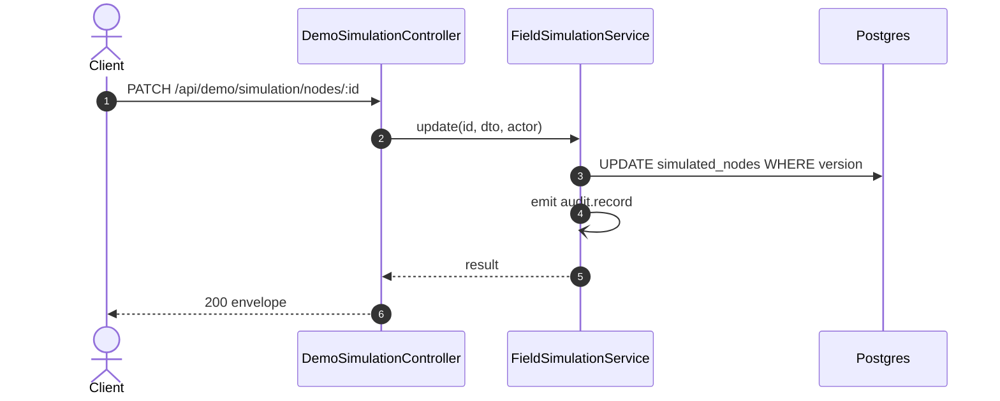

# PATCH /api/demo/simulation/nodes/:id: Change a simulated node

> Module `demo`. Generated from `scripts/specs/endpoints/demo.py` by `scripts/specs/build_api_design.py`; edit the catalog, not this file. Format: `02-templates/04-api-endpoint-template.md` with Mermaid (D-017). Envelope: D-002.

[TOC]

---
## Overview

Changes the pattern, the style, the trail or the speed of a running node. The node is re-anchored where it is now, so the move continues from there; a new trail starts at its first point. An active SOS stays active.

## API Specification

| API | URL |
| --- | --- |
| PATCH | /api/demo/simulation/nodes/:id |
| Permission | TrekLink Admin (`demo.simulate`) |
| Traces | D-093 amendment, REQ-SIM-02, REQ-SIM-04, REQ-SIM-07, REQ-SIM-09 |

### Path parameters

| Field | Description | Data Type | Examples |
| --- | --- | --- | --- |
| id | Simulated node id | uuid | `4b3a2918-0716-4f5e-8d4c-3b2a19080706` |

## Request sample

```json
{
  "expectedVersion": 0,
  "pattern": "STRAY"
}
```

| Field | Description | Data Type | Required | Examples |
| --- | --- | --- | --- | --- |
| expectedVersion | The node's `version` as read | int | yes | `0` |
| pattern | New pattern | string | no | `STRAY` |
| style | New movement style; a `GROUP_FOLLOWER` joins its trail's group at once | string | no | `WANDERER` |
| trailId | New trail | string | no | `ta-nang-phan-dung` |
| speedMetresPerMinute | New speed, 10 to 300 | int | no | `80` |

## Response sample

```json
{
  "result": {
    "id": "4b3a2918-0716-4f5e-8d4c-3b2a19080706",
    "deviceId": "0d3f6a2b-7e11-4c55-8f0a-2b1c9e7d4a10",
    "assetTag": "TL-0010",
    "nodeId": "!de00000a",
    "organization": {
      "id": "5b1d2c0e-7f3a-4e21-9c8d-1a2b3c4d5e6f",
      "code": "ORG-0001",
      "name": "TrekLink Demo Tours Co., Ltd."
    },
    "trailId": "ta-nang-phan-dung",
    "pattern": "STRAY",
    "style": "HIKER",
    "speedMetresPerMinute": 60,
    "status": "RUNNING",
    "sosKind": null,
    "sosSince": null,
    "position": {
      "lat": 11.497591,
      "lon": 108.568646
    },
    "batteryPct": 99,
    "lastPacketAt": "2026-10-20T03:15:00.000Z",
    "simulated": true,
    "version": 1,
    "createdAt": "2026-10-20T03:15:00.000Z",
    "updatedAt": "2026-10-20T03:15:00.000Z"
  },
  "isSuccess": true,
  "statusCode": 200,
  "message": "Simulated node changed"
}
```

| Field | Description | Data Type | Examples |
| --- | --- | --- | --- |
| nodeId | Mesh node id the packets carry, `!` and eight hex digits of `nodeNum` | string | `!de00000a` |
| organization | Organization holding the device now, or null when it is not handed over | object | see sample |
| position | Position the pattern gives at the time of the read (the stop time for a `STOPPED` node) | object | see sample |
| batteryPct | Battery the pattern gives at the same time, 5 to 100 | int | `99` |
| lastPacketAt | Last time the device was heard (device projection `lastSeenAt`), or null | datetime | `2026-10-20T03:15:00.000Z` |
| style | Movement style while the pattern walks (design §9.1), or null for a node started before the styles, which keeps the steady walk at `speedMetresPerMinute` | string | `HIKER` |
| sosKind | `SOS` or `FALL` while an SOS is active, otherwise null | string | `null` |
| version | Compare-and-set version for 08 and 09 | int | `0` |

## Validation

<table>
    <th>Status code</th>
    <th>Description</th>
    <th>Examples</th>
    <tbody>
        <tr>
            <td>400</td>
            <td>The body or query fails validation (<code>VALIDATION_FAILED</code>)</td>
<td>

```json
{
  "result": {
    "errorCode": "VALIDATION_FAILED"
  },
  "isSuccess": false,
  "statusCode": 400,
  "message": "{field} is required."
}
```
</td>
        </tr>
        <tr>
            <td>401</td>
            <td>Missing, malformed or expired access token or API key (<code>UNAUTHENTICATED</code>)</td>
<td>

```json
{
  "result": {
    "errorCode": "UNAUTHENTICATED"
  },
  "isSuccess": false,
  "statusCode": 401,
  "message": "Authentication required."
}
```
</td>
        </tr>
        <tr>
            <td>403</td>
            <td>The caller's role, policy or organization does not allow this action (<code>FORBIDDEN</code>)</td>
<td>

```json
{
  "result": {
    "errorCode": "FORBIDDEN"
  },
  "isSuccess": false,
  "statusCode": 403,
  "message": "You do not have access to this."
}
```
</td>
        </tr>
        <tr>
            <td>404</td>
            <td>No such record, or it belongs to another organization (<code>NOT_FOUND</code>)</td>
<td>

```json
{
  "result": {
    "errorCode": "NOT_FOUND"
  },
  "isSuccess": false,
  "statusCode": 404,
  "message": "Simulated node not found."
}
```
</td>
        </tr>
        <tr>
            <td>403</td>
            <td>The database of `DATABASE_URL` or `DATABASE_DIRECT_URL` is neither on a loopback host nor named `treklink_prod` (<code>DEMO_DATABASE_NOT_ALLOWED</code>)</td>
<td>

```json
{
  "result": {
    "errorCode": "DEMO_DATABASE_NOT_ALLOWED"
  },
  "isSuccess": false,
  "statusCode": 403,
  "message": "The field simulation runs only on a local database or the Vercel staging."
}
```
</td>
        </tr>
        <tr>
            <td>404</td>
            <td>`DEMO_SIMULATION_ENABLED` is not `true`: the route does not exist (<code>NOT_FOUND</code>)</td>
<td>

```json
{
  "result": {
    "errorCode": "NOT_FOUND"
  },
  "isSuccess": false,
  "statusCode": 404,
  "message": "Cannot GET /api/demo/simulation"
}
```
</td>
        </tr>
        <tr>
            <td>400</td>
            <td>The trail is unknown (<code>VALIDATION_FAILED</code>)</td>
<td>

```json
{
  "result": {
    "errorCode": "VALIDATION_FAILED"
  },
  "isSuccess": false,
  "statusCode": 400,
  "message": "Unknown trail."
}
```
</td>
        </tr>
        <tr>
            <td>404</td>
            <td>No such simulated node (<code>NOT_FOUND</code>)</td>
<td>

```json
{
  "result": {
    "errorCode": "NOT_FOUND"
  },
  "isSuccess": false,
  "statusCode": 404,
  "message": "Simulated node not found."
}
```
</td>
        </tr>
        <tr>
            <td>409</td>
            <td>The simulated node is `STOPPED` (<code>INVALID_STATE_TRANSITION</code>)</td>
<td>

```json
{
  "result": {
    "errorCode": "INVALID_STATE_TRANSITION"
  },
  "isSuccess": false,
  "statusCode": 409,
  "message": "This cannot be done while it is STOPPED."
}
```
</td>
        </tr>
        <tr>
            <td>409</td>
            <td>Another user changed the record first (expectedVersion differs) (<code>STALE_VERSION</code>)</td>
<td>

```json
{
  "result": {
    "errorCode": "STALE_VERSION"
  },
  "isSuccess": false,
  "statusCode": 409,
  "message": "This was changed by someone else. Reload and try again."
}
```
</td>
        </tr>
    </tbody>
</table>

## Activity Diagram

```mermaid
flowchart TB
    S((Start))
    A0["Check token, policy and organization scope"]
    S --> A0
    D1{"The body or query fails validation?"}
    A0 --> D1
    E1["Return 400 VALIDATION_FAILED"]
    D1 -->|yes| E1
    E1 --> X1((End))
    D2{"No such record, or it belongs to another organization?"}
    D1 -->|no| D2
    E2["Return 404 NOT_FOUND"]
    D2 -->|yes| E2
    E2 --> X2((End))
    D3{"`DEMO_SIMULATION_ENABLED` is not `true`: the route does not exist?"}
    D2 -->|no| D3
    E3["Return 404 NOT_FOUND"]
    D3 -->|yes| E3
    E3 --> X3((End))
    D4{"The trail is unknown?"}
    D3 -->|no| D4
    E4["Return 400 VALIDATION_FAILED"]
    D4 -->|yes| E4
    E4 --> X4((End))
    D5{"No such simulated node?"}
    D4 -->|no| D5
    E5["Return 404 NOT_FOUND"]
    D5 -->|yes| E5
    E5 --> X5((End))
    D6{"The simulated node is `STOPPED`?"}
    D5 -->|no| D6
    E6["Return 409 INVALID_STATE_TRANSITION"]
    D6 -->|yes| E6
    E6 --> X6((End))
    D7{"Another user changed the record first (expectedVersion differs)?"}
    D6 -->|no| D7
    E7["Return 409 STALE_VERSION"]
    D7 -->|yes| E7
    E7 --> X7((End))
    P0["Check the database"]
    D7 -->|no| P0
    P1["Compute the current position and battery"]
    P0 --> P1
    P2["Compare-and-set the new anchor"]
    P1 --> P2
    P3["Emit audit.record demo.simulation.update"]
    P2 --> P3
    OK["Return 200"]
    P3 --> OK
    OK --> Z((End))
```

## Sequence Diagram


