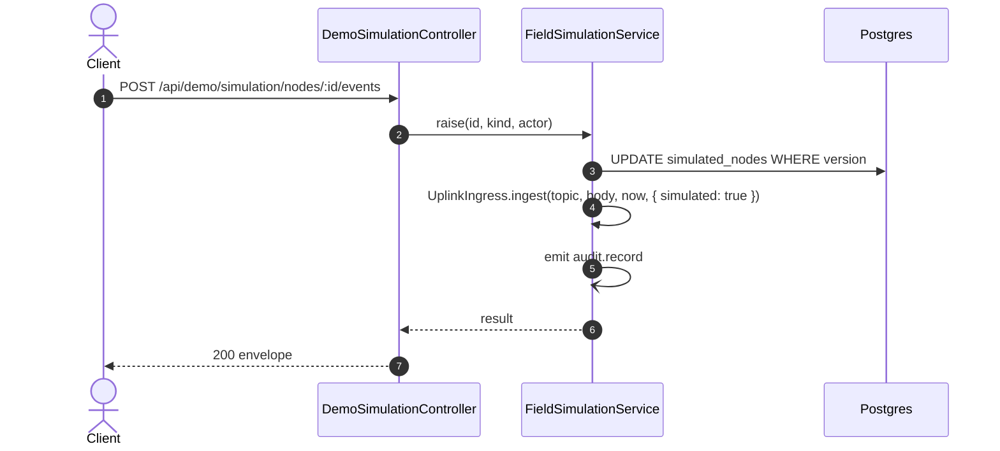

# POST /api/demo/simulation/nodes/:id/events: Raise an SOS, a fall or a cancel

> Module `demo`. Generated from `scripts/specs/endpoints/demo.py` by `scripts/specs/build_api_design.py`; edit the catalog, not this file. Format: `02-templates/04-api-endpoint-template.md` with Mermaid (D-017). Envelope: D-002.

[TOC]

---
## Overview

`SOS` and `FALL` ingest at once, through the node uplink path, the text a TrekLink node sends (`SOS - [lat], [lon]` or `SOS - FALL DETECTED - [lat], [lon]`, six decimals, firmware ground truth §2) and its first position beacon; each later simulator run adds the beacons due since the last one, every 5 s for the first 60 s and every 30 s after. The incident opens, routes, notifies and escalates as for a real device, marked simulated. A second `SOS` restarts the beacons and joins the open incident. `SOS_CANCEL` stops the beacons and sends nothing, because the firmware sends no cancel packet: a person resolves the incident.

## API Specification

| API | URL |
| --- | --- |
| POST | /api/demo/simulation/nodes/:id/events |
| Permission | TrekLink Admin (`demo.simulate`) |
| Traces | D-093 amendment, REQ-SIM-02, REQ-SIM-05, REQ-SIM-07, AC-07 |

### Path parameters

| Field | Description | Data Type | Examples |
| --- | --- | --- | --- |
| id | Simulated node id | uuid | `4b3a2918-0716-4f5e-8d4c-3b2a19080706` |

## Request sample

```json
{
  "kind": "SOS"
}
```

| Field | Description | Data Type | Required | Examples |
| --- | --- | --- | --- | --- |
| kind | `SOS`, `FALL` or `SOS_CANCEL` | string | yes | `SOS` |

## Response sample

```json
{
  "result": {
    "node": {
      "id": "4b3a2918-0716-4f5e-8d4c-3b2a19080706",
      "deviceId": "0d3f6a2b-7e11-4c55-8f0a-2b1c9e7d4a10",
      "assetTag": "TL-0010",
      "nodeId": "!de00000a",
      "organization": {
        "id": "5b1d2c0e-7f3a-4e21-9c8d-1a2b3c4d5e6f",
        "code": "ORG-0001",
        "name": "TrekLink Demo Tours Co., Ltd."
      },
      "trailId": "ta-nang-phan-dung",
      "pattern": "WALK",
      "speedMetresPerMinute": 60,
      "status": "RUNNING",
      "sosKind": "SOS",
      "sosSince": "2026-10-20T03:15:00.000Z",
      "position": {
        "lat": 11.497591,
        "lon": 108.568646
      },
      "batteryPct": 99,
      "lastPacketAt": "2026-10-20T03:15:00.000Z",
      "simulated": true,
      "version": 1,
      "createdAt": "2026-10-20T03:15:00.000Z",
      "updatedAt": "2026-10-20T03:15:00.000Z"
    },
    "fieldEventId": "9f2c4e...e1"
  },
  "isSuccess": true,
  "statusCode": 200,
  "message": "Simulated event raised"
}
```

| Field | Description | Data Type | Examples |
| --- | --- | --- | --- |
| fieldEventId | D-006 event id of the SOS text packet; null for `SOS_CANCEL` | string | `9f2c...` |

## Validation

<table>
    <th>Status code</th>
    <th>Description</th>
    <th>Examples</th>
    <tbody>
        <tr>
            <td>400</td>
            <td>The body or query fails validation (<code>VALIDATION_FAILED</code>)</td>
<td>

```json
{
  "result": {
    "errorCode": "VALIDATION_FAILED"
  },
  "isSuccess": false,
  "statusCode": 400,
  "message": "{field} is required."
}
```
</td>
        </tr>
        <tr>
            <td>401</td>
            <td>Missing, malformed or expired access token or API key (<code>UNAUTHENTICATED</code>)</td>
<td>

```json
{
  "result": {
    "errorCode": "UNAUTHENTICATED"
  },
  "isSuccess": false,
  "statusCode": 401,
  "message": "Authentication required."
}
```
</td>
        </tr>
        <tr>
            <td>403</td>
            <td>The caller's role, policy or organization does not allow this action (<code>FORBIDDEN</code>)</td>
<td>

```json
{
  "result": {
    "errorCode": "FORBIDDEN"
  },
  "isSuccess": false,
  "statusCode": 403,
  "message": "You do not have access to this."
}
```
</td>
        </tr>
        <tr>
            <td>404</td>
            <td>No such record, or it belongs to another organization (<code>NOT_FOUND</code>)</td>
<td>

```json
{
  "result": {
    "errorCode": "NOT_FOUND"
  },
  "isSuccess": false,
  "statusCode": 404,
  "message": "Simulated node not found."
}
```
</td>
        </tr>
        <tr>
            <td>403</td>
            <td>The database of `DATABASE_URL` or `DATABASE_DIRECT_URL` is neither on a loopback host nor named `treklink_prod` (<code>DEMO_DATABASE_NOT_ALLOWED</code>)</td>
<td>

```json
{
  "result": {
    "errorCode": "DEMO_DATABASE_NOT_ALLOWED"
  },
  "isSuccess": false,
  "statusCode": 403,
  "message": "The field simulation runs only on a local database or the Vercel staging."
}
```
</td>
        </tr>
        <tr>
            <td>404</td>
            <td>`DEMO_SIMULATION_ENABLED` is not `true`: the route does not exist (<code>NOT_FOUND</code>)</td>
<td>

```json
{
  "result": {
    "errorCode": "NOT_FOUND"
  },
  "isSuccess": false,
  "statusCode": 404,
  "message": "Cannot GET /api/demo/simulation"
}
```
</td>
        </tr>
        <tr>
            <td>404</td>
            <td>No such simulated node (<code>NOT_FOUND</code>)</td>
<td>

```json
{
  "result": {
    "errorCode": "NOT_FOUND"
  },
  "isSuccess": false,
  "statusCode": 404,
  "message": "Simulated node not found."
}
```
</td>
        </tr>
        <tr>
            <td>409</td>
            <td>The simulated node is `STOPPED` (<code>INVALID_STATE_TRANSITION</code>)</td>
<td>

```json
{
  "result": {
    "errorCode": "INVALID_STATE_TRANSITION"
  },
  "isSuccess": false,
  "statusCode": 409,
  "message": "This cannot be done while it is STOPPED."
}
```
</td>
        </tr>
        <tr>
            <td>409</td>
            <td>`SOS_CANCEL` while no SOS is active (<code>INVALID_STATE_TRANSITION</code>)</td>
<td>

```json
{
  "result": {
    "errorCode": "INVALID_STATE_TRANSITION"
  },
  "isSuccess": false,
  "statusCode": 409,
  "message": "No SOS is active on this node."
}
```
</td>
        </tr>
    </tbody>
</table>

## Activity Diagram

```mermaid
flowchart TB
    S((Start))
    A0["Check token, policy and organization scope"]
    S --> A0
    D1{"The body or query fails validation?"}
    A0 --> D1
    E1["Return 400 VALIDATION_FAILED"]
    D1 -->|yes| E1
    E1 --> X1((End))
    D2{"No such record, or it belongs to another organization?"}
    D1 -->|no| D2
    E2["Return 404 NOT_FOUND"]
    D2 -->|yes| E2
    E2 --> X2((End))
    D3{"`DEMO_SIMULATION_ENABLED` is not `true`: the route does not exist?"}
    D2 -->|no| D3
    E3["Return 404 NOT_FOUND"]
    D3 -->|yes| E3
    E3 --> X3((End))
    D4{"No such simulated node?"}
    D3 -->|no| D4
    E4["Return 404 NOT_FOUND"]
    D4 -->|yes| E4
    E4 --> X4((End))
    D5{"The simulated node is `STOPPED`?"}
    D4 -->|no| D5
    E5["Return 409 INVALID_STATE_TRANSITION"]
    D5 -->|yes| E5
    E5 --> X5((End))
    D6{"`SOS_CANCEL` while no SOS is active?"}
    D5 -->|no| D6
    E6["Return 409 INVALID_STATE_TRANSITION"]
    D6 -->|yes| E6
    E6 --> X6((End))
    P0["Check the database"]
    D6 -->|no| P0
    P1["Re-anchor at the current position and set or clear sosKind"]
    P0 --> P1
    P2["SOS or FALL: ingest the text packet and the first beacon with simulated = true"]
    P1 --> P2
    P3["Emit audit.record demo.simulation.event"]
    P2 --> P3
    OK["Return 200"]
    P3 --> OK
    OK --> Z((End))
```

## Sequence Diagram


