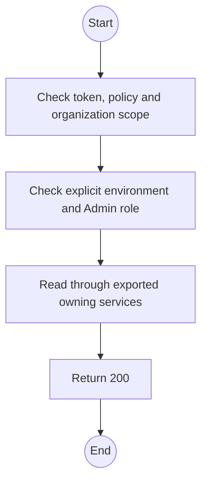
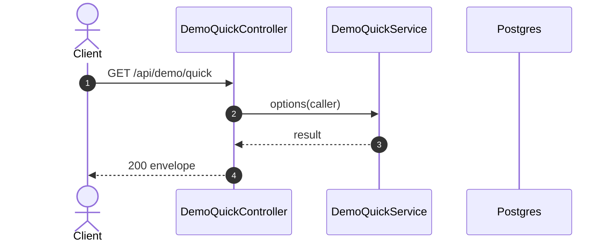

# GET /api/demo/quick: Quick scenario options

> Module `demo`. Generated from `scripts/specs/endpoints/demo.py` by `scripts/specs/build_api_design.py`; edit the catalog, not this file. Format: `02-templates/04-api-endpoint-template.md` with Mermaid (D-017). Envelope: D-002.

[TOC]

---
## Overview

Reads active organizations, variants, rented units, contracts, simulated incidents and the persistent escalation profile.

## API Specification

| API | URL |
| --- | --- |
| GET | /api/demo/quick |
| Permission | TrekLink Admin (`demo.stage`) plus ADMIN role |
| Traces | W43, REQ-QUICK-01 to 09 |

## Request sample

No body.

## Response sample

```json
{
  "result": {
    "organizations": [],
    "variants": [],
    "units": [],
    "contracts": [],
    "incidents": [],
    "profile": {
      "active": false,
      "version": 0
    }
  },
  "isSuccess": true,
  "statusCode": 200,
  "message": "OK"
}
```

## Validation

<table>
    <th>Status code</th>
    <th>Description</th>
    <th>Examples</th>
    <tbody>
        <tr>
            <td>401</td>
            <td>Missing, malformed or expired access token or API key (<code>UNAUTHENTICATED</code>)</td>
<td>

```json
{
  "result": {
    "errorCode": "UNAUTHENTICATED"
  },
  "isSuccess": false,
  "statusCode": 401,
  "message": "Authentication required."
}
```
</td>
        </tr>
        <tr>
            <td>403</td>
            <td>The caller's role, policy or organization does not allow this action (<code>FORBIDDEN</code>)</td>
<td>

```json
{
  "result": {
    "errorCode": "FORBIDDEN"
  },
  "isSuccess": false,
  "statusCode": 403,
  "message": "You do not have access to this."
}
```
</td>
        </tr>
    </tbody>
</table>

## Activity Diagram



## Sequence Diagram


