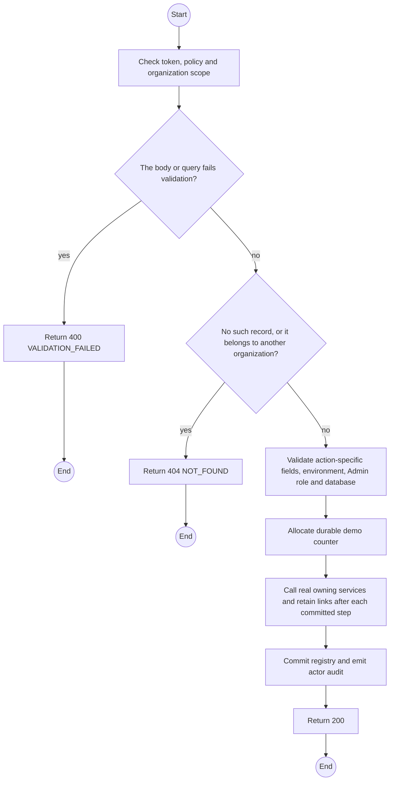
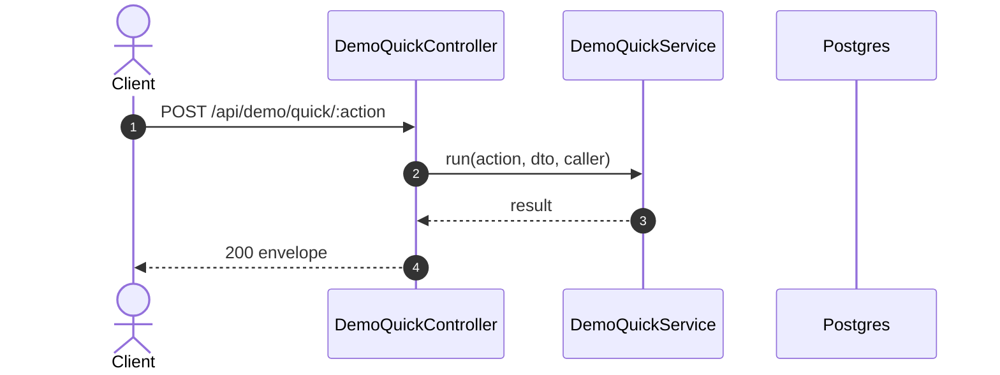

# POST /api/demo/quick/:action: Run an additive quick scenario

> Module `demo`. Generated from `scripts/specs/endpoints/demo.py` by `scripts/specs/build_api_design.py`; edit the catalog, not this file. Format: `02-templates/04-api-endpoint-template.md` with Mermaid (D-017). Envelope: D-002.

[TOC]

---
## Overview

Creates fresh demo records or applies a disclosed demo time control. Never resets, seeds, deletes or truncates. Multi-step failures retain committed record links in the run result.

## API Specification

| API | URL |
| --- | --- |
| POST | /api/demo/quick/:action |
| Permission | TrekLink Admin (`demo.stage`) plus ADMIN role |
| Traces | W43, REQ-QUICK-01 to 09 |

### Path parameters

| Field | Description | Data Type | Examples |
| --- | --- | --- | --- |
| action | organization, contract, incident, loss, fault, walkers, profile, term-end, next-tier | string | `contract` |

## Request sample

```json
{
  "organizationId": "3f2e1d0c-9b8a-4c7d-8e6f-5a4b3c2d1e0f",
  "hardwareVariantId": "3f2e1d0c-9b8a-4c7d-8e6f-5a4b3c2d1e0f",
  "quantity": 5,
  "target": "APPROVED"
}
```

| Field | Description | Data Type | Required | Examples |
| --- | --- | --- | --- | --- |
| organizationId | Active organization for contract | UUID | conditional | ... |
| hardwareVariantId | Active variant for contract | UUID | conditional | ... |
| quantity | At least parameter minimum, two for ACTIVE | integer | conditional | 5 |
| target | REQUESTED, APPROVED, ACTIVE, RETURN_DUE | string | conditional | APPROVED |
| deviceId | Rented unit for SOS/loss/fault | UUID | conditional | ... |
| recordId | Contract or incident for time control | UUID | conditional | ... |
| expectedVersion | Version for profile or time control | integer | conditional | 0 |
| active | Enable or restore escalation demo profile | boolean | conditional | true |

## Response sample

```json
{
  "result": {
    "runId": 1,
    "label": "Demo 1",
    "records": [],
    "error": null,
    "errorCode": null
  },
  "isSuccess": true,
  "statusCode": 200,
  "message": "Demo action completed"
}
```

| Field | Description | Data Type | Examples |
| --- | --- | --- | --- |
| error | Null on completion, otherwise the named cause of a business step failure, with committed records retained | string or null | `null` |
| errorCode | Domain error code, including STALE_VERSION, in the persisted run result; the run response itself is HTTP 200 | string or null | `null` |

## Validation

<table>
    <th>Status code</th>
    <th>Description</th>
    <th>Examples</th>
    <tbody>
        <tr>
            <td>400</td>
            <td>The body or query fails validation (<code>VALIDATION_FAILED</code>)</td>
<td>

```json
{
  "result": {
    "errorCode": "VALIDATION_FAILED"
  },
  "isSuccess": false,
  "statusCode": 400,
  "message": "{field} is required."
}
```
</td>
        </tr>
        <tr>
            <td>401</td>
            <td>Missing, malformed or expired access token or API key (<code>UNAUTHENTICATED</code>)</td>
<td>

```json
{
  "result": {
    "errorCode": "UNAUTHENTICATED"
  },
  "isSuccess": false,
  "statusCode": 401,
  "message": "Authentication required."
}
```
</td>
        </tr>
        <tr>
            <td>403</td>
            <td>The caller's role, policy or organization does not allow this action (<code>FORBIDDEN</code>)</td>
<td>

```json
{
  "result": {
    "errorCode": "FORBIDDEN"
  },
  "isSuccess": false,
  "statusCode": 403,
  "message": "You do not have access to this."
}
```
</td>
        </tr>
        <tr>
            <td>404</td>
            <td>No such record, or it belongs to another organization (<code>NOT_FOUND</code>)</td>
<td>

```json
{
  "result": {
    "errorCode": "NOT_FOUND"
  },
  "isSuccess": false,
  "statusCode": 404,
  "message": "Record not found."
}
```
</td>
        </tr>
        <tr>
            <td>403</td>
            <td>Flag or explicit sandbox/staging environment is wrong (<code>DEMO_DISABLED</code>)</td>
<td>

```json
{
  "result": {
    "errorCode": "DEMO_DISABLED"
  },
  "isSuccess": false,
  "statusCode": 403,
  "message": "Demo quick controls are disabled."
}
```
</td>
        </tr>
        <tr>
            <td>403</td>
            <td>Either database URL is outside the local/staging allowlist (<code>DEMO_DATABASE_NOT_ALLOWED</code>)</td>
<td>

```json
{
  "result": {
    "errorCode": "DEMO_DATABASE_NOT_ALLOWED"
  },
  "isSuccess": false,
  "statusCode": 403,
  "message": "Demo quick controls require a local or staging database."
}
```
</td>
        </tr>
    </tbody>
</table>

## Activity Diagram



## Sequence Diagram


