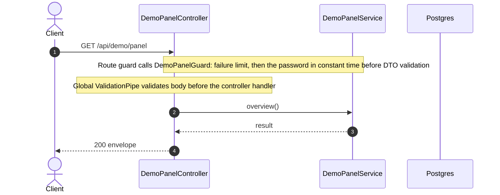

# GET /api/demo/panel: Read the demo panel

> Module `demo`. Generated from `scripts/specs/endpoints/demo.py` by `scripts/specs/build_api_design.py`; edit the catalog, not this file. Format: `02-templates/04-api-endpoint-template.md` with Mermaid (D-017). Envelope: D-002.

[TOC]

---
## Overview

Returns what the panel needs: the action catalogue, the options the actions need, the playback state and whether a reseed is possible now. A 200 also tells the page that the typed password is right. No account and no policy: the panel password guards every panel route (D-110 rule 1).

## API Specification

| API | URL |
| --- | --- |
| GET | /api/demo/panel |
| Permission | Public (demo panel password header `X-Demo-Panel-Password`) |
| Traces | D-110, REQ-PNL-01, REQ-PNL-02, REQ-PNL-06, REQ-PNL-10, REQ-PNL-11 |

## Request sample

No body.

## Response sample

```json
{
  "result": {
    "reset": {
      "available": false,
      "reason": "DEMO_RESET_ENABLED is not true.",
      "nextAllowedAt": null
    },
    "actions": [
      {
        "id": "incident-acknowledge",
        "group": "Incidents",
        "label": "Acknowledge",
        "needs": [
          "recordId",
          "expectedVersion"
        ]
      }
    ],
    "options": {
      "incidents": [],
      "contracts": [],
      "invoices": [],
      "devices": [],
      "organizations": [],
      "variants": [],
      "flows": [
        "MF-01a",
        "MF-01b",
        "MF-01c",
        "MF-02",
        "MF-03",
        "MF-04",
        "MF-05"
      ]
    },
    "playback": {
      "flow": "MF-03",
      "status": "PAUSED",
      "index": 1,
      "intervalSeconds": 10,
      "nextAt": null,
      "steps": [
        {
          "title": "SOS from TL-0010",
          "window": "Physical unit",
          "screen": "Gateway log",
          "status": "DONE",
          "error": null,
          "records": []
        },
        {
          "title": "Operator acknowledges",
          "window": "C, Operator",
          "screen": "/o/incidents",
          "status": "PENDING",
          "error": null,
          "records": []
        }
      ],
      "error": null
    }
  },
  "isSuccess": true,
  "statusCode": 200,
  "message": "OK"
}
```

| Field | Description | Data Type | Examples |
| --- | --- | --- | --- |
| reset.available | Every reseed check that needs no input passes now (REQ-PNL-12) | boolean | `false` |
| reset.reason | The first failing check, or null | string | see sample |
| actions[].needs | Body fields the action requires | array | see sample |
| options.incidents | Open, resolved and false-alarm incidents with code, state, version, device | array | `[]` |
| options.contracts | Contracts that an action can move, with code, status and version | array | `[]` |
| playback | The playback run of REQ-PNL-08, `status` IDLE when none ran | object | see sample |

## Validation

<table>
    <th>Status code</th>
    <th>Description</th>
    <th>Examples</th>
    <tbody>
        <tr>
            <td>401</td>
            <td>The panel password header is missing or wrong (<code>DEMO_PANEL_PASSWORD_INVALID</code>)</td>
<td>

```json
{
  "result": {
    "errorCode": "DEMO_PANEL_PASSWORD_INVALID"
  },
  "isSuccess": false,
  "statusCode": 401,
  "message": "Enter the panel password."
}
```
</td>
        </tr>
        <tr>
            <td>404</td>
            <td>`DEMO_PANEL_PASSWORD_HASH` is unset or does not parse: the route does not exist (<code>NOT_FOUND</code>)</td>
<td>

```json
{
  "result": {
    "errorCode": "NOT_FOUND"
  },
  "isSuccess": false,
  "statusCode": 404,
  "message": "Cannot GET /api/demo/panel"
}
```
</td>
        </tr>
        <tr>
            <td>429</td>
            <td>Five wrong or missing passwords from this address within ten minutes (<code>RATE_LIMITED</code>)</td>
<td>

```json
{
  "result": {
    "errorCode": "RATE_LIMITED"
  },
  "isSuccess": false,
  "statusCode": 429,
  "message": "Too many wrong panel passwords. Try again after 10:25."
}
```
</td>
        </tr>
    </tbody>
</table>

## Activity Diagram

```mermaid
flowchart TB
    S((Start))
    A0["Accept request"]
    S --> A0
    Auth["DemoPanelGuard: failure limit, then the password in constant time"]
    A0 --> Auth
    AuthCheck{"API key missing or wrong?"}
    Auth --> AuthCheck
    AuthError["Return 401 DEMO_PANEL_PASSWORD_INVALID"]
    AuthCheck -->|yes| AuthError
    AuthError --> AuthEnd((End))
    D1{"`DEMO_PANEL_PASSWORD_HASH` is unset or does not parse: the route does not exist?"}
    AuthCheck -->|no| D1
    E1["Return 404 NOT_FOUND"]
    D1 -->|yes| E1
    E1 --> X1((End))
    D2{"Five wrong or missing passwords from this address within ten minutes?"}
    D1 -->|no| D2
    E2["Return 429 RATE_LIMITED"]
    D2 -->|yes| E2
    E2 --> X2((End))
    P0["Check the failure limit and the password"]
    D2 -->|no| P0
    P1["Read options through exported services"]
    P0 --> P1
    P2["Read the playback state"]
    P1 --> P2
    P3["Evaluate the reseed checks"]
    P2 --> P3
    OK["Return 200"]
    P3 --> OK
    OK --> Z((End))
```

## Sequence Diagram


