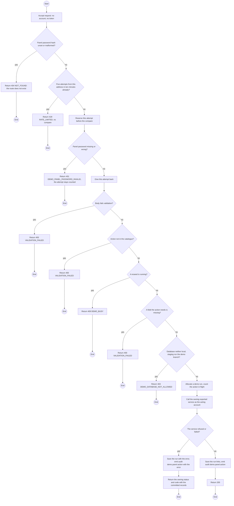
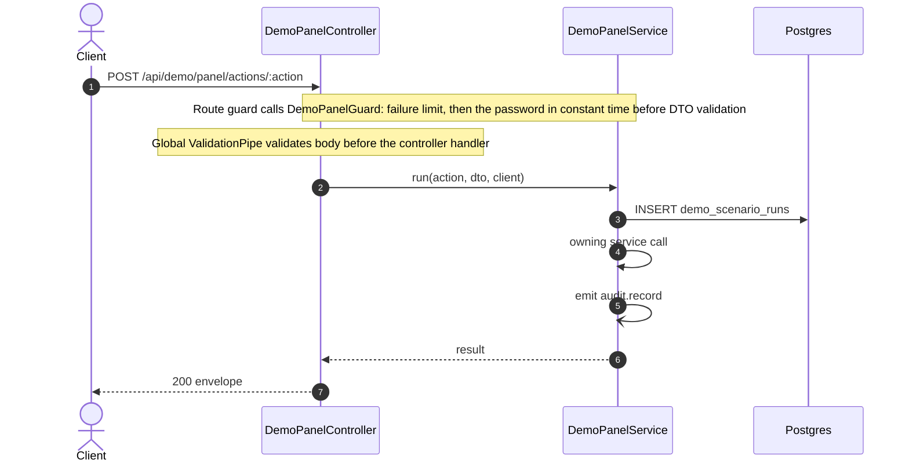

# POST /api/demo/panel/actions/:action: Run a demo panel action

> Module `demo`. Generated from `scripts/specs/endpoints/demo.py` by `scripts/specs/build_api_design.py`; edit the catalog, not this file. Format: `02-templates/04-api-endpoint-template.md` with Mermaid (D-017). Envelope: D-002.

[TOC]

---
## Overview

Runs one simulator or live data action through the owning module's exported service, acting as the account whose real screen the step stands for, under the same state machine, version, membership and payment rules as the real screens. Writes one `demo.panel.<action>` audit entry with `actorId` null and `actorRoles` `['DEMO_PANEL']`. A failed action answers the owning error with its committed links.

## API Specification

| API | URL |
| --- | --- |
| POST | /api/demo/panel/actions/:action |
| Permission | Public (demo panel password header `X-Demo-Panel-Password`) |
| Traces | D-110 rule 3, REQ-PNL-03, REQ-PNL-04, REQ-PNL-07, REQ-PNL-13, REQ-PNL-14 |

### Path parameters

| Field | Description | Data Type | Examples |
| --- | --- | --- | --- |
| action | incident-sos, incident-acknowledge, incident-respond, incident-resolve, incident-false-alarm, incident-close, contract-create, contract-approve, contract-handover, contract-return, contract-close, contract-cancel, invoice-pay, device-maintenance-open, device-maintenance-complete | string | `incident-acknowledge` |

## Request sample

```json
{
  "recordId": "7a6b5c4d-3e2f-4a1b-8c9d-0e1f2a3b4c5d",
  "expectedVersion": 3
}
```

| Field | Description | Data Type | Required | Examples |
| --- | --- | --- | --- | --- |
| recordId | Incident, contract or invoice the action moves | uuid | conditional | `7a6b5c4d-...` |
| expectedVersion | The record's `version` as read | int | conditional | `3` |
| deviceId | Device for `incident-sos` and the maintenance actions | uuid | conditional | `0d3f6a2b-...` |
| organizationId | Organization for `contract-create`; default ORG-0001 | uuid | no | `5b1d2c0e-...` |
| hardwareVariantId | Variant for `contract-create`; default `treklink-v3` | uuid | no | `a1b2c3d4-...` |
| quantity | Units for `contract-create`; default `rentals.minOrderQuantity` | int | no | `5` |

## Response sample

```json
{
  "result": {
    "action": "incident-acknowledge",
    "runId": 12,
    "label": "Demo 12",
    "actedAs": {
      "role": "ORG_OPERATOR",
      "email": "treklink.dev+operator@gmail.com"
    },
    "records": [
      {
        "label": "Incident, acknowledged",
        "code": "INC-2026-000002",
        "path": "/o/incidents/7a6b5c4d-3e2f-4a1b-8c9d-0e1f2a3b4c5d"
      }
    ]
  },
  "isSuccess": true,
  "statusCode": 200,
  "message": "Demo panel action completed"
}
```

| Field | Description | Data Type | Examples |
| --- | --- | --- | --- |
| actedAs | The seeded or live account the services acted as, null for a packet or time control | object | see sample |
| records | Links to the real screens | array | see sample |

## Validation

<table>
    <th>Status code</th>
    <th>Description</th>
    <th>Examples</th>
    <tbody>
        <tr>
            <td>400</td>
            <td>The body or query fails validation (<code>VALIDATION_FAILED</code>)</td>
<td>

```json
{
  "result": {
    "errorCode": "VALIDATION_FAILED"
  },
  "isSuccess": false,
  "statusCode": 400,
  "message": "{field} is required."
}
```
</td>
        </tr>
        <tr>
            <td>404</td>
            <td>No such record, or it belongs to another organization (<code>NOT_FOUND</code>)</td>
<td>

```json
{
  "result": {
    "errorCode": "NOT_FOUND"
  },
  "isSuccess": false,
  "statusCode": 404,
  "message": "Action not found."
}
```
</td>
        </tr>
        <tr>
            <td>401</td>
            <td>The panel password header is missing or wrong (<code>DEMO_PANEL_PASSWORD_INVALID</code>)</td>
<td>

```json
{
  "result": {
    "errorCode": "DEMO_PANEL_PASSWORD_INVALID"
  },
  "isSuccess": false,
  "statusCode": 401,
  "message": "Enter the panel password."
}
```
</td>
        </tr>
        <tr>
            <td>404</td>
            <td>`DEMO_PANEL_PASSWORD_HASH` is unset or does not parse: the route does not exist (<code>NOT_FOUND</code>)</td>
<td>

```json
{
  "result": {
    "errorCode": "NOT_FOUND"
  },
  "isSuccess": false,
  "statusCode": 404,
  "message": "Cannot GET /api/demo/panel"
}
```
</td>
        </tr>
        <tr>
            <td>429</td>
            <td>Five wrong or missing passwords from this address within ten minutes (<code>RATE_LIMITED</code>)</td>
<td>

```json
{
  "result": {
    "errorCode": "RATE_LIMITED"
  },
  "isSuccess": false,
  "statusCode": 429,
  "message": "Too many wrong panel passwords. Try again after 10:25."
}
```
</td>
        </tr>
        <tr>
            <td>403</td>
            <td>The database is neither allowed for the simulation nor the `DEMO_DATABASE_HOST` endpoint (<code>DEMO_DATABASE_NOT_ALLOWED</code>)</td>
<td>

```json
{
  "result": {
    "errorCode": "DEMO_DATABASE_NOT_ALLOWED"
  },
  "isSuccess": false,
  "statusCode": 403,
  "message": "The demo panel writes only to a local, staging or demo database."
}
```
</td>
        </tr>
        <tr>
            <td>409</td>
            <td>Another user changed the record first (expectedVersion differs) (<code>STALE_VERSION</code>)</td>
<td>

```json
{
  "result": {
    "errorCode": "STALE_VERSION"
  },
  "isSuccess": false,
  "statusCode": 409,
  "message": "This was changed by someone else. Reload and try again."
}
```
</td>
        </tr>
        <tr>
            <td>409</td>
            <td>A reseed is running (<code>DEMO_BUSY</code>)</td>
<td>

```json
{
  "result": {
    "errorCode": "DEMO_BUSY"
  },
  "isSuccess": false,
  "statusCode": 409,
  "message": "The demo data is being reseeded. Try again when the reseed finishes."
}
```
</td>
        </tr>
        <tr>
            <td>409</td>
            <td>The record's state does not allow the action (<code>INVALID_STATE_TRANSITION</code>)</td>
<td>

```json
{
  "result": {
    "errorCode": "INVALID_STATE_TRANSITION"
  },
  "isSuccess": false,
  "statusCode": 409,
  "message": "This cannot be done while it is RESOLVED."
}
```
</td>
        </tr>
    </tbody>
</table>

## Activity Diagram



## Sequence Diagram


