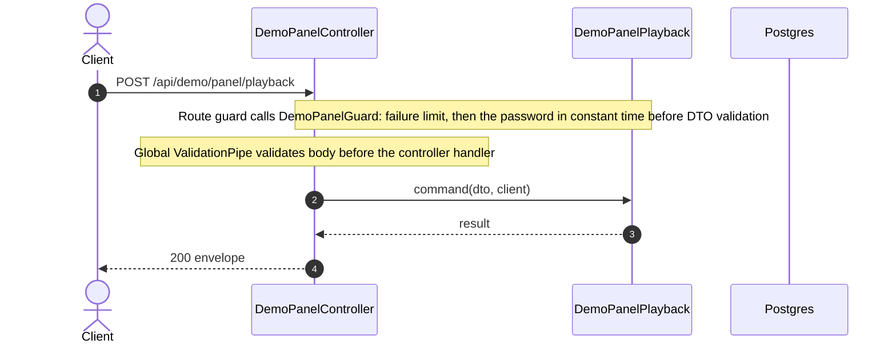

# POST /api/demo/panel/playback: Control the main flow playback

> Module `demo`. Generated from `scripts/specs/endpoints/demo.py` by `scripts/specs/build_api_design.py`; edit the catalog, not this file. Format: `02-templates/04-api-endpoint-template.md` with Mermaid (D-017). Envelope: D-002.

[TOC]

---
## Overview

Starts, pauses, resumes, steps or stops the scripted playback of one main flow. Steps come from `docs/demo/2026-11-22-scenario-playbook.md`; each executed step is one panel action (route 14) or a narration line. One playback runs at a time, held in the backend's memory.

## API Specification

| API | URL |
| --- | --- |
| POST | /api/demo/panel/playback |
| Permission | Public (demo panel password header `X-Demo-Panel-Password`) |
| Traces | D-110 rule 3, REQ-PNL-08 |

## Request sample

```json
{
  "command": "START",
  "flow": "MF-03",
  "intervalSeconds": 10
}
```

| Field | Description | Data Type | Required | Examples |
| --- | --- | --- | --- | --- |
| command | `START`, `PAUSE`, `RESUME`, `STEP` or `STOP` | string | yes | `START` |
| flow | `MF-01a`, `MF-01b`, `MF-01c`, `MF-02`, `MF-03`, `MF-04` or `MF-05`; with `START` only | string | conditional | `MF-03` |
| intervalSeconds | Seconds between steps, 3 to 60; default 10; with `START` only | int | no | `10` |

## Response sample

```json
{
  "result": {
    "flow": "MF-03",
    "status": "PAUSED",
    "index": 1,
    "intervalSeconds": 10,
    "nextAt": null,
    "steps": [
      {
        "title": "SOS from TL-0010",
        "window": "Physical unit",
        "screen": "Gateway log",
        "status": "DONE",
        "error": null,
        "records": []
      },
      {
        "title": "Operator acknowledges",
        "window": "C, Operator",
        "screen": "/o/incidents",
        "status": "PENDING",
        "error": null,
        "records": []
      }
    ],
    "error": null
  },
  "isSuccess": true,
  "statusCode": 200,
  "message": "Playback updated"
}
```

## Validation

<table>
    <th>Status code</th>
    <th>Description</th>
    <th>Examples</th>
    <tbody>
        <tr>
            <td>400</td>
            <td>The body or query fails validation (<code>VALIDATION_FAILED</code>)</td>
<td>

```json
{
  "result": {
    "errorCode": "VALIDATION_FAILED"
  },
  "isSuccess": false,
  "statusCode": 400,
  "message": "{field} is required."
}
```
</td>
        </tr>
        <tr>
            <td>401</td>
            <td>The panel password header is missing or wrong (<code>DEMO_PANEL_PASSWORD_INVALID</code>)</td>
<td>

```json
{
  "result": {
    "errorCode": "DEMO_PANEL_PASSWORD_INVALID"
  },
  "isSuccess": false,
  "statusCode": 401,
  "message": "Enter the panel password."
}
```
</td>
        </tr>
        <tr>
            <td>404</td>
            <td>`DEMO_PANEL_PASSWORD_HASH` is unset or does not parse: the route does not exist (<code>NOT_FOUND</code>)</td>
<td>

```json
{
  "result": {
    "errorCode": "NOT_FOUND"
  },
  "isSuccess": false,
  "statusCode": 404,
  "message": "Cannot GET /api/demo/panel"
}
```
</td>
        </tr>
        <tr>
            <td>429</td>
            <td>Five wrong or missing passwords from this address within ten minutes (<code>RATE_LIMITED</code>)</td>
<td>

```json
{
  "result": {
    "errorCode": "RATE_LIMITED"
  },
  "isSuccess": false,
  "statusCode": 429,
  "message": "Too many wrong panel passwords. Try again after 10:25."
}
```
</td>
        </tr>
        <tr>
            <td>403</td>
            <td>The database is neither allowed for the simulation nor the `DEMO_DATABASE_HOST` endpoint (<code>DEMO_DATABASE_NOT_ALLOWED</code>)</td>
<td>

```json
{
  "result": {
    "errorCode": "DEMO_DATABASE_NOT_ALLOWED"
  },
  "isSuccess": false,
  "statusCode": 403,
  "message": "The demo panel writes only to a local, staging or demo database."
}
```
</td>
        </tr>
        <tr>
            <td>409</td>
            <td>`START` while a playback runs or a reseed is running (<code>DEMO_BUSY</code>)</td>
<td>

```json
{
  "result": {
    "errorCode": "DEMO_BUSY"
  },
  "isSuccess": false,
  "statusCode": 409,
  "message": "A demo action is already running. Try again in a moment."
}
```
</td>
        </tr>
        <tr>
            <td>409</td>
            <td>`PAUSE`, `RESUME`, `STEP` or `STOP` in a state that does not allow it (<code>INVALID_STATE_TRANSITION</code>)</td>
<td>

```json
{
  "result": {
    "errorCode": "INVALID_STATE_TRANSITION"
  },
  "isSuccess": false,
  "statusCode": 409,
  "message": "This cannot be done while it is DONE."
}
```
</td>
        </tr>
    </tbody>
</table>

## Activity Diagram

```mermaid
flowchart TB
    S((Start))
    A0["Accept request"]
    S --> A0
    Auth["DemoPanelGuard: failure limit, then the password in constant time"]
    A0 --> Auth
    AuthCheck{"API key missing or wrong?"}
    Auth --> AuthCheck
    AuthError["Return 401 DEMO_PANEL_PASSWORD_INVALID"]
    AuthCheck -->|yes| AuthError
    AuthError --> AuthEnd((End))
    D1{"The body or query fails validation?"}
    AuthCheck -->|no| D1
    E1["Return 400 VALIDATION_FAILED"]
    D1 -->|yes| E1
    E1 --> X1((End))
    D2{"`DEMO_PANEL_PASSWORD_HASH` is unset or does not parse: the route does not exist?"}
    D1 -->|no| D2
    E2["Return 404 NOT_FOUND"]
    D2 -->|yes| E2
    E2 --> X2((End))
    D3{"Five wrong or missing passwords from this address within ten minutes?"}
    D2 -->|no| D3
    E3["Return 429 RATE_LIMITED"]
    D3 -->|yes| E3
    E3 --> X3((End))
    D4{"`START` while a playback runs or a reseed is running?"}
    D3 -->|no| D4
    E4["Return 409 DEMO_BUSY"]
    D4 -->|yes| E4
    E4 --> X4((End))
    D5{"`PAUSE`, `RESUME`, `STEP` or `STOP` in a state that does not allow it?"}
    D4 -->|no| D5
    E5["Return 409 INVALID_STATE_TRANSITION"]
    D5 -->|yes| E5
    E5 --> X5((End))
    P0["Check the failure limit and the password"]
    D5 -->|no| P0
    P1["Apply the command to the in-memory run"]
    P0 --> P1
    P2["Schedule or clear the next step"]
    P1 --> P2
    OK["Return 200"]
    P2 --> OK
    OK --> Z((End))
```

## Sequence Diagram


