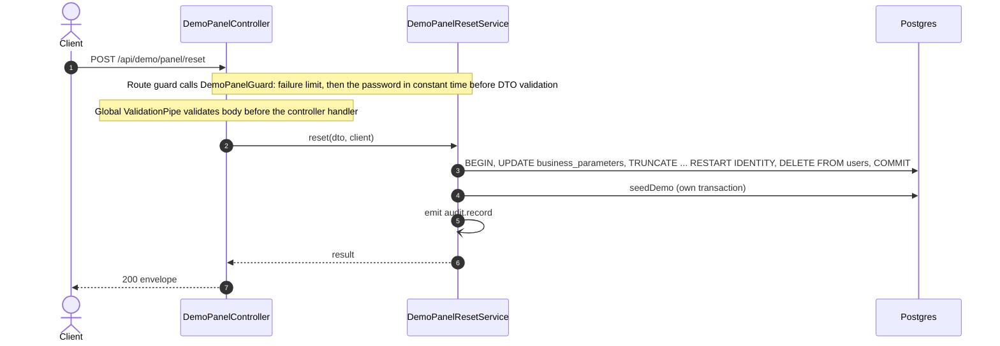

# POST /api/demo/panel/reset: Reseed the demo database

> Module `demo`. Generated from `scripts/specs/endpoints/demo.py` by `scripts/specs/build_api_design.py`; edit the catalog, not this file. Format: `02-templates/04-api-endpoint-template.md` with Mermaid (D-017). Envelope: D-002.

[TOC]

---
## Overview

Wipes the demo data and loads the standard demo seed, only on the dedicated Neon demo branch named by `DEMO_DATABASE_HOST` with `DEMO_RESET_ENABLED` on, the typed confirmation `RESET DEMO DATA`, and no reseed in the last five minutes. Data only: no migration and no schema statement. The audit entry `demo.panel.reset` is written after the seed, so it is kept after the wipe. Every window must sign in again.

## API Specification

| API | URL |
| --- | --- |
| POST | /api/demo/panel/reset |
| Permission | Public (demo panel password header `X-Demo-Panel-Password`) |
| Traces | D-110 rule 4, REQ-PNL-09, REQ-PNL-12 |

## Request sample

```json
{
  "confirmation": "RESET DEMO DATA"
}
```

| Field | Description | Data Type | Required | Examples |
| --- | --- | --- | --- | --- |
| confirmation | Exactly `RESET DEMO DATA` | string | yes | `RESET DEMO DATA` |

## Response sample

```json
{
  "result": {
    "resetAt": "2026-10-20T03:15:00.000Z",
    "tables": 61,
    "seedGroups": 24
  },
  "isSuccess": true,
  "statusCode": 200,
  "message": "Demo data reseeded"
}
```

| Field | Description | Data Type | Examples |
| --- | --- | --- | --- |
| tables | Tables whose rows were deleted | int | `61` |
| seedGroups | Row groups the demo seed created | int | `24` |

## Validation

<table>
    <th>Status code</th>
    <th>Description</th>
    <th>Examples</th>
    <tbody>
        <tr>
            <td>400</td>
            <td>The body or query fails validation (<code>VALIDATION_FAILED</code>)</td>
<td>

```json
{
  "result": {
    "errorCode": "VALIDATION_FAILED"
  },
  "isSuccess": false,
  "statusCode": 400,
  "message": "{field} is required."
}
```
</td>
        </tr>
        <tr>
            <td>401</td>
            <td>The panel password header is missing or wrong (<code>DEMO_PANEL_PASSWORD_INVALID</code>)</td>
<td>

```json
{
  "result": {
    "errorCode": "DEMO_PANEL_PASSWORD_INVALID"
  },
  "isSuccess": false,
  "statusCode": 401,
  "message": "Enter the panel password."
}
```
</td>
        </tr>
        <tr>
            <td>404</td>
            <td>`DEMO_PANEL_PASSWORD_HASH` is unset or does not parse: the route does not exist (<code>NOT_FOUND</code>)</td>
<td>

```json
{
  "result": {
    "errorCode": "NOT_FOUND"
  },
  "isSuccess": false,
  "statusCode": 404,
  "message": "Cannot GET /api/demo/panel"
}
```
</td>
        </tr>
        <tr>
            <td>429</td>
            <td>Five wrong or missing passwords from this address within ten minutes (<code>RATE_LIMITED</code>)</td>
<td>

```json
{
  "result": {
    "errorCode": "RATE_LIMITED"
  },
  "isSuccess": false,
  "statusCode": 429,
  "message": "Too many wrong panel passwords. Try again after 10:25."
}
```
</td>
        </tr>
        <tr>
            <td>403</td>
            <td>`DEMO_RESET_ENABLED` is not `true` (<code>DEMO_DISABLED</code>)</td>
<td>

```json
{
  "result": {
    "errorCode": "DEMO_DISABLED"
  },
  "isSuccess": false,
  "statusCode": 403,
  "message": "The demo reseed is off on this deployment."
}
```
</td>
        </tr>
        <tr>
            <td>403</td>
            <td>The database host is not exactly `DEMO_DATABASE_HOST`, or a URL carries a target override (<code>DEMO_DATABASE_NOT_ALLOWED</code>)</td>
<td>

```json
{
  "result": {
    "errorCode": "DEMO_DATABASE_NOT_ALLOWED"
  },
  "isSuccess": false,
  "statusCode": 403,
  "message": "The reseed runs only on the dedicated demo database."
}
```
</td>
        </tr>
        <tr>
            <td>400</td>
            <td>The confirmation is not `RESET DEMO DATA` (<code>VALIDATION_FAILED</code>)</td>
<td>

```json
{
  "result": {
    "errorCode": "VALIDATION_FAILED"
  },
  "isSuccess": false,
  "statusCode": 400,
  "message": "Type RESET DEMO DATA to confirm."
}
```
</td>
        </tr>
        <tr>
            <td>429</td>
            <td>A reseed ran less than five minutes ago (<code>RATE_LIMITED</code>)</td>
<td>

```json
{
  "result": {
    "errorCode": "RATE_LIMITED"
  },
  "isSuccess": false,
  "statusCode": 429,
  "message": "A reseed ran at 10:20. Try again after 10:25."
}
```
</td>
        </tr>
        <tr>
            <td>409</td>
            <td>Another reseed or a playback is running (<code>DEMO_BUSY</code>)</td>
<td>

```json
{
  "result": {
    "errorCode": "DEMO_BUSY"
  },
  "isSuccess": false,
  "statusCode": 409,
  "message": "A demo action is already running. Try again in a moment."
}
```
</td>
        </tr>
        <tr>
            <td>409</td>
            <td>A `SEED_*_PASSWORD` is missing or the seed is not in this build (<code>DEMO_SEED_NOT_CONFIGURED</code>)</td>
<td>

```json
{
  "result": {
    "errorCode": "DEMO_SEED_NOT_CONFIGURED"
  },
  "isSuccess": false,
  "statusCode": 409,
  "message": "The demo seed is not in this build."
}
```
</td>
        </tr>
    </tbody>
</table>

## Activity Diagram

```mermaid
flowchart TB
    S((Start))
    A0["Accept request"]
    S --> A0
    Auth["DemoPanelGuard: failure limit, then the password in constant time"]
    A0 --> Auth
    AuthCheck{"API key missing or wrong?"}
    Auth --> AuthCheck
    AuthError["Return 401 DEMO_PANEL_PASSWORD_INVALID"]
    AuthCheck -->|yes| AuthError
    AuthError --> AuthEnd((End))
    D1{"The body or query fails validation?"}
    AuthCheck -->|no| D1
    E1["Return 400 VALIDATION_FAILED"]
    D1 -->|yes| E1
    E1 --> X1((End))
    D2{"`DEMO_PANEL_PASSWORD_HASH` is unset or does not parse: the route does not exist?"}
    D1 -->|no| D2
    E2["Return 404 NOT_FOUND"]
    D2 -->|yes| E2
    E2 --> X2((End))
    D3{"Five wrong or missing passwords from this address within ten minutes?"}
    D2 -->|no| D3
    E3["Return 429 RATE_LIMITED"]
    D3 -->|yes| E3
    E3 --> X3((End))
    D4{"The confirmation is not `RESET DEMO DATA`?"}
    D3 -->|no| D4
    E4["Return 400 VALIDATION_FAILED"]
    D4 -->|yes| E4
    E4 --> X4((End))
    D5{"A reseed ran less than five minutes ago?"}
    D4 -->|no| D5
    E5["Return 429 RATE_LIMITED"]
    D5 -->|yes| E5
    E5 --> X5((End))
    D6{"Another reseed or a playback is running?"}
    D5 -->|no| D6
    E6["Return 409 DEMO_BUSY"]
    D6 -->|yes| E6
    E6 --> X6((End))
    D7{"A `SEED_*_PASSWORD` is missing or the seed is not in this build?"}
    D6 -->|no| D7
    E7["Return 409 DEMO_SEED_NOT_CONFIGURED"]
    D7 -->|yes| E7
    E7 --> X7((End))
    P0["Check the failure limit and the password"]
    D7 -->|no| P0
    P1["Check the flag, the host, the confirmation, the spacing, the lock and the seed"]
    P0 --> P1
    P2["Wipe the data in one transaction (no DDL)"]
    P1 --> P2
    P3["Run the demo seed"]
    P2 --> P3
    P4["Emit audit.record demo.panel.reset"]
    P3 --> P4
    OK["Return 200"]
    P4 --> OK
    OK --> Z((End))
```

## Sequence Diagram


