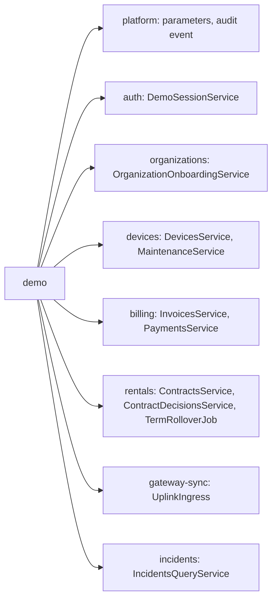

# Technical Design: demo (local demo control panel)

> Fulfills `requirements.md` in this folder (D-088). Written 2026-11-01 by KhoaDD under D-078, in the
> same branch as the code; it records what is built.

## 1. Module

`backend/src/modules/demo/`, imported by `AppModule` through `ConditionalModule.registerWhen` only when
`DEMO_CONTROLS_ENABLED` is `true` (platform requirements §4). It owns no Prisma model. It depends on the
modules of **Figure 1**, which are also the `DEMO` edges of platform design Figure 3; nothing depends on it.

***Figure 1***: The demo module's dependencies. Each box names the exported service it calls.

| Class | Role |
|---|---|
| `DemoController` | The four routes of api-design 01 to 04 |
| `DemoGuardService` | The three checks of §2, and the one-at-a-time lock |
| `DemoAccountsModule`, `DemoAccountsController`, `DemoAccountsService` | The public test accounts read of api-design 05, under its own flag (§8) |
| `DemoResetRepository` | The truncation of §3, raw SQL on table names read from `pg_tables` |
| `DemoSeedRunner` | Loads `prisma/seed-demo.ts` at run time and calls its exported `seedDemo` and `readPasswords` (§4) |
| `DemoScenariosService` | The scenario list, staging, records and first steps (§5) |
| `DemoSimulationModule`, `DemoSimulationController`, `DemoSimulationGuard` | The field simulation routes of api-design 06 to 10 and the database check of §9, under `DEMO_SIMULATION_ENABLED`; the logic is `FieldSimulationService` of `gateway-sync` |

## 2. Guards

Every `POST` runs, in this order: `NODE_ENV` is not `production` (403 `DEMO_DISABLED`); the host of
both `DATABASE_URL` and `DATABASE_DIRECT_URL` is `localhost`, an IPv4 address in `127.0.0.0/8` or `::1`,
and neither query string carries `host`, `hostaddr`, `service` or `servicefile`, in any case and after
URL decoding (403 `DEMO_DATABASE_NOT_LOCAL`); no other `POST` is running in this process (409 `DEMO_BUSY`). The lock is an in-process flag, enough for
the single backend of a demo laptop. The reads answer the same facts as data (`enabled`,
`databaseLocal`) so the screen can disable its buttons.

## 3. Reset and the reference tables

One transaction: null and drop each foreign key from a kept table to a truncated one, `TRUNCATE` every
other table of the connection's schema (`public` unless `DATABASE_URL` names another) with `RESTART IDENTITY CASCADE`, re-create the dropped keys from
`pg_get_constraintdef`. Kept tables, each filled only by migrations:

| Table | Filled by |
|---|---|
| `_prisma_migrations` | Prisma |
| `business_parameters` | `20261004120100_seed`, `20261027090000_map_basemaps` (and value updates in `20261026170000_map_cyclosm_terrain`, `20261030220000_map_drop_osm_standard`, `20261030234000_map_default_esri`) |
| `roles` | `20261004120100_seed` |
| `permissions` | `20261004120100_seed`, `20261030120000_api_key_read`, `20261030120000_permission_maintenance_decide`, `20261030130000_permission_device_dispose`, `20261030160000_compliance_and_rotation`, `20261030210000_permission_organization_history_read_own`, `20261101120000_demo_controls` |
| `role_permissions` | the same migrations as `permissions` |

`business_parameters."updatedById"` references `users`, so the reset sets it to null before the
truncation; a parameter changed in a rehearsal keeps its value, and its history rows go with the other
tables. The two sequences (`field_events_seq_seq`, `stream_events_seq_seq`) are owned by their tables
and restart with them.

## 4. Seed

`prisma/seed-demo.ts` keeps its CLI and exports `seedDemo(prisma, passwords, options)` and
`readPasswords(env)`. The backend build compiles only `src/`, so `DemoSeedRunner` loads the file at run
time by path, registering `ts-node` (a dev dependency, present wherever the demo runs) when the process
has no `.ts` loader. The seed opens its own transaction, so a failure after the truncation leaves an
empty database; staging again repairs it. The seed runs with `now` set
`gatewaySync.attributionMarginSeconds` plus one minute in the past, so a reading or an SOS sent right
after a stage is attributed to the seeded handovers instead of falling inside the margin.

## 5. Scenarios

| Id | Flow | Extra steps after the seed, each through an exported service |
|---|---|---|
| `clean` | MF-01a, MF-01, MF-02, MF-03, MF-04 | none |
| `org-pending-approval` | MF-01a | `OrganizationOnboardingService.register` with the demo script's data: ORG-0002 PENDING |
| `contract-ready-for-handover` | MF-01 | `ContractsService.request` as the Manager (five `treklink-v3`, today), `ContractDecisionsService.approve` as Staff (appointment at the next minute), `PaymentsService.recordCounter` of the holding-fee line of `InvoicesService.firstChargeableInvoice` |
| `sos-open` | MF-03 | `UplinkIngress.ingest` of `backend/test/fixtures/mqtt/sos.json` with a fresh packet id and the time now, as `replay:mqtt -- sos --now --new-ids` publishes it |
| `term-ended` | MF-05 | `ContractDecisionsService.giveNotice` on RC-2026-0002 as the Manager, `ContractsService.endOpenTermAt` at `rolloverTermEnd`, `TermRolloverJob.run` |
| `asset-maintenance` | assets | `MaintenanceService.open` on TL-0007 (`STAFF_REPORTED`), `DevicesService.scheduleService` on TL-0002 for tomorrow |
| `loss-cases` | MF-05 | unavailable: "Needs the loss cases change (treklink-web#228)." |

After the steps the service issues the Admin session through `DemoSessionService` and emits one
`audit.record` (`demo.stage`, subject `DemoScenario` and the scenario id, actor the new Admin).

## 6. Role switch

`DemoSessionService.switchTo(email, client)` in `auth` loads the account by email, checks it may sign in
(`AccountSessionService.eligible`), records `DEMO_SWITCH` and issues a pair through `TokenService.issue`,
the same path as a sign-in. It refuses with 403 `DEMO_DISABLED` unless `DEMO_CONTROLS_ENABLED` is true
and `NODE_ENV` is not production, so no other module can use it as a password bypass. Permissions are
`demo.switchRole` (Staff, so also Admin) and `demo.switchRole.org` (Operator, so also Manager): one key per
account type (D-057).

## 7. Errors

| Code | Status | When |
|---|---|---|
| `DEMO_DISABLED` | 403 | `NODE_ENV` is production |
| `DEMO_DATABASE_NOT_LOCAL` | 403 | `DATABASE_URL` host is not loopback |
| `DEMO_BUSY` | 409 | another stage or switch is running |
| `DEMO_SCENARIO_UNAVAILABLE` | 409 | scenario listed with `available: false` |
| `DEMO_SEED_NOT_CONFIGURED` | 409 | a `SEED_*_PASSWORD` is missing |
| `DEMO_DATABASE_NOT_ALLOWED` | 403 | a simulation write on a database neither loopback nor `treklink_prod` (§9) |
| `DEMO_NODE_RUNNING` | 409 | the device already runs as a simulated node (§9) |

## 8. Sandbox test accounts

D-088 amendment of 2026-11-01: testers open the deployed frontend and sign in as any role without asking
for a password. D-089: the list also shows on the Vercel production (`NODE_ENV=production`, a Neon
branch), so it has its own flag and none of the guards of §2.

`DemoAccountsModule` is a second Nest module in the `demo` folder. `AppModule` registers it through
`ConditionalModule.registerWhen(DemoAccountsModule, demoTestAccountsEnabled)`, independently of
`DemoModule`. It imports no other module, touches no database and holds only `DemoAccountsController`
(`GET /api/demo/accounts`, api-design 05, `@Public()`, `Cache-Control: no-store`) and
`DemoAccountsService`. The Vercel function ships only the build of `src/`, with no `ts-node` and no
`prisma/` folder, so the service never loads the seed file (decision of the leader, 2026-11-01). It reads
`SEEDED_TEST_ACCOUNTS` and `readTestAccountPasswords` of `demo-test-accounts.ts`, a compiled copy of the
seed's `SEEDED_ACCOUNTS` export (in its own block of `seed-demo.ts`) and of the variables its
`readPasswords` reads, and maps each account to `{ role, roleLabel, email, password, fullName,
organization }`; a missing variable answers 409 `DEMO_SEED_NOT_CONFIGURED`. `demo-test-accounts.spec.ts`
fails when the copy differs from the seed's list or variables, and checks that the accounts module loads
with the seed runner and the seed file made unloadable. The passwords are read from the environment on
every request and appear in no log line. The labels match the account menu, with the TrekLink prefix on
the two staff roles.

The control panel keeps every check of §2: `DemoModule` still loads only with `DEMO_CONTROLS_ENABLED`, and
its stage and role switch still refuse production and a database off the machine, so the reset is never
reachable on a Neon host whatever the accounts flag says.

The frontend `TestAccountsBox` widget (screen 7.5 §"Sandbox test accounts box") renders nothing on any
error, so a deployment with the flag off shows nothing.

## 9. Field simulation (D-093 amendment, D-094, 2026-11-02)

Requirements §2.4. A person drives the supervisor demo from the browser, on the local stack or on the Vercel
staging, with no agent and no script. The simulation extends the field data simulator of gateway-sync
design §2 (D-090 rule 2); it never resets anything, so the guards of §2 do not apply to it.

**Ownership.** The simulated nodes are field data, so `gateway-sync` owns the model and the logic and exports
`FieldSimulationService`; `demo` owns only the routes and the guard, and calls it (the existing `DEMO` to
`gateway-sync` edge of Figure 1). `incidents` and `monitoring` read the simulated mark from what they already
receive; no new module edge.

**Flag and guard.** `DEMO_SIMULATION_ENABLED` (default `false`) loads `DemoSimulationModule` (routes of
api-design 06 to 10) and switches the simulator from its two fixed nodes to the table below. Every write
first checks the database: loopback per §2, or the database name `treklink_prod` in both `DATABASE_URL`
and `DATABASE_DIRECT_URL` (as `backend/scripts/vercel-build.sh` does); otherwise 403
`DEMO_DATABASE_NOT_ALLOWED`. On the `treklink_prod` branch the query may carry none of `host`, `hostaddr`,
`service`, `servicefile`, `dbname` or `database` (any case, after decoding), because each would move the
connection off the staging. The simulator job's `run` makes the same check and sends nothing (logged once)
when it fails. `NODE_ENV` is not checked. Policy `demo.simulate`, TrekLink Admin, seeded by the
migration with the permission.

**Model** (gateway-sync, migration `simulation`, forward only):

| Table | Columns |
|---|---|
| `simulated_nodes` | `id`, `deviceId` (unique while `status = RUNNING`), `nodeNum`, `trailId`, `pattern` (`WALK`, `STOP`, `STRAY`, `SILENT`, `LOW_BATTERY`), `style` (§9.1, null for a node started before the styles) and `styleSeed`, `speedMetresPerMinute` (default 60), `anchorAt`, `anchorMetres` (distance along the trail at the anchor), `anchorLat`, `anchorLon`, `anchorBattery`, `direction` (1 or -1), `strayBearing` (null unless `STRAY`), `sosKind` (null, `SOS` or `FALL`), `sosSince`, `beaconedUntil` (time of the last beacon ingested, null without an SOS), `status` (`RUNNING`, `STOPPED`), `version`, `createdById`, `createdAt`, `updatedAt` |
| `field_events` | new column `simulated boolean not null default false` |
| `incidents` | new column `simulated boolean not null default false`, set when the opening event is simulated |

**Position.** Stateless per run, as today: the position at time `t` is derived from the anchor and the
elapsed time `t - anchorAt` under the pattern, so every instance computes the same packet for an interval
and ingestion stores it once (D-006 ids from node, kind and interval start). A pattern change, a speed or
trail change, or `SOS` writes a new anchor at the node's current position, so the move continues from
there. `WALK` and `LOW_BATTERY` move along the trail and turn back at either end; `STRAY` moves 300 m along
`strayBearing` (perpendicular to the trail at the anchor) over ten minutes and then stops; `STOP` stays;
`SILENT` sends nothing. Battery: 100 at start, minus 0.1 a minute, minus 2 a minute under `LOW_BATTERY`,
never below 5.

**SOS.** `SOS` or `FALL` sets `sosKind` and `sosSince` and ingests the text packet at once
(`SOS - [lat], [lon]` or `SOS - FALL DETECTED - [lat], [lon]`, six decimals, firmware ground truth §2)
with the first position beacon, because the SOS text carries no fix of its own (incidents `SosEvent`);
then each run adds the beacon positions due since `beaconedUntil`: every 5 s for the first 60 s, every
30 s after, at most the last ten minutes of them after a long pause between runs. While an SOS is active
the beacons replace the interval's position packet; telemetry continues. A second `SOS` restarts the
beacons and joins the open incident (incidents §4). `SOS_CANCEL` clears `sosKind`; no packet is sent,
because the firmware sends none; a `SOS_CANCEL` with no active SOS is 409 `INVALID_STATE_TRANSITION`.

**9.1 Movement styles (leader ruling 2026-11-06, REQ-SIM-09).** While the pattern walks (`WALK`,
`LOW_BATTERY`), the node's `style` decides how it moves; `STOP`, `STRAY` and `SILENT` keep their meaning, so
the scripted demo cases still work on any style. Like the rest of the model, a style is a pure function of
the anchor, the elapsed time and the node's `styleSeed`, so every run and instance computes the same packet.
`styleSeed` is FNV-1a 32 of `treklink-sim-v1:{assetTag}` shifted right one bit, so it fits the signed
32-bit column; the default style is `SIMULATION_STYLES[seed mod 8]`.
Every number below is drawn once from the seed inside its range (`field-styles.ts`). Speeds are on the
ground; the "smooth random" offsets interpolate seeded values with a cosine, so a path never jumps.

| Style | Moves | Pace | Rests and phases | Off the trail | Battery a minute |
|---|---|---|---|---|---|
| `JOGGER` | out and back along the trail, steady | 2.5 to 3.5 m/s | none | on the trail | 0.25 |
| `HIKER` | along the trail in cycles | 1.2 to 1.6 m/s | walk 15 to 25 min, break 5 to 10 min standing, then one circle round the spot (radius 20 to 35 m, 3 to 5 min) | the circle only | 0.15 |
| `CAMPER` | from the anchor to a camp, back again | 0.9 to 1.1 m/s | camp 300 to 800 m along the trail and 40 to 80 m off it; stays there 30 to 60 min (drifting within 10 m), returns, stays 10 to 20 min, repeats | up to 80 m | 0.08 |
| `EXPLORER` | smooth random walk round the anchor | up to about 1.6 m/s | none | within 300 m of the anchor on each axis | 0.18 |
| `TRAIL_WALKER` | along the trail in cycles | 0.9 to 1.1 m/s | walk 12 to 20 min, rest 3 to 6 min | on the trail | 0.12 |
| `WANDERER` | slow smooth random walk round the anchor, a camp or viewpoint | up to about 1 m/s, mostly far less | none | within 80 m of the anchor on each axis | 0.08 |
| `GROUP_FOLLOWER` | behind the trail's lead guide, who walks the trail at 1.0 to 1.2 m/s, resting 5 min in every 25, on a schedule of the trail and the clock, so every follower of one trail moves as one group | the guide's | the guide's | 20 to 50 m behind, 5 to 15 m to one side, swaying | 0.12 |
| `STRAGGLER` | half the seeds stand at camp (a 3 m sway); the other half lag along the trail and drift off it and back | 0.5 to 0.7 m/s | walk 10 min, rest 5 min | drifts up to 60 to 150 m off and back over 30 min | 0.40 |

A `STRAGGLER` also falls silent for 7 to 10 min in every 30 to 45 (a radio shadow): no position and no
telemetry in those intervals, so it turns offline past `monitoring.deviceStaleSeconds`, and its fast drain
reaches the low-battery case within a demo. An SOS raised in a shadow still sends its beacons. A node that
changes to `GROUP_FOLLOWER` joins its trail's group, so it moves at once to its place behind the guide; any
other change continues from where the node is. The panel shows a style picker on Add node and on each row
(Change style); `GET /api/demo/simulation` lists `styles`, and a node returns `style` (null for a node
started before the styles, which keeps the steady walk at `speedMetresPerMinute`). A styled node ignores
`speedMetresPerMinute`. Tests per style check the movement envelope with a fixed seed: the fastest step,
the farthest point from the trail or anchor, the rests, the camp stay, the group spread and the shadow.

**Constants.** The movement model's numbers (default speed 60 m/min, accepted speed 10 to 300 m/min, the
300 m stray over ten minutes, the battery rates and floor) are simulation constants of this section, kept
in `field-simulation.ts`; the beacon cadence is the firmware's. Only the run interval is a business
parameter (`gatewaySync.simulatorIntervalSeconds`).

**Speed rule.** A simulated position is exempt from the implausible-move rule of gateway-sync
(`monitoring.maxPlausibleSpeedKmh`): a start or a trail change places the node on another trail on
purpose, and the rule would then hide the node until the jump looked slow enough. The speed of a
simulated walk is bounded by the constants above and checked by unit tests.

**Ingestion.** `UplinkIngress` (gateway-sync) gains an option `{ simulated: true }`: the stored
`FieldEvent` carries it, and the `SosEvent` and position hand-offs carry it on to `incidents` (which stores
it on a new incident) and to the device projection. The real MQTT path never sets it.

**Labels.** The map snapshot and device lists of `monitoring` return `simulated` for a device whose latest
field event is simulated, under the custody clipping of the position (D-040): for an organization only an
event since the handover counts, so a unit not heard in its custody is `simulated: false`; TrekLink staff
see the stored history unclipped. The incident reads return the incident's `simulated`. The frontend shows a
"Simulated" badge (`shared/ui` `Badge`, neutral tone, text not colour alone) on those markers, rows and
the incident header, and on every row of the panel.

**Trails.** `gateway-sync/simulator/trails.ts`: at least three Vietnamese trails from OpenStreetMap through
the Overpass API, each with `id`, `name`, `region`, `osmWayIds`, the read date, the point list simplified
(Douglas-Peucker, 10 m) and its length; the Ta Nang to Phan Dung path of D-090 stays as `ta-nang-phan-dung`.
Attribution "© OpenStreetMap contributors, ODbL" on the panel. No trail is fetched at run time.

**Runs.** Unchanged: the simulator job runs every 10 s locally and from the request tick on Vercel
(`JOBS_TICK_ON_REQUEST`), and the panel polls every 15 s while open, which keeps the staging ticking during a
demo. `AppModule` loads `FieldSimulatorModule` when `FIELD_SIMULATOR_ENABLED` or `DEMO_SIMULATION_ENABLED` is
`true`, so the simulation also runs on a local stack whose MQTT subscriber is on; the job reads the table
when `DEMO_SIMULATION_ENABLED` is `true` and sends the fixed two-node batch otherwise.

**Routes** (api-design 06 to 10, generated from `scripts/specs/endpoints/demo.py`):

| # | Route | Body | Answer |
|---|---|---|---|
| 06 | `GET /api/demo/simulation` | | `{ databaseAllowed, trails, patterns, styles, devices, nodes }` (REQ-SIM-08); `databaseAllowed` lets the screen disable the writes |
| 07 | `POST /api/demo/simulation/nodes` | `{ deviceId, trailId, pattern, style?, speedMetresPerMinute?, startMetres? }` | the node; 409 `DEMO_NODE_RUNNING` if the device already runs; 400 `VALIDATION_FAILED` if the trail is unknown; 404 for a missing or `DISPOSED` device (every device has a `nodeNum`, a required column) |
| 08 | `PATCH /api/demo/simulation/nodes/:id` | `{ expectedVersion, pattern?, style?, trailId?, speedMetresPerMinute? }` | the node with a new anchor; 409 `STALE_VERSION`, 409 `INVALID_STATE_TRANSITION` when stopped |
| 09 | `POST /api/demo/simulation/nodes/:id/stop` | `{ expectedVersion }` | the node `STOPPED` |
| 10 | `POST /api/demo/simulation/nodes/:id/events` | `{ kind: SOS, FALL or SOS_CANCEL }` | `{ node, fieldEventId }`, `fieldEventId` null for `SOS_CANCEL`; 409 `INVALID_STATE_TRANSITION` when stopped |

Every write: the database check, the policy, one audit entry (REQ-SIM-07), and the D-002 envelope.

**Screen** (7.5, section "Field simulation", shown while the flag is on): a table of simulated nodes (asset
tag, organization, trail, pattern, position, battery, last packet, SOS state, Simulated badge) with row
actions Change pattern, SOS, Fall, Cancel SOS, Stop; a form Add node (device picker of devices with a
`nodeNum`, trail, pattern, speed); quick buttons for the demo cases of the script (an SOS on a rented node,
a node going silent, a node straying); the panel polls every 15 s. The nav entry shows while either the
control panel or the simulation is enabled; staging and the role switch keep their own flag and guards.

## 10. Additive staging controls (W43, 2026-11-07)

The module condition combines DEMO_CONTROLS_ENABLED with explicit VITE_APP_ENV sandbox/staging, the signal used by EnvironmentBadge (#420). A quick guard rechecks these plus both URLs through simulationDatabaseAllowed and refuses any caller without ADMIN or with an organization context. Legacy DemoGuardService and DemoSessionService.switchTo retain their local production refusal. Read-only account lookup may be used by additive scenarios without issuing tokens.

DemoScenarioRun owns a database counter and provenance: actual actor, action, demo label, result links and failure. DemoControlState owns the escalation profile snapshot and version. These are demo-owned models, added by a forward migration. No cross-module repository access is permitted. Existing demo.stage is reused, no new permission is introduced. Work calls owning exported services, followed by a committed registry update and audit event. Business operations have their own transactions; a multi-step failure leaves inspectable partial records, never a rollback claim about already committed work.

Options come from small exported reads: Active organizations with an active Manager, active variants, live contract custody and incident versions. Quick contracts execute as the actual Admin with an explicit organization context for the request and notice; the organization's active Manager is the disclosed synthetic handover signer. The real HandoverService records manual provisioning, a demo identity description and a synthetic PNG signature, and creates its normal note. A fresh request has its own real stock reservation and invoice. Invoice amounts and minimum quantities come from their services and ParameterService. An ACTIVE scenario uses at least two units. A time control checks version under the owning contract lock before changing its open term and runs only that contract's rollover.

Quick SOS uses the fixture's packet shape with the selected node number and fresh packet id, through UplinkIngress.ingest with simulated provenance. Existing incident deduplication remains effective. Incident time advance is an exported owning command, guarded by simulated provenance, which locks the incident, checks version, makes its current tier due and uses the normal lifecycle and routing in one transaction.

ParameterService exposes transactional reads and updates so the four profile values, history, restore snapshot and audit commit together. Restoring requires the versions saved on activation, preventing an external parameter change from being lost. Simulator refresh changes only simulator-owned anchors and ingests through its existing run path.
