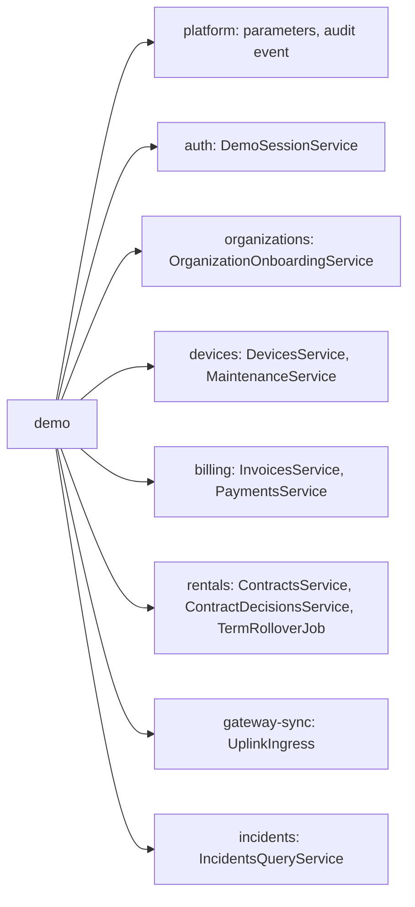

# Technical Design: demo (local demo control panel)

> Fulfills `requirements.md` in this folder (D-088). Written 2026-11-01 by KhoaDD under D-078, in the
> same branch as the code; it records what is built.

## 1. Module

`backend/src/modules/demo/`, imported by `AppModule` through `ConditionalModule.registerWhen` only when
`DEMO_CONTROLS_ENABLED` is `true` (platform requirements §4). It owns no Prisma model. It depends on the
modules of **Figure 1**, which are also the `DEMO` edges of platform design Figure 3; nothing depends on it.

***Figure 1***: The demo module's dependencies. Each box names the exported service it calls.

| Class | Role |
|---|---|
| `DemoController` | The four routes of api-design 01 to 04 |
| `DemoGuardService` | The three checks of §2, and the one-at-a-time lock |
| `DemoResetRepository` | The truncation of §3, raw SQL on table names read from `pg_tables` |
| `DemoSeedRunner` | Loads `prisma/seed-demo.ts` at run time and calls its exported `seedDemo` (§4) |
| `DemoScenariosService` | The scenario list, staging, records and first steps (§5) |

## 2. Guards

Every `POST` runs, in this order: `NODE_ENV` is not `production` (403 `DEMO_DISABLED`); the host of
`DATABASE_URL` is `localhost`, an IPv4 address in `127.0.0.0/8` or `::1` (403 `DEMO_DATABASE_NOT_LOCAL`);
no other `POST` is running in this process (409 `DEMO_BUSY`). The lock is an in-process flag, enough for
the single backend of a demo laptop. The reads answer the same facts as data (`enabled`,
`databaseLocal`) so the screen can disable its buttons.

## 3. Reset and the reference tables

One transaction: null and drop each foreign key from a kept table to a truncated one, `TRUNCATE` every
other table of the connection's schema (`public` unless `DATABASE_URL` names another) with `RESTART IDENTITY CASCADE`, re-create the dropped keys from
`pg_get_constraintdef`. Kept tables, each filled only by migrations:

| Table | Filled by |
|---|---|
| `_prisma_migrations` | Prisma |
| `business_parameters` | `20261004120100_seed`, `20261027090000_map_basemaps` (and value updates in `20261026170000_map_cyclosm_terrain`, `20261030220000_map_drop_osm_standard`, `20261030234000_map_default_esri`) |
| `roles` | `20261004120100_seed` |
| `permissions` | `20261004120100_seed`, `20261030120000_api_key_read`, `20261030120000_permission_maintenance_decide`, `20261030130000_permission_device_dispose`, `20261030160000_compliance_and_rotation`, `20261030210000_permission_organization_history_read_own`, `20261101120000_demo_controls` |
| `role_permissions` | the same migrations as `permissions` |

`business_parameters."updatedById"` references `users`, so the reset sets it to null before the
truncation; a parameter changed in a rehearsal keeps its value, and its history rows go with the other
tables. The two sequences (`field_events_seq_seq`, `stream_events_seq_seq`) are owned by their tables
and restart with them.

## 4. Seed

`prisma/seed-demo.ts` keeps its CLI and exports `seedDemo(prisma, passwords, options)` and
`readPasswords(env)`. The backend build compiles only `src/`, so `DemoSeedRunner` loads the file at run
time by path, registering `ts-node` (a dev dependency, present wherever the demo runs) when the process
has no `.ts` loader. The seed opens its own transaction, so a failure after the truncation leaves an
empty database; staging again repairs it. The seed runs with `now` set
`gatewaySync.attributionMarginSeconds` plus one minute in the past, so a reading or an SOS sent right
after a stage is attributed to the seeded handovers instead of falling inside the margin.

## 5. Scenarios

| Id | Flow | Extra steps after the seed, each through an exported service |
|---|---|---|
| `clean` | MF-01a, MF-01, MF-02, MF-03, MF-04 | none |
| `org-pending-approval` | MF-01a | `OrganizationOnboardingService.register` with the demo script's data: ORG-0002 PENDING |
| `contract-ready-for-handover` | MF-01 | `ContractsService.request` as the Manager (five `treklink-v3`, today), `ContractDecisionsService.approve` as Staff (appointment at the next minute), `PaymentsService.recordCounter` of the holding-fee line of `InvoicesService.firstChargeableInvoice` |
| `sos-open` | MF-03 | `UplinkIngress.ingest` of `backend/test/fixtures/mqtt/sos.json` with a fresh packet id and the time now, as `replay:mqtt -- sos --now --new-ids` publishes it |
| `term-ended` | MF-05 | `ContractDecisionsService.giveNotice` on RC-2026-0002 as the Manager, `ContractsService.endOpenTermAt` at `rolloverTermEnd`, `TermRolloverJob.run` |
| `asset-maintenance` | assets | `MaintenanceService.open` on TL-0007 (`STAFF_REPORTED`), `DevicesService.scheduleService` on TL-0002 for tomorrow |
| `loss-cases` | MF-05 | unavailable: "Needs the loss cases change (treklink-web#228)." |

After the steps the service issues the Admin session through `DemoSessionService` and emits one
`audit.record` (`demo.stage`, subject `DemoScenario` and the scenario id, actor the new Admin).

## 6. Role switch

`DemoSessionService.switchTo(email, client)` in `auth` loads the account by email, checks it may sign in
(`AccountSessionService.eligible`), records `DEMO_SWITCH` and issues a pair through `TokenService.issue`,
the same path as a sign-in. It refuses with 403 `DEMO_DISABLED` unless `DEMO_CONTROLS_ENABLED` is true
and `NODE_ENV` is not production, so no other module can use it as a password bypass. Permissions are
`demo.switchRole` (Staff, so also Admin) and `demo.switchRole.org` (Operator, so also Manager): one key per
account type (D-057).

## 7. Errors

| Code | Status | When |
|---|---|---|
| `DEMO_DISABLED` | 403 | `NODE_ENV` is production |
| `DEMO_DATABASE_NOT_LOCAL` | 403 | `DATABASE_URL` host is not loopback |
| `DEMO_BUSY` | 409 | another stage or switch is running |
| `DEMO_SCENARIO_UNAVAILABLE` | 409 | scenario listed with `available: false` |
| `DEMO_SEED_NOT_CONFIGURED` | 409 | a `SEED_*_PASSWORD` is missing |
