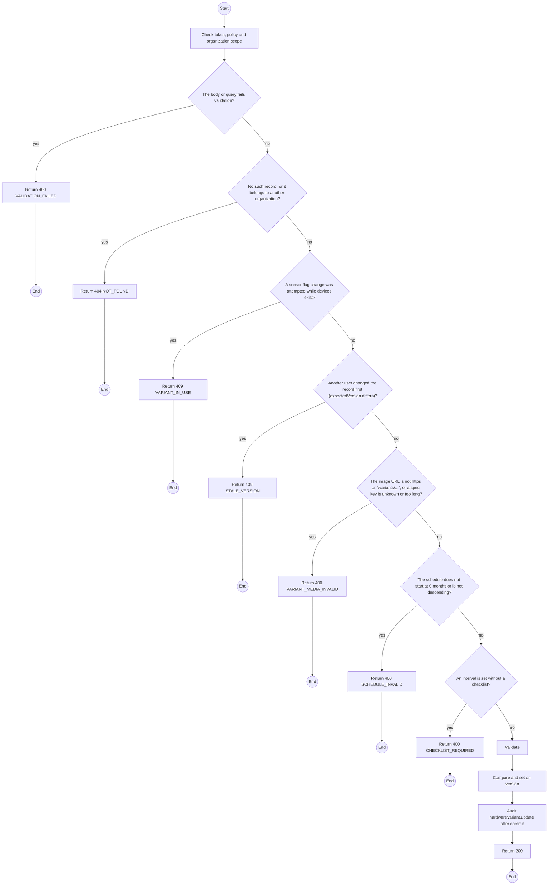
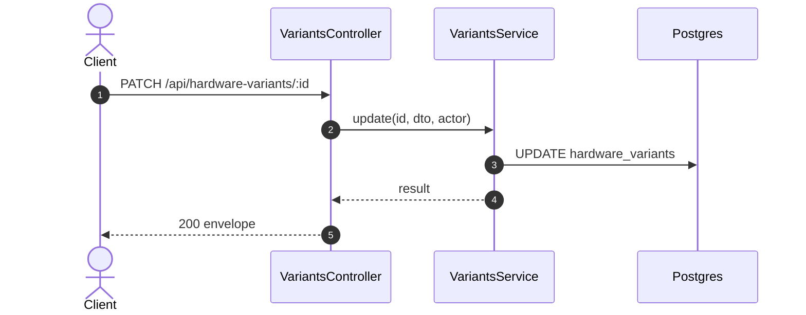

# PATCH /api/hardware-variants/:id: Edit a hardware variant

> Module `devices`. Generated from `scripts/specs/endpoints/devices.py` by `scripts/specs/build_api_design.py`; edit the catalog, not this file. Format: `02-templates/04-api-endpoint-template.md` with Mermaid (D-017). Envelope: D-002.

[TOC]

---
## Overview

Edits a variant's name, baseline, schedule, service plan or active flag. Sensor flags are fixed once devices exist, because past intake checks depend on them. A new interval applies from each device's next completed service; a new baseline makes the weekly scan flag every device on an older firmware (D-047). The code is fixed after create. The edit is a compare-and-set on `version` (design section 11).

## API Specification

| API | URL |
| --- | --- |
| PATCH | /api/hardware-variants/:id |
| Permission | TrekLink Admin |
| Traces | UC-13, FR-DEV-04, FR-DEV-18 |

### Path parameters

| Field | Description | Data Type | Examples |
| --- | --- | --- | --- |
| id | Variant id | uuid | `a1b2c3d4-e5f6-4a7b-8c9d-0e1f2a3b4c5d` |

## Request sample

```json
{
  "isActive": false,
  "expectedVersion": 3
}
```

| Field | Description | Data Type | Required | Examples |
| --- | --- | --- | --- | --- |
| name | Name | string | no | `...` |
| firmwareBaseline | Baseline | string | no | `...` |
| remainingValueSchedule | Schedule | json | no | `[...]` |
| serviceIntervalDays | Days between services, or null | int | no | `180` |
| serviceChecklist | Service checklist items | string[] | no | `[...]` |
| isActive | Offer in new requests | bool | no | `false` |
| imageUrl | Photo URL or app path under `/variants/`, or null to clear (design §10) | string | no | `/variants/treklink-v3.jpg` |
| specSheet | Spec sheet, replaces the stored one; keys from design §10 only | object | no | `{"mcu": "ESP32"}` |
| hasGps | Sensor flag; refused while units are registered | bool | no | `true` |
| hasMotionSensor | Sensor flag; refused while units are registered | bool | no | `false` |
| mqttCapable | Sensor flag; refused while units are registered | bool | no | `true` |
| expectedVersion | Variant version the caller saw | int | yes | `3` |

## Response sample

```json
{
  "result": {
    "id": "a1b2c3d4-e5f6-4a7b-8c9d-0e1f2a3b4c5d",
    "code": "treklink-v3",
    "name": "TrekLink v3 (GPS, SOS button)",
    "hasGps": true,
    "hasMotionSensor": false,
    "mqttCapable": true,
    "firmwareBaseline": "2.7.19-treklink.3",
    "remainingValueSchedule": [
      {
        "fromMonths": 0,
        "valueVnd": 2500000
      },
      {
        "fromMonths": 12,
        "valueVnd": 1800000
      },
      {
        "fromMonths": 24,
        "valueVnd": 1200000
      }
    ],
    "serviceIntervalDays": 180,
    "serviceChecklist": [
      "Battery health",
      "Antenna and connector",
      "Enclosure seal",
      "Button and buzzer"
    ],
    "imageUrl": null,
    "specSheet": {
      "mcu": "ESP32",
      "sosControl": "3 s hold on the user button",
      "localAlarm": "LED blinks"
    },
    "isActive": false,
    "deviceCount": 18,
    "version": 4
  },
  "isSuccess": true,
  "statusCode": 200,
  "message": "Saved."
}
```

## Validation

<table>
    <th>Status code</th>
    <th>Description</th>
    <th>Examples</th>
    <tbody>
        <tr>
            <td>400</td>
            <td>The body or query fails validation (<code>VALIDATION_FAILED</code>)</td>
<td>

```json
{
  "result": {
    "errorCode": "VALIDATION_FAILED"
  },
  "isSuccess": false,
  "statusCode": 400,
  "message": "{field} is required."
}
```
</td>
        </tr>
        <tr>
            <td>401</td>
            <td>Missing, malformed or expired access token or API key (<code>UNAUTHENTICATED</code>)</td>
<td>

```json
{
  "result": {
    "errorCode": "UNAUTHENTICATED"
  },
  "isSuccess": false,
  "statusCode": 401,
  "message": "Authentication required."
}
```
</td>
        </tr>
        <tr>
            <td>403</td>
            <td>The caller's role, policy or organization does not allow this action (<code>FORBIDDEN</code>)</td>
<td>

```json
{
  "result": {
    "errorCode": "FORBIDDEN"
  },
  "isSuccess": false,
  "statusCode": 403,
  "message": "You do not have access to this."
}
```
</td>
        </tr>
        <tr>
            <td>404</td>
            <td>No such record, or it belongs to another organization (<code>NOT_FOUND</code>)</td>
<td>

```json
{
  "result": {
    "errorCode": "NOT_FOUND"
  },
  "isSuccess": false,
  "statusCode": 404,
  "message": "Hardware variant not found."
}
```
</td>
        </tr>
        <tr>
            <td>409</td>
            <td>A sensor flag change was attempted while devices exist (<code>VARIANT_IN_USE</code>)</td>
<td>

```json
{
  "result": {
    "errorCode": "VARIANT_IN_USE"
  },
  "isSuccess": false,
  "statusCode": 409,
  "message": "Sensor flags cannot change once devices are registered."
}
```
</td>
        </tr>
        <tr>
            <td>409</td>
            <td>Another user changed the record first (expectedVersion differs) (<code>STALE_VERSION</code>)</td>
<td>

```json
{
  "result": {
    "errorCode": "STALE_VERSION"
  },
  "isSuccess": false,
  "statusCode": 409,
  "message": "This was changed by someone else. Reload and try again."
}
```
</td>
        </tr>
        <tr>
            <td>400</td>
            <td>The image URL is not https or `/variants/...`, or a spec key is unknown or too long (<code>VARIANT_MEDIA_INVALID</code>)</td>
<td>

```json
{
  "result": {
    "errorCode": "VARIANT_MEDIA_INVALID"
  },
  "isSuccess": false,
  "statusCode": 400,
  "message": "Check the image link and the spec sheet entries."
}
```
</td>
        </tr>
        <tr>
            <td>400</td>
            <td>The schedule does not start at 0 months or is not descending (<code>SCHEDULE_INVALID</code>)</td>
<td>

```json
{
  "result": {
    "errorCode": "SCHEDULE_INVALID"
  },
  "isSuccess": false,
  "statusCode": 400,
  "message": "remainingValueSchedule must start at 0 months and never increase."
}
```
</td>
        </tr>
        <tr>
            <td>400</td>
            <td>An interval is set without a checklist (<code>CHECKLIST_REQUIRED</code>)</td>
<td>

```json
{
  "result": {
    "errorCode": "CHECKLIST_REQUIRED"
  },
  "isSuccess": false,
  "statusCode": 400,
  "message": "Add at least one service checklist item."
}
```
</td>
        </tr>
    </tbody>
</table>

## Activity Diagram



## Sequence Diagram


