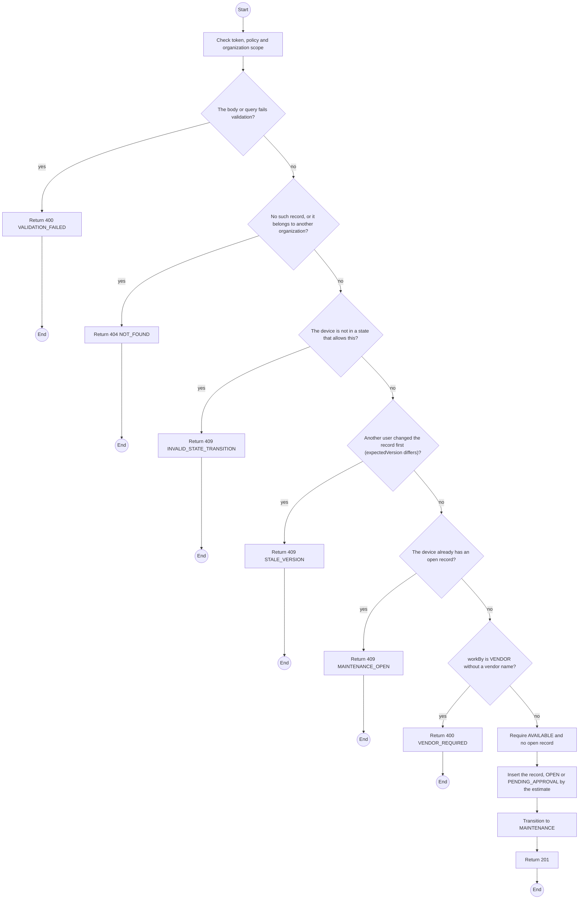
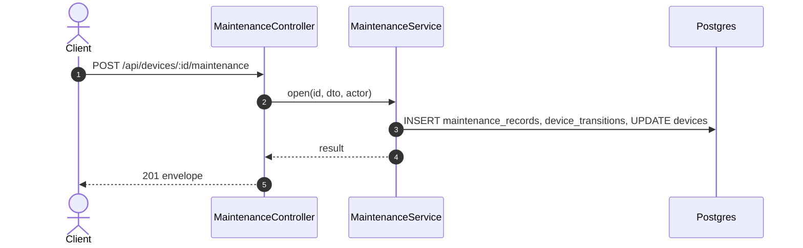

# POST /api/devices/:id/maintenance: Open maintenance

> Module `devices`. Generated from `scripts/specs/endpoints/devices.py` by `scripts/specs/build_api_design.py`; edit the catalog, not this file. Format: `02-templates/04-api-endpoint-template.md` with Mermaid (D-017). Envelope: D-002.

[TOC]

---
## Overview

Moves an `AVAILABLE` device to `MAINTENANCE` for a reported fault, a service or a firmware update, with a reason and an expected completion date (FR-DEV-08). The weekly scan opens `SCHEDULED` and `FIRMWARE_UPDATE` records itself (FR-DEV-18). An estimate above `devices.maintenanceApprovalThresholdVnd` puts the record in `PENDING_APPROVAL` (FR-DEV-20). A reserved device that fails its check at handover is swapped through the contract instead.

## API Specification

| API | URL |
| --- | --- |
| POST | /api/devices/:id/maintenance |
| Permission | TrekLink Staff |
| Traces | UC-52, FR-DEV-08, FR-DEV-20, D-047 |

### Path parameters

| Field | Description | Data Type | Examples |
| --- | --- | --- | --- |
| id | Device id | uuid | `0d3f6a2b-7e11-4c55-8f0a-2b1c9e7d4a10` |

## Request sample

```json
{
  "reason": "STAFF_REPORTED",
  "description": "Battery does not hold charge",
  "expectedAt": "2026-10-20",
  "workBy": "VENDOR",
  "vendorName": "Hoang Long Electronics",
  "estimatedCostVnd": 650000,
  "expectedVersion": 5
}
```

| Field | Description | Data Type | Required | Examples |
| --- | --- | --- | --- | --- |
| reason | `STAFF_REPORTED`, `SCHEDULED` or `FIRMWARE_UPDATE` | enum | yes | `STAFF_REPORTED` |
| description | What is to be done | string | yes | `Battery does not hold charge` |
| expectedAt | Expected completion date | date | yes | `2026-10-20` |
| workBy | `IN_HOUSE` or `VENDOR` | enum | no | `VENDOR` |
| vendorName | Required when workBy is VENDOR | string | no | `Hoang Long Electronics` |
| estimatedCostVnd | Estimated cost; may be set later | int | no | `650000` |
| expectedVersion | Device version the caller saw | int | yes | `5` |

## Response sample

```json
{
  "result": {
    "record": {
      "id": "mr-1",
      "device": {
        "id": "0d3f6a2b-7e11-4c55-8f0a-2b1c9e7d4a10",
        "assetTag": "TL-0042"
      },
      "reason": "STAFF_REPORTED",
      "status": "OPEN",
      "description": "Battery does not hold charge",
      "expectedAt": "2026-10-20",
      "workBy": "VENDOR",
      "vendorName": "Hoang Long Electronics",
      "estimatedCostVnd": 650000,
      "approvedCostVnd": null,
      "actualCostVnd": null,
      "warrantyUntil": null,
      "checklistResults": null,
      "firmwareVersion": null,
      "openedAt": "2026-10-20T03:15:00.000Z",
      "version": 1
    },
    "device": {
      "id": "0d3f6a2b-7e11-4c55-8f0a-2b1c9e7d4a10",
      "assetTag": "TL-0042",
      "nodeNum": 2763113171,
      "nodeId": "!a4b1c2d3",
      "hardwareVariant": {
        "id": "a1b2c3d4-e5f6-4a7b-8c9d-0e1f2a3b4c5d",
        "code": "treklink-v3"
      },
      "firmwareVersion": "2.7.19-treklink.3",
      "acquiredAt": "2026-06-15T00:00:00Z",
      "status": "MAINTENANCE",
      "statusChangedAt": "2026-10-20T03:15:00.000Z",
      "keyVersion": null,
      "keyOrganizationId": null,
      "batteryPct": 96,
      "lastSeenAt": "2026-10-20T03:15:00.000Z",
      "lastPosition": {
        "lat": 11.5544,
        "lon": 108.5381
      },
      "serviceDueAt": "2026-12-12",
      "version": 5
    }
  },
  "isSuccess": true,
  "statusCode": 201,
  "message": "Maintenance opened"
}
```

## Validation

<table>
    <th>Status code</th>
    <th>Description</th>
    <th>Examples</th>
    <tbody>
        <tr>
            <td>400</td>
            <td>The body or query fails validation (<code>VALIDATION_FAILED</code>)</td>
<td>

```json
{
  "result": {
    "errorCode": "VALIDATION_FAILED"
  },
  "isSuccess": false,
  "statusCode": 400,
  "message": "{field} is required."
}
```
</td>
        </tr>
        <tr>
            <td>401</td>
            <td>Missing, malformed or expired access token or API key (<code>UNAUTHENTICATED</code>)</td>
<td>

```json
{
  "result": {
    "errorCode": "UNAUTHENTICATED"
  },
  "isSuccess": false,
  "statusCode": 401,
  "message": "Authentication required."
}
```
</td>
        </tr>
        <tr>
            <td>403</td>
            <td>The caller's role, policy or organization does not allow this action (<code>FORBIDDEN</code>)</td>
<td>

```json
{
  "result": {
    "errorCode": "FORBIDDEN"
  },
  "isSuccess": false,
  "statusCode": 403,
  "message": "You do not have access to this."
}
```
</td>
        </tr>
        <tr>
            <td>404</td>
            <td>No such record, or it belongs to another organization (<code>NOT_FOUND</code>)</td>
<td>

```json
{
  "result": {
    "errorCode": "NOT_FOUND"
  },
  "isSuccess": false,
  "statusCode": 404,
  "message": "Device not found."
}
```
</td>
        </tr>
        <tr>
            <td>409</td>
            <td>The device is not in a state that allows this (<code>INVALID_STATE_TRANSITION</code>)</td>
<td>

```json
{
  "result": {
    "errorCode": "INVALID_STATE_TRANSITION"
  },
  "isSuccess": false,
  "statusCode": 409,
  "message": "This cannot be done while it is RENTED."
}
```
</td>
        </tr>
        <tr>
            <td>409</td>
            <td>Another user changed the record first (expectedVersion differs) (<code>STALE_VERSION</code>)</td>
<td>

```json
{
  "result": {
    "errorCode": "STALE_VERSION"
  },
  "isSuccess": false,
  "statusCode": 409,
  "message": "This was changed by someone else. Reload and try again."
}
```
</td>
        </tr>
        <tr>
            <td>409</td>
            <td>The device already has an open record (<code>MAINTENANCE_OPEN</code>)</td>
<td>

```json
{
  "result": {
    "errorCode": "MAINTENANCE_OPEN"
  },
  "isSuccess": false,
  "statusCode": 409,
  "message": "Finish the open maintenance record first."
}
```
</td>
        </tr>
        <tr>
            <td>400</td>
            <td>workBy is VENDOR without a vendor name (<code>VENDOR_REQUIRED</code>)</td>
<td>

```json
{
  "result": {
    "errorCode": "VENDOR_REQUIRED"
  },
  "isSuccess": false,
  "statusCode": 400,
  "message": "Name the vendor."
}
```
</td>
        </tr>
    </tbody>
</table>

## Activity Diagram



## Sequence Diagram


