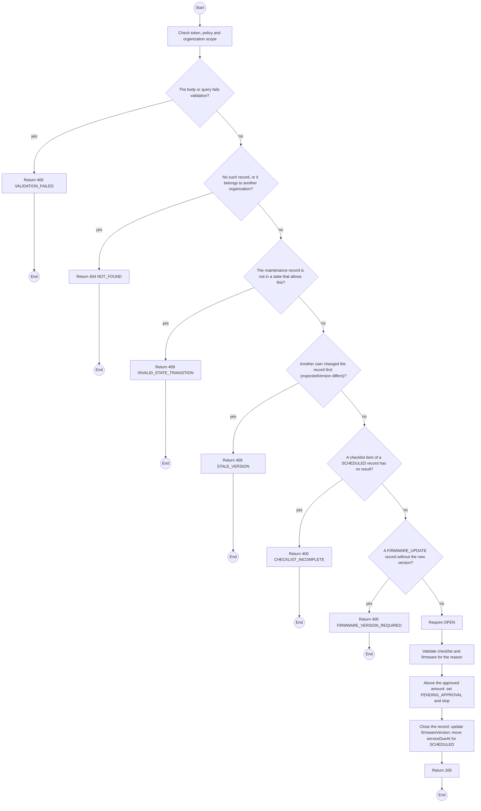
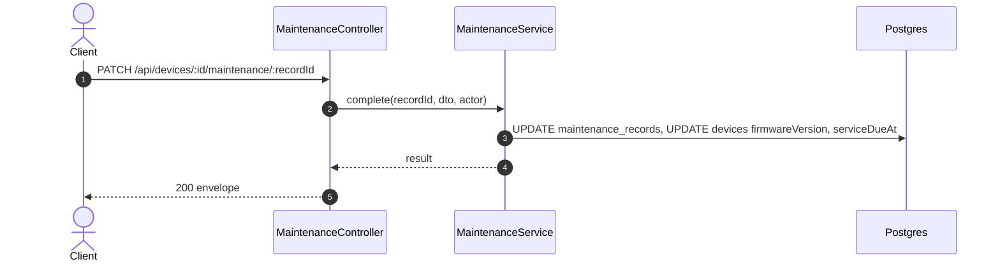

# PATCH /api/devices/:id/maintenance/:recordId: Complete or close maintenance

> Module `devices`. Generated from `scripts/specs/endpoints/devices.py` by `scripts/specs/build_api_design.py`; edit the catalog, not this file. Format: `02-templates/04-api-endpoint-template.md` with Mermaid (D-017). Envelope: D-002.

[TOC]

---
## Overview

Completes a record with the work done, the actual cost, any vendor warranty date, a result per checklist item for `SCHEDULED` and the new firmware version for `FIRMWARE_UPDATE`, or closes it `UNREPAIRABLE` for an Admin to retire the device. An actual cost above the approved amount, or above the threshold when nothing was approved, returns the record to `PENDING_APPROVAL` instead. A completed device stays `MAINTENANCE` until it passes an intake check; a completed `SCHEDULED` record moves `serviceDueAt` forward by the variant's interval (FR-DEV-08, FR-DEV-17, FR-DEV-21).

## API Specification

| API | URL |
| --- | --- |
| PATCH | /api/devices/:id/maintenance/:recordId |
| Permission | TrekLink Staff |
| Traces | UC-52, FR-DEV-08, FR-DEV-17, FR-DEV-20, FR-DEV-21 |

### Path parameters

| Field | Description | Data Type | Examples |
| --- | --- | --- | --- |
| id | Device id | uuid | `0d3f6a2b-7e11-4c55-8f0a-2b1c9e7d4a10` |
| recordId | Maintenance record id | uuid | `mr-1` |

## Request sample

```json
{
  "status": "COMPLETED",
  "resolution": "Battery and seal replaced",
  "actualCostVnd": 620000,
  "warrantyUntil": "2027-01-20",
  "expectedVersion": 3,
  "checklistResults": [
    {
      "item": "Battery health",
      "passed": true,
      "note": "replaced"
    },
    {
      "item": "Antenna and connector",
      "passed": true
    },
    {
      "item": "Enclosure seal",
      "passed": true,
      "note": "replaced"
    },
    {
      "item": "Button and buzzer",
      "passed": true
    }
  ]
}
```

| Field | Description | Data Type | Required | Examples |
| --- | --- | --- | --- | --- |
| status | `COMPLETED` or `UNREPAIRABLE` | enum | yes | `COMPLETED` |
| resolution | What was done | string | yes | `Battery and seal replaced` |
| actualCostVnd | Required for COMPLETED | int | no | `620000` |
| warrantyUntil | Vendor warranty on the work | date | no | `2027-01-20` |
| checklistResults | One result per checklist item; required for SCHEDULED | json | no | see sample |
| firmwareVersion | Firmware now on the unit; required for FIRMWARE_UPDATE | string | no | `2.7.19-treklink.4` |
| expectedVersion | Record version the caller saw | int | yes | `1` |

## Response sample

```json
{
  "result": {
    "id": "mr-1",
    "device": {
      "id": "0d3f6a2b-7e11-4c55-8f0a-2b1c9e7d4a10",
      "assetTag": "TL-0042"
    },
    "reason": "SCHEDULED",
    "status": "COMPLETED",
    "description": "Six-month service",
    "expectedAt": "2026-10-20",
    "workBy": "VENDOR",
    "vendorName": "Hoang Long Electronics",
    "estimatedCostVnd": 650000,
    "estimatedById": "3f2e1d0c-9b8a-4c7d-8e6f-5a4b3c2d1e0f",
    "approvedCostVnd": null,
    "decision": null,
    "decisionReason": null,
    "actualCostVnd": 620000,
    "warrantyUntil": "2027-01-20",
    "checklist": [
      "Battery health",
      "Antenna and connector",
      "Enclosure seal",
      "Button and buzzer"
    ],
    "checklistResults": null,
    "firmwareVersion": null,
    "resolution": null,
    "openedAt": "2026-10-20T03:15:00.000Z",
    "closedAt": "2026-10-20T03:15:00.000Z",
    "version": 4
  },
  "isSuccess": true,
  "statusCode": 200,
  "message": "Maintenance updated"
}
```

## Validation

<table>
    <th>Status code</th>
    <th>Description</th>
    <th>Examples</th>
    <tbody>
        <tr>
            <td>400</td>
            <td>The body or query fails validation (<code>VALIDATION_FAILED</code>)</td>
<td>

```json
{
  "result": {
    "errorCode": "VALIDATION_FAILED"
  },
  "isSuccess": false,
  "statusCode": 400,
  "message": "{field} is required."
}
```
</td>
        </tr>
        <tr>
            <td>401</td>
            <td>Missing, malformed or expired access token or API key (<code>UNAUTHENTICATED</code>)</td>
<td>

```json
{
  "result": {
    "errorCode": "UNAUTHENTICATED"
  },
  "isSuccess": false,
  "statusCode": 401,
  "message": "Authentication required."
}
```
</td>
        </tr>
        <tr>
            <td>403</td>
            <td>The caller's role, policy or organization does not allow this action (<code>FORBIDDEN</code>)</td>
<td>

```json
{
  "result": {
    "errorCode": "FORBIDDEN"
  },
  "isSuccess": false,
  "statusCode": 403,
  "message": "You do not have access to this."
}
```
</td>
        </tr>
        <tr>
            <td>404</td>
            <td>No such record, or it belongs to another organization (<code>NOT_FOUND</code>)</td>
<td>

```json
{
  "result": {
    "errorCode": "NOT_FOUND"
  },
  "isSuccess": false,
  "statusCode": 404,
  "message": "Maintenance record not found."
}
```
</td>
        </tr>
        <tr>
            <td>409</td>
            <td>The maintenance record is not in a state that allows this (<code>INVALID_STATE_TRANSITION</code>)</td>
<td>

```json
{
  "result": {
    "errorCode": "INVALID_STATE_TRANSITION"
  },
  "isSuccess": false,
  "statusCode": 409,
  "message": "This cannot be done while it is PENDING_APPROVAL."
}
```
</td>
        </tr>
        <tr>
            <td>409</td>
            <td>Another user changed the record first (expectedVersion differs) (<code>STALE_VERSION</code>)</td>
<td>

```json
{
  "result": {
    "errorCode": "STALE_VERSION"
  },
  "isSuccess": false,
  "statusCode": 409,
  "message": "This was changed by someone else. Reload and try again."
}
```
</td>
        </tr>
        <tr>
            <td>400</td>
            <td>A checklist item of a SCHEDULED record has no result (<code>CHECKLIST_INCOMPLETE</code>)</td>
<td>

```json
{
  "result": {
    "errorCode": "CHECKLIST_INCOMPLETE"
  },
  "isSuccess": false,
  "statusCode": 400,
  "message": "Record every checklist item."
}
```
</td>
        </tr>
        <tr>
            <td>400</td>
            <td>A FIRMWARE_UPDATE record without the new version (<code>FIRMWARE_VERSION_REQUIRED</code>)</td>
<td>

```json
{
  "result": {
    "errorCode": "FIRMWARE_VERSION_REQUIRED"
  },
  "isSuccess": false,
  "statusCode": 400,
  "message": "Enter the firmware version now on the unit."
}
```
</td>
        </tr>
    </tbody>
</table>

## Activity Diagram



## Sequence Diagram


