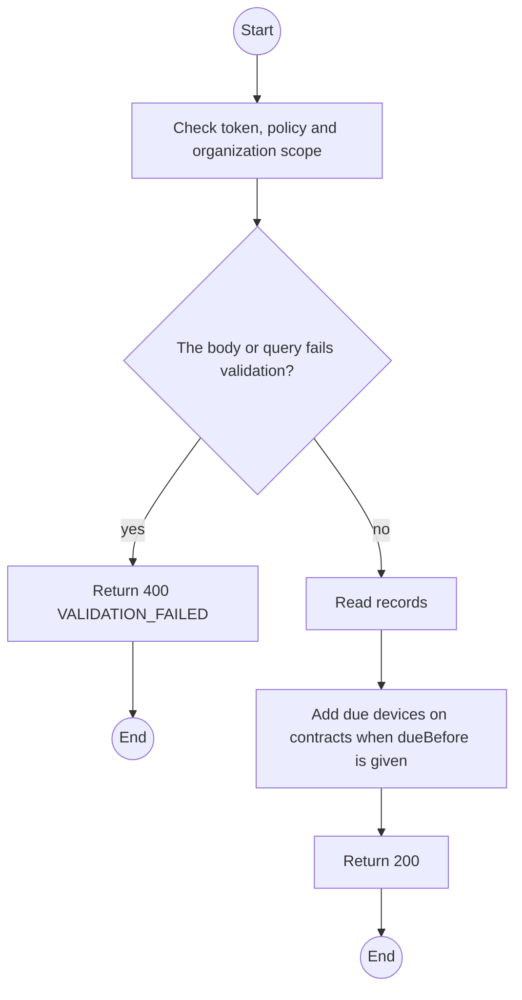
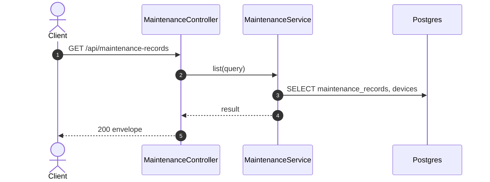

# GET /api/maintenance-records: List maintenance records

> Module `devices`. Generated from `scripts/specs/endpoints/devices.py` by `scripts/specs/build_api_design.py`; edit the catalog, not this file. Format: `02-templates/04-api-endpoint-template.md` with Mermaid (D-017). Envelope: D-002.

[TOC]

---
## Overview

Lists records by status and reason, for the week's service list (FR-DEV-18) and the Admins' approval queue (FR-DEV-20). `dueBefore` adds the devices due for service that are still `RESERVED` or `RENTED`.

## API Specification

| API | URL |
| --- | --- |
| GET | /api/maintenance-records |
| Permission | TrekLink Staff, TrekLink Admin |
| Traces | UC-52, UC-64, UC-65, FR-DEV-18, FR-DEV-20 |

### Query parameters

| Field | Description | Data Type | Required | Examples |
| --- | --- | --- | --- | --- |
| status | OPEN, PENDING_APPROVAL, COMPLETED or UNREPAIRABLE, repeatable | enum | no | `PENDING_APPROVAL` |
| reason | Reason, repeatable | enum | no | `SCHEDULED` |
| dueBefore | Also list devices on contracts due before this date | date | no | `2026-10-26` |
| pageNumber | 1-based page | int | no | `1` |
| pageSize | Items per page, at most MAX_PAGE_SIZE | int | no | `20` |

## Request sample

No body.

## Response sample

```json
{
  "result": {
    "items": [
      {
        "id": "mr-1",
        "device": {
          "id": "0d3f6a2b-7e11-4c55-8f0a-2b1c9e7d4a10",
          "assetTag": "TL-0042"
        },
        "reason": "SCHEDULED",
        "status": "OPEN",
        "description": "Six-month service",
        "expectedAt": "2026-10-20",
        "workBy": "VENDOR",
        "vendorName": "Hoang Long Electronics",
        "estimatedCostVnd": 650000,
        "approvedCostVnd": null,
        "actualCostVnd": null,
        "warrantyUntil": null,
        "checklistResults": null,
        "firmwareVersion": null,
        "openedAt": "2026-10-20T03:15:00.000Z",
        "version": 1
      }
    ],
    "pageNumber": 1,
    "pageSize": 20,
    "totalCount": 6,
    "totalPages": 1
  },
  "isSuccess": true,
  "statusCode": 200,
  "message": "OK"
}
```

## Validation

<table>
    <th>Status code</th>
    <th>Description</th>
    <th>Examples</th>
    <tbody>
        <tr>
            <td>400</td>
            <td>The body or query fails validation (<code>VALIDATION_FAILED</code>)</td>
<td>

```json
{
  "result": {
    "errorCode": "VALIDATION_FAILED"
  },
  "isSuccess": false,
  "statusCode": 400,
  "message": "{field} is required."
}
```
</td>
        </tr>
        <tr>
            <td>401</td>
            <td>Missing, malformed or expired access token or API key (<code>UNAUTHENTICATED</code>)</td>
<td>

```json
{
  "result": {
    "errorCode": "UNAUTHENTICATED"
  },
  "isSuccess": false,
  "statusCode": 401,
  "message": "Authentication required."
}
```
</td>
        </tr>
        <tr>
            <td>403</td>
            <td>The caller's role, policy or organization does not allow this action (<code>FORBIDDEN</code>)</td>
<td>

```json
{
  "result": {
    "errorCode": "FORBIDDEN"
  },
  "isSuccess": false,
  "statusCode": 403,
  "message": "You do not have access to this."
}
```
</td>
        </tr>
    </tbody>
</table>

## Activity Diagram



## Sequence Diagram


