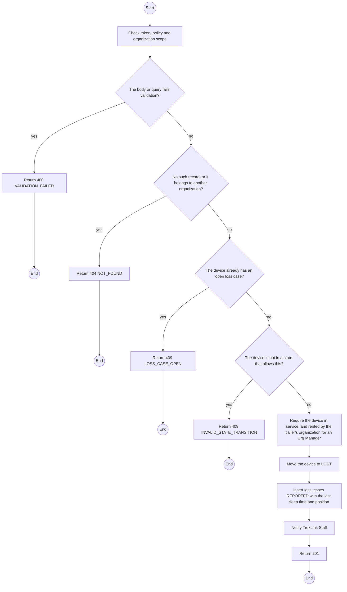
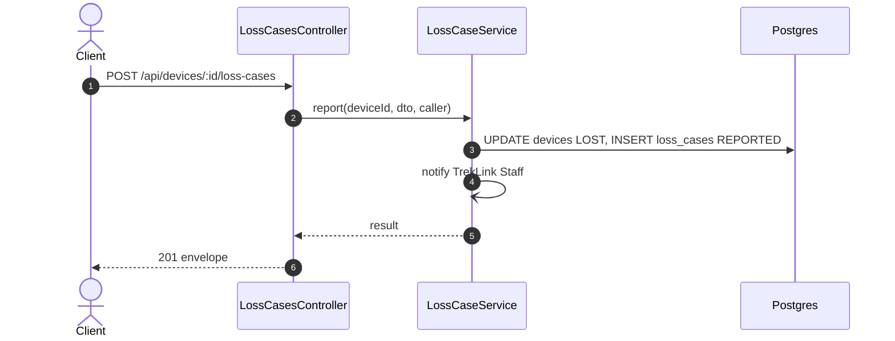

# POST /api/devices/:id/loss-cases: Report a lost device

> Module `devices`. Generated from `scripts/specs/endpoints/devices.py` by `scripts/specs/build_api_design.py`; edit the catalog, not this file. Format: `02-templates/04-api-endpoint-template.md` with Mermaid (D-017). Envelope: D-002.

[TOC]

---
## Overview

Reports a device in service as lost: the device moves to `LOST` from whichever of the six working states it was in, and one loss case opens in `REPORTED` with the device's last seen time and position from telemetry. The contract keeps running. TrekLink Staff are notified (FR-DEV-12, D-045).

## API Specification

| API | URL |
| --- | --- |
| POST | /api/devices/:id/loss-cases |
| Permission | Org Manager: a device rented by the organization; TrekLink Staff: any device in service |
| Traces | UC-49, FR-DEV-12, BR-37, E05-8, E05-9 |

### Path parameters

| Field | Description | Data Type | Examples |
| --- | --- | --- | --- |
| id | Device id | uuid | `0d3f6a2b-7e11-4c55-8f0a-2b1c9e7d4a10` |

## Request sample

```json
{
  "description": "Last seen at Phan Dung camp on 2026-10-19 evening"
}
```

| Field | Description | Data Type | Required | Examples |
| --- | --- | --- | --- | --- |
| description | Where and when it was last seen, and what happened | string | yes | `Last seen at Phan Dung camp` |

## Response sample

```json
{
  "result": {
    "id": "9a8b7c6d-5e4f-4a3b-8c2d-1e0f9a8b7c6d",
    "code": "LOSS-0003",
    "device": {
      "id": "0d3f6a2b-7e11-4c55-8f0a-2b1c9e7d4a10",
      "assetTag": "TL-0042"
    },
    "state": "REPORTED",
    "stateFromDevice": "RENTED",
    "reportedAt": "2026-10-20T03:15:00.000Z",
    "description": "Last seen at Phan Dung camp",
    "lastSeenAt": "2026-10-20T03:15:00.000Z",
    "lastPosition": {
      "lat": 11.5544,
      "lon": 108.5381
    },
    "custody": null,
    "contractDeviceId": "cd-77",
    "organization": {
      "id": "5b1d2c0e-7f3a-4e21-9c8d-1a2b3c4d5e6f",
      "code": "ORG-0007"
    },
    "keyExposed": false,
    "suspectedTheft": false,
    "policeReference": null,
    "searchEndsAt": null,
    "triagedById": null,
    "decision": null,
    "chargeVnd": null,
    "version": 1
  },
  "isSuccess": true,
  "statusCode": 201,
  "message": "Loss reported. TrekLink will contact you."
}
```

## Validation

<table>
    <th>Status code</th>
    <th>Description</th>
    <th>Examples</th>
    <tbody>
        <tr>
            <td>400</td>
            <td>The body or query fails validation (<code>VALIDATION_FAILED</code>)</td>
<td>

```json
{
  "result": {
    "errorCode": "VALIDATION_FAILED"
  },
  "isSuccess": false,
  "statusCode": 400,
  "message": "{field} is required."
}
```
</td>
        </tr>
        <tr>
            <td>401</td>
            <td>Missing, malformed or expired access token or API key (<code>UNAUTHENTICATED</code>)</td>
<td>

```json
{
  "result": {
    "errorCode": "UNAUTHENTICATED"
  },
  "isSuccess": false,
  "statusCode": 401,
  "message": "Authentication required."
}
```
</td>
        </tr>
        <tr>
            <td>403</td>
            <td>The caller's role, policy or organization does not allow this action (<code>FORBIDDEN</code>)</td>
<td>

```json
{
  "result": {
    "errorCode": "FORBIDDEN"
  },
  "isSuccess": false,
  "statusCode": 403,
  "message": "You do not have access to this."
}
```
</td>
        </tr>
        <tr>
            <td>404</td>
            <td>No such record, or it belongs to another organization (<code>NOT_FOUND</code>)</td>
<td>

```json
{
  "result": {
    "errorCode": "NOT_FOUND"
  },
  "isSuccess": false,
  "statusCode": 404,
  "message": "Device not found."
}
```
</td>
        </tr>
        <tr>
            <td>409</td>
            <td>The device already has an open loss case (<code>LOSS_CASE_OPEN</code>)</td>
<td>

```json
{
  "result": {
    "errorCode": "LOSS_CASE_OPEN"
  },
  "isSuccess": false,
  "statusCode": 409,
  "message": "This device is already reported lost."
}
```
</td>
        </tr>
        <tr>
            <td>409</td>
            <td>The device is not in a state that allows this (<code>INVALID_STATE_TRANSITION</code>)</td>
<td>

```json
{
  "result": {
    "errorCode": "INVALID_STATE_TRANSITION"
  },
  "isSuccess": false,
  "statusCode": 409,
  "message": "This cannot be done while it is RETIRED."
}
```
</td>
        </tr>
    </tbody>
</table>

## Activity Diagram



## Sequence Diagram


