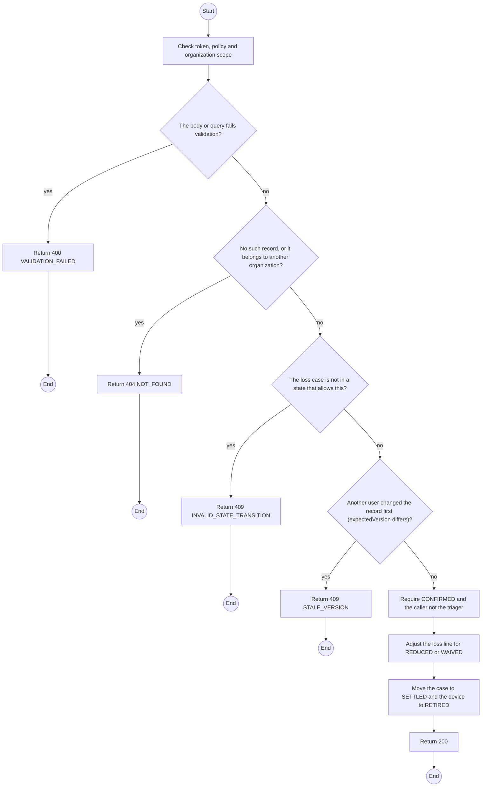
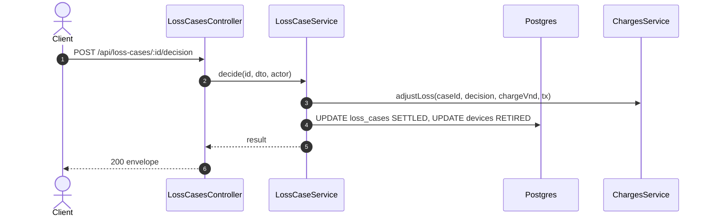

# POST /api/loss-cases/:id/decision: Settle a loss case

> Module `devices`. Generated from `scripts/specs/endpoints/devices.py` by `scripts/specs/build_api_design.py`; edit the catalog, not this file. Format: `02-templates/04-api-endpoint-template.md` with Mermaid (D-017). Envelope: D-002.

[TOC]

---
## Overview

Settles a confirmed case: keep the charge, reduce or waive it with a reason, or record a TrekLink write-off. The Admin is never the Staff member who triaged the case (FR-BILL-11, BR-39). The device moves to `RETIRED`. A `RENTER` custody case is charged, reduced or waived; a `TREKLINK` custody case is written off (AC-05); any other pairing, a reduction not below the confirmed charge, or a missing reason is 400.

## API Specification

| API | URL |
| --- | --- |
| POST | /api/loss-cases/:id/decision |
| Permission | TrekLink Admin |
| Traces | UC-60, FR-BILL-11, FR-DEV-15, BR-39 |

### Path parameters

| Field | Description | Data Type | Examples |
| --- | --- | --- | --- |
| id | Loss case id | uuid | `9a8b7c6d-5e4f-4a3b-8c2d-1e0f9a8b7c6d` |

## Request sample

```json
{
  "decision": "REDUCED",
  "chargeVnd": 900000,
  "reason": "Renter filed a police report promptly",
  "expectedVersion": 2
}
```

| Field | Description | Data Type | Required | Examples |
| --- | --- | --- | --- | --- |
| decision | CHARGED, REDUCED, WAIVED or WRITTEN_OFF | string | yes | `REDUCED` |
| chargeVnd | Final charge, for REDUCED | int | no | `900000` |
| reason | Why; required unless CHARGED | string | no | `Renter filed a police report promptly` |
| expectedVersion | Case version the caller saw | int | yes | `2` |

## Response sample

```json
{
  "result": {
    "id": "9a8b7c6d-5e4f-4a3b-8c2d-1e0f9a8b7c6d",
    "code": "LOSS-0003",
    "device": {
      "id": "0d3f6a2b-7e11-4c55-8f0a-2b1c9e7d4a10",
      "assetTag": "TL-0042"
    },
    "state": "SETTLED",
    "stateFromDevice": "RENTED",
    "reportedAt": "2026-10-20T03:15:00.000Z",
    "description": "Last seen at Phan Dung camp",
    "lastSeenAt": "2026-10-20T03:15:00.000Z",
    "lastPosition": {
      "lat": 11.5544,
      "lon": 108.5381
    },
    "custody": "RENTER",
    "contractDeviceId": "cd-77",
    "organization": {
      "id": "5b1d2c0e-7f3a-4e21-9c8d-1a2b3c4d5e6f",
      "code": "ORG-0007"
    },
    "keyExposed": true,
    "suspectedTheft": false,
    "policeReference": null,
    "searchEndsAt": "2026-10-27T03:15:00.000Z",
    "triagedById": "3f2e1d0c-9b8a-4c7d-8e6f-5a4b3c2d1e0f",
    "decision": "REDUCED",
    "chargeVnd": 900000,
    "version": 1
  },
  "isSuccess": true,
  "statusCode": 200,
  "message": "Loss case settled"
}
```

## Validation

<table>
    <th>Status code</th>
    <th>Description</th>
    <th>Examples</th>
    <tbody>
        <tr>
            <td>400</td>
            <td>The body or query fails validation (<code>VALIDATION_FAILED</code>)</td>
<td>

```json
{
  "result": {
    "errorCode": "VALIDATION_FAILED"
  },
  "isSuccess": false,
  "statusCode": 400,
  "message": "{field} is required."
}
```
</td>
        </tr>
        <tr>
            <td>401</td>
            <td>Missing, malformed or expired access token or API key (<code>UNAUTHENTICATED</code>)</td>
<td>

```json
{
  "result": {
    "errorCode": "UNAUTHENTICATED"
  },
  "isSuccess": false,
  "statusCode": 401,
  "message": "Authentication required."
}
```
</td>
        </tr>
        <tr>
            <td>403</td>
            <td>The caller's role, policy or organization does not allow this action (<code>FORBIDDEN</code>)</td>
<td>

```json
{
  "result": {
    "errorCode": "FORBIDDEN"
  },
  "isSuccess": false,
  "statusCode": 403,
  "message": "You do not have access to this."
}
```
</td>
        </tr>
        <tr>
            <td>404</td>
            <td>No such record, or it belongs to another organization (<code>NOT_FOUND</code>)</td>
<td>

```json
{
  "result": {
    "errorCode": "NOT_FOUND"
  },
  "isSuccess": false,
  "statusCode": 404,
  "message": "Loss case not found."
}
```
</td>
        </tr>
        <tr>
            <td>403</td>
            <td>The caller triaged the case (<code>SEPARATION_OF_DUTY</code>)</td>
<td>

```json
{
  "result": {
    "errorCode": "SEPARATION_OF_DUTY"
  },
  "isSuccess": false,
  "statusCode": 403,
  "message": "A different Admin must settle this case."
}
```
</td>
        </tr>
        <tr>
            <td>409</td>
            <td>The loss case is not in a state that allows this (<code>INVALID_STATE_TRANSITION</code>)</td>
<td>

```json
{
  "result": {
    "errorCode": "INVALID_STATE_TRANSITION"
  },
  "isSuccess": false,
  "statusCode": 409,
  "message": "This cannot be done while it is SEARCHING."
}
```
</td>
        </tr>
        <tr>
            <td>409</td>
            <td>Another user changed the record first (expectedVersion differs) (<code>STALE_VERSION</code>)</td>
<td>

```json
{
  "result": {
    "errorCode": "STALE_VERSION"
  },
  "isSuccess": false,
  "statusCode": 409,
  "message": "This was changed by someone else. Reload and try again."
}
```
</td>
        </tr>
    </tbody>
</table>

## Activity Diagram



## Sequence Diagram


