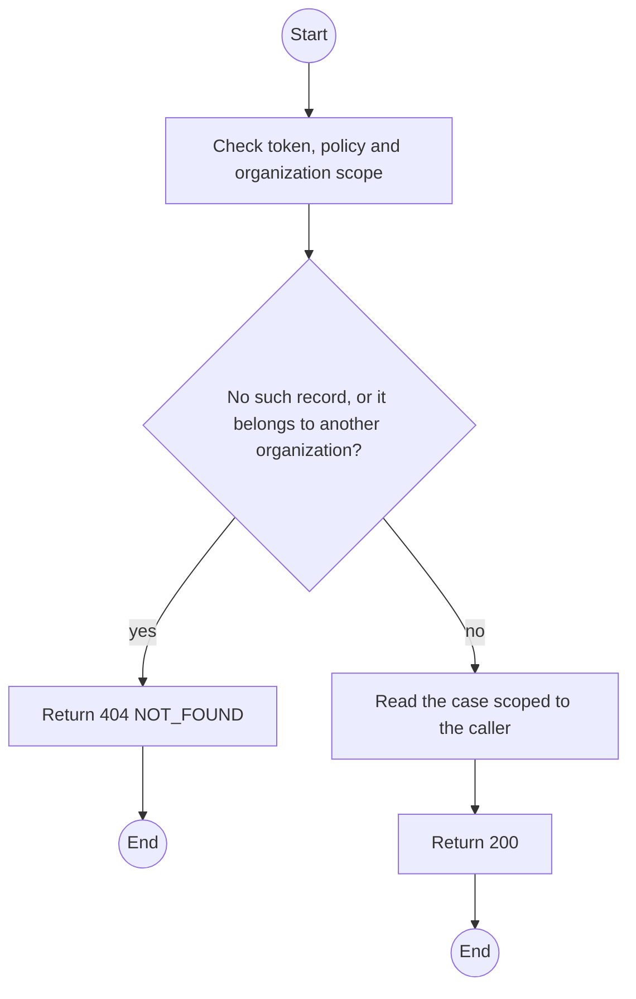
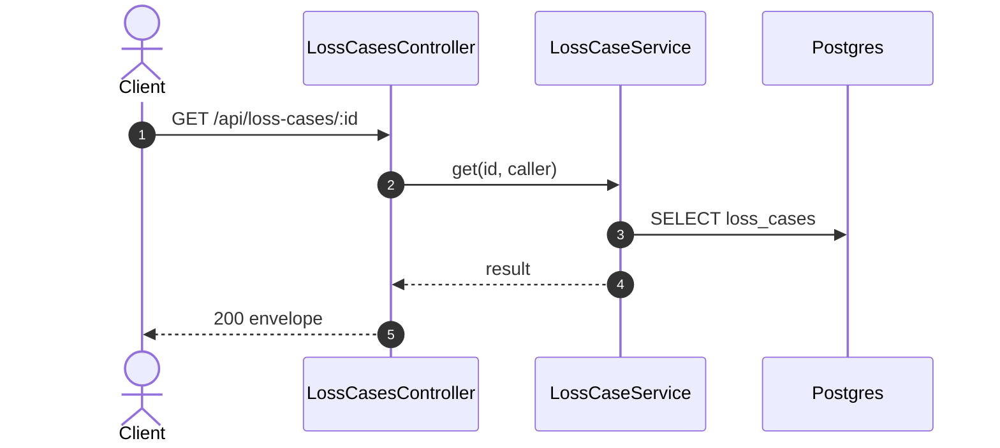

# GET /api/loss-cases/:id: Get a loss case

> Module `devices`. Generated from `scripts/specs/endpoints/devices.py` by `scripts/specs/build_api_design.py`; edit the catalog, not this file. Format: `02-templates/04-api-endpoint-template.md` with Mermaid (D-017). Envelope: D-002.

[TOC]

---
## Overview

One loss case for the case page (screen 4.4). Another organization's case answers 404 (auth REQ-ERR-06). An Org Manager's answer omits `suspectedTheft` and `policeReference`, here and in the report answer of api-design 17 (leader ruling 2026-10-31).

## API Specification

| API | URL |
| --- | --- |
| GET | /api/loss-cases/:id |
| Permission | TrekLink Staff, TrekLink Admin; Org Manager: own organization |
| Traces | UC-49, UC-60 |

### Path parameters

| Field | Description | Data Type | Examples |
| --- | --- | --- | --- |
| id | Loss case id | uuid | `9a8b7c6d-5e4f-4a3b-8c2d-1e0f9a8b7c6d` |

## Request sample

No body.

## Response sample

```json
{
  "result": {
    "id": "9a8b7c6d-5e4f-4a3b-8c2d-1e0f9a8b7c6d",
    "code": "LOSS-0003",
    "device": {
      "id": "0d3f6a2b-7e11-4c55-8f0a-2b1c9e7d4a10",
      "assetTag": "TL-0042"
    },
    "state": "SEARCHING",
    "stateFromDevice": "RENTED",
    "reportedAt": "2026-10-20T03:15:00.000Z",
    "description": "Last seen at Phan Dung camp",
    "lastSeenAt": "2026-10-20T03:15:00.000Z",
    "lastPosition": {
      "lat": 11.5544,
      "lon": 108.5381
    },
    "custody": "RENTER",
    "contractDeviceId": "cd-77",
    "organization": {
      "id": "5b1d2c0e-7f3a-4e21-9c8d-1a2b3c4d5e6f",
      "code": "ORG-0007"
    },
    "keyExposed": true,
    "suspectedTheft": false,
    "policeReference": null,
    "searchEndsAt": "2026-10-27T03:15:00.000Z",
    "triagedById": "3f2e1d0c-9b8a-4c7d-8e6f-5a4b3c2d1e0f",
    "decision": null,
    "chargeVnd": null,
    "version": 1
  },
  "isSuccess": true,
  "statusCode": 200,
  "message": "OK"
}
```

## Validation

<table>
    <th>Status code</th>
    <th>Description</th>
    <th>Examples</th>
    <tbody>
        <tr>
            <td>401</td>
            <td>Missing, malformed or expired access token or API key (<code>UNAUTHENTICATED</code>)</td>
<td>

```json
{
  "result": {
    "errorCode": "UNAUTHENTICATED"
  },
  "isSuccess": false,
  "statusCode": 401,
  "message": "Authentication required."
}
```
</td>
        </tr>
        <tr>
            <td>403</td>
            <td>The caller's role, policy or organization does not allow this action (<code>FORBIDDEN</code>)</td>
<td>

```json
{
  "result": {
    "errorCode": "FORBIDDEN"
  },
  "isSuccess": false,
  "statusCode": 403,
  "message": "You do not have access to this."
}
```
</td>
        </tr>
        <tr>
            <td>404</td>
            <td>No such record, or it belongs to another organization (<code>NOT_FOUND</code>)</td>
<td>

```json
{
  "result": {
    "errorCode": "NOT_FOUND"
  },
  "isSuccess": false,
  "statusCode": 404,
  "message": "Loss case not found."
}
```
</td>
        </tr>
    </tbody>
</table>

## Activity Diagram



## Sequence Diagram


