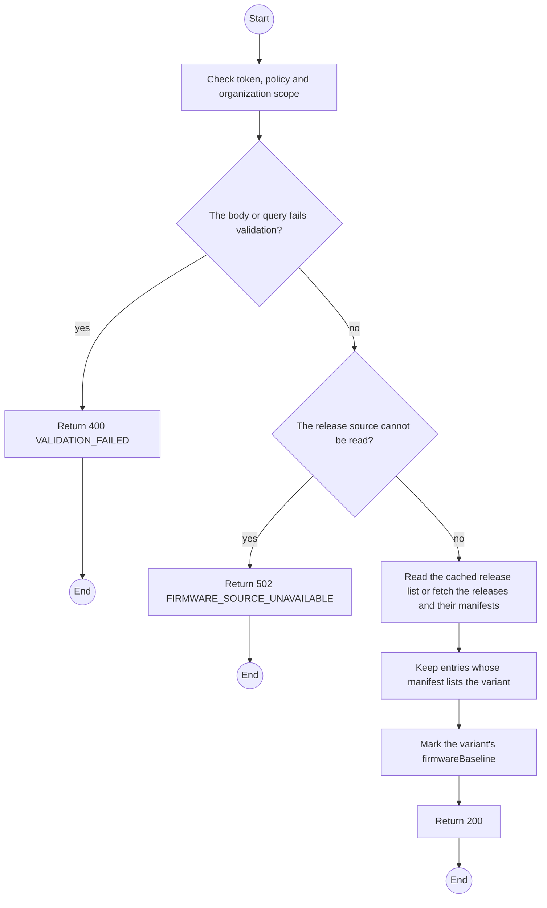
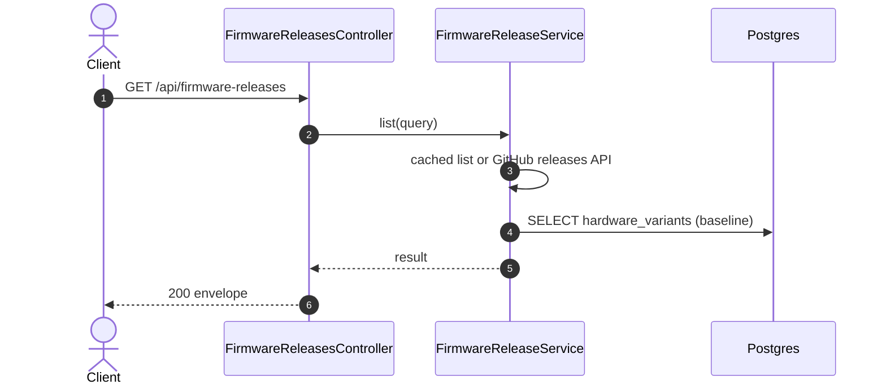

# GET /api/firmware-releases: List firmware releases

> Module `devices`. Generated from `scripts/specs/endpoints/devices.py` by `scripts/specs/build_api_design.py`; edit the catalog, not this file. Format: `02-templates/04-api-endpoint-template.md` with Mermaid (D-017). Envelope: D-002.

[TOC]

---
## Overview

Lists the TrekLink firmware releases published in the configured repository (`devices.firmwareReleaseRepo`), newest first, with the variants each release carries, so the flash panel of a `FIRMWARE_UPDATE` record offers only images built for the device's variant (design §9). Read from each release's manifest asset; cached for `devices.firmwareReleaseCacheSeconds`. `chip` is the manifest's chip name for the variant (`esp32`, `esp32s3`), which the flash panel compares with the unit before writing (REQ-ERR-16). `version` is the release tag without its leading `v`; `variantCode` is the platform's code for the manifest's short one (design §9.1). No release published yet is an empty list, not an error.

## API Specification

| API | URL |
| --- | --- |
| GET | /api/firmware-releases |
| Permission | TrekLink Staff, TrekLink Admin |
| Traces | FR-DEV-21, D-093 |

### Query parameters

| Field | Description | Data Type | Required | Examples |
| --- | --- | --- | --- | --- |
| variantCode | Only releases that carry this variant | string | no | `treklink-v3` |

## Request sample

No body.

## Response sample

```json
{
  "result": [
    {
      "version": "2.7.26-treklink.2",
      "publishedAt": "2026-10-20T03:15:00.000Z",
      "isBaseline": true,
      "variants": [
        {
          "variantCode": "treklink-v3",
          "chip": "esp32",
          "app": {
            "offset": 65536,
            "sizeBytes": 2031616
          },
          "factory": {
            "offset": 0,
            "sizeBytes": 2162688
          }
        }
      ]
    }
  ],
  "isSuccess": true,
  "statusCode": 200,
  "message": "OK"
}
```

## Validation

<table>
    <th>Status code</th>
    <th>Description</th>
    <th>Examples</th>
    <tbody>
        <tr>
            <td>400</td>
            <td>The body or query fails validation (<code>VALIDATION_FAILED</code>)</td>
<td>

```json
{
  "result": {
    "errorCode": "VALIDATION_FAILED"
  },
  "isSuccess": false,
  "statusCode": 400,
  "message": "{field} is required."
}
```
</td>
        </tr>
        <tr>
            <td>401</td>
            <td>Missing, malformed or expired access token or API key (<code>UNAUTHENTICATED</code>)</td>
<td>

```json
{
  "result": {
    "errorCode": "UNAUTHENTICATED"
  },
  "isSuccess": false,
  "statusCode": 401,
  "message": "Authentication required."
}
```
</td>
        </tr>
        <tr>
            <td>403</td>
            <td>The caller's role, policy or organization does not allow this action (<code>FORBIDDEN</code>)</td>
<td>

```json
{
  "result": {
    "errorCode": "FORBIDDEN"
  },
  "isSuccess": false,
  "statusCode": 403,
  "message": "You do not have access to this."
}
```
</td>
        </tr>
        <tr>
            <td>502</td>
            <td>The release source cannot be read (<code>FIRMWARE_SOURCE_UNAVAILABLE</code>)</td>
<td>

```json
{
  "result": {
    "errorCode": "FIRMWARE_SOURCE_UNAVAILABLE"
  },
  "isSuccess": false,
  "statusCode": 502,
  "message": "Firmware releases cannot be read right now. Try again later."
}
```
</td>
        </tr>
    </tbody>
</table>

## Activity Diagram



## Sequence Diagram


