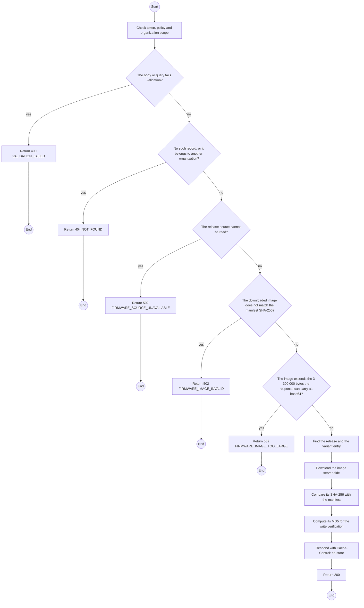
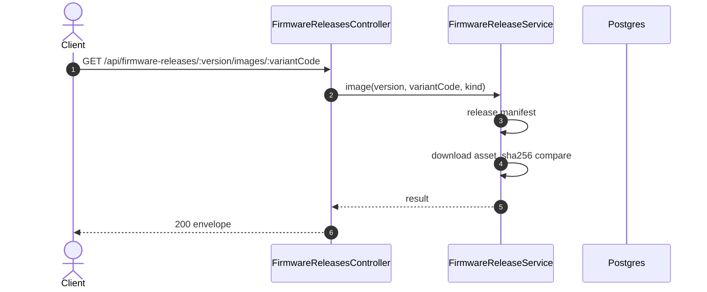

# GET /api/firmware-releases/:version/images/:variantCode: Get a firmware image

> Module `devices`. Generated from `scripts/specs/endpoints/devices.py` by `scripts/specs/build_api_design.py`; edit the catalog, not this file. Format: `02-templates/04-api-endpoint-template.md` with Mermaid (D-017). Envelope: D-002.

[TOC]

---
## Overview

Returns one image of a release for one variant, checked against the SHA-256 of the release manifest before it is returned, for the flash panel to write to a docked unit (design §9). `kind` `APP` is written at its offset and keeps the unit's settings; `FACTORY` is the merged image written at 0 after an erase. Never cached by the browser.

## API Specification

| API | URL |
| --- | --- |
| GET | /api/firmware-releases/:version/images/:variantCode |
| Permission | TrekLink Staff, TrekLink Admin |
| Traces | FR-DEV-21, D-093 |

### Path parameters

| Field | Description | Data Type | Examples |
| --- | --- | --- | --- |
| version | Release version | string | `2.7.26-treklink.2` |
| variantCode | Hardware variant code | string | `treklink-v3` |

### Query parameters

| Field | Description | Data Type | Required | Examples |
| --- | --- | --- | --- | --- |
| kind | APP or FACTORY | enum | no | `APP` |

## Request sample

No body.

## Response sample

```json
{
  "result": {
    "version": "2.7.26-treklink.2",
    "variantCode": "treklink-v3",
    "kind": "APP",
    "chip": "esp32",
    "offset": 65536,
    "sizeBytes": 2031616,
    "sha256": "9f2c...e41a",
    "md5": "3b1f...90c2",
    "imageBase64": "6QMCIC..."
  },
  "isSuccess": true,
  "statusCode": 200,
  "message": "OK"
}
```

## Validation

<table>
    <th>Status code</th>
    <th>Description</th>
    <th>Examples</th>
    <tbody>
        <tr>
            <td>400</td>
            <td>The body or query fails validation (<code>VALIDATION_FAILED</code>)</td>
<td>

```json
{
  "result": {
    "errorCode": "VALIDATION_FAILED"
  },
  "isSuccess": false,
  "statusCode": 400,
  "message": "{field} is required."
}
```
</td>
        </tr>
        <tr>
            <td>401</td>
            <td>Missing, malformed or expired access token or API key (<code>UNAUTHENTICATED</code>)</td>
<td>

```json
{
  "result": {
    "errorCode": "UNAUTHENTICATED"
  },
  "isSuccess": false,
  "statusCode": 401,
  "message": "Authentication required."
}
```
</td>
        </tr>
        <tr>
            <td>403</td>
            <td>The caller's role, policy or organization does not allow this action (<code>FORBIDDEN</code>)</td>
<td>

```json
{
  "result": {
    "errorCode": "FORBIDDEN"
  },
  "isSuccess": false,
  "statusCode": 403,
  "message": "You do not have access to this."
}
```
</td>
        </tr>
        <tr>
            <td>404</td>
            <td>No such record, or it belongs to another organization (<code>NOT_FOUND</code>)</td>
<td>

```json
{
  "result": {
    "errorCode": "NOT_FOUND"
  },
  "isSuccess": false,
  "statusCode": 404,
  "message": "Firmware image not found."
}
```
</td>
        </tr>
        <tr>
            <td>502</td>
            <td>The release source cannot be read (<code>FIRMWARE_SOURCE_UNAVAILABLE</code>)</td>
<td>

```json
{
  "result": {
    "errorCode": "FIRMWARE_SOURCE_UNAVAILABLE"
  },
  "isSuccess": false,
  "statusCode": 502,
  "message": "Firmware releases cannot be read right now. Try again later."
}
```
</td>
        </tr>
        <tr>
            <td>502</td>
            <td>The downloaded image does not match the manifest SHA-256 (<code>FIRMWARE_IMAGE_INVALID</code>)</td>
<td>

```json
{
  "result": {
    "errorCode": "FIRMWARE_IMAGE_INVALID"
  },
  "isSuccess": false,
  "statusCode": 502,
  "message": "The firmware image failed its check and was not sent. Try again later."
}
```
</td>
        </tr>
        <tr>
            <td>502</td>
            <td>The image exceeds the 3 300 000 bytes the response can carry as base64 (<code>FIRMWARE_IMAGE_TOO_LARGE</code>)</td>
<td>

```json
{
  "result": {
    "errorCode": "FIRMWARE_IMAGE_TOO_LARGE"
  },
  "isSuccess": false,
  "statusCode": 502,
  "message": "This firmware image is too large to send. Flash it on the bench."
}
```
</td>
        </tr>
    </tbody>
</table>

## Activity Diagram



## Sequence Diagram


