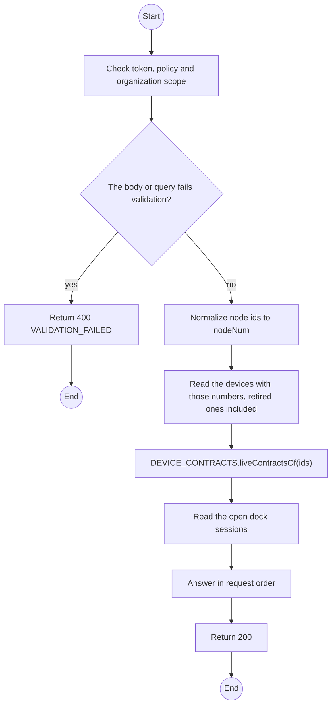
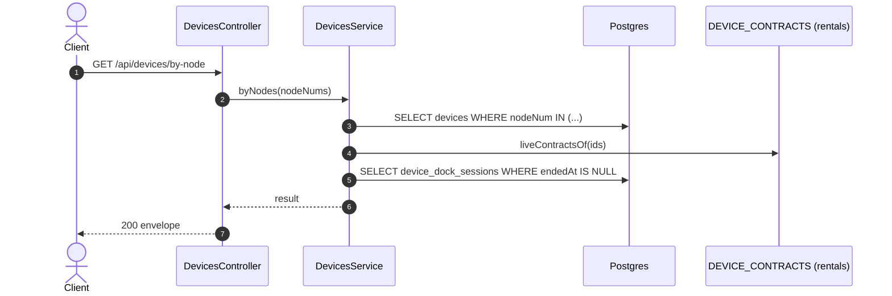

# GET /api/devices/by-node: Recognize connected units

> Module `devices`. Generated from `scripts/specs/endpoints/devices.py` by `scripts/specs/build_api_design.py`; edit the catalog, not this file. Format: `02-templates/04-api-endpoint-template.md` with Mermaid (D-017). Envelope: D-002.

[TOC]

---
## Overview

Recognizes the units plugged into the Staff computer by the `nodeNum` each one reported over Web Serial (design §11.5). One answer row per requested number, in the request's order: `device` is null for a number never registered, which the connector offers for registration; otherwise the device summary of api-design 07 with its open maintenance record, `contract` the unit's live contract row (from the rentals port `DEVICE_CONTRACTS`) or null, and `docked` its open dock session (api-design 31) or null. The key is never returned, only its version and organization (REQ-UBI-03). Permission `device.read`.

## API Specification

| API | URL |
| --- | --- |
| GET | /api/devices/by-node |
| Permission | TrekLink Staff, TrekLink Admin |
| Traces | UC-11, UC-14, FR-DEV-02, FR-DEV-11 |

### Query parameters

| Field | Description | Data Type | Required | Examples |
| --- | --- | --- | --- | --- |
| nodeNum | Unsigned 32-bit radio id, or node id `!a4b1c2d3`; repeatable, 1 to 20 | int | yes | `2763113171` |

## Request sample

No body.

## Response sample

```json
{
  "result": [
    {
      "nodeNum": 2763113171,
      "nodeId": "!a4b1c2d3",
      "device": {
        "id": "0d3f6a2b-7e11-4c55-8f0a-2b1c9e7d4a10",
        "assetTag": "TL-0042",
        "nodeNum": 2763113171,
        "nodeId": "!a4b1c2d3",
        "hardwareVariant": {
          "id": "a1b2c3d4-e5f6-4a7b-8c9d-0e1f2a3b4c5d",
          "code": "treklink-v3",
          "name": "TrekLink v3 (GPS, SOS button)",
          "imageUrl": null,
          "specSheet": {
            "mcu": "ESP32",
            "sosControl": "3 s hold on the user button",
            "localAlarm": "LED blinks"
          },
          "hasGps": true,
          "hasMotionSensor": false,
          "mqttCapable": true,
          "firmwareBaseline": "2.7.19-treklink.3"
        },
        "firmwareVersion": "2.7.19-treklink.3",
        "acquiredAt": "2026-06-15T00:00:00Z",
        "status": "RESERVED",
        "statusChangedAt": "2026-10-20T03:15:00.000Z",
        "keyVersion": null,
        "keyOrganizationId": null,
        "keyOrganization": null,
        "batteryPct": 96,
        "lastSeenAt": "2026-10-20T03:15:00.000Z",
        "lastPosition": {
          "lat": 11.5544,
          "lon": 108.5381
        },
        "serviceDueAt": "2026-12-12",
        "version": 5,
        "openMaintenance": null
      },
      "contract": {
        "id": "c0ffee00-1234-4abc-9def-001122334455",
        "code": "RC-2026-0042",
        "status": "APPROVED",
        "organization": {
          "id": "5b1d2c0e-7f3a-4e21-9c8d-1a2b3c4d5e6f",
          "code": "ORG-0007"
        },
        "provisionedKeyVersion": null
      },
      "docked": {
        "since": "2026-10-20T03:15:00.000Z",
        "byName": "Tran Thi B"
      }
    },
    {
      "nodeNum": 2763113188,
      "nodeId": "!a4b1c2e4",
      "device": null,
      "contract": null,
      "docked": null
    }
  ],
  "isSuccess": true,
  "statusCode": 200,
  "message": "OK"
}
```

| Field | Description | Data Type | Examples |
| --- | --- | --- | --- |
| device | Device summary as api-design 07 (shared variant summary, status, battery, last seen, firmware on record, key version and organization) plus `openMaintenance` `{id, reason, status}`; null when the number was never registered | object | see sample |
| contract | The live contract row: `id`, `code`, `status`, `organization {id, code}`, `provisionedKeyVersion`; null when the unit is on none | object | see sample |
| docked | The open dock session: `since`, `byName`; null when none | object | see sample |

## Validation

<table>
    <th>Status code</th>
    <th>Description</th>
    <th>Examples</th>
    <tbody>
        <tr>
            <td>400</td>
            <td>The body or query fails validation (<code>VALIDATION_FAILED</code>)</td>
<td>

```json
{
  "result": {
    "errorCode": "VALIDATION_FAILED"
  },
  "isSuccess": false,
  "statusCode": 400,
  "message": "{field} is required."
}
```
</td>
        </tr>
        <tr>
            <td>401</td>
            <td>Missing, malformed or expired access token or API key (<code>UNAUTHENTICATED</code>)</td>
<td>

```json
{
  "result": {
    "errorCode": "UNAUTHENTICATED"
  },
  "isSuccess": false,
  "statusCode": 401,
  "message": "Authentication required."
}
```
</td>
        </tr>
        <tr>
            <td>403</td>
            <td>The caller's role, policy or organization does not allow this action (<code>FORBIDDEN</code>)</td>
<td>

```json
{
  "result": {
    "errorCode": "FORBIDDEN"
  },
  "isSuccess": false,
  "statusCode": 403,
  "message": "You do not have access to this."
}
```
</td>
        </tr>
    </tbody>
</table>

## Activity Diagram



## Sequence Diagram


