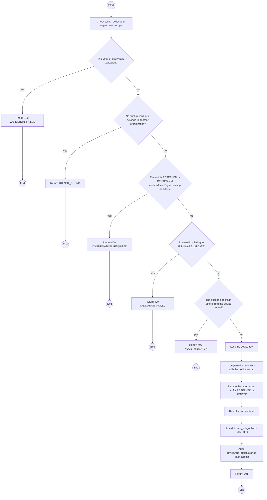
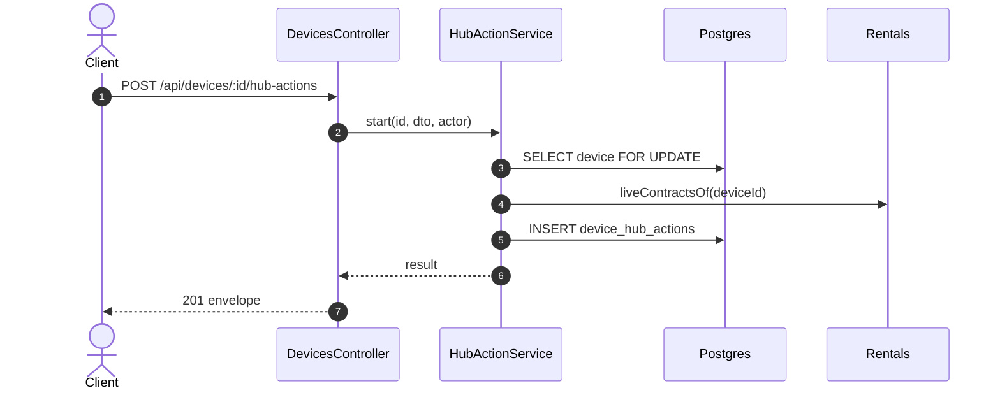

# POST /api/devices/:id/hub-actions: Start a hub action

> Module `devices`. Generated from `scripts/specs/endpoints/devices.py` by `scripts/specs/build_api_design.py`; edit the catalog, not this file. Format: `02-templates/04-api-endpoint-template.md` with Mermaid (D-017). Envelope: D-002.

[TOC]

---
## Overview

Records that the device hub starts an action on the docked unit (design §12.14, leader UAT 2026-11-06): `REBOOT`, `FACTORY_RESET`, `RESTORE_DEFAULTS`, `UPLINK` or `FIRMWARE_UPDATE`. Every device status is accepted; the status only adds the confirmation: for a `RESERVED` or `RENTED` unit `confirmAssetTag` must equal the asset tag (case-insensitive, trimmed), which the hub's dialog asks the user to type. The docked `nodeNum` must be the device's. The row keeps the status, the live contract and the firmware on record at the start. The hub sends this before it writes anything to the unit, and api-design 34 when the action ends. Writes the audit entry `device.hub_action.started` after commit. Permission `device.operate`.

## API Specification

| API | URL |
| --- | --- |
| POST | /api/devices/:id/hub-actions |
| Permission | TrekLink Staff |
| Traces | UC-14, FR-DEV-07, FR-DEV-21, D-078 |

### Path parameters

| Field | Description | Data Type | Examples |
| --- | --- | --- | --- |
| id | Device id | uuid | `0d3f6a2b-7e11-4c55-8f0a-2b1c9e7d4a10` |

## Request sample

```json
{
  "action": "FIRMWARE_UPDATE",
  "nodeNum": 2763113171,
  "confirmAssetTag": "TL-0042",
  "firmwareTo": "2.7.26-treklink.1",
  "fullImage": false
}
```

| Field | Description | Data Type | Required | Examples |
| --- | --- | --- | --- | --- |
| action | `REBOOT`, `FACTORY_RESET`, `RESTORE_DEFAULTS`, `UPLINK` or `FIRMWARE_UPDATE` | enum | yes | `FIRMWARE_UPDATE` |
| nodeNum | The docked unit's node number | int | yes | `2763113171` |
| confirmAssetTag | The asset tag the user typed; required while the unit is `RESERVED` or `RENTED` | string | no | `TL-0042` |
| firmwareTo | The release version written; required for `FIRMWARE_UPDATE` | string | no | `2.7.26-treklink.1` |
| fullImage | The factory image at `0x0` instead of the app image (erases NVS); `FIRMWARE_UPDATE` only | bool | no | `false` |

## Response sample

```json
{
  "result": {
    "id": "4b3a2918-0716-4e5d-9c4b-3a2918071605",
    "deviceId": "0d3f6a2b-7e11-4c55-8f0a-2b1c9e7d4a10",
    "action": "FIRMWARE_UPDATE",
    "outcome": "STARTED",
    "deviceStatus": "RENTED",
    "contractCode": "RC-2026-0040",
    "firmwareFrom": "2.7.19-treklink.3",
    "firmwareTo": "2.7.26-treklink.1",
    "fullImage": false,
    "failure": null,
    "startedAt": "2026-10-20T03:15:00.000Z",
    "finishedAt": null
  },
  "isSuccess": true,
  "statusCode": 201,
  "message": "Hub action started"
}
```

## Validation

<table>
    <th>Status code</th>
    <th>Description</th>
    <th>Examples</th>
    <tbody>
        <tr>
            <td>400</td>
            <td>The body or query fails validation (<code>VALIDATION_FAILED</code>)</td>
<td>

```json
{
  "result": {
    "errorCode": "VALIDATION_FAILED"
  },
  "isSuccess": false,
  "statusCode": 400,
  "message": "{field} is required."
}
```
</td>
        </tr>
        <tr>
            <td>401</td>
            <td>Missing, malformed or expired access token or API key (<code>UNAUTHENTICATED</code>)</td>
<td>

```json
{
  "result": {
    "errorCode": "UNAUTHENTICATED"
  },
  "isSuccess": false,
  "statusCode": 401,
  "message": "Authentication required."
}
```
</td>
        </tr>
        <tr>
            <td>403</td>
            <td>The caller's role, policy or organization does not allow this action (<code>FORBIDDEN</code>)</td>
<td>

```json
{
  "result": {
    "errorCode": "FORBIDDEN"
  },
  "isSuccess": false,
  "statusCode": 403,
  "message": "You do not have access to this."
}
```
</td>
        </tr>
        <tr>
            <td>404</td>
            <td>No such record, or it belongs to another organization (<code>NOT_FOUND</code>)</td>
<td>

```json
{
  "result": {
    "errorCode": "NOT_FOUND"
  },
  "isSuccess": false,
  "statusCode": 404,
  "message": "Device not found."
}
```
</td>
        </tr>
        <tr>
            <td>400</td>
            <td>The unit is RESERVED or RENTED and confirmAssetTag is missing or differs (<code>CONFIRMATION_REQUIRED</code>)</td>
<td>

```json
{
  "result": {
    "errorCode": "CONFIRMATION_REQUIRED"
  },
  "isSuccess": false,
  "statusCode": 400,
  "message": "Type TL-0042 to confirm: it is rented on RC-2026-0040."
}
```
</td>
        </tr>
        <tr>
            <td>400</td>
            <td>firmwareTo missing for FIRMWARE_UPDATE (<code>VALIDATION_FAILED</code>)</td>
<td>

```json
{
  "result": {
    "errorCode": "VALIDATION_FAILED"
  },
  "isSuccess": false,
  "statusCode": 400,
  "message": "firmwareTo is required."
}
```
</td>
        </tr>
        <tr>
            <td>409</td>
            <td>The docked nodeNum differs from the device record (<code>NODE_MISMATCH</code>)</td>
<td>

```json
{
  "result": {
    "errorCode": "NODE_MISMATCH"
  },
  "isSuccess": false,
  "statusCode": 409,
  "message": "The docked unit is !0004351c, not TL-0042."
}
```
</td>
        </tr>
    </tbody>
</table>

## Activity Diagram



## Sequence Diagram


