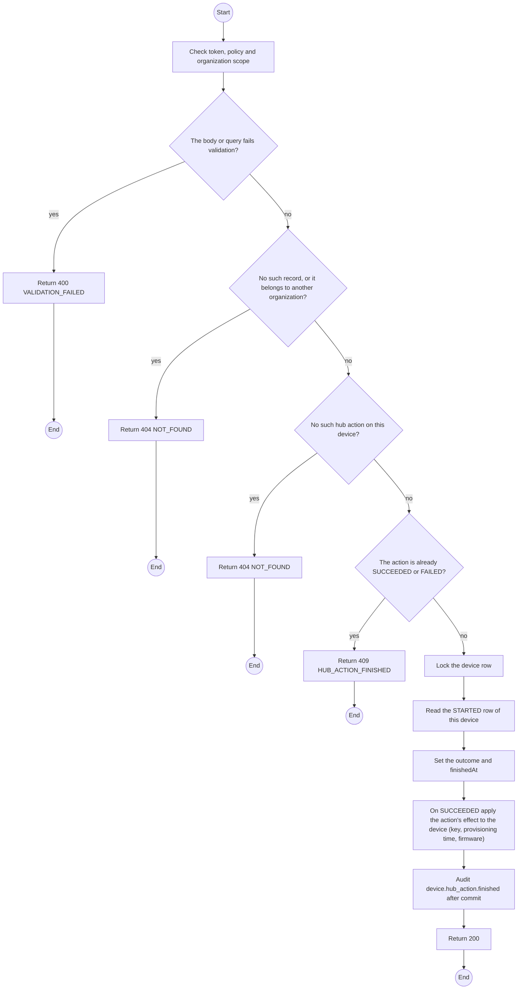
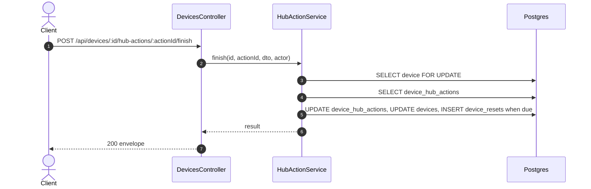

# POST /api/devices/:id/hub-actions/:actionId/finish: Finish a hub action

> Module `devices`. Generated from `scripts/specs/endpoints/devices.py` by `scripts/specs/build_api_design.py`; edit the catalog, not this file. Format: `02-templates/04-api-endpoint-template.md` with Mermaid (D-017). Envelope: D-002.

[TOC]

---
## Overview

Records how a hub action of api-design 33 ended (design §12.14). On `SUCCEEDED`: `FACTORY_RESET` and `RESTORE_DEFAULTS` clear `keyVersion`, `keyOrganizationId` and `provisionedAt`, because the unit no longer carries the organization key (as rentals api-design 19's undo leaves a device); `FACTORY_RESET` also inserts the return reset (as api-design 10 does) when the unit is `RETURNED`, out of custody and not yet reset for this return; `FIRMWARE_UPDATE` sets `firmwareVersion` to the row's `firmwareTo`. Each change bumps the device `version`. On `FAILED` only the row changes, with the failed step. Writes the audit entry `device.hub_action.finished` after commit. Permission `device.operate`.

## API Specification

| API | URL |
| --- | --- |
| POST | /api/devices/:id/hub-actions/:actionId/finish |
| Permission | TrekLink Staff |
| Traces | UC-14, FR-DEV-07, FR-DEV-21, D-078 |

### Path parameters

| Field | Description | Data Type | Examples |
| --- | --- | --- | --- |
| id | Device id | uuid | `0d3f6a2b-7e11-4c55-8f0a-2b1c9e7d4a10` |
| actionId | Hub action id from api-design 33 | uuid | `4b3a2918-0716-4e5d-9c4b-3a2918071605` |

## Request sample

```json
{
  "outcome": "SUCCEEDED"
}
```

| Field | Description | Data Type | Required | Examples |
| --- | --- | --- | --- | --- |
| outcome | `SUCCEEDED` or `FAILED` | enum | yes | `SUCCEEDED` |
| failure | The failed step, at most 300 characters; for `FAILED` | string | no | `The read-back differs: channel key.` |

## Response sample

```json
{
  "result": {
    "id": "4b3a2918-0716-4e5d-9c4b-3a2918071605",
    "deviceId": "0d3f6a2b-7e11-4c55-8f0a-2b1c9e7d4a10",
    "action": "FIRMWARE_UPDATE",
    "outcome": "SUCCEEDED",
    "deviceStatus": "RENTED",
    "contractCode": "RC-2026-0040",
    "firmwareFrom": "2.7.19-treklink.3",
    "firmwareTo": "2.7.26-treklink.1",
    "fullImage": false,
    "failure": null,
    "startedAt": "2026-10-20T03:15:00.000Z",
    "finishedAt": "2026-10-20T03:15:00.000Z",
    "returnReset": false
  },
  "isSuccess": true,
  "statusCode": 200,
  "message": "Hub action finished"
}
```

## Validation

<table>
    <th>Status code</th>
    <th>Description</th>
    <th>Examples</th>
    <tbody>
        <tr>
            <td>400</td>
            <td>The body or query fails validation (<code>VALIDATION_FAILED</code>)</td>
<td>

```json
{
  "result": {
    "errorCode": "VALIDATION_FAILED"
  },
  "isSuccess": false,
  "statusCode": 400,
  "message": "{field} is required."
}
```
</td>
        </tr>
        <tr>
            <td>401</td>
            <td>Missing, malformed or expired access token or API key (<code>UNAUTHENTICATED</code>)</td>
<td>

```json
{
  "result": {
    "errorCode": "UNAUTHENTICATED"
  },
  "isSuccess": false,
  "statusCode": 401,
  "message": "Authentication required."
}
```
</td>
        </tr>
        <tr>
            <td>403</td>
            <td>The caller's role, policy or organization does not allow this action (<code>FORBIDDEN</code>)</td>
<td>

```json
{
  "result": {
    "errorCode": "FORBIDDEN"
  },
  "isSuccess": false,
  "statusCode": 403,
  "message": "You do not have access to this."
}
```
</td>
        </tr>
        <tr>
            <td>404</td>
            <td>No such record, or it belongs to another organization (<code>NOT_FOUND</code>)</td>
<td>

```json
{
  "result": {
    "errorCode": "NOT_FOUND"
  },
  "isSuccess": false,
  "statusCode": 404,
  "message": "Device not found."
}
```
</td>
        </tr>
        <tr>
            <td>404</td>
            <td>No such hub action on this device (<code>NOT_FOUND</code>)</td>
<td>

```json
{
  "result": {
    "errorCode": "NOT_FOUND"
  },
  "isSuccess": false,
  "statusCode": 404,
  "message": "The hub action was not found."
}
```
</td>
        </tr>
        <tr>
            <td>409</td>
            <td>The action is already SUCCEEDED or FAILED (<code>HUB_ACTION_FINISHED</code>)</td>
<td>

```json
{
  "result": {
    "errorCode": "HUB_ACTION_FINISHED"
  },
  "isSuccess": false,
  "statusCode": 409,
  "message": "This hub action is already finished."
}
```
</td>
        </tr>
    </tbody>
</table>

## Activity Diagram



## Sequence Diagram


