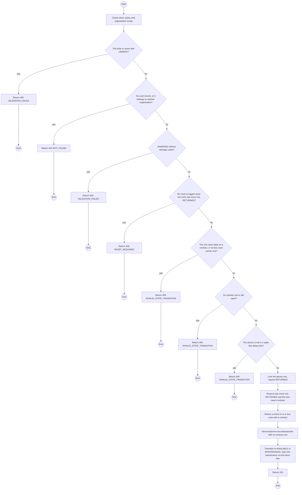
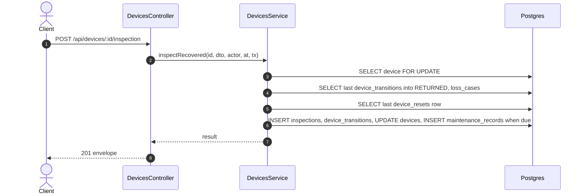

# POST /api/devices/:id/inspection: Inspect a unit recovered outside a contract

> Module `devices`. Generated from `scripts/specs/endpoints/devices.py` by `scripts/specs/build_api_design.py`; edit the catalog, not this file. Format: `02-templates/04-api-endpoint-template.md` with Mermaid (D-017). Envelope: D-002.

[TOC]

---
## Overview

Inspects a `RETURNED` device that has no contract row to return to, such as a unit lost from stock and recovered (D-114, REQ-EVT-11). The counter's inspection (rentals api-design 16) needs a handed-over contract row, so without this route such a unit never reaches `AVAILABLE`. It runs the counter's `recordInspection` with no contract row and the unit's last move into `RETURNED` (the `LOSS_RECOVERED` transition) as the check-in: a reset after it is required (409 `RESET_REQUIRED`, BR-28); `PASSED` moves the unit to `AVAILABLE`, or to `MAINTENANCE` when its service falls due or its firmware is off the baseline; `DAMAGED` and `FAILED` move it to `MAINTENANCE` with an `INSPECTION_FAILED` record. No damage charge is created, because no contract carries one. A unit whose last move into `RETURNED` was a check-in, or whose loss case names a contract, is refused and inspected at that contract's counter. Permission `device.operate`, the reset's.

## API Specification

| API | URL |
| --- | --- |
| POST | /api/devices/:id/inspection |
| Permission | TrekLink Staff |
| Traces | D-114, REQ-EVT-11, FR-DEV-07, FR-DEV-14, BR-28, BR-38 |

### Path parameters

| Field | Description | Data Type | Examples |
| --- | --- | --- | --- |
| id | Device id | uuid | `0d3f6a2b-7e11-4c55-8f0a-2b1c9e7d4a10` |

## Request sample

```json
{
  "result": "DAMAGED",
  "damageCodes": [
    "ANTENNA_BROKEN"
  ],
  "note": "Antenna snapped at the base"
}
```

| Field | Description | Data Type | Required | Examples |
| --- | --- | --- | --- | --- |
| result | `PASSED`, `DAMAGED` or `FAILED` | enum | yes | `DAMAGED` |
| damageCodes | DamageRate codes; required for DAMAGED | string[] | cond. | `["ANTENNA_BROKEN"]` |
| note | Free text, at most 500 characters | string | no | `Antenna snapped at the base` |

## Response sample

```json
{
  "result": {
    "inspection": {
      "id": "in-1",
      "result": "DAMAGED",
      "damageCodes": [
        "ANTENNA_BROKEN"
      ],
      "createdAt": "2026-10-20T03:15:00.000Z"
    },
    "device": {
      "id": "0d3f6a2b-7e11-4c55-8f0a-2b1c9e7d4a10",
      "assetTag": "TL-0042",
      "status": "MAINTENANCE"
    }
  },
  "isSuccess": true,
  "statusCode": 201,
  "message": "Inspection recorded"
}
```

| Field | Description | Data Type | Examples |
| --- | --- | --- | --- |
| inspection | The inspection recorded with no contract row: `id`, `result`, `damageCodes`, `createdAt` | object | `{ "result": "DAMAGED" }` |
| device | The device's id, asset tag and status after the inspection | object | `{ "status": "MAINTENANCE" }` |

## Validation

<table>
    <th>Status code</th>
    <th>Description</th>
    <th>Examples</th>
    <tbody>
        <tr>
            <td>400</td>
            <td>The body or query fails validation (<code>VALIDATION_FAILED</code>)</td>
<td>

```json
{
  "result": {
    "errorCode": "VALIDATION_FAILED"
  },
  "isSuccess": false,
  "statusCode": 400,
  "message": "{field} is required."
}
```
</td>
        </tr>
        <tr>
            <td>401</td>
            <td>Missing, malformed or expired access token or API key (<code>UNAUTHENTICATED</code>)</td>
<td>

```json
{
  "result": {
    "errorCode": "UNAUTHENTICATED"
  },
  "isSuccess": false,
  "statusCode": 401,
  "message": "Authentication required."
}
```
</td>
        </tr>
        <tr>
            <td>403</td>
            <td>The caller's role, policy or organization does not allow this action (<code>FORBIDDEN</code>)</td>
<td>

```json
{
  "result": {
    "errorCode": "FORBIDDEN"
  },
  "isSuccess": false,
  "statusCode": 403,
  "message": "You do not have access to this."
}
```
</td>
        </tr>
        <tr>
            <td>404</td>
            <td>No such record, or it belongs to another organization (<code>NOT_FOUND</code>)</td>
<td>

```json
{
  "result": {
    "errorCode": "NOT_FOUND"
  },
  "isSuccess": false,
  "statusCode": 404,
  "message": "Device not found."
}
```
</td>
        </tr>
        <tr>
            <td>400</td>
            <td>`DAMAGED` without damage codes (<code>VALIDATION_FAILED</code>)</td>
<td>

```json
{
  "result": {
    "errorCode": "VALIDATION_FAILED"
  },
  "isSuccess": false,
  "statusCode": 400,
  "message": "damageCodes is required."
}
```
</td>
        </tr>
        <tr>
            <td>409</td>
            <td>No reset is logged since the unit's last move into RETURNED (<code>RESET_REQUIRED</code>)</td>
<td>

```json
{
  "result": {
    "errorCode": "RESET_REQUIRED"
  },
  "isSuccess": false,
  "statusCode": 409,
  "message": "Reset this device before inspecting it."
}
```
</td>
        </tr>
        <tr>
            <td>409</td>
            <td>The unit came back on a contract, or its loss case names one (<code>INVALID_STATE_TRANSITION</code>)</td>
<td>

```json
{
  "result": {
    "errorCode": "INVALID_STATE_TRANSITION"
  },
  "isSuccess": false,
  "statusCode": 409,
  "message": "Inspect this device at the counter of the contract it came back on."
}
```
</td>
        </tr>
        <tr>
            <td>409</td>
            <td>Its contract row is still open (<code>INVALID_STATE_TRANSITION</code>)</td>
<td>

```json
{
  "result": {
    "errorCode": "INVALID_STATE_TRANSITION"
  },
  "isSuccess": false,
  "statusCode": 409,
  "message": "Check this device in on its contract first."
}
```
</td>
        </tr>
        <tr>
            <td>409</td>
            <td>The device is not in a state that allows this (<code>INVALID_STATE_TRANSITION</code>)</td>
<td>

```json
{
  "result": {
    "errorCode": "INVALID_STATE_TRANSITION"
  },
  "isSuccess": false,
  "statusCode": 409,
  "message": "This cannot be done while it is AVAILABLE."
}
```
</td>
        </tr>
    </tbody>
</table>

## Activity Diagram



## Sequence Diagram


