# Technical Design: devices

> Fulfills `requirements.md` in this folder. Schema: the `// @module devices` block of
> `backend/prisma/schema.prisma` is authoritative.

---

## 1. Data model

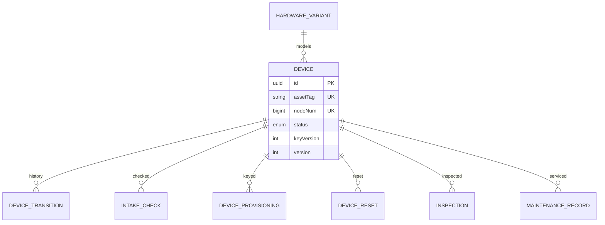

***Figure 1***: devices slice. `Inspection.contractDeviceId` points at the `rentals` row the inspection
closes; `StockTake` stands alone.

`nodeNum` is the unsigned 32-bit radio identity the firmware derives from the MAC
(`04-firmware-ground-truth.md` §3); registration accepts either the number or the `!xxxxxxxx` node id.
Remaining value (FR-BILL-05) is read from the variant's `remainingValueSchedule` by whole months since
`acquiredAt`: `valueAt(device, date)`.

---

## 2. Device lifecycle (D-035, amended by D-045)

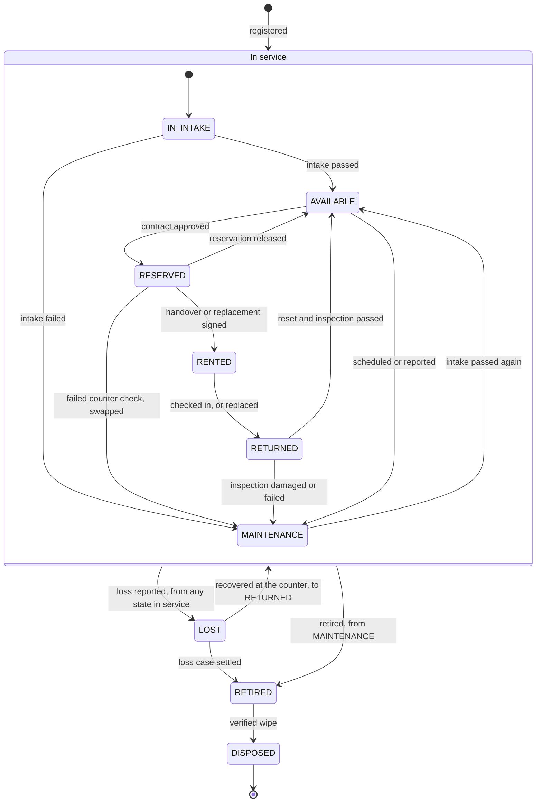

***Figure 2***: Device lifecycle; SRS Figure 23.

| From | To | Trigger | Caller | Guard |
|---|---|---|---|---|
| (none) | `IN_INTAKE` | register | Staff | unique tag and `nodeNum` |
| `IN_INTAKE`, `MAINTENANCE` | `AVAILABLE` | intake passed | Staff | no open maintenance record |
| `IN_INTAKE`, `AVAILABLE` | `MAINTENANCE` | intake failed, or maintenance opened | Staff | reason |
| `AVAILABLE` | `RESERVED` | `reserve()`, `reserveExplicit()` | rentals | locked with `SKIP LOCKED` |
| `RESERVED` | `AVAILABLE` | `release()` | rentals | contract cancelled, or swap |
| `RESERVED` | `MAINTENANCE` | `failHandoverCheck()` | rentals | swap at the counter (E01-5) |
| `RESERVED` | `RENTED` | `markRented()` | rentals | handover or replacement, provisioned at the organization's current key version |
| `RENTED` | `RETURNED` | `markReturned()` | rentals | check-in, or the faulty unit of a replacement |
| any in-service state | `LOST` | report loss | Org Manager (own rented device), Staff | no open loss case (BR-37) |
| `LOST` | `RETURNED` | recover | Staff | loss case `REPORTED`, `SEARCHING` or `SETTLED` |
| `LOST` | `RETIRED` | settle loss case | Admin | case `CONFIRMED`, Admin not the triager |
| `RETURNED` | `AVAILABLE`, `MAINTENANCE` | `recordInspection()` | rentals | reset logged after the last check-in |
| `MAINTENANCE` | `RETIRED` | retire | Admin | not on a live contract row |
| `RETIRED` | `DISPOSED` | dispose | Admin | wipe recorded (BR-42) |

Manual endpoints never reach the system-only rows; those are exported service methods taking `tx`.

---

## 2.1 Loss case (D-045)

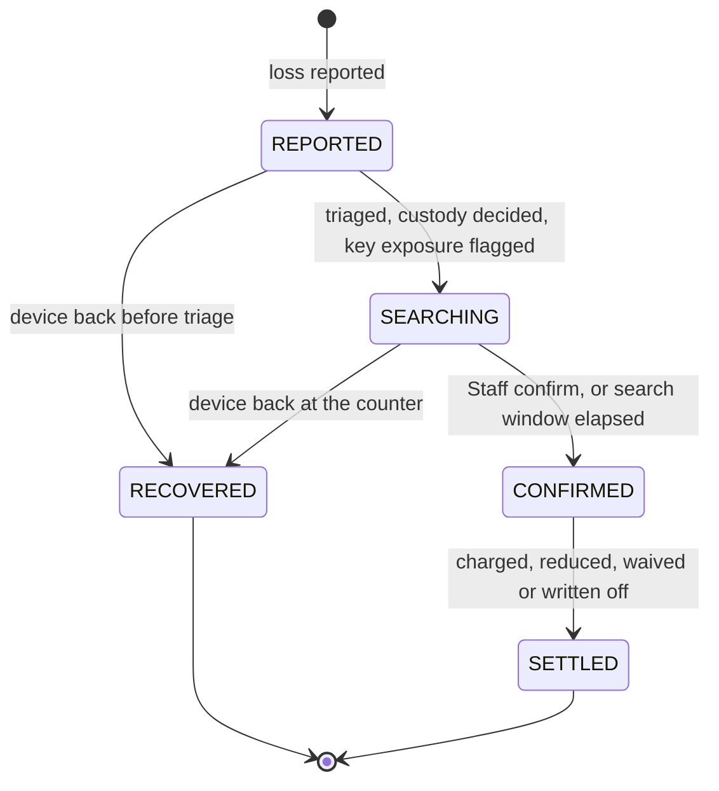

***Figure 2a***: Loss case lifecycle; SRS Figure 24.

Custody is decided at triage from `rentals.custodyAt(deviceId, lastSeenAt)`, the same custody intervals that
attribute field events (D-040). `RENTER` custody marks the organization's channel key exposed through
`organizations.markKeyExposed`, and confirmation charges the remaining value through `billing.chargeLoss`;
`TREKLINK` custody is written off. The `devices.lossSearch` job confirms `SEARCHING` cases whose
`searchEndsAt` has passed, with the usual compare-and-set on state and version. A device recovered after
settlement goes to `RETURNED` while its case stays `SETTLED`; any refund is a billing adjustment (E05-10).

---

## 3. Services other modules call

| Method | Caller |
|---|---|
| `reserve(variantId, quantity, contractId, tx)` returns device ids or throws `INSUFFICIENT_DEVICES` | rentals |
| `reserveExplicit(deviceIds, contractId, tx)` | rentals |
| `release(deviceIds, tx)`, `failHandoverCheck(deviceId, reason, tx)` | rentals |
| `recordProvisioning(deviceId, orgId, keyVersion, actor, tx)` | rentals |
| `assertReadyForHandover(deviceIds, keyVersion)` | rentals |
| `markRented(ids, tx)`, `markReturned(id, tx)` | rentals |
| `openLossForReplacement(deviceId)` returns whether the device has an open loss case | rentals |
| `recordInspection(deviceId, dto, contractDeviceId, actor, tx)` returns the inspection | rentals |
| `valueAt(deviceId, date)` | billing |
| `projectReading(nodeNum, reading, tx)` returns the device id or null | gateway-sync |
| `byNodeNum(nodeNum)`, `projections(ids)`, `trail(id)` | gateway-sync, monitoring |
| `availability(variantId?)` | rentals, monitoring |

---

## 4. Error catalogue

| Code | HTTP |
|---|---|
| `INVALID_STATE_TRANSITION` | 409 |
| `INSUFFICIENT_DEVICES` | 409 |
| `RESET_REQUIRED` | 409 |
| `RESET_INCOMPLETE` | 400 |
| `MOTION_RESULT_REQUIRED` | 400 |
| `MAINTENANCE_OPEN` | 409 |
| `VARIANT_IN_USE` | 409 |
| `SCHEDULE_INVALID` | 400 |
| `KEY_VERSION_MISMATCH` | 409 |
| `DEVICE_NOT_PROVISIONED` | 409 |

---

## 5. Sequence: return loop (check-in, reset, inspection)

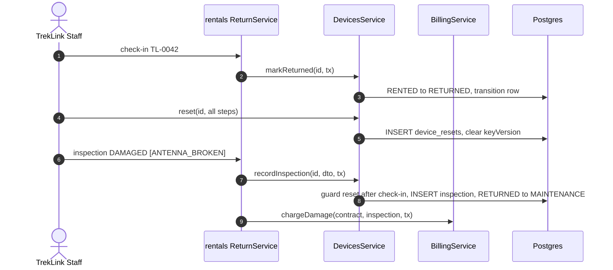

***Figure 3***: The MF-05 return loop; one transaction per arrow from Staff.

---

## 6. Testing strategy

State-matrix test over all 64 pairs; reservation race with two transactions on Postgres; reset-before-
inspection guard; remaining-value lookup by age; projection ignores older readings.

---

## 7. Detailed design for Report 4 (D-044)

Layering as in `organizations` design §9. Figures 4 and 7 are the class views, core and loss cases;
Figures 5, 6 and 8 to 11 are the MF-05 reset, inspection, loss case and disposal interactions.

<!-- sdd: MF-05 class devices -->
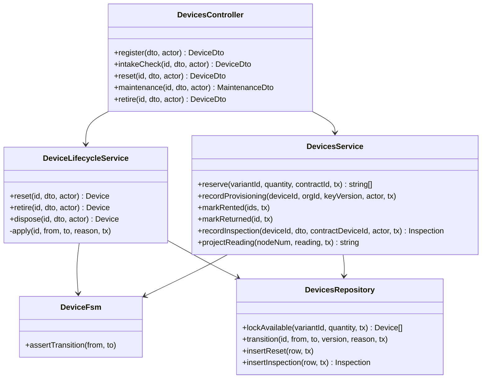

***Figure 4***: devices classes. `DeviceFsm` holds the transition table of Figure 2.

<!-- sdd: MF-05 seq UC-44 part 1 of 2: reset -->

***Figure 5***: UC-44 Reset and Inspect Device, part 1 of 2: reset.

<!-- sdd: MF-05 seq UC-44 part 2 of 2: inspection -->
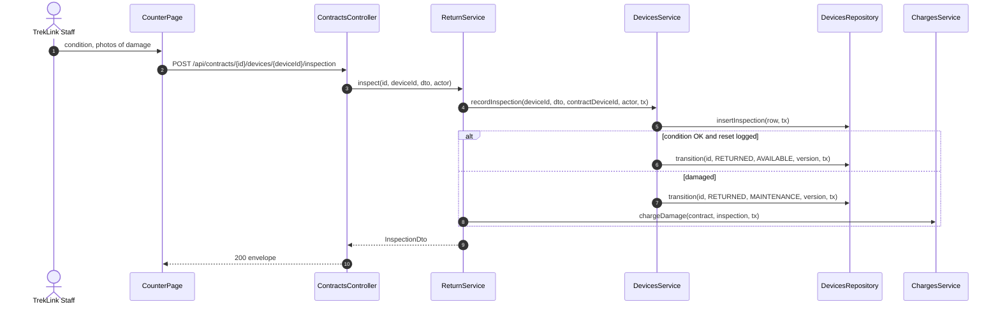

***Figure 6***: UC-44 Reset and Inspect Device, part 2 of 2: inspection. A device reaches `AVAILABLE`
only after a logged reset and a passed inspection (BR-28).

<!-- sdd: MF-05 class devices-loss -->
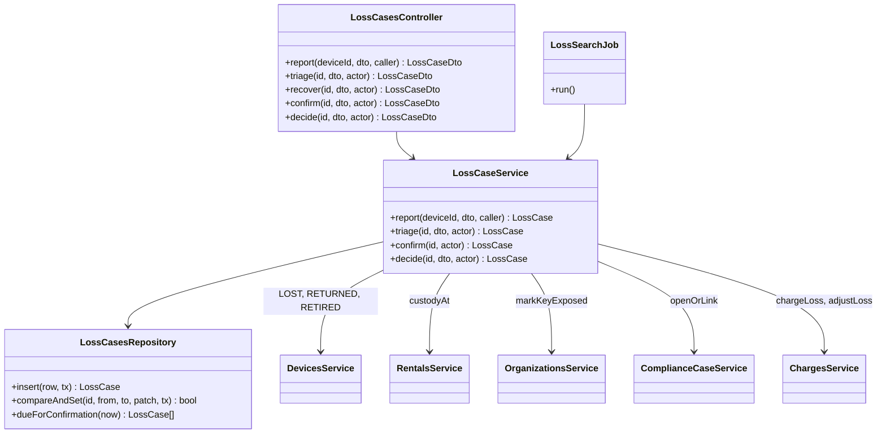

***Figure 7***: devices classes for loss cases (D-045).

<!-- sdd: MF-05 seq UC-49 -->
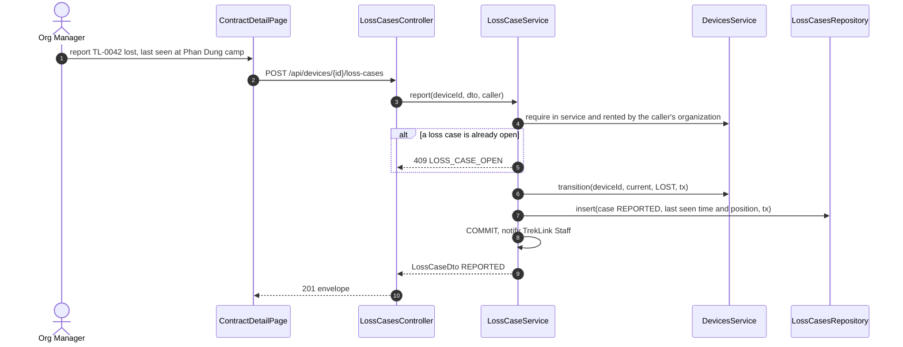

***Figure 8***: UC-49 Report Lost Device. Staff report a unit missing at stock-take through the same call.

<!-- sdd: MF-05 seq UC-60 part 1 of 2: triage -->
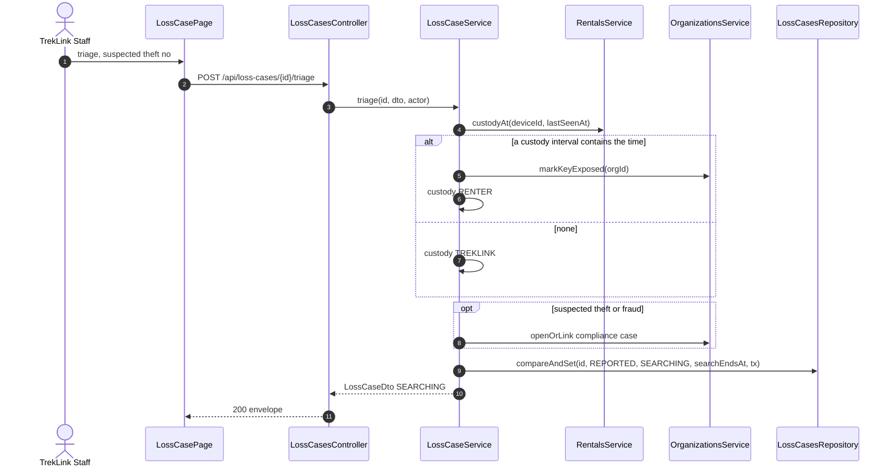

***Figure 9***: UC-60 Resolve Loss Case, part 1 of 2: triage by custody (D-040, D-045).

<!-- sdd: MF-05 seq UC-60 part 2 of 2: confirmation and settlement -->
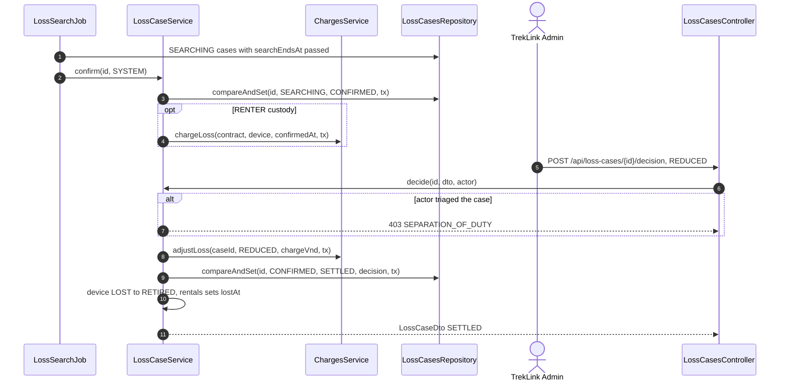

***Figure 10***: UC-60 Resolve Loss Case, part 2 of 2: confirmation and settlement with the waiver rule
(BR-39).

<!-- sdd: MF-05 seq UC-62 -->
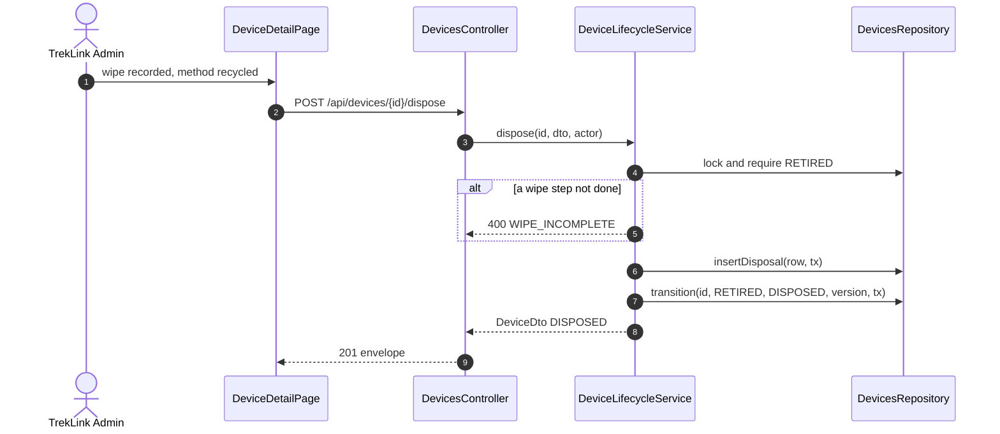

***Figure 11***: UC-62 Dispose Device (BR-42).
