# Technical Design: devices

> Fulfills `requirements.md` in this folder. Schema: the `// @module devices` block of
> `backend/prisma/schema.prisma` is authoritative.
>
> **Status**: Approved, written by KhoaDD and merged on `dev` (treklink-web PR #30 and #31, 2026-10-18). Changes go through a pull request reviewed by KhoaDD (D-052).

---

## 1. Data model

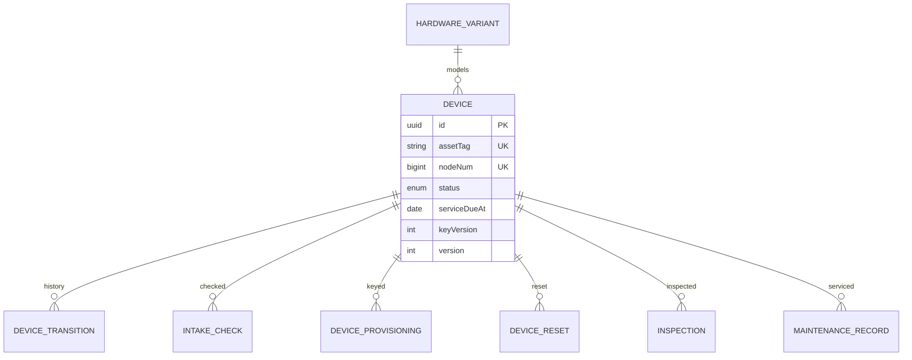

***Figure 1***: devices slice. `Inspection.contractDeviceId` points at the `rentals` row the inspection
closes; `StockTake` stands alone.

`nodeNum` is the unsigned 32-bit radio identity the firmware derives from the MAC
(`04-firmware-ground-truth.md` §3); registration accepts either the number or the `!xxxxxxxx` node id.
Remaining value (FR-BILL-05) is read from the variant's `remainingValueSchedule` by whole months since
`acquiredAt`: `valueAt(device, date)`.

The projection (`lastSeenAt`, `batteryPct`, `lastBatteryAt`, `lastLatitude`, `lastLongitude`, `lastPositionAt`) is written by
`gateway-sync` through `projectReading` and never moves backwards (REQ-EVT-08). `lastPositionAt` is the time of
the reading that set the position, because a reading without a position moves `lastSeenAt` only; monitoring
uses it to show an organization only a position from inside its custody interval (monitoring REQ-UBI-04,
D-092 rule 2, migration `20261101210100_devices_last_position_at`). It is null for a position stored before
the column existed. `lastBatteryAt` does the same for `batteryPct` (migration
`20261102040000_devices_last_battery_at`, 2026-11-02): a reading without a battery value leaves the stored
battery, and its time, as they were.

---

## 2. Device lifecycle (D-035, amended by D-045 and D-047)

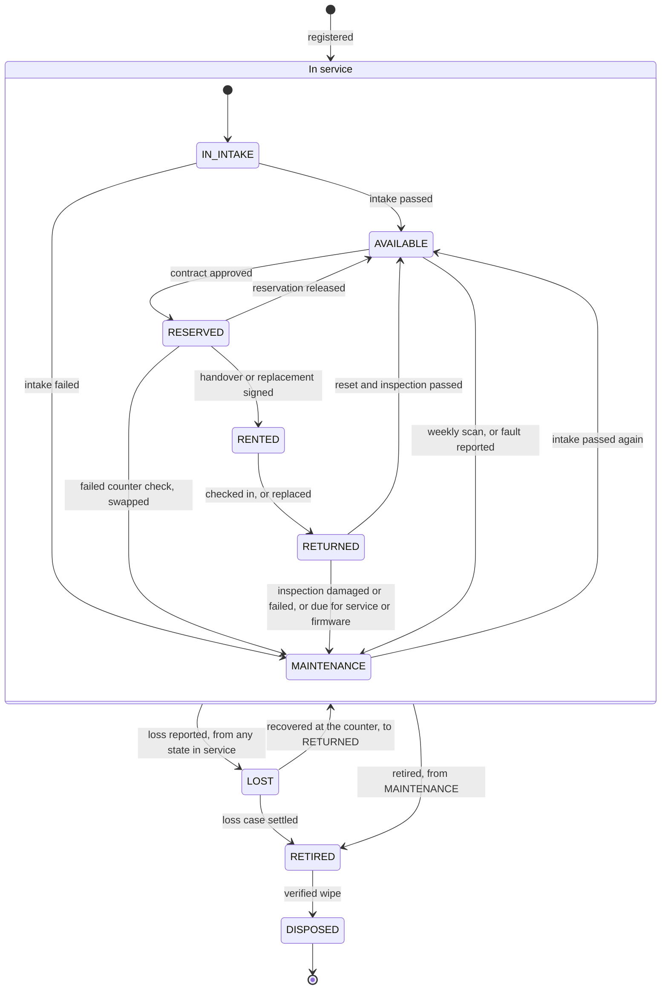

***Figure 2***: Device lifecycle; SRS Figure 23.

| From | To | Trigger | Caller | Guard |
|---|---|---|---|---|
| (none) | `IN_INTAKE` | register | Staff | unique tag and `nodeNum` |
| `IN_INTAKE`, `MAINTENANCE` | `AVAILABLE` | intake passed | Staff | no open maintenance record |
| `IN_INTAKE`, `AVAILABLE` | `MAINTENANCE` | intake failed, or maintenance opened | Staff | reason, expected date |
| `AVAILABLE` | `MAINTENANCE` | `devices.serviceScan` | SYSTEM | service due within 7 days plus lead days, or firmware differs from the baseline; no open record |
| `AVAILABLE` | `RESERVED` | `reserve()` at approval or swap, `takeForReplacement()` | rentals | locked with `SKIP LOCKED`; transition reason `RESERVED` |
| `RESERVED` | `AVAILABLE` | `release()` | rentals | contract cancelled; transition reason `RELEASED` |
| `RESERVED` | `MAINTENANCE` | `failHandoverCheck()` | rentals | swap at the counter (E01-5); opens a `HANDOVER_CHECK_FAILED` maintenance record with the swap reason; transition reason `HANDOVER_CHECK_FAILED` |
| `RESERVED` | `RENTED` | `markRented()` | rentals | handover or replacement, provisioned at the organization's current key version; transition reason `HANDED_OVER` |
| `RENTED` | `RETURNED` | `markReturned()` | rentals | check-in, or the faulty unit of a replacement; transition reason `CHECKED_IN`, or `REPLACED` for the faulty unit |
| any in-service state | `LOST` | report loss | Org Manager (own rented device), Staff | no open loss case (BR-37) |
| `LOST`, or `RETIRED` with a `SETTLED` loss case | `RETURNED` | recover | Staff | loss case `REPORTED`, `SEARCHING` or `SETTLED`; a settled case moved the device to `RETIRED`, so recovery after settlement starts there (REQ-EVT-11, 2026-10-31) |
| `LOST` | `RETIRED` | settle loss case | Admin | case `CONFIRMED`, Admin not the triager |
| `RETURNED` | `AVAILABLE`, `MAINTENANCE` | `recordInspection()` | rentals | reset logged after the last check-in; a passed unit due for service or firmware goes to `MAINTENANCE` (FR-DEV-19) |
| `MAINTENANCE` | `RETIRED` | retire | Admin | not on a live contract row |
| `RETIRED` | `DISPOSED` | dispose | Admin | wipe recorded (BR-42) |

Manual endpoints never reach the system-only rows; those are exported service methods taking `tx`.

Every move a rentals method drives writes one `device_transitions` row per unit that moved, in the caller's
transaction (`DevicesRepository.moveWithTransitions`, or `insertTransitions` after the `SKIP LOCKED` pick of
`reserve()`): `refType` `CONTRACT`, `refId` the contract id, `note` the contract code, `actorId` the Staff or
Org Manager account that acted (a Manager's cancel records the Manager), or null (SYSTEM) for a scheduled job
(2026-10-30, demo smoke defect 2). The monitoring device history (api-design 07) tells these moves through its
contract entries and leaves the `CONTRACT` rows out, so each move appears once. A unit not in the source status neither moves nor gets a row.

**Next step back to `AVAILABLE` (REQ-EVT-23, D-092 rule 4).** `nextStepOf(status, resetSinceReturn,
openMaintenance)` in `next-step.ts` is the one rule, read by `DevicesService.detail` (api-design 07) and by
`DevicesService.nextSteps(deviceIds)`, the exported batch read `rentals` calls for the checked-in rows of a
contract: `RETURNED` without a reset since `statusChangedAt` is `RESET`, with one is `INSPECT`; `MAINTENANCE`
with an open record is `COMPLETE_MAINTENANCE`, without one `INTAKE`; `IN_INTAKE` is `INTAKE`; every other state
has none. `RESET` and `INSPECT` carry the contract of the last `RENTED` to `RETURNED` transition with `refType`
`CONTRACT`, because the inspection endpoint is the contract's (rentals api-design 16); a unit recovered outside a
contract carries none. A passed inspection still goes straight to `AVAILABLE` (leader ruling 2026-11-01): the
intake check follows only a maintenance record.

`DevicesService.openLossCases(deviceIds, tx)` gives `rentals` the open loss case (`REPORTED`, `SEARCHING` or
`CONFIRMED`) of each unit, for the close check of rentals api-design 20 (D-092 rule 3).

---

## 2.1 Loss case (D-045)

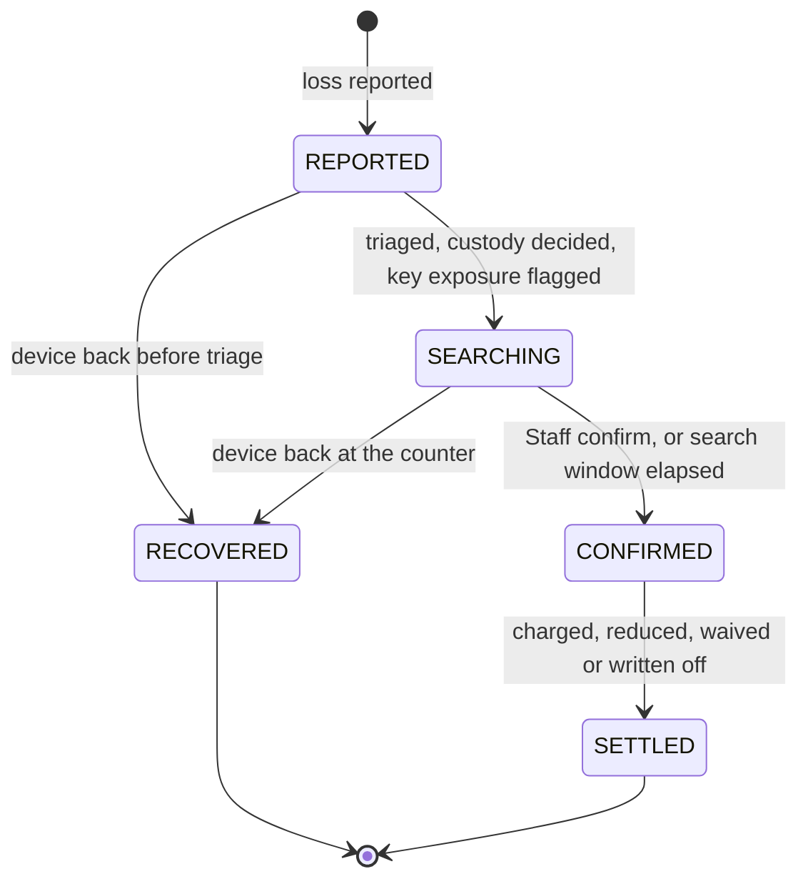

***Figure 2a***: Loss case lifecycle; SRS Figure 24.

Custody is decided at triage from `CUSTODY_RESOLVER.custodyAt(deviceId, lastSeenAt)`, the same custody intervals that
attribute field events (D-040), checked against `custodyAt(deviceId, reportedAt)`. The interval of the
last seen time counts only when it is the same rental as the interval at the report time; otherwise the
custody at the report time counts, and that is `TREKLINK` only when no rental holds the unit at the
report time (leader rulings 2026-10-31 and 2026-11-01). So a unit lost in the store after check-in, last
heard while still out, is `TREKLINK`; a unit last heard in an earlier rental, or outside any rental
(only at provisioning), and out with a renter at the report time is that renter's. A unit never heard
is read at `reportedAt` alone. A `RENTER` case
therefore always names an interval still open at the report time, which `rentals` closes with `lostAt`
when the case settles. `RENTER` custody marks the organization's channel key exposed through
`ChannelKeyService.markKeyExposed` of `organizations`, and confirmation charges the remaining value through the `LOSS_CASE_LISTENERS` port, which `billing` provides with `chargeLoss`;
`TREKLINK` custody is written off. The `devices.lossSearch` job confirms `SEARCHING` cases whose
`searchEndsAt` has passed, with the usual compare-and-set on state and version. A device recovered after
settlement goes to `RETURNED` while its case stays `SETTLED`; any refund is a billing adjustment (E05-10). A device
recovered before settlement goes to `RETURNED` with no `lostAt`, so a `RENTER` case leaves its custody
interval open and the contract counts the unit out until the counter checks it in; that check-in closes
the row, and the device, already `RETURNED`, does not move again (2026-11-01). A unit recovered while its monthly contract is `ACTIVE` stays `RETURNED`, counted out on that contract, until the term ends, because check-in accepts a monthly contract only from `ENDING` on (`RETURNING` in `rentals/return.service.ts`, REQ-STA-01). Until then the unit
cannot reach `AVAILABLE`: its reset, its inspection and a passing intake answer 409
`INVALID_STATE_TRANSITION` while `CUSTODY_RESOLVER.custodyAt` finds the open row (leader ruling 2026-11-01).

## 2.2 Maintenance record and the weekly service scan (D-047)

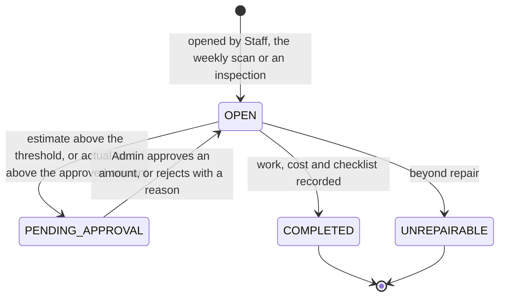

***Figure 2b***: Maintenance record lifecycle; SRS Figure 25.

| Rule | Design |
|---|---|
| Service plan | `HardwareVariant.serviceIntervalDays` and `serviceChecklist`; no interval means no periodic service |
| Due date | `Device.serviceDueAt`: the first passed intake check plus the interval; each completed `SCHEDULED` record sets it to its completion date plus the interval (FR-DEV-17) |
| Weekly scan | `ServiceScanJob`, registered as `devices.serviceScan` (`platform` design §4.6), Monday at `devices.serviceScanHourLocal`. Window: `serviceDueAt < runDate + 7 days + devices.maintenanceLeadDays`, or `firmwareVersion <> variant.firmwareBaseline`. `AVAILABLE` devices without an open record get one, `openedById` null (SYSTEM), `expectedAt` the due date, in one transaction each with the transition; the list goes to Staff by email after commit (FR-DEV-18) |
| On a contract | `RESERVED` and `RENTED` devices are listed, never moved (BR-45); `recordInspection()` checks the same window and the baseline and opens the record when the inspection passes (FR-DEV-19) |
| Cost approval | `estimate()` and `complete()` compare against `devices.maintenanceApprovalThresholdVnd` or `approvedCostVnd`; `decide()` refuses the estimator (`maintenance_records_decider_not_estimator`) |
| Firmware | `complete()` writes `Device.firmwareVersion` from the record; a `FIRMWARE_UPDATE` record requires it (`maintenance_records_firmware_on_completion`) |
| One open record | `maintenance_records_one_open_per_device`; the scan skips a device that has one |

Paying the vendor happens outside the platform. A renter's share of a repair is the damage charge of the
inspection (BR-24), never the maintenance cost.

---

## 3. Services other modules call

| Method | Caller |
|---|---|
| `reserve(variantId, quantity, contractId, tx)` returns device ids or throws `INSUFFICIENT_DEVICES` | rentals |
| `reserveExplicit(deviceIds, contractId, tx)` | rentals |
| `release(deviceIds, tx)`, `failHandoverCheck(deviceId, reason, tx)` | rentals |
| `recordProvisioning(deviceId, orgId, keyVersion, actor, tx)` | rentals |
| `clearProvisioning(deviceId, tx)`: undoes the record before the handover (rentals api-design 19); the `DeviceProvisioning` row stays | rentals |
| `assertReadyForHandover(deviceIds, keyVersion)` | rentals |
| `markRented(ids, tx)`, `markReturned(id, tx)` | rentals |
| `openLossForReplacement(deviceId)` returns whether the device has an open loss case | rentals |
| `recordInspection(deviceId, dto, contractDeviceId, actor, tx)` returns the inspection | rentals |
| `valueAt(deviceId, date)` | billing |
| `projectReading(nodeNum, reading, tx)` returns the device id or null | gateway-sync |
| `byNodeNum(nodeNum)`, `projections(ids)`, `trail(id)` | gateway-sync, monitoring |
| `availability(variantId?)` | rentals, monitoring |

**Ports declared here (corrected 2026-10-18).** `rentals` and `billing` both import `devices` (`platform`
design Figure 3), so the loss-case flow of D-045 reaches them through ports, never by import:

```typescript
export const CUSTODY_RESOLVER = Symbol('CUSTODY_RESOLVER'); // provided by rentals
export interface CustodyResolver {
  // Reads in the caller's transaction, so a check-in committed before the read is seen (2026-11-01).
  custodyAt(deviceId: string, at: Date, tx: Prisma.TransactionClient):
    Promise<{ contractId: string; organizationId: string; contractDeviceId: string } | null>;
}

export const LOSS_CASE_LISTENERS = Symbol('LOSS_CASE_LISTENERS'); // multi: billing, rentals
export interface LossCaseListener {
  onConfirmed(lossCase: LossCaseView, tx: Prisma.TransactionClient): Promise<void>;
  onSettled(lossCase: LossCaseView, decision: LossDecision, tx: Prisma.TransactionClient): Promise<void>;
}
```

`billing` charges the remaining value in `onConfirmed` for `RENTER` custody (`chargeLoss`) and writes the
`ADJUSTMENT` line of a reduction or waiver in `onSettled` (`adjustLoss`, dated at the view's `settledAt`); `rentals` sets the contract row's
`lostAt` to the confirmation time in `onSettled` (rentals REQ-EVT-12). Both run inside the loss-case
transaction. `LossCaseView` carries the deciding Admin's `decidedById` and `decidedByRoles`, so the
`RETURNED` transition rentals writes when the last unit out settles audits the actor with its roles
(review of #228, 2026-11-01).

**Organization actions of a triage (added 2026-10-31, task 2.7).** For `RENTER` custody triage calls
`ChannelKeyService.markKeyExposed(orgId, at, actor, tx)` directly, in the triage transaction
(REQ-EVT-14); organizations tells the Managers after commit. A suspected theft in renter custody reaches
`ComplianceCasesService.openOrLink` (organizations 2.10) through the port `LOSS_ORGANIZATION_ACTIONS`
(`ports/loss-organization-actions.port.ts`), which `DevicesModule` binds to it; the loss case stores the
returned case id. In the other direction `DevicesComplianceLossCases` provides the organizations port
`COMPLIANCE_LOSS_CASES`: the loss case codes of a compliance case and the link of the loss cases Staff
name when they open one.

```typescript
export const LOSS_ORGANIZATION_ACTIONS = Symbol('LOSS_ORGANIZATION_ACTIONS');
export interface LossOrganizationActions {
  openOrLinkComplianceCase(input: { organizationId: string; lossCaseId: string; lossCaseCode: string;
    evidence: string; policeReference: string | null; actorId: string; actorRoles: string[] },
    tx: Prisma.TransactionClient): Promise<string | null>; // the compliance case id, or null
}
```

A loss case stores the custody interval's `contractId` and `organizationId` beside `contractDeviceId`
(migration `20261101180000_loss_case_custody_contract`), because `devices` cannot read the rentals
tables and `LossCaseView.custodyContract` needs all three. They are set at report from
`custodyAt(deviceId, now)` and replaced at triage by the triage custody of §2.1, or
cleared for `TREKLINK` custody; the Org Manager's list reads `organizationId`.

---

## 4. Error catalogue

| Code | HTTP |
|---|---|
| `INVALID_STATE_TRANSITION` | 409 |
| `INSUFFICIENT_DEVICES` | 409 |
| `RESET_REQUIRED` | 409 |
| `RESET_INCOMPLETE` | 400 |
| `MOTION_RESULT_REQUIRED` | 400 |
| `MAINTENANCE_OPEN` | 409 |
| `VARIANT_IN_USE` | 409 |
| `SCHEDULE_INVALID` | 400 |
| `KEY_VERSION_MISMATCH` | 409 |
| `DEVICE_NOT_PROVISIONED` | 409 |
| `SEPARATION_OF_DUTY` | 403 |
| `LOSS_CASE_OPEN` | 409 |
| `WIPE_INCOMPLETE` | 400 |
| `CHECKLIST_INCOMPLETE` | 400 |
| `CHECKLIST_REQUIRED` | 400 |
| `FIRMWARE_VERSION_REQUIRED` | 400 |
| `VENDOR_REQUIRED` | 400 |
| `FIRMWARE_SOURCE_UNAVAILABLE` | 502 |
| `FIRMWARE_IMAGE_INVALID` | 502 |
| `FIRMWARE_IMAGE_TOO_LARGE` | 502 |
| `VARIANT_MEDIA_INVALID` | 400 |

---

## 5. Sequence: return loop (check-in, reset, inspection)

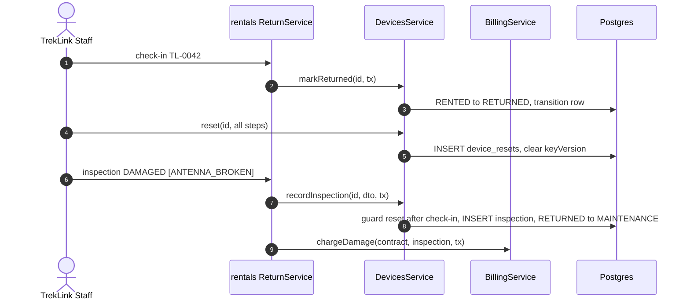

***Figure 3***: The MF-05 return loop; one transaction per arrow from Staff.

---

## 6. Testing strategy

State-matrix test over all 81 pairs; reservation race with two transactions on Postgres; reset-before-
inspection guard; remaining-value lookup by age; projection ignores older readings. Service scan with a fake
clock: the window boundary of AC-09, a rented unit listed but not moved, no second record; inspection routing
of AC-10; the approval path of AC-11 including the estimator's 403; firmware update of AC-12; the four
maintenance constraints on Postgres.

---

## 7. Detailed design for Report 4 (D-044)

Layering as in `organizations` design §9. Figures 4, 7 and 12 are the class views, core, loss cases and
maintenance; Figures 5, 6, 8 to 11 and 13 to 16 are the MF-05 reset, inspection, loss case, disposal, service
scan, maintenance and cost approval interactions.

<!-- sdd: MF-05 class devices -->
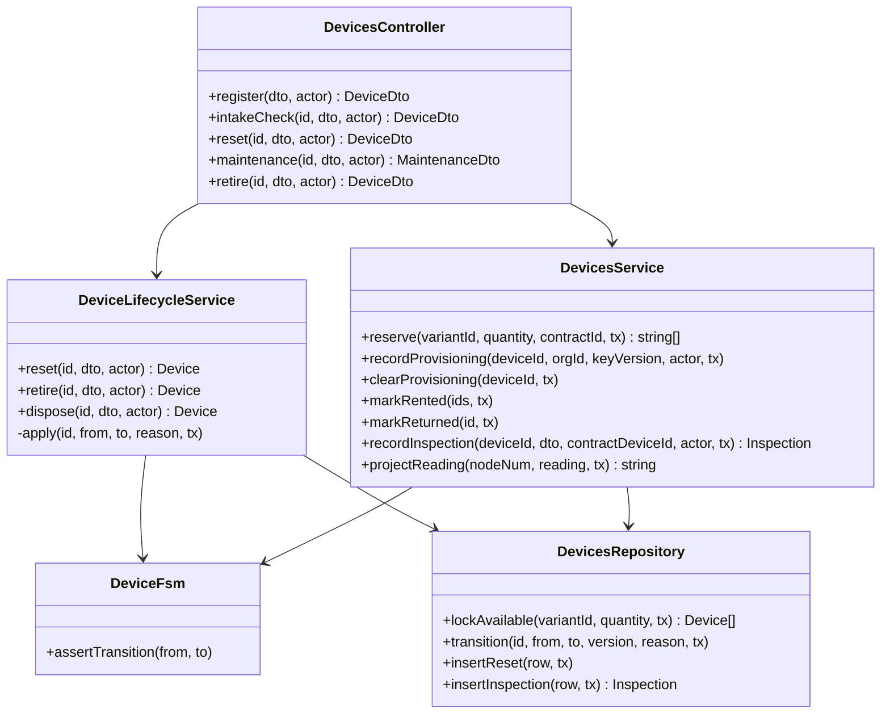

***Figure 4***: devices classes. `DeviceFsm` holds the transition table of Figure 2.

<!-- sdd: MF-05 seq UC-44 part 1 of 2: reset -->
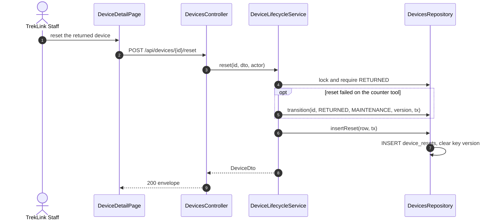

***Figure 5***: UC-44 Reset and Inspect Device, part 1 of 2: reset.

<!-- sdd: MF-05 seq UC-44 part 2 of 2: inspection -->
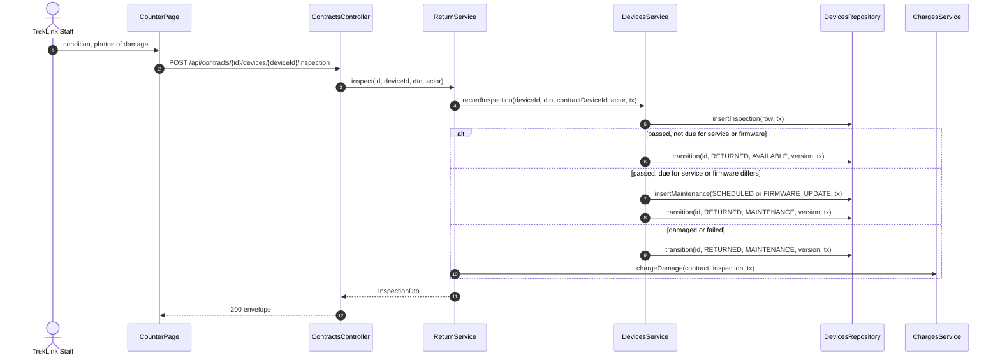

***Figure 6***: UC-44 Reset and Inspect Device, part 2 of 2: inspection. A device reaches `AVAILABLE`
only after a logged reset and a passed inspection (BR-28), and a unit due for service goes to maintenance
instead (FR-DEV-19, BR-45).

<!-- sdd: MF-05 class devices-loss -->
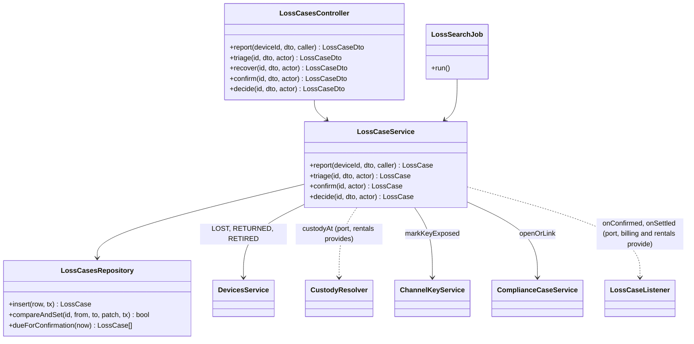

***Figure 7***: devices classes for loss cases (D-045).

<!-- sdd: MF-05 seq UC-49 -->
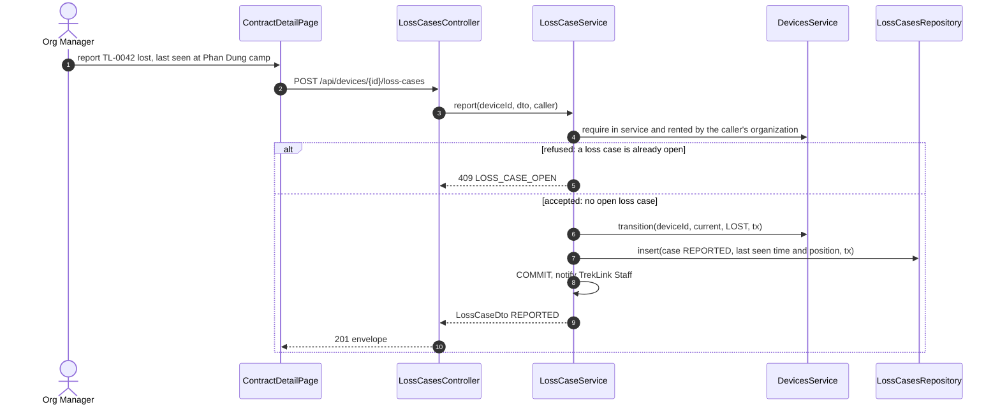

***Figure 8***: UC-49 Report Lost Device. Staff report a unit missing at stock-take through the same call.

<!-- sdd: MF-05 seq UC-60 part 1 of 2: triage -->
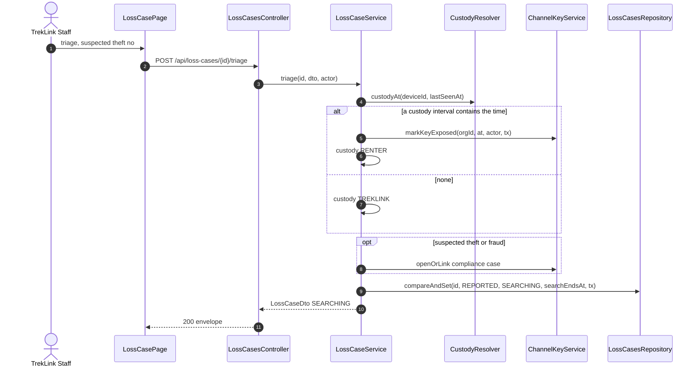

***Figure 9***: UC-60 Resolve Loss Case, part 1 of 2: triage by custody (D-040, D-045).

<!-- sdd: MF-05 seq UC-60 part 2 of 2: confirmation and settlement -->
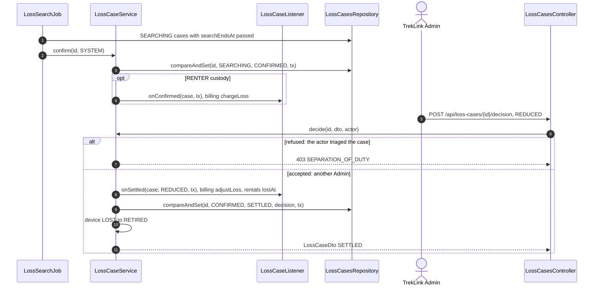

***Figure 10***: UC-60 Resolve Loss Case, part 2 of 2: confirmation and settlement with the waiver rule
(BR-39).

<!-- sdd: MF-05 seq UC-62 -->
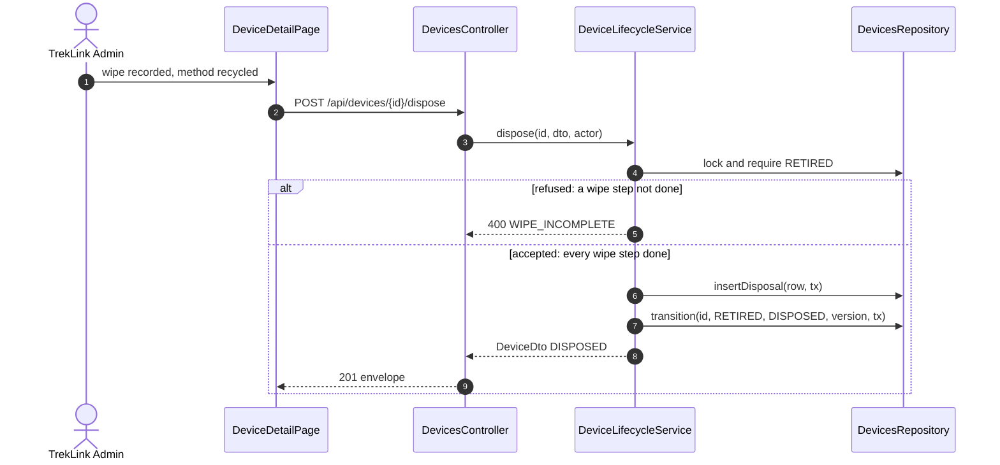

***Figure 11***: UC-62 Dispose Device (BR-42).

<!-- sdd: MF-05 class devices-maintenance -->
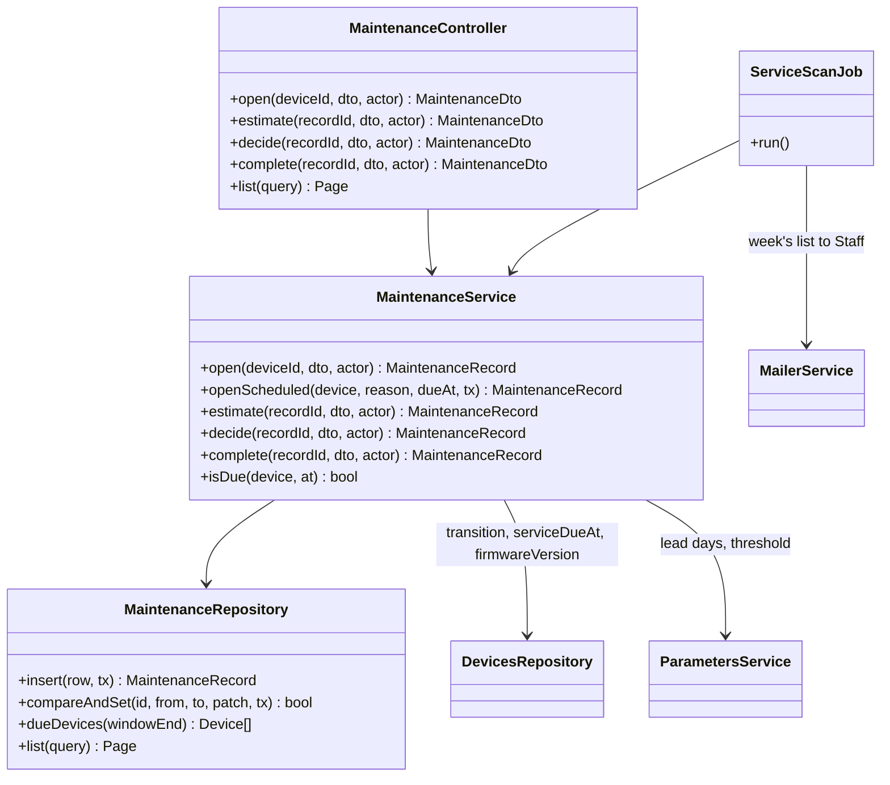

***Figure 12***: devices classes for maintenance (D-047). `DevicesService.recordInspection()` calls
`MaintenanceService.isDue()` and `openScheduled()` for FR-DEV-19.

<!-- sdd: MF-05 seq UC-65 -->
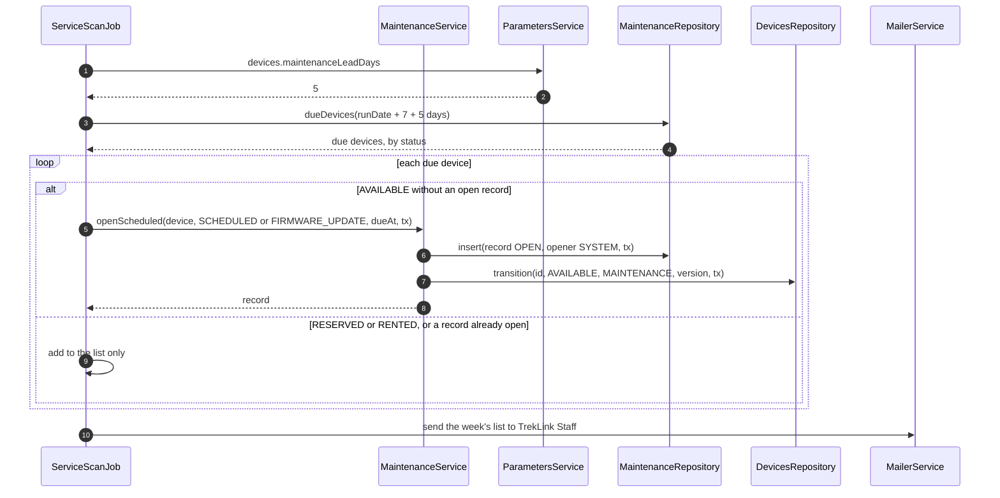

***Figure 13***: UC-65 Scan for Due Service. A unit on a contract is listed, never moved (BR-45).

<!-- sdd: MF-05 seq UC-52 part 1 of 2: open and estimate -->
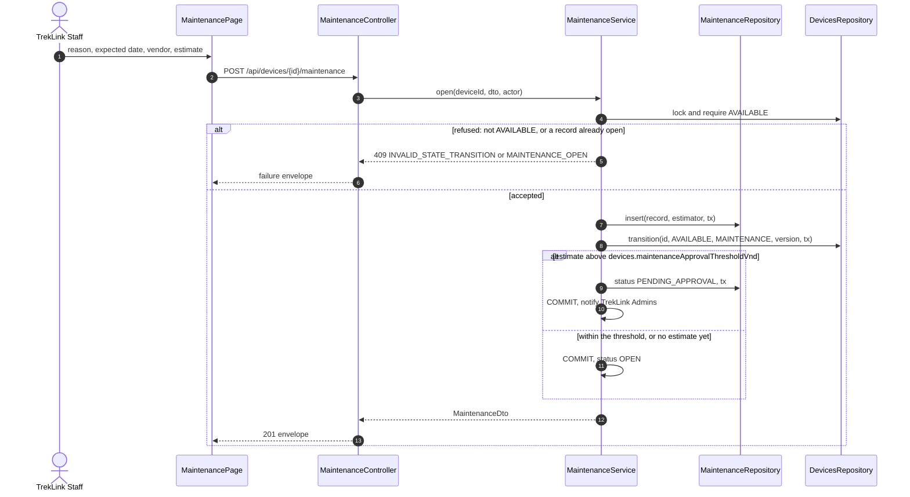

***Figure 14***: UC-52 Record Maintenance, part 1 of 2: opening with an estimate (FR-DEV-08, FR-DEV-20).
A record the scan opened gets its estimate through `PATCH .../estimate` with the same threshold check.

<!-- sdd: MF-05 seq UC-52 part 2 of 2: completion -->
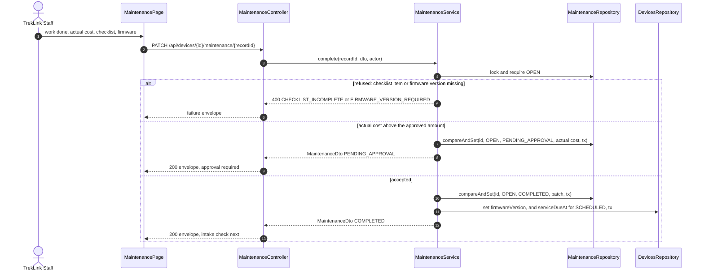

***Figure 15***: UC-52 Record Maintenance, part 2 of 2: completion (FR-DEV-17, FR-DEV-21). The device stays
`MAINTENANCE` until it passes the intake check (UC-12).

<!-- sdd: MF-05 seq UC-64 -->
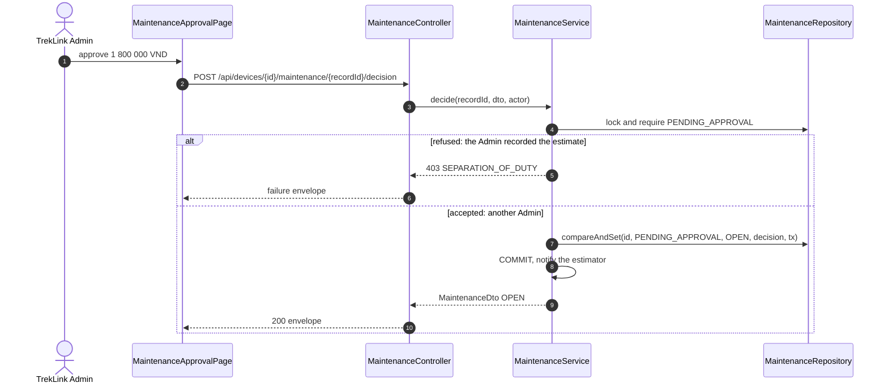

***Figure 16***: UC-64 Approve Maintenance Cost (BR-44). A rejection takes the same path with a reason.

---

## 8. Docking at the counter over Web Serial (D-080, D-082)

> **Status**: Decided (leader rulings D-082, 2026-10-30, and the D-080 amendment, 2026-11-02, both on
> treklink-web#126). §8.6 records the ruling on each point D-080 left open; the options table is kept for
> its rationale. §8.8 adds the Stage A uplink configuration the D-093 amendment requires this week.

### 8.1 Scope and placement

Docking is the Staff device station, not only a key writer (D-082 decision 1). Staff plug a unit in to
register it at intake, read and record its state, adjust its configuration (owner names, channel), and
provision it at handover; each is a step of the existing device and handover flows, done through the
docked unit instead of typed values. The backend never talks to a unit; it only checks the docked
`nodeNum` when provisioning is recorded, and issues the channel key once that check passes (§8.5, §8.6
decision 1). Two frontend slices (FSD):

| Slice | Contents |
|---|---|
| `shared/lib/meshtastic-dock.ts` | One adapter around `@meshtastic/transport-web-serial` and `@meshtastic/core` (D-082 decision 3, pinned exact versions): opens the Web Serial port, runs the config-only handshake (`want_config_id` 69420), and exposes `readUnit()` and `writeOwnerAndChannel()` to the feature slice below it. A later fork of the libraries replaces this one file. |
| `features/dock-device/` | `DockingService` with `readUnit()`, `provision(expected, key, keyVersion)` and `configureUplink(settings)`, and the `useDocking` hook that pages call: it fetches the key from rentals api-design 21 and hands it to `provision`; the key lives in one local variable of the hook and of `provision` and is dropped when they return |

Pages: the Register panel of screen 4.2 (intake) and step 1 of `CounterPage` (screen 5.4, handover; the
replacement tab of screen 5.5 reuses it). Web Serial needs a secure context and a Chromium browser; every
other browser sees the banner of screens 4.2 and 5.4 and keeps manual entry ("Enter manually").

### 8.2 Protocol facts the client relies on (firmware 2.7.19, `treklink-firmware` at `f062a35`)

Firmware `dev` has since taken upstream `v2.7.26` (D-087); the facts of §8.8 are cited at `a4aa98d`, and the
lines below are checked again on the current `dev` when task 7.2 is built.

The adapter of §8.1 relies on the Meshtastic libraries for framing and the protobuf codec; these facts
about the firmware's admin authorization are still recorded here because they are what the adapter and
the vetting record's §3.2 depend on, and the library's own passkey machinery goes unused on this path.

| Fact | Source |
|---|---|
| A client packet is stamped `from = 0` | `src/mesh/MeshService.cpp:186` |
| Local admin is accepted unless `security.is_managed`; the session passkey is checked only for `from != 0` | `src/modules/AdminModule.cpp:85-89`, `:132-138` |
| The serial API needs `security.serial_enabled`, default true | `src/SerialConsole.cpp:129`, `src/mesh/NodeDB.cpp:669` |
| `want_config_id = 69420` sends `myInfo`, the own `NodeInfo`, `metadata`, channels, config and `config_complete_id`, without the node database | `src/mesh/PhoneAPI.h:23`, `src/mesh/PhoneAPI.cpp:248-300` |
| Set owner saves and, outside an edit transaction, reboots the unit 7 s later when a name changed (`saveChanges` defaults to a reboot); set channel saves without a reboot; so the dock writes both inside `begin_edit_settings` and `commit_edit_settings` and reads back after the one reboot (firmware `dev` `a4aa98d`) | `AdminModule.cpp:595-630`, `:1022-1030`, `:330-341`, `AdminModule.h:44`, `src/configuration.h:372` |
| Get channel returns the PSK to the local client | `AdminModule.cpp:1323-1336` (at `f062a35`) |
| Long name holds 39 characters, short name 4 | `mesh.pb.h:704`, `:707` |
| PSK is 0, 1, 16 or 32 bytes; TrekLink writes 32 | `channel.pb.h:42` |

Field numbers used (`src/mesh/generated/meshtastic/*.pb.h`): `ToRadio` packet 1, want_config_id 3,
heartbeat 7; `FromRadio` id 1, packet 2, my_info 3, node_info 4, config_complete_id 7, channel 10,
metadata 13; `MeshPacket` from 1, to 2, channel 3, decoded 4, id 6, want_ack 10; `Data` portnum 1 (`ADMIN_APP`
= 6), payload 2, want_response 3, request_id 6; `AdminMessage` get_channel_request 1, get_channel_response 2,
get_owner_request 3, get_owner_response 4, set_owner 32, set_channel 33; `User` id 1, long_name 2,
short_name 3; `Channel` index 1, settings 2, role 3; `ChannelSettings` psk 2 (others kept as read);
`MyNodeInfo` my_node_num 1, pio_env 13; `NodeInfo` num 1, user 2; `DeviceMetadata` firmware_version 1.

### 8.3 Intake (screen 4.2, Register panel)

1. Staff press **Read from unit**; the browser's own port chooser opens (a user gesture is required).
2. `readUnit()` runs the config-only handshake and returns `nodeNum`, `pioEnv`, `firmwareVersion` and
   the current owner names.
3. The panel fills Node number, preselects the variant whose code the build environment maps to
   (`treklink-v2` to `treklink-v2`, `treklink-v3-tbeam` to `treklink-v3`, `treklink-v4-supreme` to
   `treklink-v4`, a table in `shared/config`), and shows the reported firmware version next to the
   firmware field. The unit reports `major.minor.build.<sha7>` (`bin/readprops.py`), while variant
   baselines read `2.7.19-treklink.N`, so the field keeps the baseline and the page warns when the build
   part differs; it does not overwrite it.
4. Registration is devices api-design 05, unchanged. Manual entry ("Enter manually") stays possible;
   uniqueness is still the server's (REQ-ERR-01).

### 8.4 Handover (screen 5.4, step 1, per reserved device)

1. Staff press **Dock and provision** on the row; the first docking of the visit opens the port chooser,
   later ones reuse the granted port (`navigator.serial.getPorts()`).
2. `readUnit()`; the docked `nodeNum` is compared with the row's `nodeNum` (rentals api-design 03 gains
   `devices[].nodeNum`, §8.5). A mismatch writes nothing and the page names the docked node id
   (REQ-ERR-12).
3. On a match `useDocking` calls rentals api-design 21, the Staff-only channel-key endpoint (§8.6
   decision 1), sending the docked `nodeNum`. The endpoint requires the device reserved to this `APPROVED`
   contract, re-checks the `nodeNum` match, and has `ChannelKeyService.deriveKey(organizationId)`
   (organizations) read the current key version and derive the key; it returns the key and its version
   with `Cache-Control: no-store` and audits the call. Each call derives the key again and is audited.
4. `provision()` sends `begin_edit_settings`, `set_owner` (long name the asset tag, short name the last
   four characters per §8.6 decision 2), `set_channel` for index 0 with role `PRIMARY` and the settings
   read in step 2 with field 2 replaced, and `commit_edit_settings`. The commit saves both and reboots the
   unit once (§8.2: outside a transaction `set_owner` alone would reboot the unit between the two
   writes). The page waits for the port to come back, asks Staff to reconnect when the browser dropped
   it, then repeats the config-only handshake and compares the owner names and the primary PSK.
5. On a match the page records provisioning (rentals api-design 09) with `keyVersion` and the docked
   `nodeNum`; the key variable is cleared before the request is sent. A write, read-back or disconnect
   failure at any point records nothing and asks Staff to dock the unit again (REQ-ERR-13).

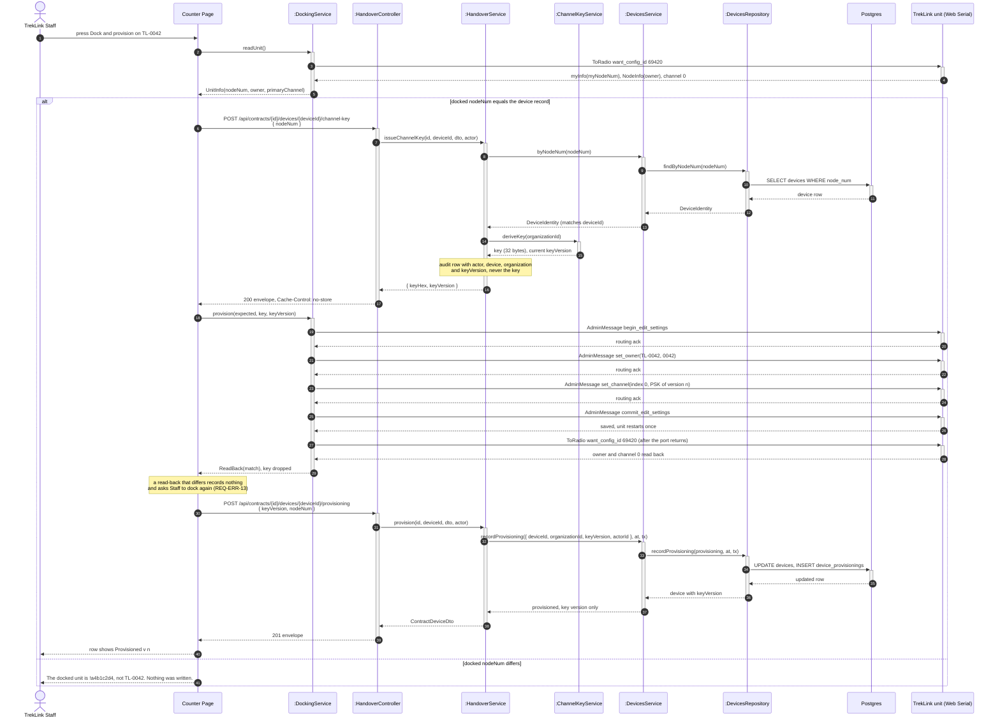

***Figure 17***: UC-14 Provision Device by docking at handover

### 8.5 Contract changes (made in the catalog)

| Endpoint | Change |
|---|---|
| rentals api-design 03 `GET /api/contracts/:id` | `devices[].nodeNum` (read-only) |
| rentals api-design 09 provisioning | body gains `nodeNum`, sent by every docked record and omitted only by the manual fallback (§8.6 decision 3); 409 `NODE_MISMATCH` when it differs from the device record, nothing recorded |
| rentals api-design 21, new: `POST /api/contracts/:id/devices/:deviceId/channel-key` | Staff-only, permission `contract.issueChannelKey`. Body: `nodeNum`. Requires the contract `APPROVED` and the device reserved to it; 409 `NODE_MISMATCH` when the docked `nodeNum` differs. Returns `{ keyHex, keyVersion }`, `Cache-Control: no-store`; writes an audit row (actor, device, organization, version, never the key) |

No schema change for the device or contract tables. `NODE_MISMATCH` joins the error catalogue of
`rentals`. A forward migration adds the `contract.issueChannelKey` permission to `catalog.py` and the
seed.

### 8.6 Docking rulings (D-082, 2026-10-30)

**Decision 1, how the counter obtains the channel key: option A.** D-021 keeps only the key version in
the platform, REQ-UBI-03 says a key is never stored, displayed, returned or logged, and `organizations`
design §1 put the key "only in the counter's provisioning tool". The counter page is now that tool, so it
must hold the key for one write.

| Option | How | Security | Demo cost |
|---|---|---|---|
| **A. Derived on the server, issued once per docking (chosen)** | One master secret `CHANNEL_KEY_MASTER` in the deployment's secret store, never in the database or the seed; a dev-only value in `backend/.env.example`. Key = HKDF-SHA256(master, salt = organization id, info = `treklink-channel-key/v{version}`), 32 bytes, via `node:crypto` `hkdfSync`. A Staff-only endpoint returns it for a device reserved to an `APPROVED` contract, after the docked `nodeNum` matched, with a new permission and an audit row (actor, device, organization, version, never the key), `Cache-Control: no-store` | Nothing stored per organization; rotation is a version bump; escrow is one secret. A leak of the master exposes every organization's keys, past and future; a stolen Staff session can fetch keys for reserved units, each fetch audited. Amends REQ-UBI-03 ("returned once to the counter, never stored, displayed or logged") | Endpoint, permission row with a forward migration, `crypto.hkdfSync`, env var: about half a day of backend |
| B. Staff paste the key from the escrow | The key stays in TrekLink's escrow (a password manager); Staff paste it into the counter for the visit; the platform holds a non-secret fingerprint per version (SHA-256 of the key, first 8 bytes) so a wrong paste is refused before any write | Closest to D-021 as written; no key on the server. The key passes through people and the clipboard; a fingerprint is needed or a wrong key is written and "verified" against itself | Fingerprint column and its entry at rotation, or none without it: lowest |
| C. Stored encrypted at rest | A random key per organization and version, AES-256-GCM under a key-encryption key in the secret store, issued like A | Independent random keys; a database dump alone reveals nothing; database plus secret store reveals all. Contradicts D-021 directly; needs its own amendment | New table, encryption, endpoint: about a day |
| D. The organization brings its own key | The Org Manager keeps the channel (as the Meshtastic app needs it anyway, D-021) and pastes or shows its channel URL at the counter | TrekLink never holds a key, but loses the escrow D-021 requires and depends on the customer at every visit; a lost key is re-keying the whole fleet | Parsing the channel URL: low |

**Rejected: B, C and D.** A is chosen: no per-device human handling of a secret, the binding to a matched
`nodeNum` and a reserved unit limits what a Staff account can fetch, rotation needs no storage, and the
escrow D-021 asks for becomes one secret. D-021 is amended: the escrowed secret is the master, and
per-organization keys are derived, never stored.

Note (2026-11-03, review of treklink-web#126): HKDF is deterministic, so the endpoint returns the same key on
every call; "once per docking" means one call per docking by the page, not a server limit. The `nodeNum`
match proves little on its own, because rentals api-design 03 returns `devices[].nodeNum` to Staff; the
effective limit is the device reserved to an `APPROVED` contract and the `contract.issueChannelKey`
permission, and every call is audited.

**Decision 2, the short name: the last four characters of the asset tag.** It holds four characters
(`mesh.pb.h:707`), so `TL-0009` does not fit. The last four characters of the asset tag (`0009`) are the
short name; the long name carries the full tag (`TL-0009`).

**Decision 3, provisioning without a dock: manual entry stays until every rented variant docks.**
D-082 kept "Enter manually" at handover as a fallback until after the 2026-11-01 demo, and the D-080
amendment (2026-11-02) removes manual provisioning once docking ships. Docking ships for the fleet only when
v2 units answer over USB (decision 4), so until the v2 build flag lands the fallback stays, labelled "Enter
manually" under the dock action, and rentals api-design 09 accepts a record without `nodeNum` from it (the
audit row marks it manual). The release that brings v2 docking makes `nodeNum` required on 09 and removes
the fallback at handover. Intake keeps manual entry.

**Decision 4 (v2 units): docking waits for the v2 build flag.** The missing
`-DARDUINO_USB_CDC_ON_BOOT=1` build flag (vetting record §3.3) is a class S firmware change that waits
for a hardware run with the leader present (D-077). The dock shows "No response over USB. v2 units
cannot dock yet; enter the node number manually." when a docked unit answers nothing over USB; v3 and v4
units dock, and v2 units go through the fallback of decision 3 until the flag lands (D-093 amendment
item 3).

**Related, not a decision here.** The reset step "Owner cleared" (screen 4.2, devices api-design 10)
conflicts with the asset tag as owner name; it should read "Owner set back to the asset tag" when the
reset is next edited.

### 8.7 Testing and size

Unit tests on `meshtastic-dock.ts` against a fake `SerialPort` (timeouts, disconnect mid-write, a unit
that answers nothing within the timeout, mapped to the v2 "no response" message), and `DockingService`
(mismatch writes nothing, read-back mismatch records nothing, the key is not reachable after
`provision` returns). Backend unit tests on `HandoverService.issueChannelKey` (nodeNum match required,
HKDF derivation deterministic per organization and version, the response carries no key when the match
fails) and on the `nodeNum` check inside `provision`. Component tests for the banner, the dock buttons,
the "Enter manually" fallback and each error state. A hardware run on v3 and v4, and on v2 once the USB
build flag lands (vetting record §3.3).

Estimated size (estimate, not measured): `shared/lib/meshtastic-dock.ts` about 120 lines plus
`@meshtastic/core` and `@meshtastic/transport-web-serial` as dependencies, `features/dock-device` about
150, page changes about 150, tests about 350; backend channel-key endpoint, `nodeNum` check and rentals
03 field about 150 lines with tests, plus a forward migration for the new permission.

### 8.8 Stage A uplink configuration (D-005, D-093 amendment item 3)

Stage A (D-005) needs nodes that publish to the broker over their own Wi-Fi with the frozen transport
settings. The dock writes those settings, so a member does not need the Meshtastic app or CLI to prepare an
uplink node. It is configuration only (D-080 rule 2): no firmware change and no server call.

**Where.** Screen 4.2, `DeviceDetailPage`, action **Configure uplink**, Staff only, shown for a device that
is not `RETIRED` or `DISPOSED` while Web Serial is available.

**Form.** Wi-Fi network name (1 to 32 characters, `config.pb.h` `wifi_ssid[33]`), Wi-Fi password (0 to 64,
`wifi_psk[65]`), broker address as host or host:port (1 to 63, `module_config.pb.h` `address[64]`), broker
user name (0 to 63, `username[64]`) and password (0 to 31, `password[32]`), and a TLS switch, off by default
(the laptop broker of the checkpoint runs on the local network; a node built without TLS support refuses it,
`MQTT.cpp` `isValidConfig`). Shown read-only, because D-005 froze them: root `treklink`, JSON on, MQTT
encryption off, uplink on the primary channel. Nothing typed is kept after the docking (REQ-UBI-05).

**Steps.**
1. `readUnit()`; the docked `nodeNum` must equal the device's (REQ-ERR-12). The handshake also returns the
   unit's current network config, MQTT module config and primary channel, which step 2 keeps as read except
   for the fields named here.
2. `begin_edit_settings`; `set_config` network with Wi-Fi on and the typed name and password;
   `set_module_config` MQTT with enabled, the typed address, user name, password and TLS switch, JSON on,
   encryption off, root `treklink`; `set_channel` index 0 with `uplink_enabled` on; `commit_edit_settings`.
3. The commit saves every segment and reboots the unit once. The page waits for the port to come back, asks
   Staff to reconnect when the browser dropped it, repeats the handshake and compares the MQTT fields, the
   Wi-Fi name and the channel's uplink flag. A difference or a unit that does not come back shows which
   check failed (REQ-ERR-15).

**Constraint.** An uplink node relays only the channel it holds: with MQTT encryption off it decrypts with
its own primary key before publishing. A node that uplinks an organization's units therefore carries that
organization's channel, so Staff configure the uplink on a unit already provisioned for that organization
(§8.4). Otherwise the backend receives nothing from those units.

| Fact (firmware `dev` `a4aa98d`) | Source |
|---|---|
| `AdminMessage` set_config 34, set_module_config 35, begin_edit_settings 64, commit_edit_settings 65, reboot_seconds 97 | `src/mesh/generated/meshtastic/admin.pb.h:585-608` |
| `Config` network 4; `NetworkConfig` wifi_enabled 1, wifi_ssid 3, wifi_psk 4 | `config.pb.h:843-845`, `:900` |
| `ModuleConfig` mqtt 1; `MQTTConfig` enabled 1, address 2, username 3, password 4, encryption_enabled 5, json_enabled 6, tls_enabled 7, root 8 | `module_config.pb.h:626-633`, `:746` |
| `ChannelSettings` uplink_enabled 5 | `channel.pb.h:145` |
| Inside an open edit transaction a set is held; the commit saves config, module config, channels and device state, then reboots once (`saveChanges` defaults to a reboot) | `src/modules/AdminModule.cpp:330-341`, `:1364-1375`, `AdminModule.h:44` |
| A set MQTT config is checked by `MQTT::isValidConfig`; a broker connection is tried only when the node is already on a network, so a node docked without Wi-Fi accepts it | `AdminModule.cpp:924-938`, `src/mqtt/MQTT.cpp:661-726` |

---

## 9. Firmware flash from the maintenance page (D-093 amendment item 3)

> **Status**: Spec, 2026-11-03 (treklink-web#326; D-093 amendment of 2026-11-02, item 3). Library: `esptool-js` 0.7.1, adopted in
> `vetting/esptool-js.md`. Needs the firmware release workflow of §9.1 before it can flash a real image.

A unit gets new firmware inside the existing `FIRMWARE_UPDATE` maintenance record (§2.2): the weekly scan
opens the record when `firmwareVersion` differs from the variant's `firmwareBaseline`, Staff flash the unit
from the record, and completing the record writes `Device.firmwareVersion` as today (REQ-EVT-22, AC-12). A
flash outside a record is not offered, so a unit on a contract is never flashed (BR-45).

### 9.1 Where the images come from

- `treklink-firmware` publishes a GitHub release per TrekLink version (`v2.7.26-treklink.N`), built by a
  release workflow for `treklink-v2`, `treklink-v3-tbeam` and `treklink-v4-supreme`. Each release carries,
  per variant, the app image (`firmware.bin`, written at `0x10000`), the merged factory image
  (`firmware.factory.bin`, written at `0x0`, `bin/platformio-custom.py:75`) and one manifest asset
  `treklink-manifest.json`: `version`, and per variant `variantCode`, `pioEnv`, `chip`, and for `app` and
  `factory` the file name, offset, size and SHA-256. The workflow is a leader item (workflow token scope);
  until a release exists the panel shows "No firmware release is published yet."
- The browser cannot download a GitHub release asset (no `Access-Control-Allow-Origin`, vetting record
  §3.3), so the backend reads the releases and serves the images: devices api-design 28 lists the releases
  for a variant, 29 returns one image after comparing its SHA-256 with the manifest.
- Parameters (`platform` configuration matrix): `devices.firmwareReleaseRepo` (`TrekLink-Team/treklink-firmware`)
  and `devices.firmwareReleaseCacheSeconds` (`300`). An optional `GITHUB_TOKEN` raises the GitHub rate limit;
  the repository is public, so none is needed to read it.
- Module: `FirmwareReleaseService` and `FirmwareReleasesController` in `devices`, which owns the variants and
  `firmwareBaseline`. The release list needs `device.read`, the image `device.operate` (TrekLink Staff; Admin
  inherits both).
- Size: api-design 29 returns the image as base64 in the D-002 envelope, as rentals api-design 08 returns its
  PDF. A Vercel Function answers at most 4.5 MB ("The maximum payload size for the request body or the response
  body of a Vercel Function is 4.5 MB", vercel.com/docs/functions/limitations, read 2026-11-03), so the raw image
  must stay under 3 300 000 bytes (4 400 000 bytes as base64); the service refuses a larger manifest entry with 502 `FIRMWARE_IMAGE_TOO_LARGE`. A
  4 MB-flash variant's app partition holds 2.42 MB, so only an 8 MB variant's factory image can come near it.

### 9.2 Flash panel (screen 4.3, on an `OPEN` `FIRMWARE_UPDATE` record)

1. The panel lists the releases that carry the device's variant (api-design 28), the variant's baseline
   preselected, and two modes: **Update** (app image, default: keeps the unit's channel, owner names and
   settings) and **Full install** (erase, then the factory image; the unit loses its settings and must be
   provisioned again before its next handover).
2. Staff press **Flash** and choose the port in the browser's prompt. For a v2 unit the page first says
   "Hold the power button of {assetTag} until the flash finishes; a reset turns a v2 unit off otherwise."
   (bench record 2026-10-29).
3. The page connects through `esptool-js` (`ESPLoader.main("default_reset")`). The library picks the reset
   from the port: the USB Serial/JTAG reset on the ESP32-S3 native USB (v2, v4), the classic DTR and RTS reset
   through a USB to UART bridge (v3) (`lib/esploader.js:534-540`). For v2 it sets `baudrate` and `romBaudrate`
   both to 115200, which skips the port reopen (`lib/types/loaderOptions.d.ts:29-36`).
4. Two checks before any write (REQ-ERR-16): the chip must match the manifest's `chip` for the variant, and
   the unit must be this device. The firmware derives the node number from the MAC address, bytes 2 to 5
   (`treklink-firmware` `src/mesh/NodeDB.cpp:1160`), so the page reads the MAC (`readMac`) and compares the
   derived number with the device's `nodeNum`. A unit whose node number was re-picked after a collision
   (`NodeDB.cpp:1162-1171`) fails this check and is flashed on the bench instead. v2 and v4 are both ESP32-S3,
   so the chip alone cannot tell them apart; the node number does.
5. It fetches the image (api-design 29, which also returns the image's MD5), writes it compressed at the
   manifest offset, and passes `calculateMD5Hash` returning that MD5, so `esptool-js` compares each written
   region with the chip's `flashMd5sum` (`lib/types/flashOptions.d.ts:46-49`, `lib/esploader.d.ts:396`) with no
   MD5 library in the browser. `flashMode`, `flashFreq` and `flashSize` stay `"keep"`: otherwise the library rewrites the
   header of an image written at `0x0` before hashing it (`lib/esploader.js:1466-1471`, `:1598-1600`), and a Full
   install would fail its own verification. Then it resets the unit; a v2 unit turns off at the reset unless its power
   button is still held.
6. On a verified write the panel fills the record's firmware version with the release version and opens
   Complete (devices api-design 14); Staff complete the record as today. A failed or unverified write
   records nothing and keeps the record `OPEN` (REQ-ERR-17).
7. When docking is available (§8), the page also reads the unit back after the reset and shows the
   firmware version the unit reports beside the release version.

### 9.3 Testing

Backend unit tests: manifest parsing, variant filter, SHA-256 mismatch answers 502 `FIRMWARE_IMAGE_INVALID`
and returns no image, the cache window. Frontend tests with a fake `ESPLoader`: chip mismatch writes
nothing, a verify failure records nothing, the v2 notice, Update and Full install offsets. Hardware run on
v3 and v4 by the leader, v2 with the power button held.

---

## 10. Variant image and spec sheet (gap G1 and element E-2 of the UI flow audit, branch `docs/ux-flow-audit`)

> **Status**: Spec, 2026-11-03. The leader ruled the UI review answers on 2026-11-03: contracts and devices get
> the entity home, lifecycle header, action bar, device references and variant media before Friday 2026-11-06.

A variant is fixed hardware (leader, 2026-11-03): its image and spec sheet describe every unit of it, while the
firmware version stays per unit (`Device.firmwareVersion`) and organization settings stay on the unit's
provisioning (§8). Two fields on `HardwareVariant`, edited on screen 4.1 by an Admin:

| Field | Type | Rule |
|---|---|---|
| `imageUrl` | `String?` | Up to 500 characters: an `https://` URL with a host, or an app path `/variants/<file>` whose file name has no `/`, no `..` and a `.jpg`, `.jpeg`, `.png` or `.webp` extension (a file in `frontend/public/variants/`, shipped with the frontend: Vercel has no persistent disk for uploads). Null shows the labelled empty slot "Variant image not added yet". The value names the detail render; the icon render is derived from it ("Two renders" below). No stock photo is ever seeded |
| `specSheet` | `Json`, default `{}` | An object whose keys come from this fixed list, shown in this order, each value a string of 1 to 80 characters after trimming (a non-string or whitespace-only value is refused): `mcu`, `radio`, `gnss`, `motionSensor`, `display`, `battery`, `sosControl`, `localAlarm`, `enclosure`. An unknown key, an empty or longer value answers 400 `VARIANT_MEDIA_INVALID`. A missing key is not shown |

The capability flags (`hasGps`, `hasMotionSensor`, `mqttCapable`) stay the source of logic; the spec sheet is
display text only and never drives behaviour.

**Seed (verified facts only).** From `treklink-firmware` `docs/variants.md` at `dev` `a4aa98d`: v2 `mcu` ESP32-S3,
`radio` SX1268, `motionSensor` ICM-20948, `sosControl` "Dedicated SOS button", `localAlarm` "Buzzer and
vibrator"; v3 (LilyGo T-Beam v1.2) `mcu` ESP32, `sosControl` "3 s hold on the user button", `localAlarm` "LED
blinks"; v4 (LilyGo T-Beam Supreme) `mcu` ESP32-S3, `motionSensor` QMI8658, `sosControl` "3 s hold on the user
button", `localAlarm` "None"; v1 `mcu` ESP32, `radio` SX1278, `motionSensor` MPU6050. Radio, GNSS, display,
battery and enclosure of v3 and v4 are left empty until the leader records them.

**Two renders per variant (W17, 2026-11-04).** The leader supplied two product renders per variant under
`frontend/public/variants/` (commit `048e1e6`, 1254 by 1254 px, transparent background):
`treklink-vN-detail.png`, photorealistic, and `treklink-vN-icon.png`, flat. The **detail render** shows in
detail panes and on the device page; the **icon render** shows in lists and cards. One `imageUrl` column carries
both by convention, with no new column: `imageUrl` names the detail render, and the icon is derived by name,
replacing a final `-detail.<ext>` with `-icon.<ext>` (`/variants/treklink-v3-detail.png` gives
`/variants/treklink-v3-icon.png`). A value without the `-detail.` suffix, for example an `https://` photo,
serves both places. An icon that fails to load falls back to the detail render, and that one to the labelled
empty slot. The forward migration `20261104200000_variant_renders` sets
`imageUrl = /variants/treklink-vN-detail.png` on the rows of v1 to v4, and the demo seed writes the same values.

**treklink-v1 in the catalog (W17, leader 2026-11-04).** v1 joins the seed and the catalog: the grey box with
three side buttons and a side antenna. Recorded facts: the spec sheet above, `hasMotionSensor` true (MPU6050)
and `mqttCapable` false (`-D MESHTASTIC_EXCLUDE_MQTT=1`, the schema comment); so a v1 unit is never a Stage A
uplink (§8.8, D-005). **Unverified**, set only because the columns are required: `hasGps` false and
`firmwareBaseline` `2.7.19-treklink.1`, the pattern of v2 to v4. Its monthly price, 350 000 VND, is a demo
value. The migration inserts the variant only when absent, and its price schedule only when none exists and an
active Admin account can be named as its author; the seed adds two AVAILABLE demo units, TL-0020 and TL-0021
(placeholder node numbers `0xde000014` and `0xde000015`).

**Where it shows (E-2).** Screen 4.1 (the admin panel edits both fields and previews the card), the device detail
of screen 4.2, the device cards of the contract home's Devices tab, and the variant picker of the request form,
which shows the variants as cards with the image slot and the spec summary in place of a `select`. Which render
goes where: the icon in the fleet table's Variant column and the fleet list, the variant picker cards, the
variant card above the Devices tab list and the rows of screen 4.1; the detail render on the device page, in the
details pane of the fleet and of the Devices tab, and in the screen 4.1 panel preview. Each image has fixed width
and height, loads lazily, takes the alt text "{variant name} unit" and sits on a theme surface token, so the
transparent renders read in both themes and nothing shifts while they load. A card
shows, besides the spec sheet, the capability flags as text (GPS, motion sensor, MQTT) and the firmware
baseline. Devices api-design 01 returns both fields to Staff, Admin and the Org Manager. Unit payloads carry
only `hardwareVariant {id, code}` today and the Org Operator cannot read api-design 01, so task 9.1 widens the
variant summary of every unit payload (devices 05 to 07, rentals 03 `devices[]`, the monitoring console rows)
to `{id, code, name, imageUrl, specSheet, hasGps, hasMotionSensor, mqttCapable, firmwareBaseline}`, one shared
shape (E-1); the card shows `firmwareBaseline` as "Firmware baseline" (leader ruling 2026-11-03). The monitoring rows keep their
variant code string until W10: the live map and the organization API read it.
