# Technical Design: devices

> Fulfills `requirements.md` in this folder. Schema: the `// @module devices` block of
> `backend/prisma/schema.prisma` is authoritative.
>
> **Status**: Approved, written by KhoaDD and merged on `dev` (treklink-web PR #30 and #31, 2026-10-18). Changes go through a pull request reviewed by KhoaDD (D-052).

---

## 1. Data model

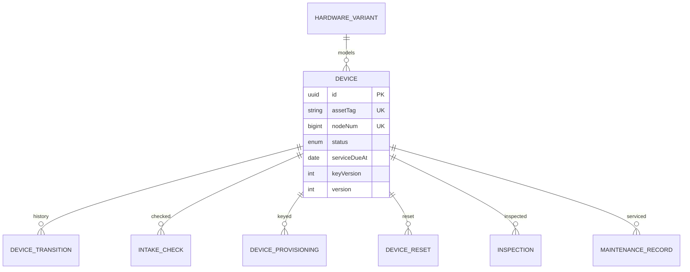

***Figure 1***: devices slice. `Inspection.contractDeviceId` points at the `rentals` row the inspection
closes; `StockTake` stands alone.

`nodeNum` is the unsigned 32-bit radio identity the firmware derives from the MAC
(`04-firmware-ground-truth.md` §3); registration accepts either the number or the `!xxxxxxxx` node id.
Remaining value (FR-BILL-05) is read from the variant's `remainingValueSchedule` by whole months since
`acquiredAt`: `valueAt(device, date)`.

---

## 2. Device lifecycle (D-035, amended by D-045 and D-047)

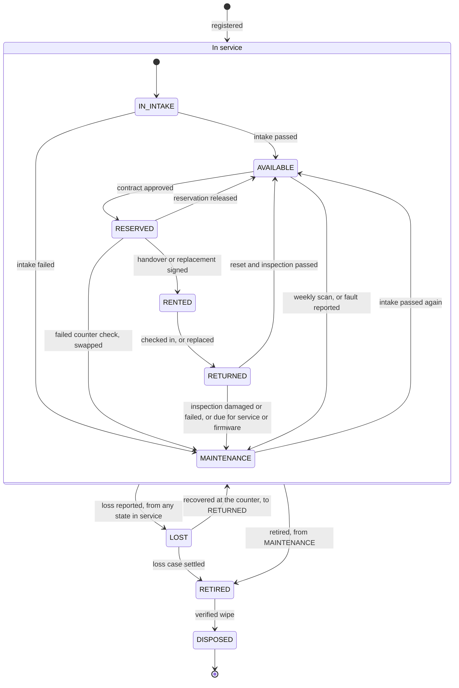

***Figure 2***: Device lifecycle; SRS Figure 23.

| From | To | Trigger | Caller | Guard |
|---|---|---|---|---|
| (none) | `IN_INTAKE` | register | Staff | unique tag and `nodeNum` |
| `IN_INTAKE`, `MAINTENANCE` | `AVAILABLE` | intake passed | Staff | no open maintenance record |
| `IN_INTAKE`, `AVAILABLE` | `MAINTENANCE` | intake failed, or maintenance opened | Staff | reason, expected date |
| `AVAILABLE` | `MAINTENANCE` | `devices.serviceScan` | SYSTEM | service due within 7 days plus lead days, or firmware differs from the baseline; no open record |
| `AVAILABLE` | `RESERVED` | `reserve()`, `reserveExplicit()` | rentals | locked with `SKIP LOCKED` |
| `RESERVED` | `AVAILABLE` | `release()` | rentals | contract cancelled, or swap |
| `RESERVED` | `MAINTENANCE` | `failHandoverCheck()` | rentals | swap at the counter (E01-5) |
| `RESERVED` | `RENTED` | `markRented()` | rentals | handover or replacement, provisioned at the organization's current key version |
| `RENTED` | `RETURNED` | `markReturned()` | rentals | check-in, or the faulty unit of a replacement |
| any in-service state | `LOST` | report loss | Org Manager (own rented device), Staff | no open loss case (BR-37) |
| `LOST` | `RETURNED` | recover | Staff | loss case `REPORTED`, `SEARCHING` or `SETTLED` |
| `LOST` | `RETIRED` | settle loss case | Admin | case `CONFIRMED`, Admin not the triager |
| `RETURNED` | `AVAILABLE`, `MAINTENANCE` | `recordInspection()` | rentals | reset logged after the last check-in; a passed unit due for service or firmware goes to `MAINTENANCE` (FR-DEV-19) |
| `MAINTENANCE` | `RETIRED` | retire | Admin | not on a live contract row |
| `RETIRED` | `DISPOSED` | dispose | Admin | wipe recorded (BR-42) |

Manual endpoints never reach the system-only rows; those are exported service methods taking `tx`.

---

## 2.1 Loss case (D-045)

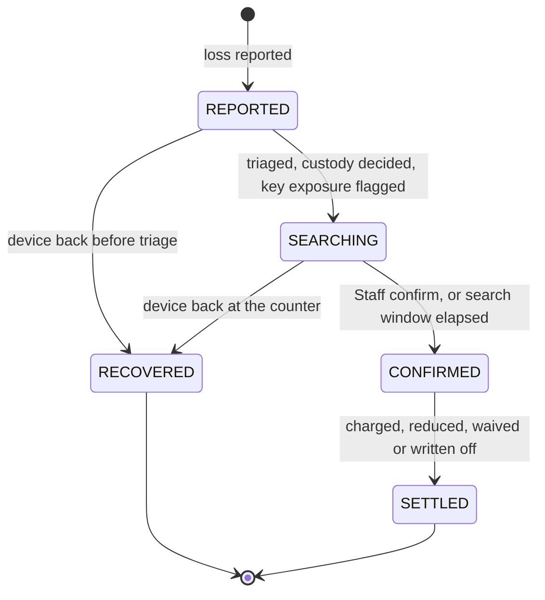

***Figure 2a***: Loss case lifecycle; SRS Figure 24.

Custody is decided at triage from `CUSTODY_RESOLVER.custodyAt(deviceId, lastSeenAt)`, the same custody intervals that
attribute field events (D-040). `RENTER` custody marks the organization's channel key exposed through
`organizations.markKeyExposed`, and confirmation charges the remaining value through the `LOSS_CASE_LISTENERS` port, which `billing` provides with `chargeLoss`;
`TREKLINK` custody is written off. The `devices.lossSearch` job confirms `SEARCHING` cases whose
`searchEndsAt` has passed, with the usual compare-and-set on state and version. A device recovered after
settlement goes to `RETURNED` while its case stays `SETTLED`; any refund is a billing adjustment (E05-10).

## 2.2 Maintenance record and the weekly service scan (D-047)

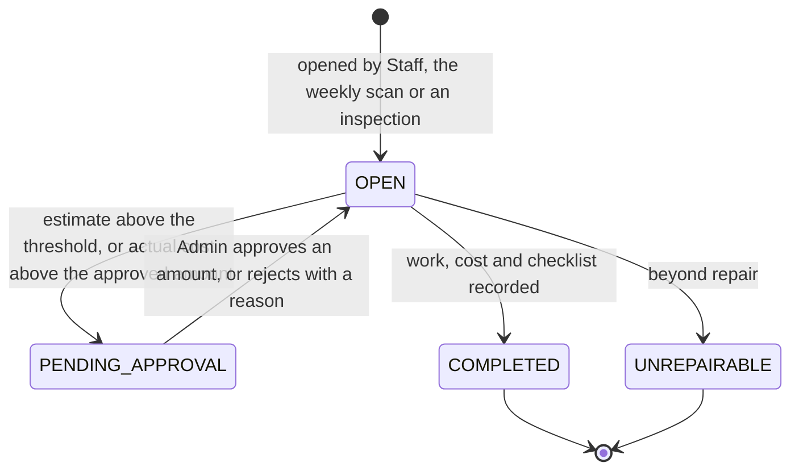

***Figure 2b***: Maintenance record lifecycle; SRS Figure 25.

| Rule | Design |
|---|---|
| Service plan | `HardwareVariant.serviceIntervalDays` and `serviceChecklist`; no interval means no periodic service |
| Due date | `Device.serviceDueAt`: the first passed intake check plus the interval; each completed `SCHEDULED` record sets it to its completion date plus the interval (FR-DEV-17) |
| Weekly scan | `ServiceScanJob`, registered as `devices.serviceScan` (`platform` design §4.6), Monday at `devices.serviceScanHourLocal`. Window: `serviceDueAt < runDate + 7 days + devices.maintenanceLeadDays`, or `firmwareVersion <> variant.firmwareBaseline`. `AVAILABLE` devices without an open record get one, `openedById` null (SYSTEM), `expectedAt` the due date, in one transaction each with the transition; the list goes to Staff by email after commit (FR-DEV-18) |
| On a contract | `RESERVED` and `RENTED` devices are listed, never moved (BR-45); `recordInspection()` checks the same window and the baseline and opens the record when the inspection passes (FR-DEV-19) |
| Cost approval | `estimate()` and `complete()` compare against `devices.maintenanceApprovalThresholdVnd` or `approvedCostVnd`; `decide()` refuses the estimator (`maintenance_records_decider_not_estimator`) |
| Firmware | `complete()` writes `Device.firmwareVersion` from the record; a `FIRMWARE_UPDATE` record requires it (`maintenance_records_firmware_on_completion`) |
| One open record | `maintenance_records_one_open_per_device`; the scan skips a device that has one |

Paying the vendor happens outside the platform. A renter's share of a repair is the damage charge of the
inspection (BR-24), never the maintenance cost.

---

## 3. Services other modules call

| Method | Caller |
|---|---|
| `reserve(variantId, quantity, contractId, tx)` returns device ids or throws `INSUFFICIENT_DEVICES` | rentals |
| `reserveExplicit(deviceIds, contractId, tx)` | rentals |
| `release(deviceIds, tx)`, `failHandoverCheck(deviceId, reason, tx)` | rentals |
| `recordProvisioning(deviceId, orgId, keyVersion, actor, tx)` | rentals |
| `assertReadyForHandover(deviceIds, keyVersion)` | rentals |
| `markRented(ids, tx)`, `markReturned(id, tx)` | rentals |
| `openLossForReplacement(deviceId)` returns whether the device has an open loss case | rentals |
| `recordInspection(deviceId, dto, contractDeviceId, actor, tx)` returns the inspection | rentals |
| `valueAt(deviceId, date)` | billing |
| `projectReading(nodeNum, reading, tx)` returns the device id or null | gateway-sync |
| `byNodeNum(nodeNum)`, `projections(ids)`, `trail(id)` | gateway-sync, monitoring |
| `availability(variantId?)` | rentals, monitoring |

**Ports declared here (corrected 2026-10-18).** `rentals` and `billing` both import `devices` (`platform`
design Figure 3), so the loss-case flow of D-045 reaches them through ports, never by import:

```typescript
export const CUSTODY_RESOLVER = Symbol('CUSTODY_RESOLVER'); // provided by rentals
export interface CustodyResolver {
  custodyAt(deviceId: string, at: Date): Promise<{ contractId: string; organizationId: string;
                                                   contractDeviceId: string } | null>;
}

export const LOSS_CASE_LISTENERS = Symbol('LOSS_CASE_LISTENERS'); // multi: billing, rentals
export interface LossCaseListener {
  onConfirmed(lossCase: LossCaseView, tx: Prisma.TransactionClient): Promise<void>;
  onSettled(lossCase: LossCaseView, decision: LossDecision, tx: Prisma.TransactionClient): Promise<void>;
}
```

`billing` charges the remaining value in `onConfirmed` for `RENTER` custody (`chargeLoss`) and writes the
`ADJUSTMENT` line of a reduction or waiver in `onSettled` (`adjustLoss`); `rentals` sets the contract row's
`lostAt` to the confirmation time in `onSettled` (rentals REQ-EVT-12). Both run inside the loss-case
transaction.

---

## 4. Error catalogue

| Code | HTTP |
|---|---|
| `INVALID_STATE_TRANSITION` | 409 |
| `INSUFFICIENT_DEVICES` | 409 |
| `RESET_REQUIRED` | 409 |
| `RESET_INCOMPLETE` | 400 |
| `MOTION_RESULT_REQUIRED` | 400 |
| `MAINTENANCE_OPEN` | 409 |
| `VARIANT_IN_USE` | 409 |
| `SCHEDULE_INVALID` | 400 |
| `KEY_VERSION_MISMATCH` | 409 |
| `DEVICE_NOT_PROVISIONED` | 409 |
| `SEPARATION_OF_DUTY` | 403 |
| `CHECKLIST_INCOMPLETE` | 400 |
| `CHECKLIST_REQUIRED` | 400 |
| `FIRMWARE_VERSION_REQUIRED` | 400 |
| `VENDOR_REQUIRED` | 400 |

---

## 5. Sequence: return loop (check-in, reset, inspection)

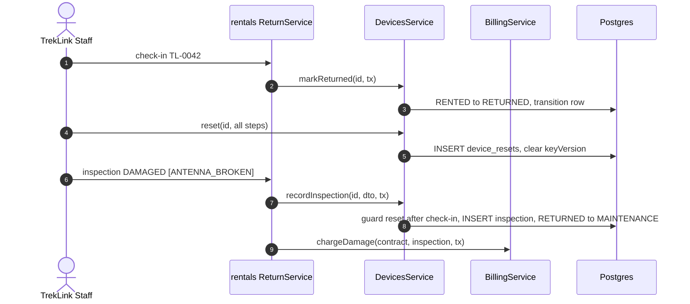

***Figure 3***: The MF-05 return loop; one transaction per arrow from Staff.

---

## 6. Testing strategy

State-matrix test over all 81 pairs; reservation race with two transactions on Postgres; reset-before-
inspection guard; remaining-value lookup by age; projection ignores older readings. Service scan with a fake
clock: the window boundary of AC-09, a rented unit listed but not moved, no second record; inspection routing
of AC-10; the approval path of AC-11 including the estimator's 403; firmware update of AC-12; the four
maintenance constraints on Postgres.

---

## 7. Detailed design for Report 4 (D-044)

Layering as in `organizations` design §9. Figures 4, 7 and 12 are the class views, core, loss cases and
maintenance; Figures 5, 6, 8 to 11 and 13 to 16 are the MF-05 reset, inspection, loss case, disposal, service
scan, maintenance and cost approval interactions.

<!-- sdd: MF-05 class devices -->
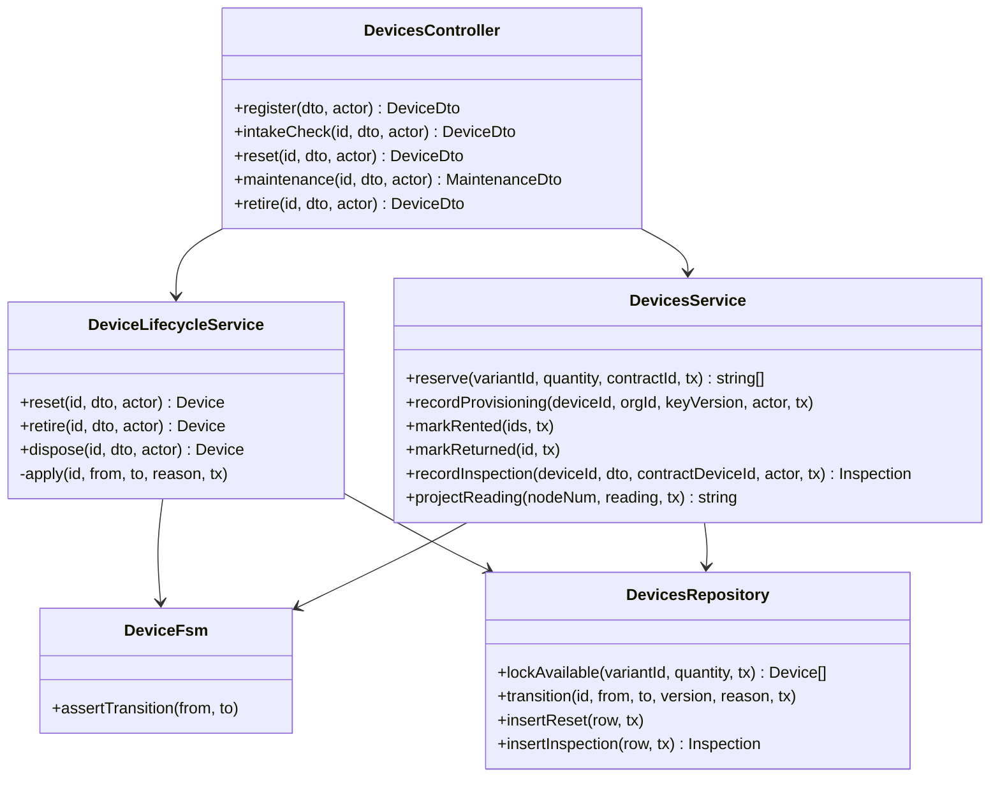

***Figure 4***: devices classes. `DeviceFsm` holds the transition table of Figure 2.

<!-- sdd: MF-05 seq UC-44 part 1 of 2: reset -->
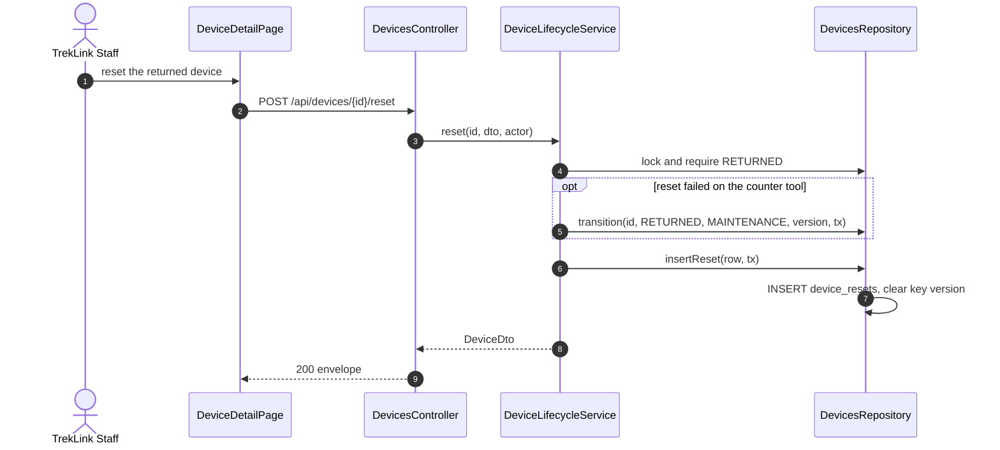

***Figure 5***: UC-44 Reset and Inspect Device, part 1 of 2: reset.

<!-- sdd: MF-05 seq UC-44 part 2 of 2: inspection -->
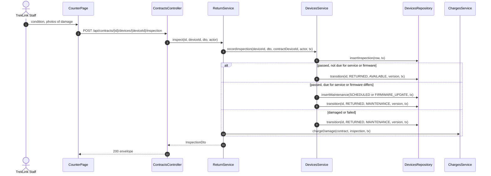

***Figure 6***: UC-44 Reset and Inspect Device, part 2 of 2: inspection. A device reaches `AVAILABLE`
only after a logged reset and a passed inspection (BR-28), and a unit due for service goes to maintenance
instead (FR-DEV-19, BR-45).

<!-- sdd: MF-05 class devices-loss -->
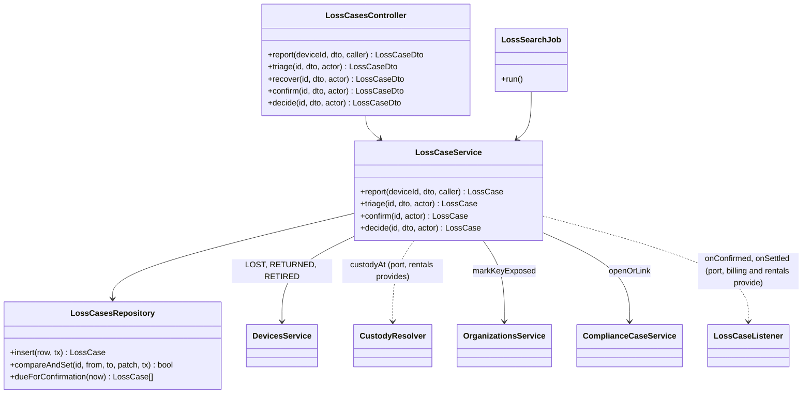

***Figure 7***: devices classes for loss cases (D-045).

<!-- sdd: MF-05 seq UC-49 -->
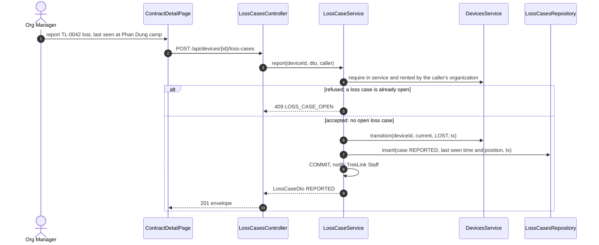

***Figure 8***: UC-49 Report Lost Device. Staff report a unit missing at stock-take through the same call.

<!-- sdd: MF-05 seq UC-60 part 1 of 2: triage -->


***Figure 9***: UC-60 Resolve Loss Case, part 1 of 2: triage by custody (D-040, D-045).

<!-- sdd: MF-05 seq UC-60 part 2 of 2: confirmation and settlement -->
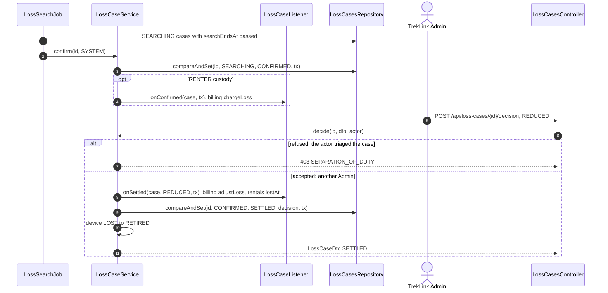

***Figure 10***: UC-60 Resolve Loss Case, part 2 of 2: confirmation and settlement with the waiver rule
(BR-39).

<!-- sdd: MF-05 seq UC-62 -->
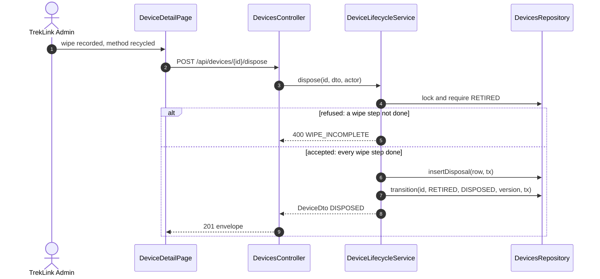

***Figure 11***: UC-62 Dispose Device (BR-42).

<!-- sdd: MF-05 class devices-maintenance -->
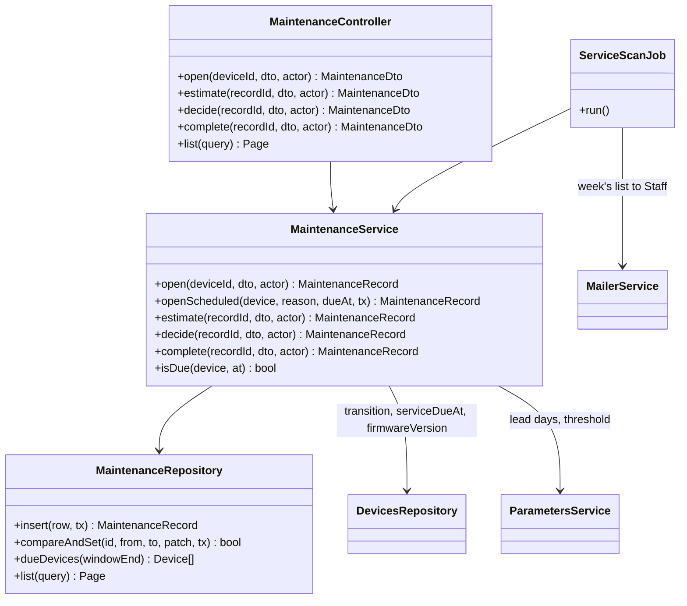

***Figure 12***: devices classes for maintenance (D-047). `DevicesService.recordInspection()` calls
`MaintenanceService.isDue()` and `openScheduled()` for FR-DEV-19.

<!-- sdd: MF-05 seq UC-65 -->
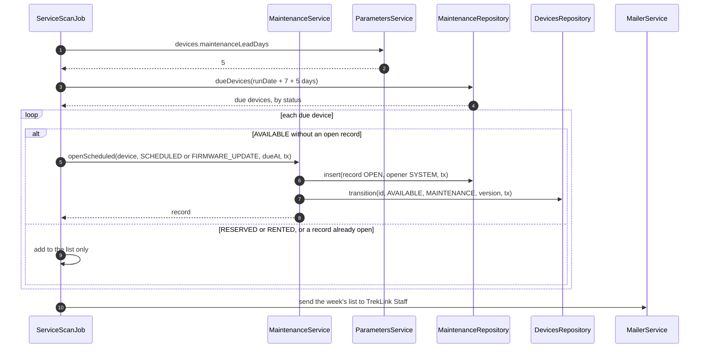

***Figure 13***: UC-65 Scan for Due Service. A unit on a contract is listed, never moved (BR-45).

<!-- sdd: MF-05 seq UC-52 part 1 of 2: open and estimate -->
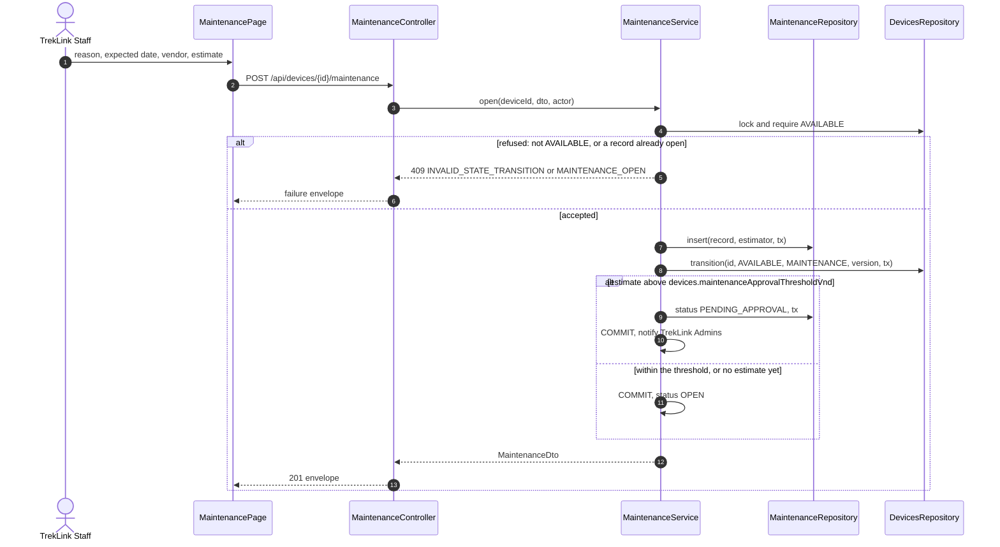

***Figure 14***: UC-52 Record Maintenance, part 1 of 2: opening with an estimate (FR-DEV-08, FR-DEV-20).
A record the scan opened gets its estimate through `PATCH .../estimate` with the same threshold check.

<!-- sdd: MF-05 seq UC-52 part 2 of 2: completion -->
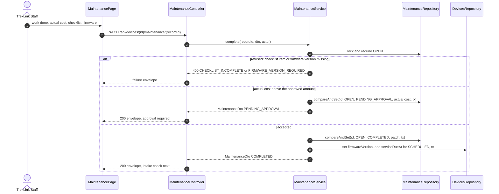

***Figure 15***: UC-52 Record Maintenance, part 2 of 2: completion (FR-DEV-17, FR-DEV-21). The device stays
`MAINTENANCE` until it passes the intake check (UC-12).

<!-- sdd: MF-05 seq UC-64 -->
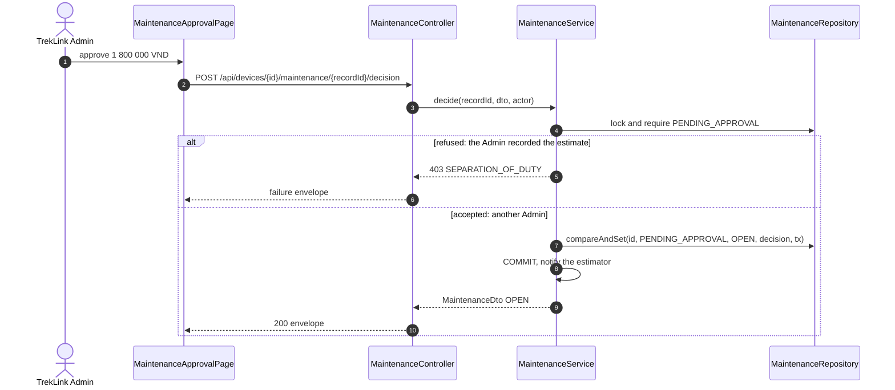

***Figure 16***: UC-64 Approve Maintenance Cost (BR-44). A rejection takes the same path with a reason.

---

## 8. Docking at the counter over Web Serial (D-080)

> **Status**: Draft for the leader's approval (2026-10-30, branch `docs/devices-docking`). No code before
> approval (D-052). Library choice: `vetting/meshtastic-web-serial.md` (recommendation: re-author, no
> dependency). §8.6 holds the decisions the leader has to take.

### 8.1 Scope and placement

Docking runs in the Staff browser only. The backend never talks to a unit; it only checks the docked
`nodeNum` when provisioning is recorded (§8.5). Two frontend slices (FSD):

| Slice | Contents |
|---|---|
| `shared/lib/meshtastic/` | `framing.ts` (`0x94 0xC3` plus a 16-bit big-endian length, frames above 512 bytes dropped), `codec.ts` (varint and length-delimited encoding for the messages of §8.2; `ChannelSettings` kept as raw fields so a write changes field 2 only), `serialLink.ts` (Web Serial port at 115200 baud, wake bytes, one request at a time, a timeout per answer) |
| `features/dock-device/` | `DockingService` with `readUnit()` and `provision(expected)`, and the `useDocking` hook that pages call; the key lives in one local variable of `provision` and is dropped when it returns |

Pages: the Register panel of screen 4.2 (intake) and step 1 of `CounterPage` (screen 5.4, handover; the
replacement tab of screen 5.5 reuses it). Web Serial needs a secure context and a Chromium browser.

### 8.2 Protocol facts the client relies on (firmware 2.7.19, `treklink-firmware` at `f062a35`)

| Fact | Source |
|---|---|
| A client packet is stamped `from = 0` | `src/mesh/MeshService.cpp:186` |
| Local admin is accepted unless `security.is_managed`; the session passkey is checked only for `from != 0` | `src/modules/AdminModule.cpp:85-89`, `:132-138` |
| The serial API needs `security.serial_enabled`, default true | `src/SerialConsole.cpp:129`, `src/mesh/NodeDB.cpp:669` |
| `want_config_id = 69420` sends `myInfo`, the own `NodeInfo`, `metadata`, channels, config and `config_complete_id`, without the node database | `src/mesh/PhoneAPI.h:23`, `src/mesh/PhoneAPI.cpp:248-300` |
| Set owner and set channel save without a reboot; get channel returns the PSK to the local client | `AdminModule.cpp:594-626`, `:1015-1022`, `:1323-1336` |
| Long name holds 39 characters, short name 4 | `mesh.pb.h:704`, `:707` |
| PSK is 0, 1, 16 or 32 bytes; TrekLink writes 32 | `channel.pb.h:42` |

Field numbers used (`src/mesh/generated/meshtastic/*.pb.h`): `ToRadio` packet 1, want_config_id 3,
heartbeat 7; `FromRadio` id 1, packet 2, my_info 3, node_info 4, config_complete_id 7, channel 10,
metadata 13; `MeshPacket` from 1, to 2, channel 3, decoded 4, id 6, want_ack 10; `Data` portnum 1 (`ADMIN_APP`
= 6), payload 2, want_response 3, request_id 6; `AdminMessage` get_channel_request 1, get_channel_response 2,
get_owner_request 3, get_owner_response 4, set_owner 32, set_channel 33; `User` id 1, long_name 2,
short_name 3; `Channel` index 1, settings 2, role 3; `ChannelSettings` psk 2 (others kept as read);
`MyNodeInfo` my_node_num 1, pio_env 13; `NodeInfo` num 1, user 2; `DeviceMetadata` firmware_version 1.

### 8.3 Intake (screen 4.2, Register panel)

1. Staff press **Read from unit**; the browser's own port chooser opens (a user gesture is required).
2. `readUnit()` runs the config-only handshake and returns `nodeNum`, `pioEnv`, `firmwareVersion` and
   the current owner names.
3. The panel fills Node number, preselects the variant whose code the build environment maps to
   (`treklink-v2` to `treklink-v2`, `treklink-v3-tbeam` to `treklink-v3`, `treklink-v4-supreme` to
   `treklink-v4`, a table in `shared/config`), and shows the reported firmware version next to the
   firmware field. The unit reports `major.minor.build.<sha7>` (`bin/readprops.py`), while variant
   baselines read `2.7.19-treklink.N`, so the field keeps the baseline and the page warns when the build
   part differs; it does not overwrite it.
4. Registration is devices api-design 05, unchanged. Manual entry stays possible; uniqueness is still
   the server's (REQ-ERR-01).

### 8.4 Handover (screen 5.4, step 1, per reserved device)

1. Staff press **Dock and provision** on the row; the first docking of the visit opens the port chooser,
   later ones reuse the granted port (`navigator.serial.getPorts()`).
2. `readUnit()`; the docked `nodeNum` is compared with the row's `nodeNum` (rentals api-design 03 gains
   `devices[].nodeNum`, §8.5). A mismatch writes nothing (REQ-ERR-12).
3. The page obtains the organization's channel key at the current version (§8.6, decision 1).
4. `provision()` sends `set_owner` (long name the asset tag, short name per §8.6 decision 2) and
   `set_channel` for index 0 with role `PRIMARY` and the settings read in step 2 with field 2 replaced,
   then repeats the config-only handshake and compares the owner names and the primary PSK.
5. On a match the page records provisioning (rentals api-design 09) with `keyVersion` and the docked
   `nodeNum`; the key variable is cleared before the request is sent.

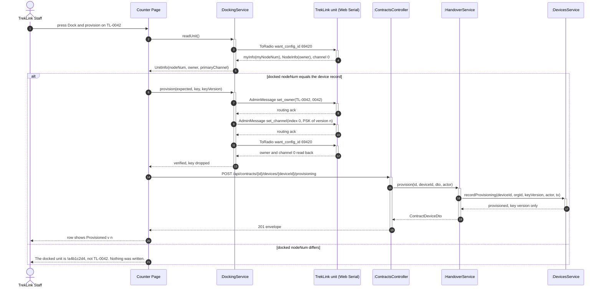

***Figure 17***: UC-14 Provision Device by docking at handover (D-080). How the page obtains the key in
step 3 of §8.4 is decision 1 of §8.6 and is left out of the figure.

### 8.5 Contract changes (made in the catalog after approval)

| Endpoint | Change |
|---|---|
| rentals api-design 03 `GET /api/contracts/:id` | `devices[].nodeNum` (read-only) |
| rentals api-design 09 provisioning | body gains required `nodeNum`; 409 `NODE_MISMATCH` when it differs from the device record, nothing recorded |
| A key-issuing endpoint | only under option A or C of §8.6 decision 1 |

No schema change for docking itself. `NODE_MISMATCH` joins the error catalogue of `rentals`.

### 8.6 Open for the leader

**Decision 1, how the counter obtains the channel key.** D-021 keeps only the key version in the
platform, REQ-UBI-03 says a key is never stored, displayed, returned or logged, and `organizations`
design §1 put the key "only in the counter's provisioning tool". The counter page is now that tool, so it
must hold the key for one write.

| Option | How | Security | Demo cost |
|---|---|---|---|
| **A. Derived on the server, issued once per docking** | One master secret `CHANNEL_KEY_MASTER` in the deployment's secret store, never in the database or the seed. Key = HKDF-SHA256(master, salt = organization id, info = `treklink-channel-key/v{version}`), 32 bytes. A Staff-only endpoint returns it for a device reserved to an `APPROVED` contract, after the docked `nodeNum` matched, with a new permission and an audit row (actor, device, organization, version, never the key), `Cache-Control: no-store` | Nothing stored per organization; rotation is a version bump; escrow is one secret. A leak of the master exposes every organization's keys, past and future; a stolen Staff session can fetch keys for reserved units, each fetch audited. Amends REQ-UBI-03 ("returned once to the counter") | Endpoint, permission row with a forward migration, `crypto.hkdfSync`, env var: about half a day of backend |
| **B. Staff paste the key from the escrow** | The key stays in TrekLink's escrow (a password manager); Staff paste it into the counter for the visit; the platform holds a non-secret fingerprint per version (SHA-256 of the key, first 8 bytes) so a wrong paste is refused before any write | Closest to D-021 as written; no key on the server. The key passes through people and the clipboard; a fingerprint is needed or a wrong key is written and "verified" against itself | Fingerprint column and its entry at rotation, or none without it: lowest |
| **C. Stored encrypted at rest** | A random key per organization and version, AES-256-GCM under a key-encryption key in the secret store, issued like A | Independent random keys; a database dump alone reveals nothing; database plus secret store reveals all. Contradicts D-021 directly; needs its own amendment | New table, encryption, endpoint: about a day |
| **D. The organization brings its own key** | The Org Manager keeps the channel (as the Meshtastic app needs it anyway, D-021) and pastes or shows its channel URL at the counter | TrekLink never holds a key, but loses the escrow D-021 requires and depends on the customer at every visit; a lost key is re-keying the whole fleet | Parsing the channel URL: low |

**Recommendation: A.** No per-device human handling of a secret, the binding to a matched `nodeNum` and a
reserved unit limits what a Staff account can fetch, rotation needs no storage, and the escrow D-021
asks for becomes one secret. It needs D-021 and REQ-UBI-03 reworded in the same pass. If the leader reads
D-021 literally, B with the fingerprint is the fallback.

**Decision 2, the short name.** It holds four characters (`mesh.pb.h:707`), so `TL-0009` does not fit.
Default proposed: the last four characters of the asset tag (`0009`); the long name carries the full tag.

**Decision 3, provisioning without a dock.** Recommended: once docking ships, rentals api-design 09
requires the docked `nodeNum`, so a typed record is no longer possible at handover; intake keeps manual
entry. The alternative keeps a manual path for a browser without Web Serial and loses the check.

**Related, not a decision here.** The reset step "Owner cleared" (screen 4.2, devices api-design 10)
conflicts with the asset tag as owner name; it should read "Owner set back to the asset tag" when the
reset is next edited.

### 8.7 Testing and size

Unit tests on the codec against frames captured from a unit (owner, channel, myInfo), the framing parser
with split and oversized frames, the link with a fake `SerialPort` (timeouts, disconnect mid-write), and
`DockingService` (mismatch writes nothing, read-back mismatch records nothing, the key is not reachable
after `provision` returns). Component tests for the banner, the dock buttons and each error state. A
hardware run on v3 and v4, and on v2 once the USB build flag lands (vetting record §3.3).

Estimated size after approval (estimate, not measured): `shared/lib/meshtastic` about 300 lines,
`features/dock-device` about 150, page changes about 150, tests about 400; backend `nodeNum` check and
rentals 03 field about 60 lines with tests; option A adds about 150 lines, a migration and tests. About
two working days for one developer, plus the v2 firmware flag and its hardware run.
