# Technical Design: devices

> Fulfills `requirements.md` in this folder. Schema: the `// @module devices` block of
> `backend/prisma/schema.prisma` is authoritative.
>
> **Status**: Approved, written by KhoaDD and merged on `dev` (treklink-web PR #30 and #31, 2026-10-18). Changes go through a pull request reviewed by KhoaDD (D-052).

---

## 1. Data model

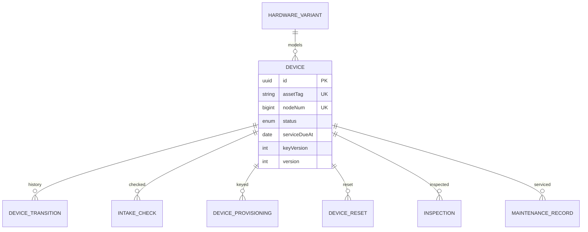

***Figure 1***: devices slice. `Inspection.contractDeviceId` points at the `rentals` row the inspection
closes; `StockTake` stands alone.

`nodeNum` is the unsigned 32-bit radio identity the firmware derives from the MAC
(`04-firmware-ground-truth.md` §3); registration accepts either the number or the `!xxxxxxxx` node id.
Remaining value (FR-BILL-05) is read from the variant's `remainingValueSchedule` by whole months since
`acquiredAt`: `valueAt(device, date)`.

---

## 2. Device lifecycle (D-035, amended by D-045 and D-047)

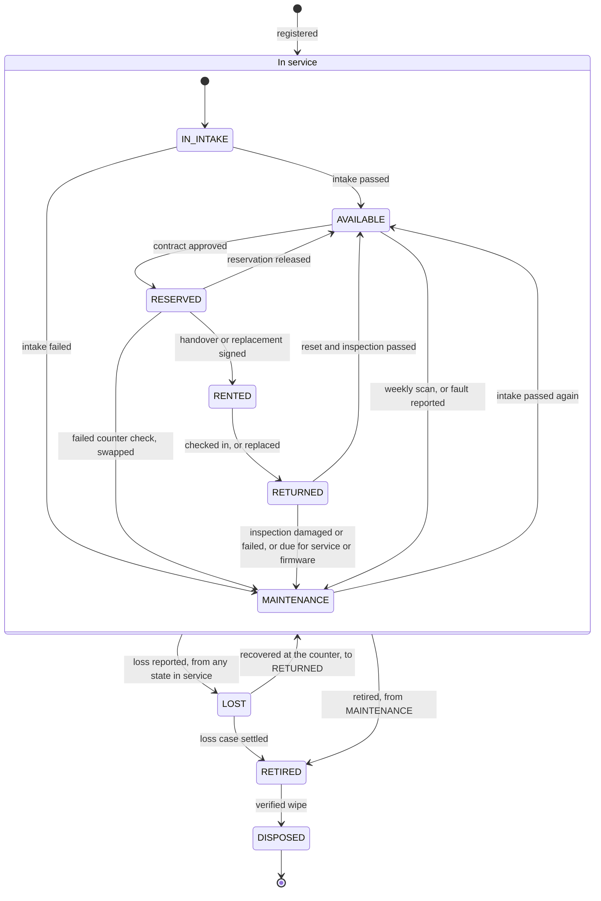

***Figure 2***: Device lifecycle; SRS Figure 23.

| From | To | Trigger | Caller | Guard |
|---|---|---|---|---|
| (none) | `IN_INTAKE` | register | Staff | unique tag and `nodeNum` |
| `IN_INTAKE`, `MAINTENANCE` | `AVAILABLE` | intake passed | Staff | no open maintenance record |
| `IN_INTAKE`, `AVAILABLE` | `MAINTENANCE` | intake failed, or maintenance opened | Staff | reason, expected date |
| `AVAILABLE` | `MAINTENANCE` | `devices.serviceScan` | SYSTEM | service due within 7 days plus lead days, or firmware differs from the baseline; no open record |
| `AVAILABLE` | `RESERVED` | `reserve()` at approval or swap, `takeForReplacement()` | rentals | locked with `SKIP LOCKED`; transition reason `RESERVED` |
| `RESERVED` | `AVAILABLE` | `release()` | rentals | contract cancelled; transition reason `RELEASED` |
| `RESERVED` | `MAINTENANCE` | `failHandoverCheck()` | rentals | swap at the counter (E01-5); opens a `HANDOVER_CHECK_FAILED` maintenance record with the swap reason; transition reason `HANDOVER_CHECK_FAILED` |
| `RESERVED` | `RENTED` | `markRented()` | rentals | handover or replacement, provisioned at the organization's current key version; transition reason `HANDED_OVER` |
| `RENTED` | `RETURNED` | `markReturned()` | rentals | check-in, or the faulty unit of a replacement; transition reason `CHECKED_IN`, or `REPLACED` for the faulty unit |
| any in-service state | `LOST` | report loss | Org Manager (own rented device), Staff | no open loss case (BR-37) |
| `LOST`, or `RETIRED` with a `SETTLED` loss case | `RETURNED` | recover | Staff | loss case `REPORTED`, `SEARCHING` or `SETTLED`; a settled case moved the device to `RETIRED`, so recovery after settlement starts there (REQ-EVT-11, 2026-10-31) |
| `LOST` | `RETIRED` | settle loss case | Admin | case `CONFIRMED`, Admin not the triager |
| `RETURNED` | `AVAILABLE`, `MAINTENANCE` | `recordInspection()` | rentals | reset logged after the last check-in; a passed unit due for service or firmware goes to `MAINTENANCE` (FR-DEV-19) |
| `MAINTENANCE` | `RETIRED` | retire | Admin | not on a live contract row |
| `RETIRED` | `DISPOSED` | dispose | Admin | wipe recorded (BR-42) |

Manual endpoints never reach the system-only rows; those are exported service methods taking `tx`.

Every move a rentals method drives writes one `device_transitions` row per unit that moved, in the caller's
transaction (`DevicesRepository.moveWithTransitions`, or `insertTransitions` after the `SKIP LOCKED` pick of
`reserve()`): `refType` `CONTRACT`, `refId` the contract id, `note` the contract code, `actorId` the Staff or
Org Manager account that acted (a Manager's cancel records the Manager), or null (SYSTEM) for a scheduled job
(2026-10-30, demo smoke defect 2). The monitoring device history (api-design 07) tells these moves through its
contract entries and leaves the `CONTRACT` rows out, so each move appears once. A unit not in the source status neither moves nor gets a row.

---

## 2.1 Loss case (D-045)

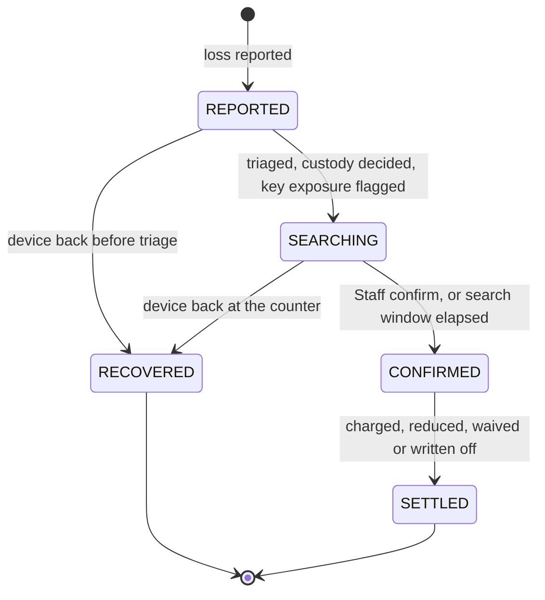

***Figure 2a***: Loss case lifecycle; SRS Figure 24.

Custody is decided at triage from `CUSTODY_RESOLVER.custodyAt(deviceId, lastSeenAt)`, the same custody intervals that
attribute field events (D-040), checked against `custodyAt(deviceId, reportedAt)`: when the two answer
different intervals, the rental of the last seen time was returned before the report, so the interval
at the report time counts, or `TREKLINK` custody when there is none (a unit lost in the store after
check-in, leader ruling 2026-10-31). A unit never heard is read at `reportedAt` alone. A `RENTER` case
therefore always names an interval still open at the report time, which `rentals` closes with `lostAt`
when the case settles. `RENTER` custody marks the organization's channel key exposed through
`ChannelKeyService.markKeyExposed` of `organizations`, and confirmation charges the remaining value through the `LOSS_CASE_LISTENERS` port, which `billing` provides with `chargeLoss`;
`TREKLINK` custody is written off. The `devices.lossSearch` job confirms `SEARCHING` cases whose
`searchEndsAt` has passed, with the usual compare-and-set on state and version. A device recovered after
settlement goes to `RETURNED` while its case stays `SETTLED`; any refund is a billing adjustment (E05-10).

## 2.2 Maintenance record and the weekly service scan (D-047)

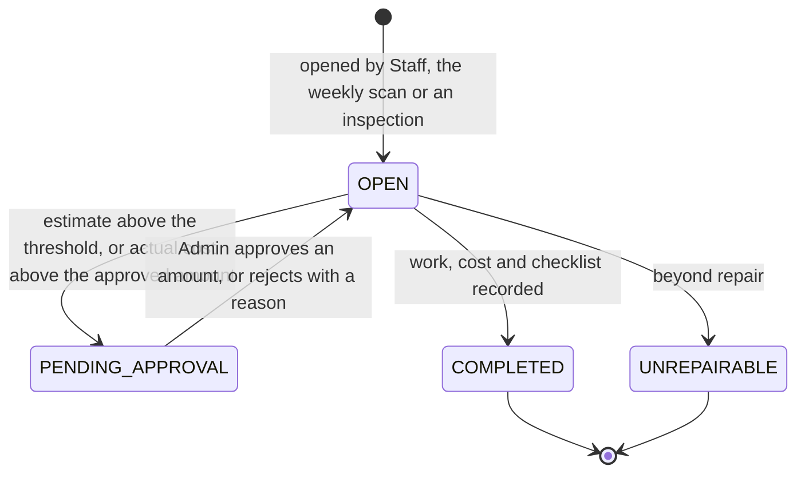

***Figure 2b***: Maintenance record lifecycle; SRS Figure 25.

| Rule | Design |
|---|---|
| Service plan | `HardwareVariant.serviceIntervalDays` and `serviceChecklist`; no interval means no periodic service |
| Due date | `Device.serviceDueAt`: the first passed intake check plus the interval; each completed `SCHEDULED` record sets it to its completion date plus the interval (FR-DEV-17) |
| Weekly scan | `ServiceScanJob`, registered as `devices.serviceScan` (`platform` design §4.6), Monday at `devices.serviceScanHourLocal`. Window: `serviceDueAt < runDate + 7 days + devices.maintenanceLeadDays`, or `firmwareVersion <> variant.firmwareBaseline`. `AVAILABLE` devices without an open record get one, `openedById` null (SYSTEM), `expectedAt` the due date, in one transaction each with the transition; the list goes to Staff by email after commit (FR-DEV-18) |
| On a contract | `RESERVED` and `RENTED` devices are listed, never moved (BR-45); `recordInspection()` checks the same window and the baseline and opens the record when the inspection passes (FR-DEV-19) |
| Cost approval | `estimate()` and `complete()` compare against `devices.maintenanceApprovalThresholdVnd` or `approvedCostVnd`; `decide()` refuses the estimator (`maintenance_records_decider_not_estimator`) |
| Firmware | `complete()` writes `Device.firmwareVersion` from the record; a `FIRMWARE_UPDATE` record requires it (`maintenance_records_firmware_on_completion`) |
| One open record | `maintenance_records_one_open_per_device`; the scan skips a device that has one |

Paying the vendor happens outside the platform. A renter's share of a repair is the damage charge of the
inspection (BR-24), never the maintenance cost.

---

## 3. Services other modules call

| Method | Caller |
|---|---|
| `reserve(variantId, quantity, contractId, tx)` returns device ids or throws `INSUFFICIENT_DEVICES` | rentals |
| `reserveExplicit(deviceIds, contractId, tx)` | rentals |
| `release(deviceIds, tx)`, `failHandoverCheck(deviceId, reason, tx)` | rentals |
| `recordProvisioning(deviceId, orgId, keyVersion, actor, tx)` | rentals |
| `clearProvisioning(deviceId, tx)`: undoes the record before the handover (rentals api-design 19); the `DeviceProvisioning` row stays | rentals |
| `assertReadyForHandover(deviceIds, keyVersion)` | rentals |
| `markRented(ids, tx)`, `markReturned(id, tx)` | rentals |
| `openLossForReplacement(deviceId)` returns whether the device has an open loss case | rentals |
| `recordInspection(deviceId, dto, contractDeviceId, actor, tx)` returns the inspection | rentals |
| `valueAt(deviceId, date)` | billing |
| `projectReading(nodeNum, reading, tx)` returns the device id or null | gateway-sync |
| `byNodeNum(nodeNum)`, `projections(ids)`, `trail(id)` | gateway-sync, monitoring |
| `availability(variantId?)` | rentals, monitoring |

**Ports declared here (corrected 2026-10-18).** `rentals` and `billing` both import `devices` (`platform`
design Figure 3), so the loss-case flow of D-045 reaches them through ports, never by import:

```typescript
export const CUSTODY_RESOLVER = Symbol('CUSTODY_RESOLVER'); // provided by rentals
export interface CustodyResolver {
  // Reads in the caller's transaction, so a check-in committed before the read is seen (2026-11-01).
  custodyAt(deviceId: string, at: Date, tx: Prisma.TransactionClient):
    Promise<{ contractId: string; organizationId: string; contractDeviceId: string } | null>;
}

export const LOSS_CASE_LISTENERS = Symbol('LOSS_CASE_LISTENERS'); // multi: billing, rentals
export interface LossCaseListener {
  onConfirmed(lossCase: LossCaseView, tx: Prisma.TransactionClient): Promise<void>;
  onSettled(lossCase: LossCaseView, decision: LossDecision, tx: Prisma.TransactionClient): Promise<void>;
}
```

`billing` charges the remaining value in `onConfirmed` for `RENTER` custody (`chargeLoss`) and writes the
`ADJUSTMENT` line of a reduction or waiver in `onSettled` (`adjustLoss`); `rentals` sets the contract row's
`lostAt` to the confirmation time in `onSettled` (rentals REQ-EVT-12). Both run inside the loss-case
transaction.

**Organization actions of a triage (added 2026-10-31, task 2.7).** For `RENTER` custody triage calls
`ChannelKeyService.markKeyExposed(orgId, at, actor, tx)` directly, in the triage transaction
(REQ-EVT-14); organizations tells the Managers after commit. `openOrLinkComplianceCase` is not built in
organizations yet, so a suspected theft or fraud reaches it through the port `LOSS_ORGANIZATION_ACTIONS`
(`ports/loss-organization-actions.port.ts`), which `DevicesModule` binds to a no-op default; the case
still records `suspectedTheft`. Binding the real provider is a one-line change in `devices.module.ts`.

```typescript
export const LOSS_ORGANIZATION_ACTIONS = Symbol('LOSS_ORGANIZATION_ACTIONS');
export interface LossOrganizationActions {
  openOrLinkComplianceCase(input: { organizationId: string; lossCaseId: string; lossCaseCode: string;
    evidence: string; policeReference: string | null; actorId: string },
    tx: Prisma.TransactionClient): Promise<string | null>; // the compliance case id, or null
}
```

A loss case stores the custody interval's `contractId` and `organizationId` beside `contractDeviceId`
(migration `20261031120000_loss_case_custody_contract`), because `devices` cannot read the rentals
tables and `LossCaseView.custodyContract` needs all three. They are set at report from
`custodyAt(deviceId, now)` and replaced at triage by `custodyAt(deviceId, lastSeenAt ?? reportedAt)`, or
cleared for `TREKLINK` custody; the Org Manager's list reads `organizationId`.

---

## 4. Error catalogue

| Code | HTTP |
|---|---|
| `INVALID_STATE_TRANSITION` | 409 |
| `INSUFFICIENT_DEVICES` | 409 |
| `RESET_REQUIRED` | 409 |
| `RESET_INCOMPLETE` | 400 |
| `MOTION_RESULT_REQUIRED` | 400 |
| `MAINTENANCE_OPEN` | 409 |
| `VARIANT_IN_USE` | 409 |
| `SCHEDULE_INVALID` | 400 |
| `KEY_VERSION_MISMATCH` | 409 |
| `DEVICE_NOT_PROVISIONED` | 409 |
| `SEPARATION_OF_DUTY` | 403 |
| `LOSS_CASE_OPEN` | 409 |
| `WIPE_INCOMPLETE` | 400 |
| `CHECKLIST_INCOMPLETE` | 400 |
| `CHECKLIST_REQUIRED` | 400 |
| `FIRMWARE_VERSION_REQUIRED` | 400 |
| `VENDOR_REQUIRED` | 400 |

---

## 5. Sequence: return loop (check-in, reset, inspection)

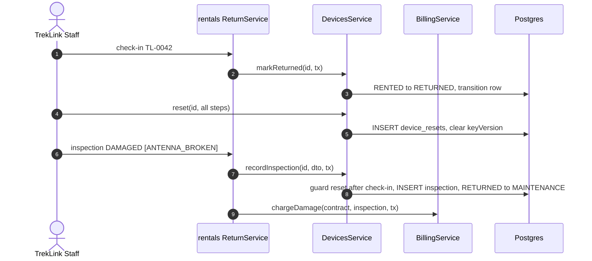

***Figure 3***: The MF-05 return loop; one transaction per arrow from Staff.

---

## 6. Testing strategy

State-matrix test over all 81 pairs; reservation race with two transactions on Postgres; reset-before-
inspection guard; remaining-value lookup by age; projection ignores older readings. Service scan with a fake
clock: the window boundary of AC-09, a rented unit listed but not moved, no second record; inspection routing
of AC-10; the approval path of AC-11 including the estimator's 403; firmware update of AC-12; the four
maintenance constraints on Postgres.

---

## 7. Detailed design for Report 4 (D-044)

Layering as in `organizations` design §9. Figures 4, 7 and 12 are the class views, core, loss cases and
maintenance; Figures 5, 6, 8 to 11 and 13 to 16 are the MF-05 reset, inspection, loss case, disposal, service
scan, maintenance and cost approval interactions.

<!-- sdd: MF-05 class devices -->
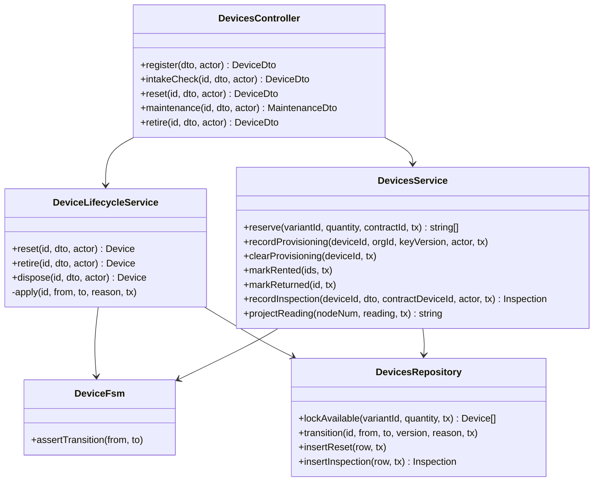

***Figure 4***: devices classes. `DeviceFsm` holds the transition table of Figure 2.

<!-- sdd: MF-05 seq UC-44 part 1 of 2: reset -->
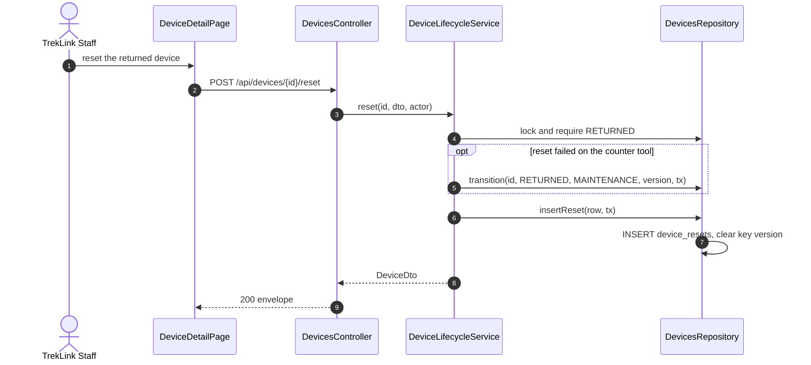

***Figure 5***: UC-44 Reset and Inspect Device, part 1 of 2: reset.

<!-- sdd: MF-05 seq UC-44 part 2 of 2: inspection -->
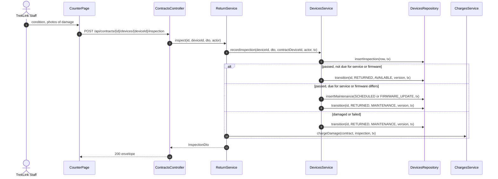

***Figure 6***: UC-44 Reset and Inspect Device, part 2 of 2: inspection. A device reaches `AVAILABLE`
only after a logged reset and a passed inspection (BR-28), and a unit due for service goes to maintenance
instead (FR-DEV-19, BR-45).

<!-- sdd: MF-05 class devices-loss -->
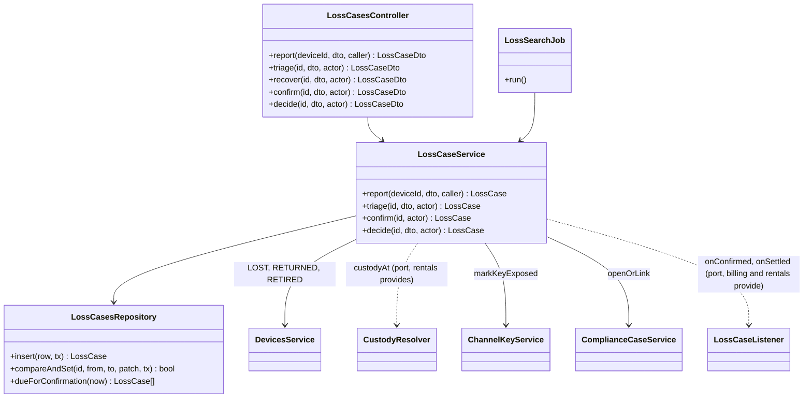

***Figure 7***: devices classes for loss cases (D-045).

<!-- sdd: MF-05 seq UC-49 -->
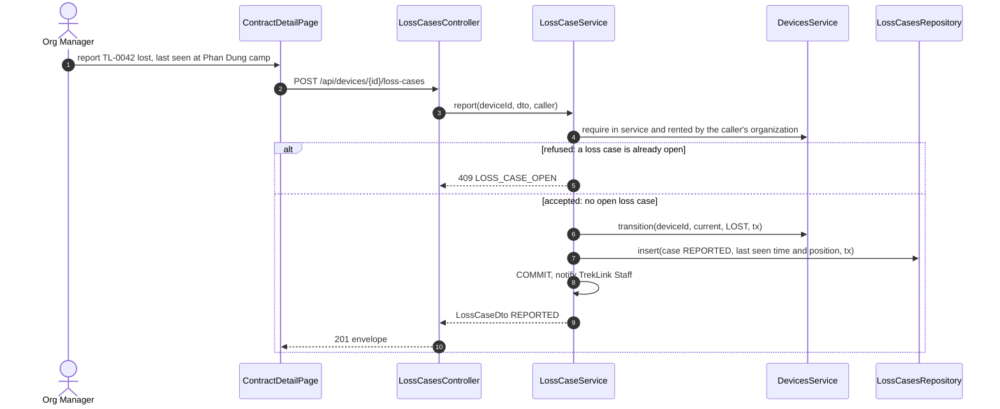

***Figure 8***: UC-49 Report Lost Device. Staff report a unit missing at stock-take through the same call.

<!-- sdd: MF-05 seq UC-60 part 1 of 2: triage -->
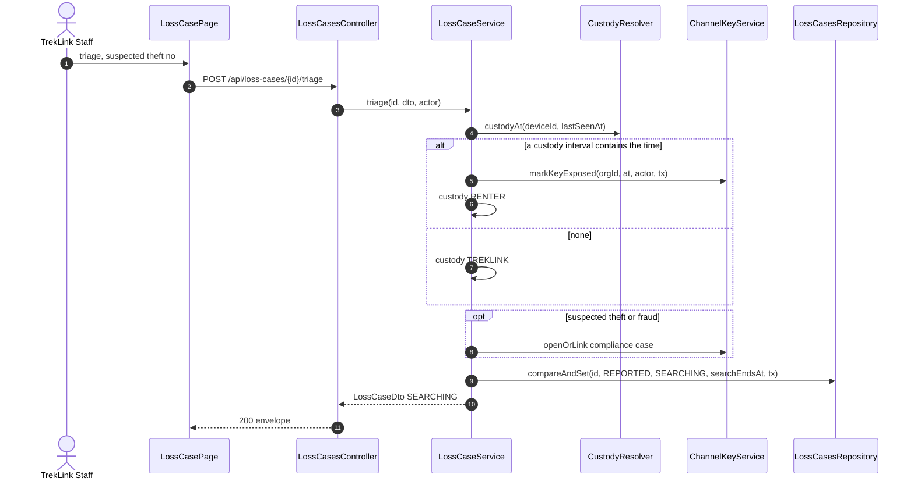

***Figure 9***: UC-60 Resolve Loss Case, part 1 of 2: triage by custody (D-040, D-045).

<!-- sdd: MF-05 seq UC-60 part 2 of 2: confirmation and settlement -->
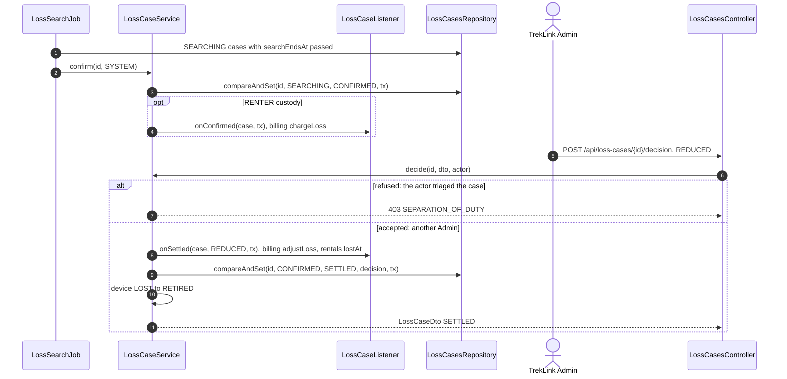

***Figure 10***: UC-60 Resolve Loss Case, part 2 of 2: confirmation and settlement with the waiver rule
(BR-39).

<!-- sdd: MF-05 seq UC-62 -->
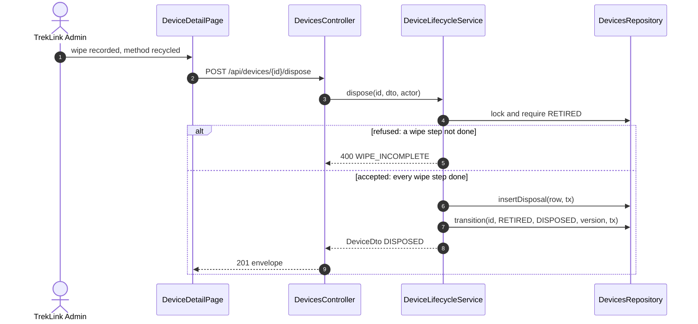

***Figure 11***: UC-62 Dispose Device (BR-42).

<!-- sdd: MF-05 class devices-maintenance -->
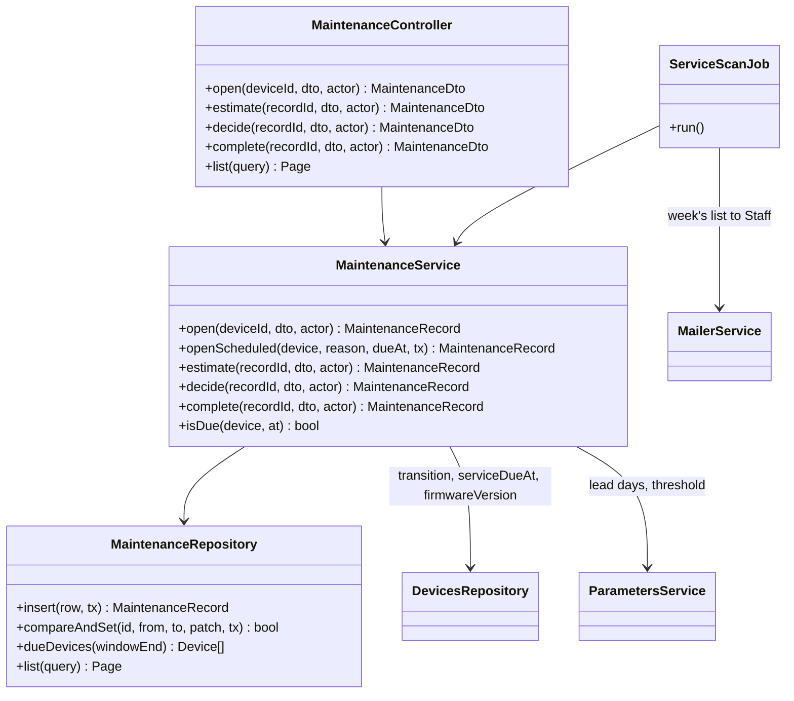

***Figure 12***: devices classes for maintenance (D-047). `DevicesService.recordInspection()` calls
`MaintenanceService.isDue()` and `openScheduled()` for FR-DEV-19.

<!-- sdd: MF-05 seq UC-65 -->
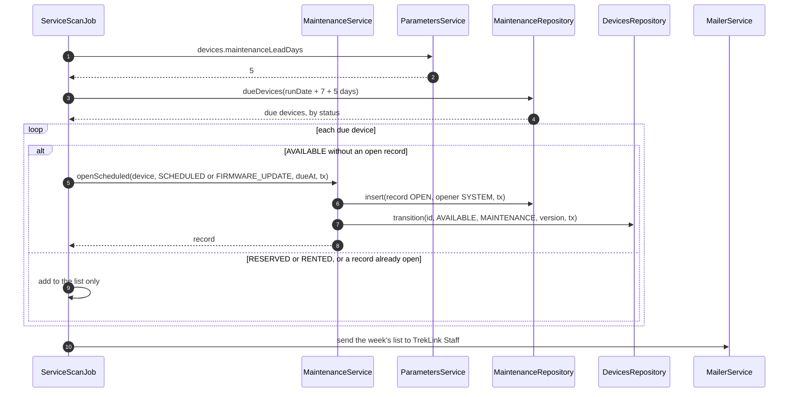

***Figure 13***: UC-65 Scan for Due Service. A unit on a contract is listed, never moved (BR-45).

<!-- sdd: MF-05 seq UC-52 part 1 of 2: open and estimate -->
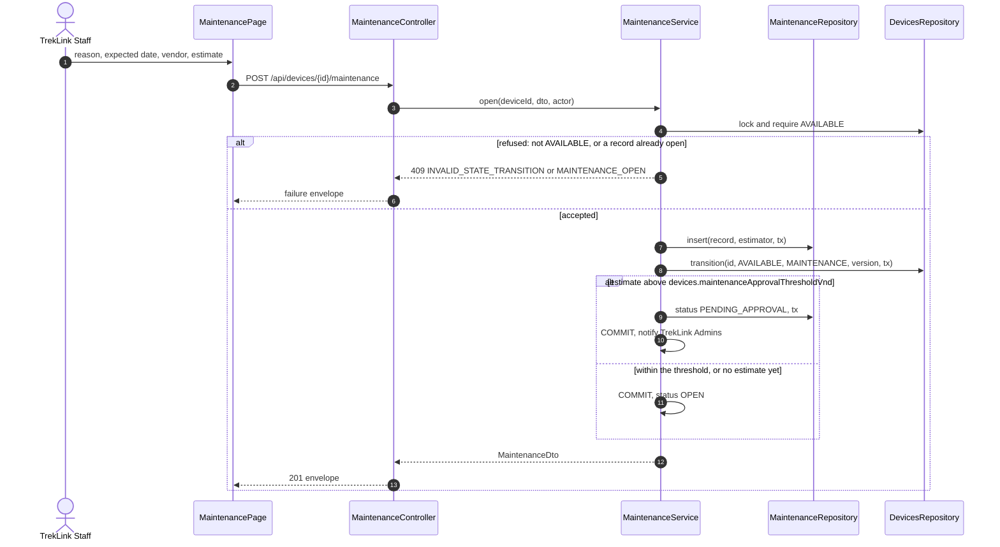

***Figure 14***: UC-52 Record Maintenance, part 1 of 2: opening with an estimate (FR-DEV-08, FR-DEV-20).
A record the scan opened gets its estimate through `PATCH .../estimate` with the same threshold check.

<!-- sdd: MF-05 seq UC-52 part 2 of 2: completion -->
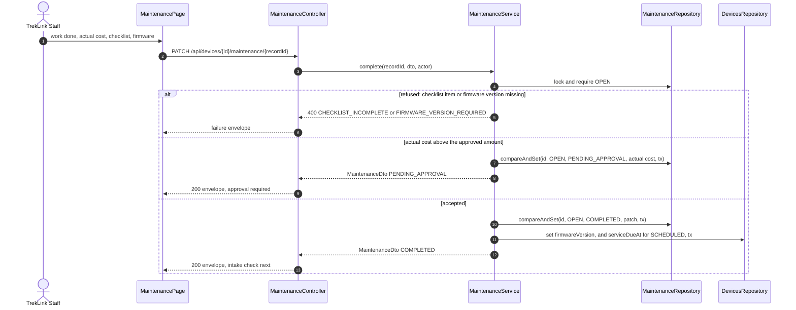

***Figure 15***: UC-52 Record Maintenance, part 2 of 2: completion (FR-DEV-17, FR-DEV-21). The device stays
`MAINTENANCE` until it passes the intake check (UC-12).

<!-- sdd: MF-05 seq UC-64 -->
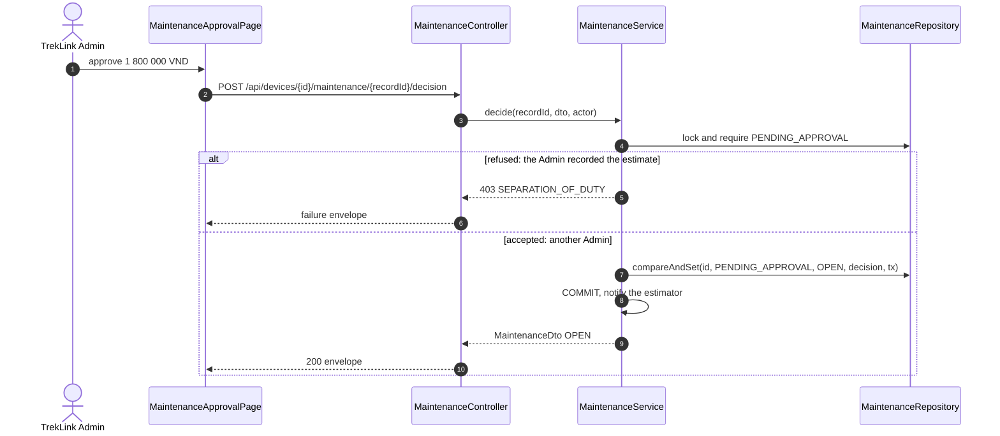

***Figure 16***: UC-64 Approve Maintenance Cost (BR-44). A rejection takes the same path with a reason.
