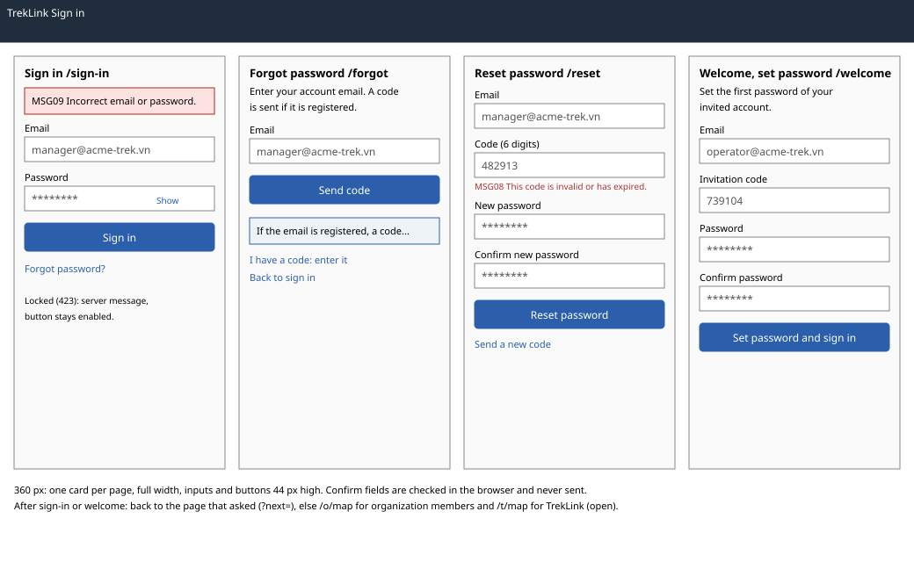

# Sign-in, forgot, reset, welcome (set password) (`/sign-in`, `/forgot`, `/reset`, `/welcome`)

| | |
|---|---|
| Owner | LongLP |
| Task | `specs/frontend/tasks.md` 2.1 |
| Assigned, due | 2026-10-21, 2026-10-23 |
| Status | Ready for review |
| Routes | `/sign-in`, `/forgot`, `/reset`, `/welcome` (set password), all public (`specs/frontend/design.md` §2) |
| Roles | Public. The same four pages serve every account type: TrekLink Admin and Staff, Org Manager and Org Operator. A signed-in user who opens one of them is sent to their landing route. |
| Use case, FRs, story | UC-08, UC-09, UC-04 and UC-10 (invitation); FR-AUTH-02, FR-AUTH-05, FR-AUTH-08, FR-ORG-04; US-UC08, US-UC09 |
| Requirements | `specs/auth/requirements.md` REQ-EVT-01, REQ-EVT-04 to REQ-EVT-06, REQ-STA-01 to REQ-STA-03, REQ-ERR-01, REQ-ERR-03, REQ-ERR-04, REQ-ERR-08; `specs/frontend/requirements.md` REQ-UBI-02, REQ-UBI-07 |
| Wireframe |  |

Scope from the task: auth api-design 01, 05, 06, 07; one message for wrong credentials (MSG09); code errors MSG08

## Data

| Shown | Source (api-design file, property) |
|---|---|
| Nothing from the server before submit; the four pages are forms | none |
| Signed-in user, kept in the auth context to choose the landing route and the workspace | auth 01 and auth 07 `result.user.accountType`, `roles`, `organization.status`, `organization.memberRole` |
| Tokens, held by the auth context and `apiClient` (task 1.1, 1.2), never shown | auth 01 and auth 07 `result.accessToken`, `refreshToken`, `accessTokenExpiresIn`, `refreshTokenExpiresIn` |
| Confirmation after "Send code" | auth 05 `message` ("If the email is registered, a code has been sent."), identical for unknown emails (REQ-EVT-04) |

## Actions

| Control | Endpoint | Confirmation | Success message |
|---|---|---|---|
| Sign in (`/sign-in`, primary) | auth 01 `POST /api/auth/login` | none | none; landing per `specs/frontend/design.md` §2 (D-059 rule 1): the page that sent them to sign-in (`?next=`, same-origin paths only) wins; otherwise the Org Manager lands on `/o/contracts` until the `/o` dashboard (task 5.6) exists, the Org Operator on `/o/map`, TrekLink Staff and Admin on `/t/map` |
| Forgot password? (link) | navigation to `/forgot` | none | none |
| Set password (link on `/sign-in`) | navigation to `/welcome` | none | none; the invitation email tells the invitee to choose "Set password" (dry run 2026-10-30) |
| Send code (`/forgot`, primary) | auth 05 `POST /api/auth/password/forgot` | none | info panel with the auth 05 `message`; the link "I have a code: enter it" opens `/reset` with the email carried in router state, never in the URL |
| Reset password (`/reset`, primary) | auth 06 `POST /api/auth/password/reset` | none | `/sign-in` with an info banner showing the auth 06 `message` ("Password changed"); every other session of the account is signed out by the server (REQ-EVT-05) |
| Send a new code (`/reset`, link) | auth 05 `POST /api/auth/password/forgot` with the email field | none | the same info panel as on `/forgot` |
| Set password and sign in (`/welcome`, primary) | auth 07 `POST /api/auth/password/set` | none | signed in; same landing rule as Sign in |
| Back to sign in (link on `/forgot`, `/reset`, `/welcome`) | navigation to `/sign-in` | none | none |

## States

| State | What the user sees |
|---|---|
| Loading | The primary button shows its pending state at once and stays disabled until the server answers (chapter 06 §8.5) |
| Empty | Not applicable: no lists |
| Error `VALIDATION_FAILED` (400, auth 01, 05, 06, 07) | MSG02 under the field the server names |
| Error `INVALID_CREDENTIALS` (401, auth 01) | MSG09 in line above the form; one message for an unknown email, a wrong password, an inactive account or a member of a `CLOSED` or `REJECTED` organization (REQ-ERR-01, D-059 rule 2) |
| Error `ACCOUNT_LOCKED` (423, auth 01) | The server's `message` in line above the form ("Too many attempts. Try again in 15 minutes."); SRS §5.3 has no code for it, so the server wording is the fallback |
| Error `OTP_COOLDOWN` (429, auth 05) | The server's `message` in line under "Send code" ("Please wait a minute before requesting another code."); no SRS code exists |
| Error `CODE_INVALID` (400, auth 06, 07) | MSG08 under the code field. On `/welcome`, "Request a new one" links to `/forgot`, which sends a new `SET_PASSWORD` code to an account that never set a password (auth 05, D-059 rule 6) |
| Error `PASSWORD_POLICY` (400, auth 06, 07) | MSG02 under the password field, with the minimum `auth.passwordMinLength` (8) |
| Confirm field differs (browser only) | MSG02 style text under the confirm field, "Passwords do not match."; the request is not sent |
| Not found or forbidden | Not applicable: public pages. A signed-in user is redirected to the landing route |
| Success | As in Actions: landing route, or the info panel or banner |

## Form fields (if any)

| Step | Field | Type | Required | Rule |
|---|---|---|---|---|
| Sign in | Email | email | yes | valid email; case-insensitive, sent as typed (auth 01 `email`) |
| Sign in | Password | password with Show toggle | yes | not empty (auth 01 `password`) |
| Forgot | Email | email | yes | valid email (auth 05 `email`) |
| Reset | Email | email | yes | prefilled from `/forgot` through router state, editable (auth 06 `email`) |
| Reset | Code | text, numeric keypad | yes | six digits (auth 06 `code`) |
| Reset | New password | password with Show toggle | yes | at least `auth.passwordMinLength` characters, 8 by default (auth 06 `newPassword`) |
| Reset | Confirm new password | password | yes | equals New password; checked in the browser, never sent |
| Welcome | Email | email | yes | the invited email (auth 07 `email`) |
| Welcome | Invitation code | text | yes | as written in the invitation email (auth 07 `code`); its length is not specified |
| Welcome | Password | password with Show toggle | yes | at least `auth.passwordMinLength` characters (auth 07 `password`) |
| Welcome | Confirm password | password | yes | equals Password; checked in the browser, never sent |

Each page is one step of at most four fields (chapter 06 §3, REQ-UBI-07). A failed submit keeps every
field (chapter 06 §8.7).

## Mobile, accessibility, live data

- 360 px layout: each page is one card in a single column, inputs and buttons full width and at least 44 px high; the error and info panels sit above the form.
- Tab order and focus after each action: email, password, Show, primary button, then the links. Focus starts on the first empty field. After an error, focus moves to the message, which is announced (`role="alert"`); a field error links to its field with `aria-describedby`. Fields carry `autocomplete` (`email`, `current-password`, `new-password`, `one-time-code`). The Show toggle is a button with the label "Show password" or "Hide password".
- WebSocket events and invalidated query keys: none; no socket is open before sign-in. On sign-in and on welcome, the query cache is cleared and the user from the response fills the auth context (task 1.1).

## Checklist

Chapter 06 §7 (Screen Design Checklist) and §8 (UI and UX practices), ticked by the owner before review.

- [x] Route and roles match `design.md` §2; all four routes are public
- [x] Data: every field names its source; tokens are never shown
- [x] Actions: each button names auth 01, 05, 06 or 07; the landing rule is stated
- [x] States: loading, every error code of auth 01, 05, 06 and 07, success; empty and forbidden not applicable
- [x] Forms: one step per page, at most four fields, each with type, requirement and rule
- [x] Mobile: 360 px layout described
- [x] Accessibility: tab order, focus after errors, `autocomplete`, labelled Show toggle
- [x] Live data: none; cache cleared on sign-in
- [x] Traceability: UC-08, UC-09, UC-04, UC-10; US-UC08, US-UC09
