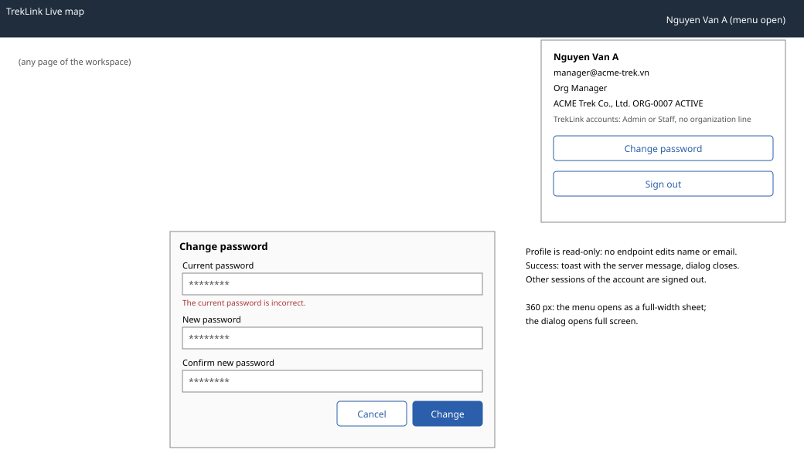

# Account menu: profile and change password (header of every signed-in page)

| | |
|---|---|
| Owner | LongLP |
| Task | `specs/frontend/tasks.md` 2.2 |
| Assigned, due | 2026-10-21, 2026-10-23 |
| Status | Ready for review |
| Routes | No route of its own: a menu in the header of every `/o/*` and `/t/*` page, and a change-password dialog opened from it. `specs/frontend/design.md` §2 lists no account route. |
| Roles | Every signed-in account: TrekLink Admin and Staff, Org Manager and Org Operator. An organization account also sees its organization line; a TrekLink account does not. |
| Use case, FRs, story | UC-08; FR-AUTH-02, FR-AUTH-04, FR-AUTH-10; US-UC08 |
| Requirements | `specs/auth/requirements.md` REQ-EVT-03, REQ-ERR-04, REQ-UBI-05; `specs/frontend/requirements.md` REQ-UBI-02 |
| Wireframe |  |

Scope from the task: auth api-design 04 and 08

## Data

| Shown | Source (api-design file, property) |
|---|---|
| Name in the header button and at the top of the menu | auth 04 `result.fullName` |
| Email | auth 04 `result.email` |
| Role, as a text label (Admin, Staff, Org Manager, Org Operator) | auth 04 `result.roles` |
| Organization name, code and state (organization accounts only) | auth 04 `result.organization.legalName`, `code`, `status` |

The profile is read-only: no endpoint changes a name or an email. A TrekLink account's details are
changed by an Admin (screen 7.1), an organization member's by the Org Manager (screen 3.3).

## Actions

| Control | Endpoint | Confirmation | Success message |
|---|---|---|---|
| Account button (header, top right) | none; opens the menu with the cached `['me']` | none | none |
| Change password (menu) | none; opens the dialog | none | none |
| Change (dialog, primary) | auth 08 `POST /api/auth/password/change` | none | toast with the auth 08 `message` ("Password changed"); the dialog closes; other sessions of the account are signed out by the server |
| Cancel (dialog) | none | asks first if a field is filled (chapter 06 §8.7) | none |
| Sign out (menu) | auth 03 `POST /api/auth/logout` with the refresh token | none | `/sign-in`; the query cache and the auth context are cleared (task 1.1) |

## States

| State | What the user sees |
|---|---|
| Loading | The header button shows a placeholder until `['me']` resolves; Change shows its pending state and is disabled until the server answers |
| Empty | Not applicable |
| Error `VALIDATION_FAILED` (400, auth 08) | MSG02 under the field the server names |
| Error `INVALID_CREDENTIALS` (400, auth 08) | The server's `message` under Current password ("The current password is incorrect."); SRS §5.3 has no code for it, and MSG09 is the sign-in message |
| Error `PASSWORD_POLICY` (400, auth 08) | MSG02 under New password, with the minimum `auth.passwordMinLength` (8) |
| Confirm field differs (browser only) | "Passwords do not match." under the confirm field; nothing is sent |
| Error `UNAUTHENTICATED` (401, auth 04, 08) | `apiClient` refreshes once and retries; if the refresh fails, the user returns to `/sign-in` (frontend REQ-EVT-02) |
| Not found or forbidden | `FORBIDDEN` (403, auth 04, 08): MSG26 dialog; not expected for a signed-in account |
| Sign-out fails | The client still clears its tokens and cache and opens `/sign-in`; the refresh token expires on its own |

## Form fields (if any)

| Step | Field | Type | Required | Rule |
|---|---|---|---|---|
| Change password | Current password | password with Show toggle | yes | not empty (auth 08 `currentPassword`) |
| Change password | New password | password with Show toggle | yes | at least `auth.passwordMinLength` characters, 8 by default (auth 08 `newPassword`) |
| Change password | Confirm new password | password | yes | equals New password; checked in the browser, never sent |

One step of three fields. A failed submit keeps every field (chapter 06 §8.7).

## Mobile, accessibility, live data

- 360 px layout: the header shows only the initials button; the menu opens as a full-width sheet with each item at least 44 px high; the dialog opens full screen.
- Tab order and focus after each action: the account button is a menu button (`aria-haspopup="menu"`, `aria-expanded`); arrow keys move through the items and Escape closes the menu and returns focus to the button. The dialog traps focus, starts on Current password and returns focus to the account button when it closes. An error is announced and linked to its field (`aria-describedby`). Fields carry `autocomplete` `current-password` and `new-password`.
- WebSocket events and invalidated query keys: no live events. Query key `['me']`, read once after sign-in; Sign out clears the whole cache.

## Checklist

Chapter 06 §7 (Screen Design Checklist) and §8 (UI and UX practices), ticked by the owner before review.

- [x] Route and roles: no route in `design.md` §2; a header menu for every signed-in role, organization line for organization accounts only
- [x] Data: every field names auth 04 as its source; nothing editable that no endpoint changes
- [x] Actions: change password (auth 08) and sign out (auth 03), with their results
- [x] States: loading, every error code of auth 04 and 08, success; empty not applicable
- [x] Forms: one step, three fields, each with type, requirement and rule
- [x] Mobile: 360 px layout described
- [x] Accessibility: menu button semantics, focus trap and return, announced errors
- [x] Live data: none; `['me']` query key
- [x] Traceability: UC-08, US-UC08
