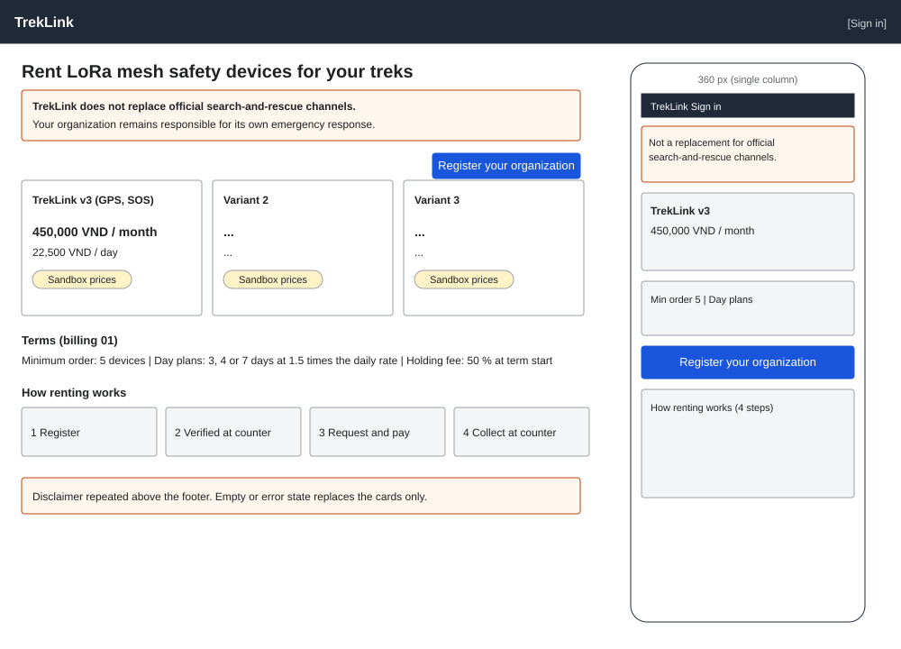

# Plans page (`/` and `/plans`)

| | |
|---|---|
| Owner | LongNN |
| Task | `specs/frontend/tasks.md` 2.3 |
| Assigned, due | 2026-10-21, 2026-10-23 |
| Status | Ready for review |
| Routes | `/` and `/plans` (`specs/frontend/design.md` §2) |
| Roles | Public: no sign-in needed. A signed-in user sees the same page; the header shows their workspace link instead of Sign in. |
| Use case, FRs, story | UC-15 (the page leads to Request Contract), UC-56 (the values it shows); FR-BILL-01, FR-BILL-02, BR-02, BR-29; US-UC15 |
| Requirements | REQ-UBI-09, NFR-LEG-05 (`specs/frontend/requirements.md`), REQ-UBI-08 / NFR-UI-03 (sandbox label) |
| Wireframe |  |

Scope from the task: billing api-design 01, public; the search-and-rescue disclaimer (also on `RegisterPage`)

## Data

| Shown | Source (api-design file, property) |
|---|---|
| Variant card: name | billing 01 `variants[].name` |
| Variant card: code (small text) | billing 01 `variants[].code` |
| Monthly price per device, VND with thousands separators and no decimals (for example `450,000 VND / month`) | billing 01 `variants[].monthlyPriceVnd` |
| Day-plan price per device per day | billing 01 `variants[].dayPriceVnd` |
| Day-plan lengths ("3, 4 or 7 days") | billing 01 `dayPlanLengths[]` |
| Day-plan premium over the monthly rate ("1.5 times the daily share of the monthly price") | billing 01 `dayPremium` |
| Minimum order ("From 5 devices per contract") | billing 01 `minOrderQuantity` |
| Holding fee ("A holding fee of 50 % of the first monthly term is due at the term start") | billing 01 `holdingFeeRatio`, rendered as a percentage |
| Sandbox label next to every price when `sandbox` is true | billing 01 `sandbox` |
| Search-and-rescue disclaimer (fixed text, see below) | NFR-LEG-05 / REQ-UBI-09; static copy, not an endpoint |
| How renting works (4 steps: register, TrekLink verifies at the counter, request and pay, collect at the counter) | static copy from the main flows MF-01 and MF-02 of the SRS; no endpoint |

Disclaimer text, shown in a bordered panel directly under the page header and again above the
footer, never in a tooltip (§8 item 10):

> TrekLink does not replace official search-and-rescue channels. Your organization remains
> responsible for its own emergency response.

The same string is a shared constant used by `RegisterPage` (screen 3.1) and the incident screens
(REQ-UBI-09), kept in `shared/ui` so the three cannot drift.

## Actions

| Control | Endpoint | Confirmation | Success message |
|---|---|---|---|
| Register your organization (primary, top right and under the prices) | none; navigates to `/register` | none | none |
| Sign in (header link) | none; navigates to `/sign-in` | none | none |
| Page load | billing 01 `GET /api/plans` | none | none |
| Retry (on the error panel) | billing 01 `GET /api/plans` | none | none |

The page changes nothing on the server. Quoting a specific order happens after sign-in on
`/o/contracts/new` (screen 5.1, `POST /api/quotes`); this page shows list prices only.

## States

| State | What the user sees |
|---|---|
| Loading | Three variant-card skeletons and the disclaimer already visible (it is static) |
| Empty | No active variants: MSG01 is worded for filtered lists and does not fit a public catalogue, so the panel reads "No plans are open right now. Contact TrekLink at the counter." (copy to confirm, open item O-6); the disclaimer and how-it-works stay |
| Error `INTERNAL_ERROR` or network failure | Panel with the server `message` (or "The prices could not be loaded." when none) and a Retry button. The disclaimer and how-it-works stay visible. |
| Error `VALIDATION_FAILED`, `UNAUTHENTICATED`, `FORBIDDEN` | Not returned: the endpoint takes no input and is public |
| Not found or forbidden | MSG26 does not apply to the public route |
| Success | Cards in the order the API returns them |

## Form fields (if any)

None. The page has no form.

## Mobile, accessibility, live data

- 360 px layout: not one of the operator screens, but it is the public entry point and is read on phones. Single column: header with Sign in, disclaimer panel, variant cards stacked, shared terms (minimum order, day plans, holding fee) in a list, the Register button as a full-width bar at the end, then the how-it-works steps.
- Tab order and focus after each action: skip link, header (Sign in), disclaimer (not focusable, but marked as a note region), variant cards (not interactive), Register button, steps list, footer. After Retry succeeds, focus moves to the first variant card heading. Prices are real text, never images; the sandbox label is text beside the price, not colour alone.
- WebSocket events and invalidated query keys: none (public page, no socket). Query key `['plans']`, stale time 5 minutes because prices change by Admin edit (UC-56), no refetch on window focus.

## Checklist

Chapter 06 §7 (Screen Design Checklist) and §8 (UI and UX practices), ticked by the owner before review.

- [x] Route and roles match `design.md` §2 (public)
- [x] Data: every price field names its billing 01 property; static copy is labelled static
- [x] Actions: navigation targets named, no mutating call
- [x] States: loading, empty, error, success; error codes that cannot occur are stated
- [x] Forms: none
- [x] Mobile: single-column layout drawn
- [x] Accessibility: skip link, tab order, text alternatives, no colour-only meaning
- [x] Live data: none, stated
- [x] Traceability: UC-15, UC-56, FR-BILL-01, FR-BILL-02, REQ-UBI-09, US-UC15
- [x] §8 items 1, 3, 8 (VND without decimals), 10 (disclaimer and sandbox visible) applied
