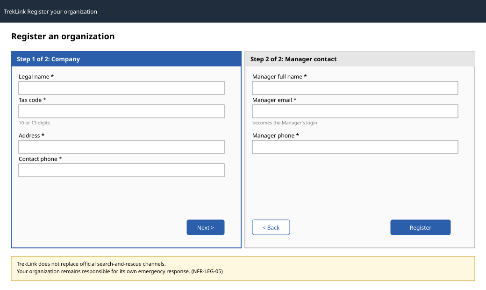

# `RegisterPage`

| | |
|---|---|
| Owner | TanNB |
| Task | `specs/frontend/tasks.md` 3.1 |
| Assigned, due | 2026-10-21, 2026-10-23 |
| Status | Ready for review |
| Routes | `/register` (`specs/frontend/design.md` §2) |
| Roles | Public (Guest, signed out). No other role sees this page; a signed-in user is redirected to their landing route. |
| Use case, FRs, story | UC-01; FR-ORG-01; US-UC01 |
| Requirements | REQ-EVT-01, REQ-ERR-01 (`specs/organizations/requirements.md`); REQ-UBI-09 (`specs/frontend/requirements.md`, NFR-LEG-05) |
| Wireframe |  |

Scope from the task: organizations api-design 01; MSG04 on success; MSG10 on a duplicate.

The request body of api-design 01 has 7 required fields, over the 6-field-per-step cap of chapter 06
§3. The form is therefore split into two steps so neither exceeds it: **Step 1, Company** (legalName,
taxCode, address, contactPhone), **Step 2, Manager contact** (managerFullName, managerEmail,
managerPhone), submitted together on Step 2's Register action. Two steps, not four, stays inside
NFR-USE-01.

A static notice below the form, visible without scrolling and never in a tooltip (REQ-UBI-09,
NFR-LEG-05, chapter 06 §8 item 10): *"TrekLink does not replace official search-and-rescue channels.
Your organization remains responsible for its own emergency response."*

## Data

| Shown | Source (api-design file, property) |
|---|---|
| (none; this is a create-only public form, no GET on load) | |

## Actions

| Control | Endpoint | Confirmation | Success message |
|---|---|---|---|
| Back (Step 2 to Step 1) | none, client-side only | none | none |
| Register (Step 2) | `POST /api/organizations/register` (organizations api-design 01) | none, not destructive | MSG04, shown on the page in place of the form (not a toast, so the Guest keeps reading it before navigating away) |

## States

| State | What the user sees |
|---|---|
| Loading | Register button shows its pending state at once and is disabled until the server answers (chapter 06 §8 item 5) |
| Empty | Not applicable, no list or record is read |
| Error 400 `VALIDATION_FAILED` | MSG02 under the field that failed, from the mirrored Zod schema first, the server message as a form-level fallback (chapter 06 §6.3) |
| Error 409 `CONFLICT_UNIQUE` | MSG10 under `taxCode` or `managerEmail`, whichever the server names in `message`; both fields stay filled (chapter 06 §8 item 7) |
| Not found or forbidden | Not applicable, a public create form has no record to deny |

## Form fields (if any)

| Step | Field | Type | Required | Rule |
|---|---|---|---|---|
| 1 Company | legalName | text | yes | non-empty |
| 1 Company | taxCode | text | yes | 10 or 13 digits (mirrors the DTO) |
| 1 Company | address | text | yes | non-empty |
| 1 Company | contactPhone | tel | yes | non-empty |
| 2 Manager contact | managerFullName | text | yes | non-empty |
| 2 Manager contact | managerEmail | email | yes | valid email shape; becomes the Manager's login |
| 2 Manager contact | managerPhone | tel | yes | non-empty |

## Mobile, accessibility, live data

- 360 px layout: not one of NFR-UI-01's mandatory screens (operator incident and map); the form is
  already single-column at every width, so it collapses with no layout change, only wider side margins
  above 360 px.
- Tab order and focus after each action: fields in source order within a step; Register moves focus to
  the MSG04 confirmation heading so a screen reader announces it; a validation failure moves focus to
  the first invalid field.
- WebSocket events and invalidated query keys: none, this page opens no socket (signed out, no org to
  scope a room to) and reads nothing to invalidate.

## Checklist

Chapter 06 §7 (Screen Design Checklist) and §8 (UI and UX practices), ticked by the owner before review.

- [x] Route and roles match `design.md` §2; a signed-in user never reaches this page (redirected to
  their landing route, design.md §2 "Landing after sign-in").
- [x] Data: no field is shown that no endpoint returns; this screen reads nothing.
- [x] Actions: Register names its endpoint, has no confirmation (non-destructive), and names MSG04.
- [x] States: loading, the two error codes the endpoint returns, and success are covered; empty and
  forbidden are marked not applicable with the reason.
- [x] Forms: 2 steps of at most 4 fields each, inside the 4-step/6-field cap; every field has its type,
  required flag and the rule mirrored from api-design 01's request table.
- [x] Mobile: not a mandatory 360 px screen; how it collapses is stated.
- [x] Accessibility: tab order and the post-action focus target are stated.
- [x] Live data: stated as none, with the reason.
- [x] Traceability: UC-01, FR-ORG-01, US-UC01 in the header table.
