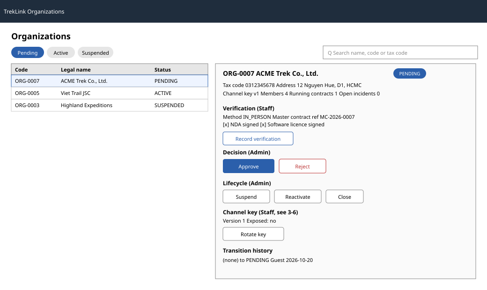

# `OrganizationReviewPage` for Staff and Admin

| | |
|---|---|
| Owner | TanNB |
| Task | `specs/frontend/tasks.md` 3.2 |
| Assigned, due | 2026-10-21, 2026-10-23 |
| Status | Ready for review |
| Routes | `/t/organizations` (queue), `/t/organizations/:id` (detail, verification, decisions, channel key) |
| Roles | TrekLink Staff: verify, rotate the channel key, read everything. TrekLink Admin inherits every Staff action (FR-AUTH-10) and alone may approve, reject, suspend, reactivate and close. |
| Use case, FRs, story | UC-02, UC-03, UC-07; FR-ORG-02, FR-ORG-03, FR-ORG-07, FR-DEV-13; US-UC02, US-UC03, US-UC07 |
| Requirements | REQ-UBI-01, REQ-UBI-02, REQ-EVT-02 to REQ-EVT-06, REQ-EVT-13, REQ-STA-01, REQ-ERR-02 to REQ-ERR-04, REQ-ERR-07 (`specs/organizations/requirements.md`) |
| Wireframe |  |

Scope from the task: organizations api-design 02, 03, 05 to 11; verification form with method,
documents, master contract reference and the NDA and software licence checkboxes (both required);
approve or reject (MSG16, MSG21); suspend, reactivate, close. Endpoint 04 (edit contact details) is
out of scope for this screen, it belongs to the organization's own `/o` settings, not yet built
(Sprint 4). Endpoint 27 (channel key rotation) is bundled into task 3.6 but, per `design.md` §2 row
`/t/organizations`, `/t/organizations/:id`, renders here on the detail page; documented fully in
[3-6](3-6-compliancecasepage-and-channel-key-rotation.md) and cross-referenced below.

## Data

| Shown | Source (api-design file, property) |
|---|---|
| Queue row: code, legalName, taxCode, status, statusChangedAt | organizations api-design 02, `GET /api/organizations` `items[]` |
| Queue filter chips (All, Pending, Active, Suspended, Rejected, Closed) and search | 02 query params `status`, `q` |
| Detail header: code, legalName, taxCode, address, contactEmail, contactPhone, status, verifiedAt, decidedAt, channelKeyVersion | organizations api-design 03, `GET /api/organizations/:id` |
| Verification record (method, documentsSeen, masterContractRef, verifiedBy) | 03, `verification` |
| Counts (members, runningContracts, openIncidents) | 03, `counts` |
| Transition history list (fromStatus, toStatus, actor, reason, createdAt) | organizations api-design 11, `GET /api/organizations/:id/transitions` |
| Channel key status (version, exposed since) | 03, `channelKeyVersion`; `channelKeyExposedAt` is carried on the same organization record (`specs/organizations/design.md` §4.1) |

## Actions

| Control | Endpoint | Confirmation | Success message |
|---|---|---|---|
| Open an organization from the queue | 02 to 03, navigation only | none | none |
| Record verification (Staff) | `POST /api/organizations/:id/verification` (05) | none, a recorded fact, not a status change | "Verification recorded" (server `message`, chapter 06 §6.3; no MSG) |
| Approve (Admin, shown only when `status=PENDING` and verified) | `POST /api/organizations/:id/approve` (06) | none, moves forward in the normal flow | MSG05 |
| Reject (Admin, shown only when `status=PENDING`) | `POST /api/organizations/:id/reject` (07) | yes, "Reject {legalName}?" with the reason field inline (chapter 06 §8 item 1) | MSG16 |
| Suspend (Admin, shown only when `status=ACTIVE`) | `POST /api/organizations/:id/suspend` (08) | yes, "Suspend {legalName}? Its devices stay monitored and its incidents still route." (REQ-STA-01) | "Organization suspended" (server `message`) |
| Reactivate (Admin, shown only when `status=SUSPENDED`) | `POST /api/organizations/:id/reactivate` (09) | yes, "Reactivate {legalName}?" | "Organization reactivated" (server `message`) |
| Close (Admin, shown only when `status=ACTIVE`) | `POST /api/organizations/:id/close` (10) | yes, "Close {legalName}? This deactivates its members and revokes its keys and Field Stations." | "Organization closed" (server `message`) |
| Rotate channel key (Staff; see [3-6](3-6-compliancecasepage-and-channel-key-rotation.md) for the full action spec) | `POST /api/organizations/:id/channel-key/rotate` (27) | yes, "Rotate the channel key for {legalName}?" with the reason field inline | "Channel key rotated" (server `message`) |

Every state-changing action sends `expectedVersion` from the detail record currently on screen
(chapter 06 §6.1, optimistic concurrency).

## States

| State | What the user sees |
|---|---|
| Loading | Queue table and detail panel show skeleton rows; every action button shows its pending state at once and is disabled until the server answers (chapter 06 §8 item 5) |
| Empty | Queue: "No organizations match your filters." (MSG01) with a Clear filters action |
| Error 400 `VALIDATION_FAILED` | MSG02 under the field that failed |
| Error 400 `CONTRACT_TERMS_MISSING` | MSG02 under the NDA and software licence checkboxes, since both are required (BR-43) |
| Error 409 `NOT_VERIFIED` | MSG21, shown inline on the disabled Approve button's tooltip and as a dialog if forced |
| Error 409 `INVALID_STATE_TRANSITION` | MSG28 |
| Error 409 `BALANCE_OUTSTANDING` | MSG29 |
| Error 409 `OPEN_CONTRACTS` | MSG29 |
| Error 409 `STALE_VERSION` | MSG36, a dialog with Reload that keeps the reason field's text (D-057 rule 5) |
| Not found or forbidden | MSG26, full-page, in place of the detail panel |

## Form fields (if any)

| Step | Field | Type | Required | Rule |
|---|---|---|---|---|
| 1 Verification (one step, one dialog) | method | select (IN_PERSON, PHONE) | yes | one of the two values |
| 1 Verification | documentsSeen | tag list (add/remove strings) | yes | at least one entry |
| 1 Verification | masterContractRef | text | yes | non-empty |
| 1 Verification | ndaSigned | checkbox | yes | must be checked (BR-43) |
| 1 Verification | softwareLicenceSigned | checkbox | yes | must be checked (BR-43) |
| 1 Reject (one step) | reason | textarea | yes | non-empty, shown to the Manager |
| 1 Suspend (one step) | reason | textarea | yes | non-empty |
| 1 Close (one step) | reason | textarea | yes | non-empty |

Approve and Reactivate take no input beyond the confirmation.

## Mobile, accessibility, live data

- 360 px layout: not one of NFR-UI-01's mandatory screens (operator incident and map); below 760 px
  the queue table collapses to one card per organization (code, legalName, status, a "View" action)
  and the detail panel becomes its own full-width page instead of a split view.
- Tab order and focus after each action: queue row to detail panel follows visual order; after any
  decision action, focus moves to the updated status badge so a screen reader announces the new
  state; a rejected or stale-version dialog keeps focus trapped until Cancel or Reload.
- WebSocket events and invalidated query keys: none. No `/live` event exists for
  `organization.statusChanged` or a verification record (`ws-live-contract.md` lists only device,
  incident and Field Station events); this screen relies on TanStack Query invalidating
  `['organization', id]` and `['organizations', filters]` after each successful mutation.

## Checklist

Chapter 06 §7 (Screen Design Checklist) and §8 (UI and UX practices), ticked by the owner before review.

- [x] Route and roles match `design.md` §2; Admin-only actions are stated per action, not just per page.
- [x] Data: every field names its api-design source; `channelKeyExposedAt` is cross-referenced to
  `design.md` §4.1 since it is not itemised in 03's sample but is part of the same record.
- [x] Actions: every button names its endpoint, its confirmation (or why none), and its message.
- [x] States: one row per error code the seven endpoints actually return, plus empty and forbidden.
- [x] Forms: each dialog is one step of at most 5 fields, inside the cap.
- [x] Mobile: not mandatory for this screen; collapse behaviour is stated.
- [x] Accessibility: tab order and the post-action focus target are stated.
- [x] Live data: stated as none, with the reason, and the query keys invalidated instead.
- [x] Traceability: UC-02, UC-03, UC-07, the FRs and US-UC02/03/07 are in the header table.
