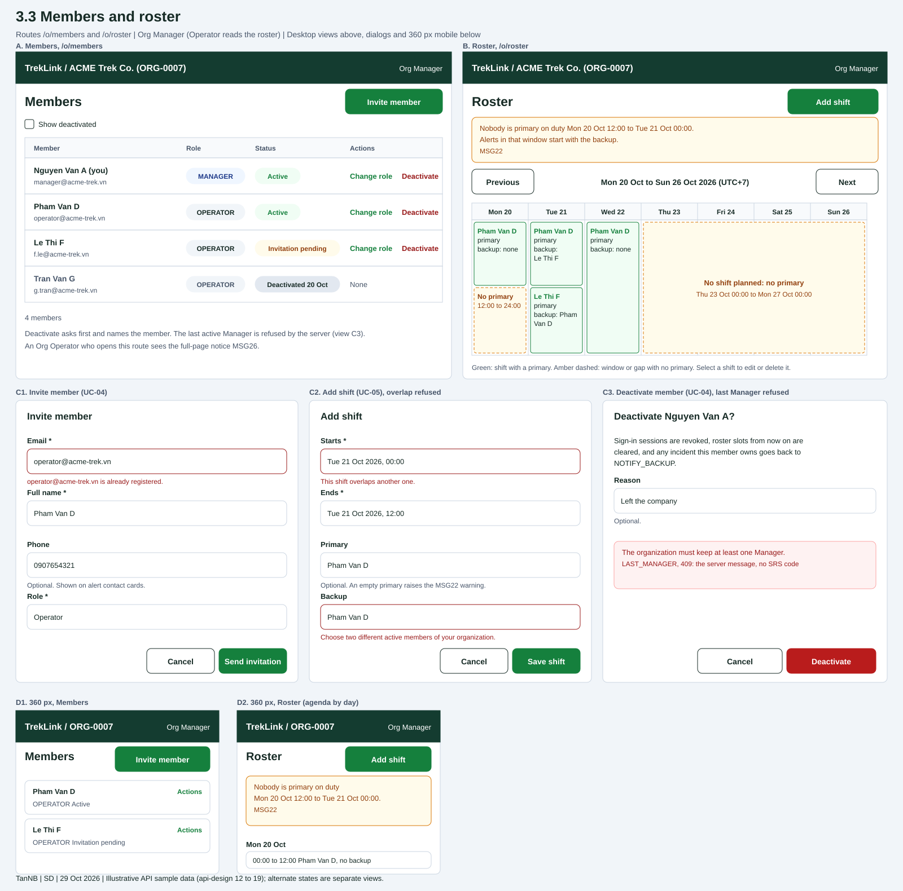

# Members and roster

| | |
|---|---|
| Owner | TanNB |
| Task | `specs/frontend/tasks.md` 3.3 |
| Assigned, due | 2026-10-21, 2026-10-23 |
| Status | Ready for review |
| Routes | `/o/members` and `/o/roster` (`specs/frontend/design.md` §2) |
| Roles | Org Manager: both pages with every action. Org Operator: `/o/roster` read only, no Add, Edit or Delete controls; `/o/members` shows MSG26. TrekLink Staff and Admin: no route here (api-design 12 also lets Staff read a member list, and no screen of this task uses that). |
| Use case, FRs, story | UC-04, UC-05; FR-ORG-04, FR-ORG-05, FR-AUTH-07; US-UC04, US-UC05 |
| Requirements | `specs/organizations/requirements.md` REQ-UBI-02, REQ-UBI-04, REQ-EVT-07, REQ-EVT-08, REQ-STA-02, REQ-ERR-03, AC-03, AC-04 |
| Wireframe | Figure 1 below, `3-3-members-and-roster.svg` |

Scope from the task: organizations api-design 12 to 19; invite, change role, deactivate (MSG for `LAST_MANAGER`); `RosterCalendar` widget with overlap errors and `NO_PRIMARY` warnings (MSG22)

Leader rulings of 2026-10-30 (`treklink-web` #119) applied: on a started shift the edit form locks every field except Ends, and Ends cannot be before now (organizations 18).

## Wireframe

***Figure 1***: Wireframes of the Members page (A), the Roster page (B), the invite dialog (C1), the add shift dialog with an overlap refusal (C2), the deactivate dialog with a refused last Manager (C3), and the 360 px layouts (D1, D2). The data is illustrative.

## Data

Members page (`/o/members`):

| Shown | Source (api-design file, property) |
|---|---|
| Member name and email | organizations 12 `result[].fullName`, `result[].email` |
| "(you)" after the signed-in member's name | organizations 12 `result[].userId` compared with the signed-in user's id from the session |
| Role badge `MANAGER` or `OPERATOR` | organizations 12 `result[].role` |
| Status: Active, Invitation pending, or Deactivated with its date | organizations 12 `result[].invitationPending` and `result[].deactivatedAt`; Deactivated rows appear only when "Show deactivated" is on |
| Count line ("4 members") | length of organizations 12 `result` |

Roster page (`/o/roster`):

| Shown | Source (api-design file, property) |
|---|---|
| Shift block: window, primary, backup | organizations 16 `result.shifts[].startsAt`, `endsAt`, `primary.fullName`, `backup.fullName` |
| MSG22 banner and the amber cells for a window or gap without a primary | organizations 16 `result.warnings[]` with `kind` `NO_PRIMARY`, `from`, `to` |
| "backup: none" inside a shift block | organizations 16 `result.shifts[].backup`, null |
| Week label | the `from` and `to` the page sent; the page asks for Monday 00:00 to the next Monday 00:00 in the viewer's timezone, converted to UTC, well inside the 31 day limit of organizations 16 |
| Options of the Primary and Backup selects | organizations 12 members with no `deactivatedAt` and `invitationPending` false (see Open points) |

## Actions

| Control | Endpoint | Confirmation | Success message |
|---|---|---|---|
| Invite member (primary action of `/o/members`) | organizations 13 `POST /api/organizations/:id/members` | dialog form, no extra confirmation | "Invitation sent" (server message; no SRS code) |
| Change role | organizations 14 `PATCH /api/organizations/:id/members/:memberId` | dialog with a Manager or Operator choice and Save | MSG03 "Saved." |
| Deactivate | organizations 15 `POST /api/organizations/:id/members/:memberId/deactivate` | ConfirmDialog naming the member ("Deactivate Pham Van D?") and the effects: sign-in sessions revoked, roster slots from now on cleared, owned incidents go back to `NOTIFY_BACKUP` | "Member deactivated" (server message; no SRS code) |
| Show deactivated | organizations 12 with `includeDeactivated=true` | none | none |
| Previous, Next week | organizations 16 with the new `from` and `to` | none | none |
| Add shift (primary action of `/o/roster`) | organizations 17 `POST /api/organizations/:id/roster` | dialog form | MSG03 "Saved." |
| Edit shift (select a shift) | organizations 18 `PATCH /api/organizations/:id/roster/:shiftId` | the same dialog, filled in; on a shift that has started it locks every field except Ends | MSG03 "Saved." |
| Delete shift | organizations 19 `DELETE /api/organizations/:id/roster/:shiftId` | ConfirmDialog naming the window ("Delete the shift Tue 21 Oct 00:00 to 12:00?"); disabled with the hint "A started shift is shortened by editing its end." on a shift that has started | "Shift deleted" (server message; no SRS code) |

An Org Operator sees none of these controls on `/o/roster`; the calendar and the MSG22 banner stay.

## States

| State | What the user sees |
|---|---|
| Loading | Members: skeleton rows. Roster: skeleton calendar. Buttons that call the server show their pending state and are disabled until it answers. |
| Empty, members | Not reachable: an organization that is not `CLOSED` or `REJECTED` keeps at least one active Manager (REQ-UBI-02). |
| Empty, roster | A week with no shift shows an empty calendar, one amber cell over the whole range and the MSG22 banner for it, with Add shift as the next step. |
| Error `VALIDATION_FAILED` | MSG02 under the field the server names ("{field} is required."); the form keeps every value. |
| Error `CONFLICT_UNIQUE` (invite) | MSG10 under Email: "{email} is already registered." The email is unique across the platform, not only in this organization. |
| Error `INVALID_STATE_TRANSITION` (invite) | MSG28 as an error Alert in the dialog, for example "This cannot be done while it is CLOSED." |
| Error `LAST_MANAGER` (change role, deactivate) | The server message "The organization must keep at least one Manager." as an error Alert in the dialog; the dialog stays open. The SRS (UC-04) cites MSG29 for this refusal; see Open points. |
| Error `NOT_FOUND` (member, shift, organization) | The server message ("Member not found.", "Shift not found.") as an error Alert; the list refetches. |
| Error `SHIFT_OVERLAP` (add, edit) | "This shift overlaps another one." under Starts. |
| Error `MEMBER_NOT_ELIGIBLE` (add; defined by organizations 17 only, see Open points) | "Choose two different active members of your organization." under Backup. |
| Error `SHIFT_STARTED` (edit, delete) | Edit (organizations 18): "Only the end of a started shift can change." as an error Alert; the form already locks the other fields, so it appears only if the shift started while the form was open. Delete (organizations 19): "Shorten a started shift instead of deleting it." as an error Alert in the dialog. |
| Error `VALIDATION_FAILED` (edit a started shift, Ends before now) | "endsAt must not be in the past." under Ends; the field's minimum is the current time. |
| Warning `NO_PRIMARY` | MSG22 amber banner above the calendar, one amber dashed cell per window or gap, each with its text. |
| Shift without a backup | The muted line "backup: none" inside the shift block; no banner. |
| Forbidden | MSG26 full-page notice. |
| Unauthenticated | Redirect to `/sign-in` with the same-origin `?next=` path (D-059 rule 1). |
| Any other failure | The server message, or "Something went wrong.", as an error Alert. |
| Success | A toast with the message of the Actions table; the list refetches. |

## Form fields (if any)

Invite member (one step, four fields):

| Step | Field | Type | Required | Rule |
|---|---|---|---|---|
| 1 | Email | email | yes | trimmed and lower-cased; unique on the platform (MSG10) |
| 1 | Full name | text | yes | not blank |
| 1 | Phone | tel | no | hint "Shown on alert contact cards."; organizations 13 `phoneNumber` |
| 1 | Role | select | yes | `MANAGER` or `OPERATOR`; preselected Operator |

Change role (one step, one field): Role, radio group `MANAGER` or `OPERATOR`, required.

Deactivate (one step, one field): Reason, text, optional, organizations 15 `reason`.

Shift, add and edit (one step, four fields):

| Step | Field | Type | Required | Rule |
|---|---|---|---|---|
| 1 | Starts | date and time | yes | entered in the viewer's timezone, sent as UTC; the zone is shown in the week label and on hover; disabled on a started shift |
| 1 | Ends | date and time | yes | after Starts; on a started shift the only editable field, not before now (the minimum is the current time); the page blocks Save and shows "Choose an end after the start." under the field |
| 1 | Primary | select | no | an active member; an empty primary raises the MSG22 warning; disabled on a started shift |
| 1 | Backup | select | no | an active member other than the primary; disabled on a started shift |

The server repeats every rule (organizations 13 to 18) and its message is shown when it disagrees.

## Mobile, accessibility, live data

- 360 px layout (Figure 1, D1 and D2): Members becomes cards with the name, email, role, status and an Actions menu button of at least 44 px; the Invite member button stays beside the title. Roster collapses the week grid to an agenda by day, one card per shift and one amber card per gap, with Previous and Next kept and the MSG22 banner on top. Dialogs fill the width.
- Tab order and focus after each action: Members: Invite member, Show deactivated, then Change role and Deactivate of each row in order. Roster: Add shift, Previous, Next, then the shifts in time order, each one a button that opens Edit. A dialog traps focus, closes on Escape and returns focus to the control that opened it; Cancel comes first. After a successful invite focus returns to Invite member; after a deactivation it moves to the page heading; after a shift is added or edited it moves to that shift; after a delete it moves to Add shift. Every shift block has an accessible name such as "Pham Van D, primary, Mon 20 Oct 00:00 to 12:00"; the MSG22 banner is a status region; an amber cell always carries its words, so colour is never the only signal.
- WebSocket events and invalidated query keys: no WebSocket event refreshes these pages (the live provider handles map and incident events only). Query keys: `['org-members', orgId, { includeDeactivated }]` and `['org-roster', orgId, from, to]`. Every mutation invalidates its own list; a deactivation also invalidates `['org-roster', orgId]`, because it clears the member from the shifts that have not ended (REQ-EVT-08). The roster refetches when the window regains focus, so a second Manager's edit shows up.

## Open points raised to the leader (D-052 rule 2)

1. **`LAST_MANAGER` and MSG29.** The SRS (UC-04) cites MSG29 for the refusal to deactivate the last Manager, and its template reads "This cannot be done while it has open {dependency}.", which does not fit this case. The server answers "The organization must keep at least one Manager." and the screen shows that text in the dialog. Does MSG29 apply with the server's text, or is a new code needed? The SRS names the deactivation only; the screen applies the same dialog to a demotion.
2. **`MEMBER_NOT_ELIGIBLE` on edit.** organizations 17 defines it, organizations 18 does not, although both can set the primary and the backup. Confirm that 18 returns it too.
3. **`NO_BACKUP` has no text.** organizations 17 shows `NO_BACKUP` in the sample of `warnings` and nothing defines it. The screen does not use it: "backup: none" comes from organizations 16.
4. **Who counts as an active member for the selects.** The screen offers members that are neither deactivated nor invitation pending. The server decides through `MEMBER_NOT_ELIGIBLE`; confirm that a member who has not yet set a password is not eligible.
5. **Shift length.** No document bounds a shift. The screen checks only that Ends is after Starts, with a shortened MSG35 ("Choose an end after the start.").
6. **The member list is not paged.** organizations 12 has no paging parameters; an organization is small. The default role of the invite form is Operator, the least privilege.

## Checklist

Chapter 06 §7 (Screen Design Checklist) and §8 (UI and UX practices), ticked by the owner before review.

- [x] Route and roles match `specs/frontend/design.md` §2; what an Operator sees is stated
- [x] Every shown field names its api-design file and property; nothing is shown that no endpoint returns
- [x] Every action names its endpoint, its confirmation and its message; deactivate and delete name the object (§8 item 1)
- [x] States cover loading, empty, every error code of api-design 12 to 19, forbidden (MSG26) and success
- [x] Forms have at most 4 fields in one step, with type, required flag and the rule mirrored from the api-design
- [x] The 360 px layout is drawn (Figure 1, D1 and D2)
- [x] Tab order, focus after each action and accessible names are stated
- [x] Live data: no event, the query keys and the invalidation are stated
- [x] Traceability: UC-04, UC-05, FR-ORG-04, FR-ORG-05, US-UC04, US-UC05
- [x] One primary action per screen; status is text as well as colour (§8 items 1 and 3)
